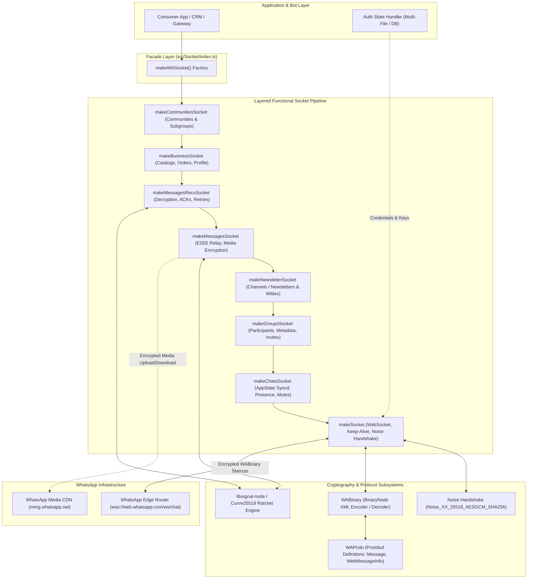
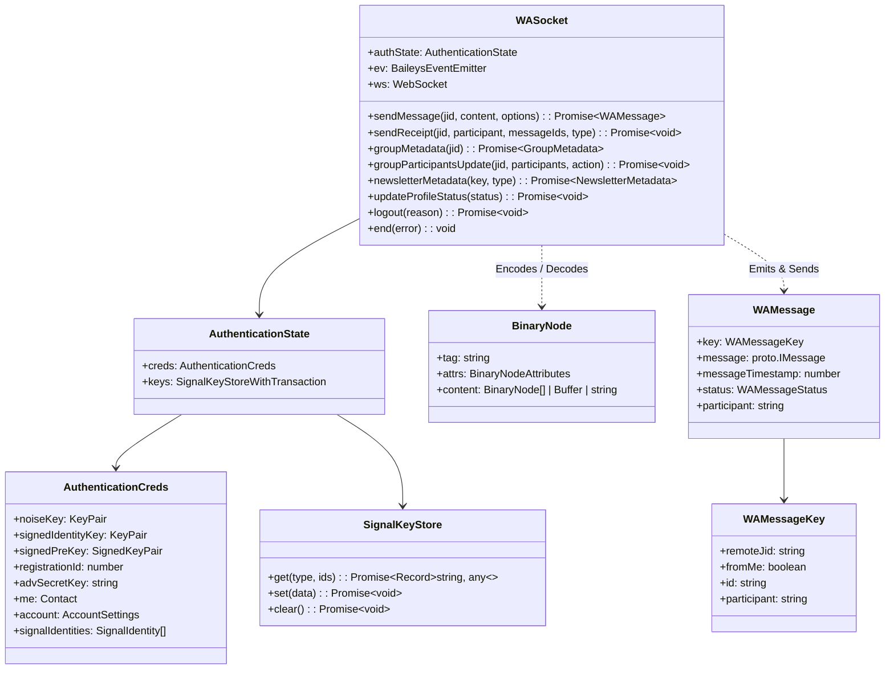
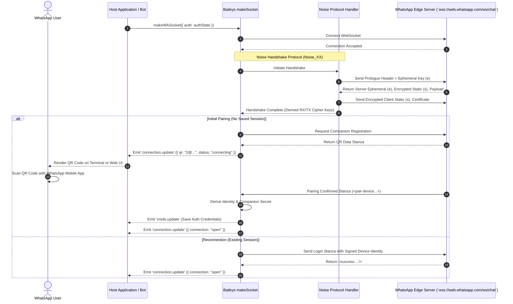
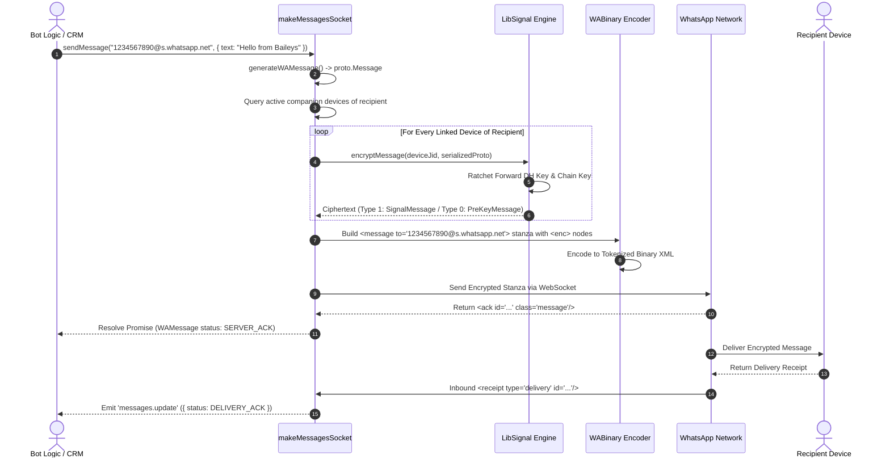

# Baileys - Architecture & Technical Wiki

> **Direct, Lightweight WhatsApp Web Multi-Device Protocol Library in TypeScript**  
> GitHub: [WhiskeySockets/Baileys](https://github.com/WhiskeySockets/Baileys) | Stack: TypeScript (ESM), Node.js, WebSockets (`ws`), libsignal, Protocol Buffers (`protobufjs`), Pino | License: MIT

---

## 1. Executive Summary & Value Proposition

**Baileys** is the premier, battle-tested open-source TypeScript library that implements the native WhatsApp Web Multi-Device protocol. Originally created by Adiwajshing and actively maintained by the WhiskeySockets community, Baileys interacts directly with WhatsApp's multi-device WebSocket endpoints (`wss://web.whatsapp.com/ws/chat`) without spawning a Chromium instance, Puppeteer session, or Selenium driver.

By speaking the binary XML and Noise handshake protocol directly, Baileys achieves orders-of-magnitude lower memory and CPU utilization compared to browser-based automation tools. It serves as the core communication engine powering enterprise WhatsApp gateways, including [Evolution API](evolution-api.md) and numerous customer support / conversational AI platforms.

### Core Problems Solved
- **Elimination of Headless Browser Overhead**: Running a browser instance for WhatsApp Web requires 300MB–800MB of RAM per session. Baileys operates purely at the transport and cryptographic layer, reducing session memory footprint to ~20MB–50MB.
- **Native Signal Protocol Cryptography**: Implements end-to-end encryption (E2EE) using `libsignal` with Curve25519 key exchange, Double Ratchet algorithm, and Sender Keys for group broadcast privacy.
- **Full Multi-Device Protocol Support**: Accommodates WhatsApp's companion device architecture, enabling concurrent pairing via QR codes or 8-digit pairing codes, background app-state synchronization, and multi-device receipt tracking.
- **Layered, Composable Socket Design**: Uses a functional onion architecture where each socket layer (chats, groups, newsletters, communities, business, messages) wraps and enriches the base socket.
- **Pluggable Session Storage**: Decouples cryptographic state (identity keys, pre-keys, session ratchets) through an abstract `AuthenticationState` interface, enabling multi-file disk persistence or database-backed engines (PostgreSQL, SQLite, Redis).

---

## 2. High-Level System Architecture

Baileys implements a layered pipeline that transforms high-level messaging requests into binary stanzas, encrypts them using the Signal protocol, frames them through the Noise protocol, and transmits them over a persistent WebSocket.



---

## 2.1 Core Domain & Service Class Architecture

Baileys organizes its functional domain around immutable stanzas, protobuf definitions, typed event emitters, and modular auth credentials.



---

## 3. Technology Stack & Key Dependencies

| Component | Technology / Library | Purpose |
| :--- | :--- | :--- |
| **Runtime & Language** | Node.js (v18+ / v20+), TypeScript 5.8+ | Native ECMAScript Modules (ESM) codebase |
| **Transport** | `ws` (v8.13+) | Resilient raw WebSocket connection to WhatsApp chat servers |
| **Cryptography** | `libsignal` (v6.0+), native `crypto` | Signal Protocol Double Ratchet, Curve25519, HKDF, AES-GCM, AES-CTR |
| **Protocol Serialization** | `protobufjs` (v7.5+), `WABinary` | Official WhatsApp Protobuf decoding (`WAProto`) & binary XML tokenized stanzas |
| **Rust Acceleration** | `whatsapp-rust-bridge` (v0.5.4) | Native Rust extensions for compute-heavy cryptographic operations |
| **Concurrency & Locks** | `async-mutex` (v0.5+), `p-queue` (v9.0+) | Per-file I/O locking and sequential message queueing to prevent nonce collisions |
| **In-Memory Caching** | `@cacheable/node-cache`, `lru-cache` | Fast lookup for sender keys, message retries, and media decryption metadata |
| **Audio & Media** | `music-metadata` (v11.12+), `jimp`, `sharp` | Audio duration extraction, PTT waveform calculation, thumbnail generation |
| **Logging & Errors** | `pino` (v9.6+), `@hapi/boom` | High-throughput structured JSON logging and standardized HTTP-style error handling |

---

## 4. Repository Layout & Key Modules

```
inspire/Baileys/
├── src/
│   ├── index.ts                     # Main entrypoint exporting makeWASocket and public types
│   ├── Defaults/                    # Default connection configs, timeouts, URLs, and constants
│   ├── Socket/                      # Onion-layered socket implementations
│   │   ├── index.ts                 # makeWASocket factory (outer layer)
│   │   ├── socket.ts                # Base WebSocket client, Noise handshake, ping/pong
│   │   ├── chats.ts                 # App state synchronization (Syncd/LTHash), presence, mute
│   │   ├── groups.ts                # Group creation, participants update, invites, subject
│   │   ├── newsletter.ts            # WhatsApp Channels / Newsletters (WMex GraphQL queries)
│   │   ├── messages-send.ts         # Message generation, E2EE encryption, media upload
│   │   ├── messages-recv.ts         # Inbound message parsing, Signal decryption, ACKs, retries
│   │   ├── business.ts              # Business profiles, product catalogs, order stanzas
│   │   ├── communities.ts           # WhatsApp Communities and linked announcement groups
│   │   └── mex.ts                   # WMex GraphQL query executor for modern WhatsApp endpoints
│   ├── Signal/                      # Signal protocol integration
│   │   ├── libsignal.ts             # Adapter bridging Baileys store to libsignal engine
│   │   ├── lid-mapping.ts           # Phone number (PN) to Linked Device ID (LID) translation
│   │   └── Group/                   # SenderKeyGroup and group session encryption managers
│   ├── WABinary/                    # WhatsApp Binary XML Protocol
│   │   ├── constants.ts             # Binary token dictionaries (single-byte and double-byte tokens)
│   │   ├── encode.ts                # BinaryNode to Buffer encoder with dictionary compression
│   │   ├── decode.ts                # Buffer to BinaryNode XML parser
│   │   ├── jid-utils.ts             # JID normalization, parsing, decoding (@s.whatsapp.net, @g.us)
│   │   └── types.ts                 # BinaryNode interface and attributes
│   ├── WAProto/                     # Compiled Google Protocol Buffer definitions
│   │   ├── index.js                 # Protobuf root generated from WhatsApp web clients
│   │   └── index.d.ts               # Complete TypeScript types for all WhatsApp message structures
│   ├── WAUSync/                     # Interactive USync protocol for contact and device sync
│   └── Utils/                       # Helper utilities
│       ├── auth-utils.ts            # Key pair generation, auth cred initialization, Noise state
│       ├── use-multi-file-auth-state.ts # File-based persistent session manager with Mutex
│       ├── messages-media.ts        # Media encryption, thumbnail generation, streaming upload
│       ├── make-mutex.ts            # Keyed mutex synchronization utility
│       └── offline-node-processor.ts# Offline message and stanza buffering on reconnect
└── WAProto/                         # Source .proto definitions and generator scripts
```

---

## 5. Core Features & Capabilities

### 5.1 Noise Protocol Handshake (Noise_XX)
When establishing a connection to `wss://web.whatsapp.com/ws/chat`, Baileys conducts a Noise_XX handshake (`Noise_XX_25519_AESGCM_SHA256`). This secures the WebSocket connection before any WhatsApp stanzas are sent:
1. Client generates an ephemeral Curve25519 keypair and sends the prologue header (`WA\x06\x02` or `WA\x06\x03`).
2. Server responds with its ephemeral key and static key encrypted under ephemeral shared secret.
3. Client verifies server identity and transmits its own encrypted static identity key.
4. Both sides derive forward-secret symmetric transport keys for frame encryption.

### 5.2 Signal Protocol Double Ratchet & Sender Keys
- **1-on-1 Chats**: Every individual chat maintains an independent Signal session using Diffie-Hellman ratcheting. Each outgoing message advances the symmetric key ratchet, guaranteeing forward secrecy and break-in recovery.
- **Group Chats (Sender Keys)**: Instead of encrypting a message $N$ times for $N$ participants, Baileys creates a symmetric *Sender Key*. The Sender Key is encrypted via 1-on-1 Signal sessions once to each group member (`senderKeyDistributionMessage`). Subsequent group messages are encrypted with the Sender Key, dramatically reducing CPU and bandwidth overhead.

### 5.3 Binary XML Tokenization (WABinary)
WhatsApp communicates over WebSocket using a proprietary binary representation of XML:
- Common XML strings (e.g., `iq`, `message`, `presence`, `to`, `from`, `type`, `status`) are replaced with 1-byte or 2-byte token indices from a pre-defined static dictionary (`src/WABinary/constants.ts`).
- JIDs and numbers are packed into compact nibble formats.
- Binary payloads (Protobuf bytes) are embedded directly within leaf nodes.

### 5.4 App State Sync (Syncd & LTHash)
WhatsApp synchronizes cross-device mutations (contacts, starred messages, chat archives, pinned chats, mutes) through an authenticated encrypted log called **Syncd**:
- Mutations are encrypted with dedicated app-state keys.
- State consistency is verified using **LTHash** (an additively homomorphic hash function). Baileys validates and applies patches incrementally, ensuring local state matches the phone's primary device state.

### 5.5 Multi-File Authentication State (`useMultiFileAuthState`)
Baileys persists connection and crypto state across restarts. Rather than saving a massive monolithic JSON file (which caused severe performance degradation and write corruption in legacy versions), `useMultiFileAuthState` partitions keys into individual files:
- `creds.json`: Account identity keys, registration ID, Noise keys, companion device info.
- `pre-key-{id}.json`: One-time Curve25519 pre-keys.
- `session-{jid}.json`: Active Signal protocol ratchet states per contact.
- `sender-key-{jid}.json`: Group broadcast ratchet states.
- `app-state-sync-key-{id}.json`: Keys used to decrypt Syncd patches.
- **Mutex Protection**: All file read/write operations pass through `async-mutex` per file path to prevent concurrent write corruptions during rapid message bursts.

---

## 6. Data Models & Schema Architecture

Although Baileys is a protocol library rather than a database-bound application, its state engine strictly conforms to a relational schema for cryptographic keys and chat entities.

```mermaid
erDiagram
    AUTHENTICATION_CREDS ||--o{ PRE_KEYS : maintains
    AUTHENTICATION_CREDS ||--o{ SIGNED_PRE_KEYS : signs
    AUTHENTICATION_CREDS ||--o{ SESSIONS : establishes
    AUTHENTICATION_CREDS ||--o{ SENDER_KEYS : manages
    AUTHENTICATION_CREDS ||--o{ APP_STATE_SYNC_KEYS : uses

    AUTHENTICATION_CREDS {
        string me_jid PK "User JID (e.g., 1234567890@s.whatsapp.net)"
        string me_name "Display Name"
        json noise_key "Ephemeral Noise Keypair"
        json signed_identity_key "Curve25519 Identity Keypair"
        int registration_id "32-bit Signal Registration ID"
        string adv_secret_key "Companion Device Secret"
        json account_settings "Privacy and Sync Settings"
    }

    PRE_KEYS {
        string key_id PK "Pre-key ID (1 to 65535)"
        json key_pair "Curve25519 Public & Private Key"
    }

    SIGNED_PRE_KEYS {
        string key_id PK "Signed Pre-Key ID"
        json key_pair "Curve25519 Public & Private Key"
        binary signature "Signed by Identity Key"
    }

    SESSIONS {
        string remote_jid PK "Remote JID (Contact or Device JID)"
        binary session_record "Serialized Libsignal Session Ratchet State"
    }

    SENDER_KEYS {
        string group_jid PK "Group JID (@g.us)"
        string sender_jid PK "Sender Device JID"
        binary sender_key_record "Serialized Sender Key State"
    }

    APP_STATE_SYNC_KEYS {
        string key_id PK "App State Key ID"
        binary key_data "256-bit AES-GCM Key"
        binary fingerprint "Key Fingerprint"
        bigint timestamp "Creation Timestamp"
    }

    CHATS ||--o{ MESSAGES : contains
    CHATS {
        string jid PK "Chat JID (@s.whatsapp.net or @g.us)"
        string name "Subject or Contact Name"
        int unread_count "Number of Unread Messages"
        bigint conversation_timestamp "Last Active Epoch Timestamp"
        boolean read_only "Is Read Only"
        json mute_end_time "Mute Status"
    }

    MESSAGES {
        string id PK "Unique Message UUID"
        string remote_jid FK "Chat JID"
        boolean from_me "Sent by Local Device"
        string participant "Sender JID in Group"
        bigint message_timestamp "Unix Epoch Seconds"
        string message_type "conversation, imageMessage, extendedTextMessage"
        binary raw_protobuf "Full proto.Message payload"
        int status "PENDING, SERVER_ACK, DELIVERY_ACK, READ"
    }
```



---

## 7. Operational Workflows & Sequence Diagrams

### 7.1 Multi-Device WebSocket Connection & QR Pairing



### 7.2 Outbound Message Dispatch & Fan-Out Encryption



---

## 8. Strategic Value & Takeaways for MarketingStudio / SGrowing

### 1. Zero-Browser Lightweight WhatsApp Ingestion
Baileys proves that WhatsApp automation can be executed with minimal resource overhead. Integrating Baileys directly into MarketingStudio provides a cost-effective, high-density alternative to browser automation frameworks like Puppeteer or Playwright. A single cloud container can effortlessly host dozens of concurrent WhatsApp business connections.

### 2. High-Performance Abstract Auth Storage
While `useMultiFileAuthState` is ideal for development, production deployment in multi-tenant SaaS environments requires database-backed session stores. By implementing the `SignalKeyStoreWithTransaction` interface, MarketingStudio can persist pre-keys, sender keys, and session records into PostgreSQL (`jsonb` or `bytea` columns) or Redis, enabling seamless container restarts and horizontal scaling.

### 3. Native WhatsApp Channel (Newsletters) & Communities
Baileys includes first-class support for modern WhatsApp constructs:
- **Channels (Newsletters)**: Broadcasting marketing updates, subscriber count tracking, and rich media distribution via WhatsApp's WMex GraphQL APIs.
- **Communities & Subgroups**: Structuring VIP customer communities and topic-based lead discussion groups directly from the CRM.

### 4. Direct Media Decryption Pipeline
Baileys decrypts incoming images, audio voice notes, and PDF attachments in memory using AES-CBC/GCM without writing raw media to disk. This allows MarketingStudio to stream decrypted media straight into S3/MinIO buckets or vector search pipelines (Whisper voice-to-text, OCR) in real time.
