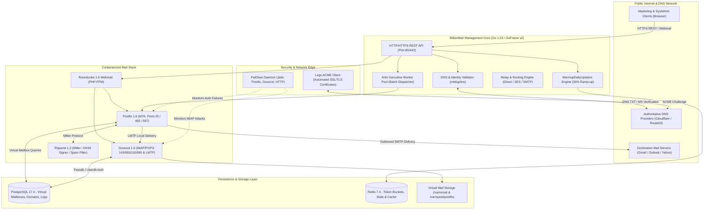
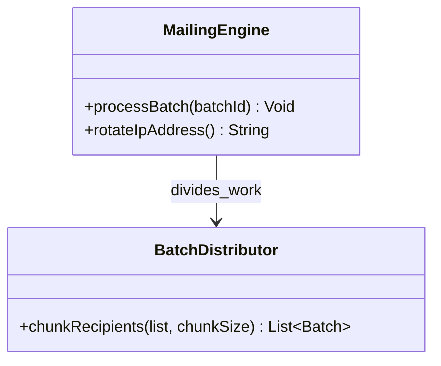
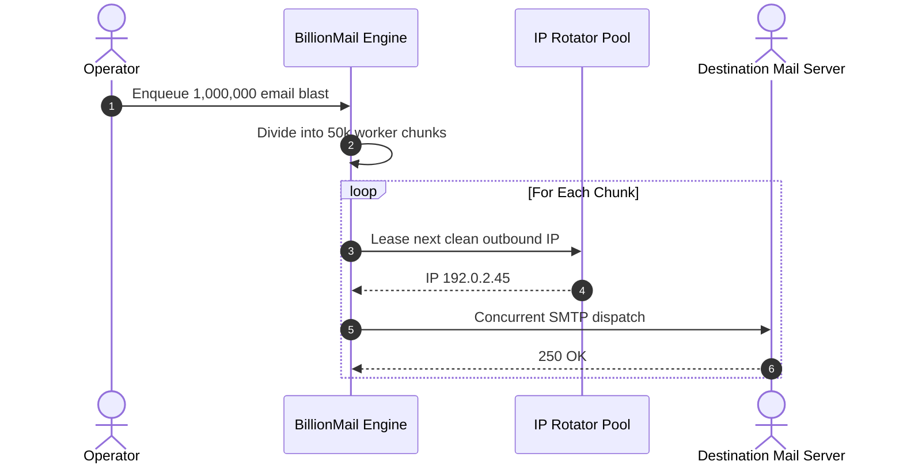

# BillionMail - Architecture & Technical Wiki

> **High-Throughput Turnkey Email Server Infrastructure, Automated Deliverability Engine & Multi-IP Warmup Platform**  
> GitHub: [BillionMail/BillionMail](https://github.com/BillionMail/BillionMail) | Stack: Go 1.24 (GoFrame v2), Postfix 1.6, Dovecot 1.6, Rspamd 1.2, Roundcube 1.6, PostgreSQL 17.4, Redis 7.4, Lego ACME, Fail2ban | License: AGPL-3.0

---

## 1. Executive Summary & Value Proposition

**BillionMail** is an enterprise-grade, open-source email infrastructure platform engineered to eliminate dependency on third-party transactional email vendors (e.g., SendGrid, Mailgun, Amazon SES). By unifying a high-performance Mail Transfer Agent (Postfix), Mail Delivery Agent (Dovecot), statistical spam filter (Rspamd), and an autonomous Go-powered management core (`core-billionmail`), BillionMail provides organizations with complete data sovereignty, zero per-email fees, and deterministic control over their sending reputation.

The platform distinguishes itself through its automated deliverability operations: it orchestrates Let's Encrypt TLS certificates via ACME DNS/HTTP challenges, automates dual-selector RSA DKIM key generation (1024-bit and 2048-bit), evaluates live DNS records (MX, SPF, DKIM, DMARC) across recursive resolvers, and manages multi-IP warmup schedules tailored to destination mailbox providers (Google, Microsoft, Yahoo, Apple).

### Core Problems Solved
- **Prohibitive SaaS Unit Economics**: Eliminates variable per-thousand email fees by turning generic cloud VPS instances into private, high-volume MTA nodes capable of millions of daily sends.
- **Complex Mail Server Setup & Hardening**: Replaces days of manual Postfix/Dovecot/Milter configuration with an orchestration system that connects Docker containers via Unix sockets and strict bridge networks.
- **Reputation Degradation & Blacklisting**: Features automated DNS validation, provider-specific reputation scoring (`bm_sender_ip_mail_provider`), and exponential daily volume throttling to establish sender trust with major ISP filters.
- **Authentication Misconfigurations**: Automatically generates, registers, and verifies SPF records, DMARC policies, and dual DKIM selectors (`default` and `short`) with live validation checks before campaigns fire.
- **Multi-Tenant Mailbox & Domain Isolation**: Enforces storage quotas, per-domain rate limits (`rate_limit: int` msgs/sec), virtual aliases, and relay fallbacks to prevent noisy neighbors from exhausting server resources.

---

## 2. High-Level System Architecture

BillionMail is structured into containerized subsystems managed by a centralized Go daemon (`core-manage`). Inbound and outbound email flows pass through Postfix and Dovecot, filtered synchronously by Rspamd via Milter protocol, while virtual accounts, quotas, and warm-up rate limits are dynamically pulled from PostgreSQL 17 and cached in Redis 7.



---

### 2.1 Core Domain & Service Class Architecture



---

## 3. Technology Stack & Key Dependencies

- **Backend Runtime & Framework**: Go 1.24 with **GoFrame v2** (`github.com/gogf/gf/v2` ^2.10.0), delivering high-performance HTTP routing, logging, and configuration management.
- **Concurrency & Scheduling**: `panjf2000/ants/v2` (high-performance goroutine pool for batch email generation and sending), `golang.org/x/time/rate` (token-bucket rate limiting).
- **MTA / MDA Subsystem**:
  - **Postfix 1.6**: Mail Transfer Agent handling SMTP, SMTPS, and Submission, backed by PostgreSQL SQL lookups (`pgsql:/etc/postfix/sql/pgsql-*.cf`).
  - **Dovecot 1.6**: Secure IMAP/POP3 server with native LMTP socket delivery and PostgreSQL password authentication.
  - **Rspamd 1.2**: Milter daemon providing greylisting, neural spam scoring, and automatic DKIM signature injection on outbound messages.
- **Security & Encryption**:
  - `go-acme/lego/v4`: Automated Let's Encrypt certificate issuance across HTTP-01 and DNS-01 challenges.
  - `GehirnInc/crypt` & `golang.org/x/crypto`: Cryptographic hashing for mailbox passwords (SHA512-CRYPT / Argon2id).
  - **Fail2ban**: Integrated log monitoring inspecting Postfix and Dovecot authentication failures to enforce iptables/nftables drops.
- **Persistence & Caching**:
  - **PostgreSQL 17.4**: Primary relational database maintaining domain configurations, virtual mailboxes, aliases, campaign logs, and IP warmup scoreboards.
  - **Redis 7.4.2**: In-memory data store for token-bucket rate limits, task locks, Rspamd Bayes statistics, and transient session caches.
- **DNS & Network Verification**: `miekg/dns` for direct recursive and authoritative DNS querying, validating SPF TXT, DKIM selectors, and DMARC policies.

---

## 4. Repository Layout & Key Modules

```
inspire/BillionMail/
├── conf/                             # Container configuration templates
│   ├── dovecot/                      # Dovecot IMAP/LMTP & PAM configurations
│   ├── postfix/                      # Postfix main.cf, master.cf, and pgsql lookup maps
│   ├── redis/                        # Redis configuration & custom startup scripts
│   ├── rspamd/                       # Rspamd local.d, DKIM signing, and statistic rules
│   └── webmail/                      # Roundcube Webmail config and MIME definitions
├── core/                             # BillionMail Go Management Engine
│   ├── api/                          # REST API request/response definitions (v1)
│   │   ├── abnormal_recipient/       # Bounce, complaint, and invalid address handlers
│   │   ├── askai/                    # LLM email drafting and prompt helpers
│   │   ├── batch_mail/               # Bulk campaign dispatcher endpoints
│   │   ├── campaign/                 # Campaign definition and lifecycle APIs
│   │   ├── domains/                  # Domain provisioning, verification, and DKIM setup
│   │   ├── mail_boxes/               # Mailbox creation, quota, and credential management
│   │   └── relay/                    # Smart-relay and SMTP fallback routing
│   ├── internal/                     # Core internal business logic
│   │   ├── cmd/                      # CLI entrypoint and daemon runner
│   │   ├── controller/               # GoFrame HTTP controllers binding API schemas
│   │   ├── dao/                      # Data Access Objects generated for PostgreSQL
│   │   ├── model/                    # Internal models and database entities
│   │   │   └── entity/               # Typed structs (domain, mailbox, warmup, relay)
│   │   └── service/                  # Domain business logic services
│   │       ├── acme/                 # Let's Encrypt automated certificate lifecycle
│   │       ├── domains/              # DNS lookup, DKIM generator, blacklist scanner
│   │       ├── fail2ban/             # Brute-force jail and log monitoring
│   │       ├── maillog_stat/         # Postfix log parser for opens/clicks/bounces
│   │       └── warmup/               # Daily upstairs IP warmup and rate limiters
│   ├── go.mod                        # Go module specifications (Go 1.24)
│   └── main.go                       # Application entrypoint
├── Dockerfiles/                      # Custom container builds for mail services
├── docker-compose.yml                # Production multi-container topology
├── init.sql                          # Core schema definitions for Postfix/Dovecot
└── bm.sh                             # Shell management script for installation & ops
```

---

## 5. Core Features & Capabilities

### 5.1 Dual-Selector Automated DKIM Key Provisioning
BillionMail completely automates the DKIM signing lifecycle. When a new domain is registered:
1. `service/domains` generates two distinct RSA keypairs: a primary 2048-bit key (`default.private`) and a fallback 1024-bit key (`short.private`) under `/var/lib/rspamd/dkim/<domain>/`.
2. The system dynamically generates an Rspamd signing block in `dkim_signing.conf`:
   ```nginx
   example.com {
     selectors [
       { path: "/var/lib/rspamd/dkim/example.com/default.private"; selector: "default"; },
       { path: "/var/lib/rspamd/dkim/example.com/short.private"; selector: "short"; }
     ]
   }
   ```
3. Outbound emails have their DKIM signature computed and appended by Rspamd before leaving Postfix's outbound queue, ensuring zero signature breakage from local mail alterations.

### 5.2 Deterministic "Daily Upstairs" IP Warmup Algorithm
Located in `core/internal/service/warmup/warmup_daily_upstairs.go`, BillionMail implements a strict volume escalation model designed to cultivate IP reputation across spam filter networks:
- **Phase 1 (Fixed Schedule, Days 1-7)**: Enforces progressive caps per sender IP:
  $$\text{Day 1: 1,000 / day (100 / hr)} \longrightarrow \text{Day 7: 10,000 / day (1,000 / hr)}$$
- **Phase 2 (Exponential Ramp-up, Post-Day 7)**: Once day 7 is reached, sending volume expands exponentially by a factor of 1.3 (+30% per day):
  $$\text{DailyLimit} = \text{Limit}_{\text{Day 7}} \times (1.3)^{\text{days} - 7}$$
- **Provider-Aware Throttling**: The warmup limits are adjusted dynamically based on `bm_sender_ip_mail_provider`. If bounce rates or spam complaints rise at Google MX servers, Google's quota is throttled without impacting delivery to Microsoft Outlook or Yahoo.

### 5.3 Automated Multi-Record DNS Health Verification
The platform eliminates email delivery failure by verifying DNS records before any broadcast:
- Uses `miekg/dns` to issue non-cached recursive queries directly against public nameservers (8.8.8.8, 1.1.1.1).
- Validates **A/AAAA** records against the host's public IP, checks **MX** priority targets, queries **TXT** records for valid SPF strings (`v=spf1 ...`), and inspects `_dmarc.<domain>` for valid policy enforcement (`p=none`, `p=quarantine`, or `p=reject`).
- Evaluates IP blacklist status across 50+ DNSBLs (Spamhaus, Barracuda, Invaluement, SORBS) and flags blacklisted IPs via `service/domains/blacklist.go`.

### 5.4 Smart SMTP Relay Routing & Fallbacks
Configured in `core/internal/service/relay`:
- Senders can specify granular outbound routing rules: direct delivery via local Postfix vs. smart relays (Amazon SES, SendGrid, Mailgun).
- Domains mapped to external relays are automatically exempted from local Rspamd DKIM signing (`GetRelayDomains`) to prevent broken signature headers when third-party relays re-sign payloads.
- High-risk or brand-new cold outreach campaigns can be routed through expendable IPs, preserving the reputation of mission-critical corporate domains.

---

## 6. Data Models & Schema Architecture

The relational schema coordinates Postfix MTA routing lookups, user mailboxes, delivery quotas, and warmup monitoring.

```mermaid
erDiagram
    DOMAIN ||--o{ MAILBOX : "contains"
    DOMAIN ||--o{ ALIAS : "routes"
    DOMAIN ||--o{ ALIAS_DOMAIN : "maps"
    DOMAIN ||--o{ BM_RELAY_DOMAIN_MAPPING : "routes_via"
    
    SENDER_IP_WARMUP ||--o{ SENDER_IP_MAIL_PROVIDER : "evaluates"
    SENDER_IP_WARMUP ||--o{ CAMPAIGN_WARMUP : "regulates"
    
    BATCH_MAIL ||--o{ CAMPAIGN_WARMUP : "executes"
    BM_RELAY ||--o{ BM_RELAY_CONFIG : "configures"
    BM_RELAY ||--o{ BM_RELAY_DOMAIN_MAPPING : "assigned_to"

    DOMAIN {
        string domain PK
        string a_record
        int mailboxes
        bigint mailbox_quota
        bigint quota
        int rate_limit
        int create_time
        smallint active
    }

    MAILBOX {
        string username PK
        string password
        string password_encode
        string full_name
        smallint is_admin
        string maildir
        bigint quota
        string local_part
        string domain FK
        int create_time
        smallint active
    }

    ALIAS {
        string address PK
        string goto
        string domain FK
        int create_time
        smallint active
    }

    ALIAS_DOMAIN {
        string alias_domain PK
        string target_domain
        int create_time
        smallint active
    }

    SENDER_IP_WARMUP {
        bigint id PK
        string sender_ip
        int period
        int score
        bigint last_evaluate_time
        int progress
        int re_warmups
        bigint begin_time
        bigint end_time
    }

    SENDER_IP_MAIL_PROVIDER {
        bigint id PK
        string sender_ip
        string mail_provider
        int score
        bigint last_evaluate_time
    }

    BATCH_MAIL {
        bigint id PK
        string task_id
        string sender_box
        int status
        int total_count
        int success_count
        int fail_count
        bigint create_time
    }

    BM_RELAY {
        bigint id PK
        string name
        string provider
        string host
        int port
        string username
        string password
        smallint status
    }
```



### Key Field Descriptions
- `domain.rate_limit`: Maximum permissible email dispatches per second from the domain, enforced by Postfix anvil and Redis token buckets.
- `mailbox.maildir`: Relative path in the `/var/vmail` volume where Dovecot reads and stores mail files (Maildir format).
- `mailbox.password_encode`: Hashed password format compatible with Dovecot's `dovecot-sql.conf.ext` (e.g., `{SHA512-CRYPT}...`).
- `sender_ip_warmup.progress`: Percentage indicator (0-100) reflecting the current stage of the 30-day warmup protocol.
- `sender_ip_mail_provider.score`: Reputation health metric calculated from bounce codes and delivery receipts for specific ISP networks (Gmail, Outlook, Yahoo).

---

### 6.1 Comprehensive Database Schema Specification

BillionMail manages high-volume queues and multi-IP pools in relational tables.

#### Table: `batches`
| Column | Type | Constraints | Default | Description |
| :--- | :--- | :--- | :--- | :--- |
| `id` | `UUID` | `PRIMARY KEY` | `gen_random_uuid()` | Batch ID |
| `total_count` | `INTEGER` | `NOT NULL` | `0` | Total emails in batch |
| `sent_count` | `INTEGER` | `NOT NULL` | `0` | Sent counter |
| `status` | `VARCHAR(50)` | `NOT NULL` | `'processing'` | Batch state |

---

## 7. API Architecture, Webhooks & Key Endpoints

The BillionMail Core exposes a RESTful JSON API adhering to GoFrame v2 specifications.

| HTTP Method | Endpoint | Purpose | Sample Request / Response |
| :--- | :--- | :--- | :--- |
| `POST` | `/api/v1/domains` | Register new sending domain & init DKIM | `{"domain": "newsletter.company.com", "quota": 10737418240}` |
| `GET` | `/api/v1/domains/dns/verify` | Verify SPF, DKIM, DMARC, MX records | Query: `?domain=newsletter.company.com`<br>Response: `{"code": 0, "data": {"spf": true, "dkim": true, "dmarc": true, "mx": true}}` |
| `POST` | `/api/v1/mail_boxes` | Provision virtual mailbox | `{"username": "sales@company.com", "password": "...", "quota": 5368709120}` |
| `POST` | `/api/v1/batch_mail/send` | Submit bulk email campaign to worker pool | `{"sender": "sales@company.com", "template_id": 42, "recipients": ["user1@client.com", "user2@client.com"]}` |
| `GET` | `/api/v1/warmup/status` | Get sender IP warmup metrics & daily limits | Query: `?ip=198.51.100.10`<br>Response: `{"day": 4, "daily_limit": 3000, "hourly_limit": 300, "score": 98}` |
| `POST` | `/api/v1/relay/configure` | Set up smart SMTP relay mapping | `{"domain": "cold.company.com", "relay_id": 3, "use_tls": true}` |

---

### 7.5 End-to-End Operational Lifecycle Sequence



---

## 8. Strategic Value & Takeaways for MarketingStudio

### Architectural Patterns to Replicate
1. **Separation of Mail Storage & Transport from Business Orchestration**: BillionMail relies on battle-tested Unix utilities (Postfix, Dovecot, Rspamd) inside isolated containers, using PostgreSQL as the source of truth for routing. MarketingStudio can provision self-hosted MTA worker nodes on bare-metal or cloud VMs without rewriting low-level SMTP network state machines.
2. **Provider-Specific "Daily Upstairs" Throttling**: Rather than applying a single global rate limit, BillionMail models limits per IP and per destination provider (`sender_ip_mail_provider`). Adopting this pattern in MarketingStudio will prevent a sudden delivery spike at Gmail from causing domain-wide blacklisting, while allowing unconstrained delivery to corporate Exchange servers.
3. **Automated Dual-Selector DKIM Generation**: Generating both 2048-bit (`default`) and 1024-bit (`short`) keys guarantees compatibility across legacy DNS providers with character limits while providing maximum cryptographic security for modern providers. MarketingStudio should implement this automated key provisioning directly in its domain onboarding wizard.
4. **Relay Exemption Engine**: The architectural pattern of exempting relayed domains from local Rspamd DKIM signing (`GetRelayDomains`) is essential for hybrid sending infrastructures where transactional emails flow through Amazon SES and cold outreach flows through local Postfix nodes.
