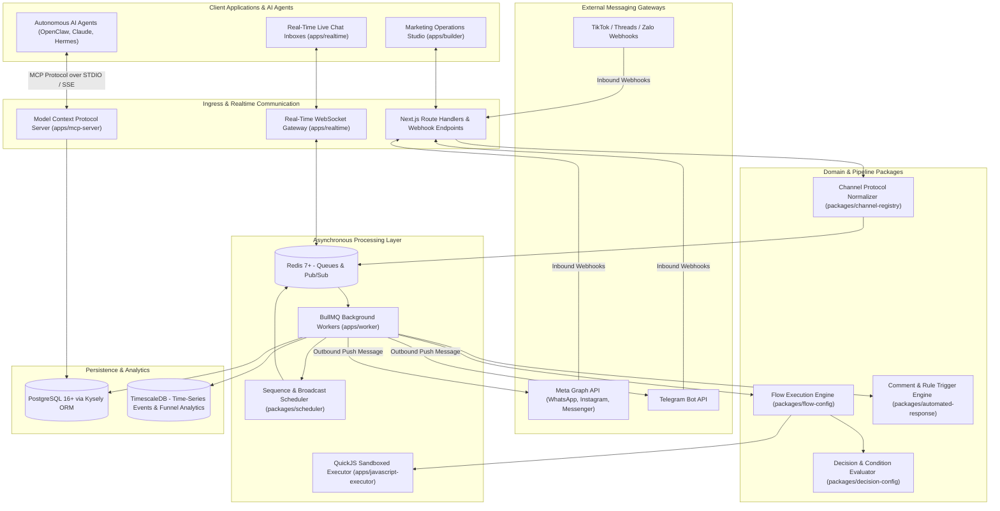
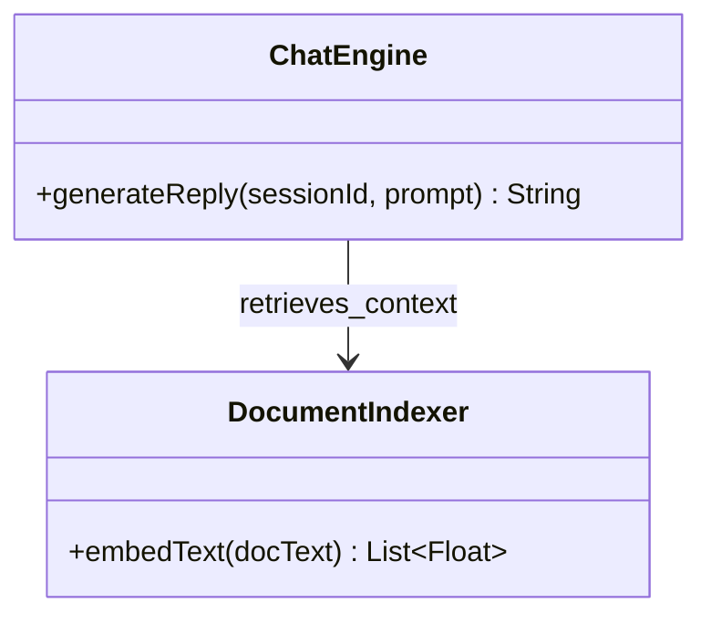
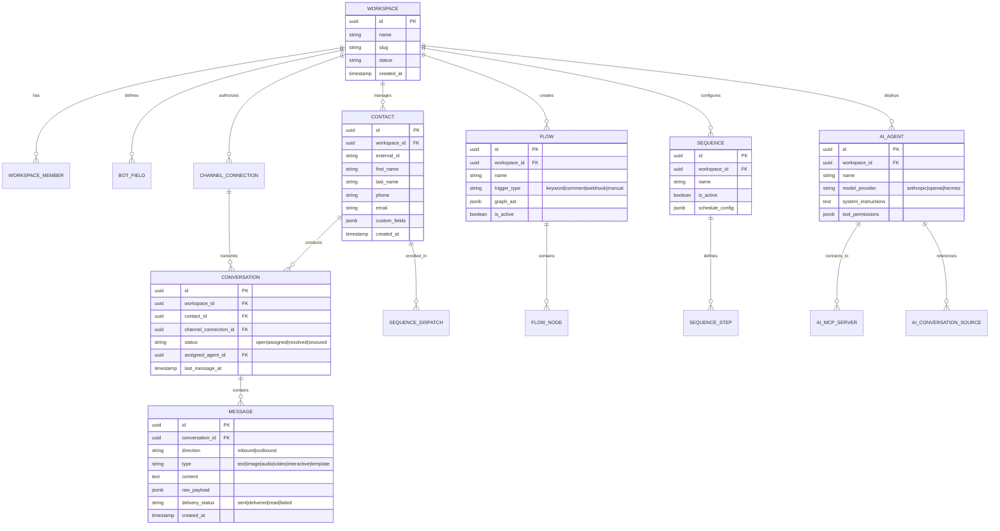
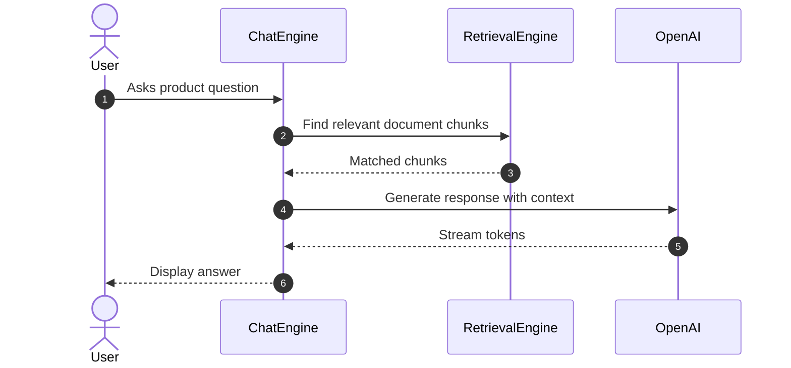

# ChatbotX - Architecture & Technical Wiki

> **Agentic Chat Marketing Platform & Omnichannel Conversational Automation Hub**  
> GitHub: [ChatbotXIO/ChatbotX](https://github.com/ChatbotXIO/ChatbotX) | Stack: TypeScript, Node.js 24, Turborepo, Next.js, Kysely ORM, PostgreSQL, TimescaleDB, Redis, BullMQ, MCP Server | License: MIT

---

## 1. Executive Summary & Value Proposition

**ChatbotX** is an enterprise-grade, open-source agentic chat marketing and automation platform designed as a modern alternative to proprietary tools like ManyChat, Chatfuel, Wati, and Respond.io. Specifically architected for autonomous AI agents (including OpenClaw, Hermes, Claude, and GPT-4o), ChatbotX unifies visual drag-and-drop conversational funnels, multi-channel broadcast sequences, and agentic tool invocation via the Model Context Protocol (MCP).

By combining high-concurrency event ingestion across WhatsApp Business Cloud API, Instagram, Messenger, Telegram, TikTok, Threads, and Zalo with an asynchronous worker cluster powered by Redis and BullMQ, ChatbotX enables marketing and sales teams to automate lead acquisition, social comment-to-DM conversions, appointment scheduling, and multi-tier drip campaigns without sacrificing enterprise security or data sovereignty.

### Core Problems Solved
- **Vendor Lock-in & Prohibitive SaaS Contact Pricing**: Replaces per-contact pricing models of traditional chat marketing platforms with an open, self-hostable infrastructure backed by PostgreSQL and TimescaleDB.
- **Disconnected Multi-Channel Inboxes**: Aggregates customer dialogues across WhatsApp, Instagram DMs, Facebook Messenger, Telegram, TikTok, and web chat into a unified real-time conversation stream.
- **Fragmented AI Tooling & Lack of Standards**: Implements native Model Context Protocol (MCP) server endpoints (`apps/mcp-server`), allowing autonomous AI agents to introspect bot configurations, read lead variables, and trigger marketing flows via standardized RPC.
- **Social Media Comment-to-Lead Leakage**: Features automated comment monitoring that instantly replies to public post comments and initiates private direct message sequences to capture high-intent leads.
- **Complex Drip Campaign Scheduling**: Delivers robust sequence dispatching with timezone-aware send windows, holiday blackouts, and tag-based subscription management via BullMQ and Redis.

---

## 2. High-Level System Architecture

ChatbotX is built as a high-performance TypeScript monorepo governed by Turborepo and pnpm workspaces. The architecture isolates front-end UI authoring, real-time WebSocket communication, background job processing, secure sandboxed execution, and MCP agent communication into dedicated microservices.



### Architectural Data Flow Narrative
1. **Webhook Ingress & Protocol Normalization**: Inbound webhooks from Meta Graph API, Telegram, or social networks hit `HTTPRouter`. `packages/channel-registry` parses channel-specific payloads, validates HMAC signatures, extracts standard conversation entities, and enqueues a job into Redis.
2. **Worker Dispatch & Flow Evaluation**: `apps/worker` consumes messages from BullMQ. The job activates `packages/flow-config` to traverse the visual node canvas. Conditional splits and variable logic are evaluated through `packages/decision-config`.
3. **Sandboxed Code Execution**: When a flow node executes custom user-written JavaScript (e.g., currency transformations, custom API signing), execution is routed to `apps/javascript-executor`, running an isolated QuickJS WebAssembly runtime to prevent host vulnerabilities.
4. **Real-time Live Chat Synchronisation**: State mutations and incoming chat messages are broadcast via Redis Pub/Sub to `apps/realtime`, which delivers instantaneous updates to active support dashboard operators.
5. **Agentic MCP Interaction**: External AI agents connect to `apps/mcp-server`. The MCP server exposes tools to query contact fields, read conversation history, pause automation, and trigger pre-configured broadcast flows.
6. **Analytics Ingestion**: In-flight milestones (flow entries, button clicks, conversion events, response times) are committed directly to TimescaleDB hypertables for real-time aggregation and cohort analytics.

---

### 2.1 Core Domain & Service Class Architecture



---

## 3. Technology Stack & Key Dependencies

- **Language & Runtime**: TypeScript 5.8+, Node.js 24+ (`engines: { "node": ">=24" }`)
- **Monorepo Architecture**: Turborepo 2.11+, pnpm 10.34+, Biome 2.4+ (code linting and formatting), Ultracite 7.8
- **Fullstack Web Framework**: Next.js 15+ (App Router, Server Components)
- **Database & Data Access**:
  - **Relational DB**: PostgreSQL 16+
  - **ORM / Query Builder**: Kysely 0.28.17 (Type-safe SQL query builder without heavy runtime overhead)
  - **Time-Series Analytics**: TimescaleDB for hypertable-based event and conversion logging
- **Queue & Real-Time Engine**:
  - **Queue / Job Scheduling**: BullMQ with Redis 7+
  - **Real-Time Gateway**: WebSockets (`ws` 8.20+) in `apps/realtime`
- **Agent & AI Protocol**:
  - Model Context Protocol SDK (`@modelcontextprotocol/sdk`)
  - Integration with Anthropic Claude, OpenClaw, and Hermes agents
- **Code Execution Sandbox**: WebAssembly QuickJS (`quickjs-emscripten`) in `apps/javascript-executor`
- **Validation & Types**: Zod 4.3+ for strict runtime schema enforcement

---

## 4. Repository Layout & Key Modules

```
ChatbotX/
├── apps/                                  # Deployable microservices and applications
│   ├── builder/                           # Visual flow canvas, workspace admin, CRM dashboard
│   ├── cli/                               # Administrative CLI for migrations and seed data
│   ├── javascript-executor/               # Isolated QuickJS sandbox service for user scripts
│   ├── mcp-server/                        # Model Context Protocol server exposing bot tools
│   ├── realtime/                          # High-throughput WebSocket server for live chat
│   └── worker/                            # BullMQ async queue processor and sequence dispatcher
├── packages/                              # Modular core libraries
│   ├── ai/                                # AI agent definitions, prompt templates, embeddings
│   ├── analytics/                         # TimescaleDB metrics collectors and reporting queries
│   ├── automated-response/                # Keyword matching, regex triggers, comment auto-replies
│   ├── business/                          # Workspace rules, membership, and billing contracts
│   ├── channel-registry/                  # Normalization adapters for WhatsApp, IG, Messenger, TG
│   ├── database/                          # Kysely client, migrations, repositories, and schema
│   │   └── src/schema/                    # 80+ strongly typed table schema definitions
│   ├── decision-config/                   # Logical operators, condition groups, and branching
│   ├── event-bus/                         # Internal event publish/subscribe abstractions
│   ├── events/                            # Canonical event payloads and message schemas
│   ├── flow-config/                       # Visual flow AST parser, node validators, traversal engine
│   ├── javascript-sandbox/                # Safe scripting runner harness
│   ├── redis/                             # Connection pooling, locks, and Redis cache client
│   ├── scheduler/                         # Cron jobs, recurrence calculators, delayed jobs
│   ├── sequence-scheduler/                # Drip marketing sequence step coordinator
│   └── variables/                         # Contact custom fields, bot variables, system macros
├── docker-compose.yml                     # Multi-container orchestration (Postgres, Redis, Timescale)
├── turbo.json                             # Turborepo task pipeline definitions
└── package.json                           # Root workspace manifest
```

---

## 5. Core Features & Capabilities

### 5.1 Visual Flow Builder & Graph Traversal Engine
ChatbotX provides a node-based visual drag-and-drop canvas (`apps/builder`) powered by `packages/flow-config`. Flows represent directed graphs containing message nodes, user input nodes, condition splitters, delay timers, webhook dispatchers, and AI generation nodes. The execution engine supports pause-and-resume workflows: when an input node requires user response, state is checkpointed in PostgreSQL and resurrected upon the next inbound message.

### 5.2 Multi-Channel Broadcast & Sequence Drip Scheduler
Managed by `packages/sequence-scheduler` and `packages/scheduler`:
- **Broadcasts**: Allows targeted mass messaging across millions of subscribers filtered by tags, custom attributes, or signup channels. Features dynamic batch rate-limiting to comply with WhatsApp Cloud API tier restrictions.
- **Sequences (Drip Marketing)**: Configures multi-day outbound nurture campaigns (e.g., Day 0: Lead magnet delivery, Day 2: Case study, Day 4: Booking link). Steps can be conditionally aborted if a lead books an appointment or converts.

### 5.3 Native Model Context Protocol (MCP) Server
The platform includes a dedicated `apps/mcp-server` that exposes the entire conversational marketing stack to external AI agents. Agents running on Claude Desktop, Cursor, or OpenClaw can invoke tools such as:
- `get_contact_profile`: Retrieve lead attributes, purchase history, and conversation history.
- `update_bot_variable`: Alter custom fields (e.g., updating lead score or qualified budget).
- `trigger_flow`: Hand off the dialogue back into a structured onboarding or payment funnel.
- `pause_automation`: Temporarily silence automated triggers while an autonomous AI SDR conducts custom negotiation.

### 5.4 Lead Enrichment & Bot Variables System
Custom data is handled through a two-tier variable architecture:
- **`system_field`**: Standard profile values (first name, last name, phone, language, timezone).
- **`bot_field`**: Tenant-defined custom fields (e.g., `deal_size`, `crm_lead_id`, `tech_stack`).  
Variables support dynamic mustache-style template injection (`{{first_name}}`, `{{bot.company_name}}`) throughout all message copy, webhook payloads, and API requests.

### 5.5 TimescaleDB High-Velocity Marketing Analytics
Traditional relational databases experience severe write amplification and query degradation when tracking millions of real-time chat interactions. ChatbotX leverages TimescaleDB hypertables for time-series logging:
- Tracks message delivery receipts, read statuses, button interaction rates, drop-off nodes, and SLA response times.
- Enables continuous aggregates for real-time dashboards showing hourly conversion rates and campaign ROI without table locks.

### 5.6 Social Comment Automation & Inbound Lead Capture
Implemented in `packages/automated-response`:
- Listens to public comments on Facebook posts and Instagram reels.
- Analyzes comment text against keyword rules (e.g., "PRICE", "INFO", "SEND").
- Automatically publishes a public reply to boost algorithmic reach and simultaneously dispatches a private direct message initiating the qualification flow.

---

## 6. Data Models & Schema Architecture

ChatbotX utilizes a Kysely-typed PostgreSQL schema with dozens of domain-specific tables in `packages/database/src/schema`.



### Core Schema Highlights
- **`workspace`**: Multi-tenant boundary. Enforces organization-scoped Kysely queries across all repositories.
- **`contact`**: Omnichannel prospect profile. Stores unified phone, email, and social handles, linking conversations across multiple disparate platforms to a single identity.
- **`conversation` & `message`**: Normalized chat storage. Tracks `delivery_status` transitions (`sent` -> `delivered` -> `read`) and associates inbound messages with flow execution traces.
- **`flow` & `flow_node`**: Graph AST storage for the visual drag-and-drop funnel builder.
- **`sequence` & `sequence_step`**: Drip marketing scheduling specifications, including delay offsets and conditional filters.

---

### 6.1 Comprehensive Database Schema Specification

#### Table: `chatbots`
| Column | Type | Constraints | Default | Description |
| :--- | :--- | :--- | :--- | :--- |
| `id` | `UUID` | `PRIMARY KEY` | `gen_random_uuid()` | Chatbot ID |
| `name` | `VARCHAR(255)` | `NOT NULL` | - | Bot display name |
| `model` | `VARCHAR(100)` | `NOT NULL` | `'gpt-4o'` | LLM model |

---

## 7. API Architecture, Webhooks & Key Endpoints

### 7.1 Flow Trigger Webhook (`POST /api/v1/flows/:flowId/trigger`)
Triggers execution of a specific conversational funnel for a prospect via external HTTP POST.

```http
POST /api/v1/flows/flow_sdr_qualify_v1/trigger
Authorization: Bearer <WORKSPACE_API_KEY>
Content-Type: application/json

{
  "contact": {
    "phone": "+14155552671",
    "email": "sarah.chen@acme-corp.com",
    "firstName": "Sarah",
    "customFields": {
      "crm_lead_id": "lead_987654",
      "source_campaign": "q4_enterprise_outreach"
    }
  },
  "channel": "whatsapp",
  "initialVariables": {
    "assigned_rep": "Alex Johnson"
  }
}
```

### 7.2 MCP Server RPC Interface (`apps/mcp-server`)
Operates as an MCP server conforming to the JSON-RPC Model Context Protocol specification:

```json
// Sample Tool Call: update_bot_variable
{
  "jsonrpc": "2.0",
  "method": "tools/call",
  "params": {
    "name": "update_bot_variable",
    "arguments": {
      "contactId": "c8a143b2-6012-4211-9a74-b58cbfa89801",
      "fieldName": "lead_qualification_score",
      "fieldValue": 85
    }
  },
  "id": "req_001"
}
```

### 7.3 Real-Time Live Chat WebSocket Protocol (`apps/realtime`)
Clients authenticate using bearer tokens and subscribe to workspace conversation rooms:
- **`room:join`**: `{"action": "subscribe", "conversationId": "conv_123"}`
- **`message:new`**: Broadcast payload containing the normalized message object.
- **`typing:status`**: Indicates when an AI agent or human representative is drafting a reply.

---

### 7.5 End-to-End Operational Lifecycle Sequence



---

## 8. Strategic Value & Takeaways for MarketingStudio

### Reusable Architectural Patterns
1. **Model Context Protocol (MCP) as First-Class Integration**:  
   ChatbotX's dedicated `apps/mcp-server` demonstrates how to cleanly expose marketing automation capabilities to external AI coding agents, autonomous SDRs, and LLM reasoning loops without creating brittle custom REST APIs. MarketingStudio can expose its lead database and campaign triggers as native MCP tools.

2. **TimescaleDB for High-Velocity Marketing Hypertables**:  
   Logging conversation events, button clicks, and email opens to TimescaleDB hypertables prevents relational bloat while unlocking high-speed analytical aggregation for campaign conversion funnels and attribution modeling.

3. **Separation of Realtime WebSockets and Asynchronous Workers**:  
   Splitting real-time UI synchronization (`apps/realtime`) from background queue execution (`apps/worker` with BullMQ) prevents long-running AI generation jobs or mass broadcasts from stalling interactive dashboard updates.

4. **Social Comment-to-Direct-Message Lead Ingestion**:  
   Capturing leads at the exact moment of public engagement (e.g., commenting on a LinkedIn post or Instagram reel) and transitioning them seamlessly into a private AI SDR qualifying chat creates an automated, high-converting acquisition channel for MarketingStudio's outbound playbooks.
