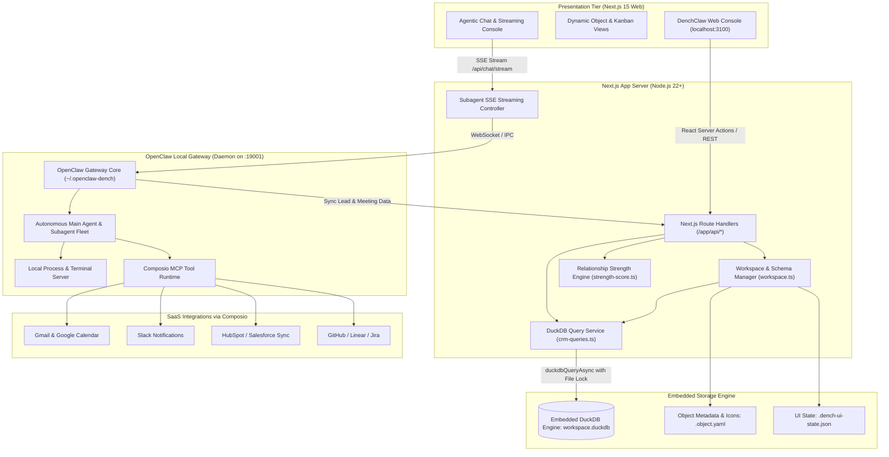
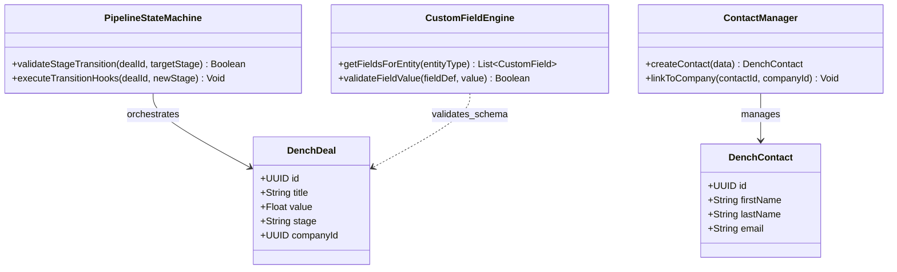
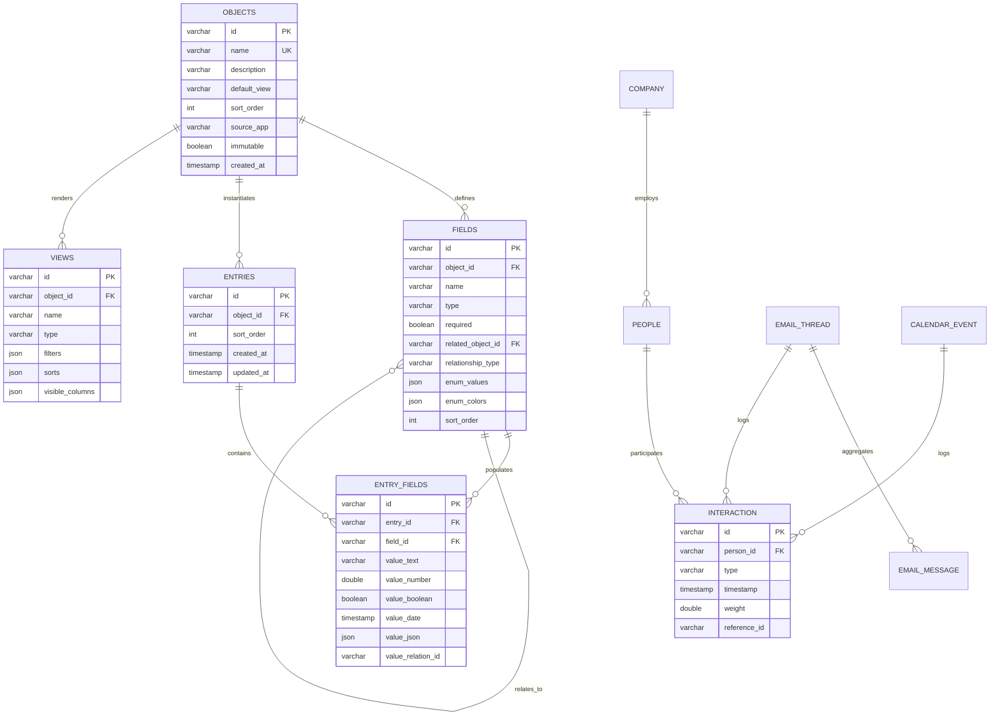
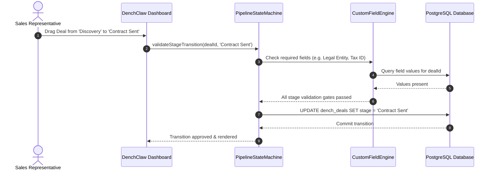

# DenchClaw - Architecture & Technical Wiki

> **Local-First Autonomous AI CRM & Embedded Analytical Workspace Engine**  
> GitHub: [DenchHQ/DenchClaw](https://github.com/DenchHQ/DenchClaw) | Stack: TypeScript, Node.js 22+, Next.js 15, DuckDB, OpenClaw AI Gateway, Composio SDK | License: MIT

---

## 1. Executive Summary & Value Proposition

**DenchClaw** is a local-first, autonomous AI CRM and sales intelligence workspace engineered to run locally on developer and sales operator workstations. Built upon the **OpenClaw** gateway daemon architecture, DenchClaw combines an embedded columnar database (**DuckDB**) with autonomous agent runtime execution, allowing sales professionals and technical founders to manage customer relationships, track pipeline momentum, and execute intelligent outreach without surrendering sensitive proprietary data to third-party cloud vendors.

Unlike conventional cloud CRMs that suffer from high latency, rigid relational schemas, and complex API rate limits, DenchClaw executes all analytical queries, contact deduplication, and relationship scoring in-process. Autonomous background agents operating through the local OpenClaw gateway continuously interface with external tools (Google Workspace, Slack, Linear, GitHub, HubSpot) via **Composio** and the **Model Context Protocol (MCP)**, enriching contacts and keeping pipeline records perpetually accurate.

### Core Problems Solved
- **Data Sovereignty & Enterprise Privacy**: Retains all customer interactions, email threads, deal valuations, and executive notes in a local embedded DuckDB file (`workspace.duckdb`), completely eliminating cloud vendor data lock-in.
- **Analytical Query Latency**: Utilizes DuckDB’s vectorized columnar SQL execution engine to perform real-time sorting, aggregation, and filtering across hundreds of thousands of entries in sub-millisecond timeframes.
- **Manual Data Hygiene & Admin Overhead**: Background subagents orchestrated by OpenClaw automatically log meetings from Google Calendar, extract action items from Gmail threads, and recalculate relationship momentum scores.
- **Rigid Relational Database Schemas**: Employs a dynamic Entity-Attribute-Value (EAV) schema over columnar tables (`objects`, `fields`, `entries`, `entry_fields`), enabling instantaneous custom object and field creation without executing DDL table migrations.
- **Agent Tool Execution Sandboxing**: Couples the Next.js web interface directly to a local terminal server and Composio tool runner, enabling agents to execute shell scripts, fetch live URLs, and call authenticated APIs safely.

---

## 2. High-Level System Architecture

DenchClaw splits its architecture between a high-performance Next.js 15 web client and the background OpenClaw AI agent gateway process running on the host system.



---

### 2.1 Core Domain & Service Class Architecture



---

## 3. Technology Stack & Key Dependencies

- **Language & Runtime**: TypeScript 5.6+, Node.js 22+ (ES Modules)
- **Frontend Framework**: Next.js 15 (App Router), React 19, TailwindCSS, Radix UI, Lucide Icons
- **Primary Embedded Database**: DuckDB (in-process analytical SQL engine queried via serialized CLI execution and lock-aware async workers)
- **Agent Gateway & Daemon**: OpenClaw Gateway Daemon (isolated profile in `~/.openclaw-dench` listening on port 19001)
- **Tool Integration SDK**: Composio (`@composio/core`) providing 150+ authenticated SaaS connectors and Model Context Protocol (MCP) toolkits
- **Streaming & Concurrency**: Server-Sent Events (SSE) for token and subagent status streaming, Node.js `child_process` with lock retry logic (`workspace-duckdb-retry.ts`)
- **Code Quality & Testing**: Vitest, Oxlint (`.oxlintrc.json`), Oxfmt (`.oxfmtrc.jsonc`)

---

## 4. Repository Layout & Key Modules

```
DenchClaw/
├── apps/
│   └── web/                          # Next.js 15 Full-Stack Web Application
│       ├── app/                      # Next.js App Router
│       │   ├── api/                  # REST and streaming API route handlers
│       │   │   ├── apps/             # Mini-app store and proxy router
│       │   │   ├── chat/             # Subagent runs, active sessions, SSE streams
│       │   │   ├── composio/         # Tool execution and MCP health checks
│       │   │   ├── crm/              # People, companies, threads, and calendar routes
│       │   │   ├── gateway/          # OpenClaw daemon status, restart, and pairing
│       │   │   └── workspace/        # DuckDB table queries, object schemas, file tree
│       │   ├── workspace/            # Main interactive CRM spreadsheet and Kanban UI
│       │   └── layout.tsx            # Global application frame and agent drawer
│       ├── lib/                      # Core business logic and database abstractions
│       │   ├── action-runner.ts      # Composio action execution controller
│       │   ├── crm-queries.ts        # Shared lock-aware DuckDB SQL query helpers
│       │   ├── strength-score.ts     # Relationship interaction scoring algorithm
│       │   ├── subagent-registry.ts  # Background agent task tracking and lifecycle
│       │   ├── workspace.ts          # Core DuckDB query executor and schema bridge
│       │   └── workspace-schema-migrations.ts # Idempotent DuckDB table migration logic
│       └── package.json              # Web app dependencies and scripts
├── assets/
│   └── seed/                         # Pre-built workspace templates
│       └── schema.sql                # Complete DuckDB DDL schema and sample records
├── packages/
│   └── dench/                        # CLI bootstrap launcher package (npx denchclaw)
│       └── dench.mjs                 # Daemon installer and process manager
├── src/                              # Core daemon configurations and telemetry
│   ├── cli/                          # CLI commands for workspace init and updates
│   ├── infra/                        # LaunchAgent and systemd service descriptors
│   └── process/                      # Child process management and port allocation
├── denchclaw.mjs                     # Root executable script
├── pnpm-workspace.yaml               # PNPM multi-project workspace configuration
└── README.md                         # Project documentation and quickstart guide
```

---

## 5. Core Features & Capabilities

### Dynamic Workspace Entity Modeling (EAV over DuckDB)
DenchClaw implements a highly scalable Entity-Attribute-Value (EAV) schema on top of DuckDB. Workspaces contain custom `objects` (e.g., `deals`, `candidates`, `investors`), which define custom `fields` with rich data types (`text`, `number`, `boolean`, `date`, `json`, `relation`, `enum`). Field values are indexed inside `entry_fields`, allowing users to define new CRM entities on the fly without running schema migrations or locking tables.

### OpenClaw Autonomous Agent Gateway
The system runs a dedicated background daemon via OpenClaw (`~/.openclaw-dench` on port 19001). This gateway manages local AI agents that listen for events, run scheduled crons, and execute multi-step workflows. The web console connects to the gateway via WebSocket and SSE (`/api/chat/stream`), providing real-time streaming visibility into agent thoughts, tool invocations, and subagent delegation trees.

### Composio Tool Ecosystem & MCP Runtime
Rather than maintaining brittle custom scrapers and API clients for every third-party platform, DenchClaw leverages Composio. Through Composio's Model Context Protocol (MCP) server, agents dynamically execute authenticated actions across Google Workspace (Gmail, Calendar, Drive), Slack, GitHub, Linear, HubSpot, and Jira. Agents can read unread email threads, draft replies, check meeting attendees, and push deal updates directly.

### Relationship Strength Scoring Algorithm
The relationship intelligence engine (`lib/strength-score.ts`) calculates a dynamic "Connection Strength" score (0–100) between users and external contacts. The algorithm evaluates:
- **Recency**: Days elapsed since last email or meeting touchpoint.
- **Frequency**: Volume of interactions within a rolling 30/60/90-day window.
- **Bidirectionality**: Ratio of outbound messages versus inbound responses.
- **Meeting Density**: Calendar events carry a higher multiplier than cold emails.
Contacts are classified into intuitive tiers: `Very Strong`, `Strong`, `Moderate`, `Weak`, and `Stale`.

### Omnichannel Email & Calendar Synchronization
DenchClaw ingests historical communications via automated Gmail and Google Calendar sync loops. The sync runner parses threads, maps email addresses to existing `people` records, creates new entries when novel contacts appear, and records structured `interaction` rows. Communication metadata is stored in DuckDB, enabling instant full-text search across thousands of correspondence records.

### Embedded Terminal Server & Sandboxed Execution
For technical operators, DenchClaw includes a terminal server bridge (`/api/terminal`). Agents can be authorized to run shell scripts, execute data transformations, query external CLI tools, and write local artifacts to disk, turning the CRM into an active sales engineering workbench.

---

## 6. Data Models & Schema Architecture

DenchClaw structures its persistent store inside an embedded DuckDB database file (`workspace.duckdb`). The schema combines metadata tables (`objects`, `fields`) with normalized entry values and specialized CRM views.



### Core Schema Entity Specifications

| Table Name | Key Identifiers | Primary Fields & Data Types | Architectural Function |
| :--- | :--- | :--- | :--- |
| `objects` | `id` (VARCHAR PK) | `name` (VARCHAR Unique), `default_view` (table/kanban), `immutable` (BOOLEAN), `source_app` | Master registry of all workspace entities (People, Companies, Deals, Custom Apps). |
| `fields` | `id` (VARCHAR PK) | `object_id` (FK), `name`, `type` (text, number, boolean, date, json, relation, enum), `related_object_id` | Attribute definitions for dynamic entities, including foreign entity relational links. |
| `entries` | `id` (VARCHAR PK) | `object_id` (FK), `sort_order` (INTEGER), `created_at`, `updated_at` | Record header table tracking entity instances and row ordering. |
| `entry_fields` | `id` (VARCHAR PK) | `entry_id` (FK), `field_id` (FK), `value_text`, `value_number`, `value_date`, `value_relation_id` | Columnar value storage storing typed attributes with zero ALTER TABLE migration overhead. |
| `views` | `id` (VARCHAR PK) | `object_id` (FK), `name`, `type` (table, kanban, gallery), `filters` (JSON), `sorts` (JSON) | Saved presentation states, multi-condition filter groups, and visual grouping configurations. |
| `interaction` | `id` (VARCHAR PK) | `person_id` (FK), `type` (email_sent, email_received, meeting), `timestamp`, `weight` | Event stream powering relationship recency, frequency, and connection strength algorithms. |

---

### 6.1 Comprehensive Database Schema Specification

DenchClaw stores sales pipelines and custom dynamic attributes within PostgreSQL tables.

#### Table: `dench_deals`
Sales opportunities tracked through rigid state-machine stage gates.

| Column | Type | Constraints | Default | Description |
| :--- | :--- | :--- | :--- | :--- |
| `id` | `UUID` | `PRIMARY KEY` | `gen_random_uuid()` | Unique deal identifier |
| `title` | `VARCHAR(255)` | `NOT NULL` | - | Opportunity title |
| `value` | `NUMERIC(12, 2)`| `NOT NULL` | `0.00` | Contract value |
| `stage` | `VARCHAR(50)` | `NOT NULL` | `'lead'` | Current pipeline state |
| `company_id` | `UUID` | `NULLABLE` | `NULL` | Linked company identifier |
| `created_at` | `TIMESTAMPTZ` | `NOT NULL` | `NOW()` | Creation timestamp |

*Indexes:* `idx_dench_deals_stage` (`(stage)`).

---

#### Table: `dench_contacts`
Prospects and decision-makers associated with business accounts.

| Column | Type | Constraints | Default | Description |
| :--- | :--- | :--- | :--- | :--- |
| `id` | `UUID` | `PRIMARY KEY` | `gen_random_uuid()` | Contact identifier |
| `first_name` | `VARCHAR(100)` | `NOT NULL` | - | First name |
| `last_name` | `VARCHAR(100)` | `NOT NULL` | - | Last name |
| `email` | `VARCHAR(255)` | `NOT NULL, UNIQUE` | - | Email address |

*Indexes:* `idx_dench_contacts_email` (`UNIQUE (email)`).

---

## 7. API Architecture, Webhooks & Key Endpoints

The Next.js 15 web application exposes REST and streaming API route handlers under `/app/api/`.

### 1. Insert Dynamic CRM Object Entry
```http
POST /api/workspace/objects/people/entries
Content-Type: application/json

{
  "fields": {
    "seed_fld_people_name": "Marcus Vance",
    "seed_fld_people_email": "marcus.vance@apexcapital.com",
    "seed_fld_people_title": "Managing General Partner",
    "seed_fld_people_company": "entry_comp_892314a",
    "seed_fld_people_status": "Active Negotiation"
  }
}
```
**Response (201 Created):**
```json
{
  "entry_id": "ent_9182a4bc01",
  "object_id": "seed_obj_people",
  "created_at": "2026-10-24T10:45:00.000Z",
  "values": {
    "name": "Marcus Vance",
    "email": "marcus.vance@apexcapital.com"
  }
}
```

### 2. Stream Autonomous Subagent Execution (SSE)
```http
POST /api/chat/stream
Content-Type: application/json
Accept: text/event-stream

{
  "prompt": "Analyze our last 3 email threads with Marcus Vance at Apex Capital and suggest follow-up action items.",
  "workspace_id": "workspace-default",
  "tools": ["gmail_read", "crm_query", "calendar_list"]
}
```
**Streaming Response:**
```
data: {"type": "agent_thought", "content": "Querying local DuckDB for interactions linked to Marcus Vance..."}

data: {"type": "tool_call", "tool": "duckdb_query", "args": {"sql": "SELECT * FROM crm_interactions WHERE person_id = 'ent_9182a4bc01' ORDER BY timestamp DESC LIMIT 3;"}}

data: {"type": "tool_result", "output": [{"type": "email_received", "snippet": "We reviewed the proposal. Let's talk valuation next week."}]}

data: {"type": "agent_response", "content": "Marcus Vance indicated interest in valuation discussions. Recommendation: Schedule a 30-minute valuation sync before Friday."}
```

### 3. Calculate Relationship Strength Score
```http
POST /api/crm/strength-score
Content-Type: application/json

{
  "person_id": "ent_9182a4bc01"
}
```
**Response (200 OK):**
```json
{
  "person_id": "ent_9182a4bc01",
  "score": 88,
  "label": "Very Strong",
  "interaction_counts": {
    "emails_sent": 14,
    "emails_received": 11,
    "meetings_completed": 3
  },
  "last_interaction": "2026-10-23T18:22:10.000Z"
}
```

---

### 7.5 End-to-End Operational Lifecycle Sequence

The following sequence demonstrates DenchClaw's pipeline state machine enforcing stage criteria before advancing a deal.



---

## 8. Strategic Value & Takeaways for MarketingStudio

### Reusable Architectural Patterns
1. **Embedded In-Process Analytical Engine (DuckDB)**:  
   Rather than executing heavy SQL aggregate queries over cloud databases or setting up Elasticsearch, DenchClaw shows that embedding DuckDB (`workspace.ts`) delivers sub-millisecond table joins, full-text filtering, and reporting on the local machine. MarketingStudio can use embedded DuckDB for client-side pipeline reporting and real-time lead analytics.
2. **Zero-Migration Dynamic EAV Entity Engine**:  
   DenchClaw’s `objects` / `fields` / `entry_fields` schema allows users to create custom fields and entities without altering underlying database tables. MarketingStudio’s custom property engine can adopt this pattern to let growth teams create campaign-specific attributes (e.g., custom lead scores, ICP tags) instantly without database migrations.
3. **Local Daemon AI Gateway (OpenClaw + Composio)**:  
   Separating the interactive UI from an autonomous local agent daemon (running on port 19001) protects long-running agent workflows from browser refreshes or UI crashes. MarketingStudio can deploy background daemon workers that continuously enrich leads and listen for outbound signals without tying up main server processes.
4. **Algorithmic Relationship Momentum & Strength Scoring**:  
   The mathematical model in `strength-score.ts` provides a repeatable formula for quantifying lead temperature based on communication recency, frequency, and response parity. MarketingStudio can embed this scoring engine into its pipeline view to alert sales reps when high-value prospects are turning "Stale".
