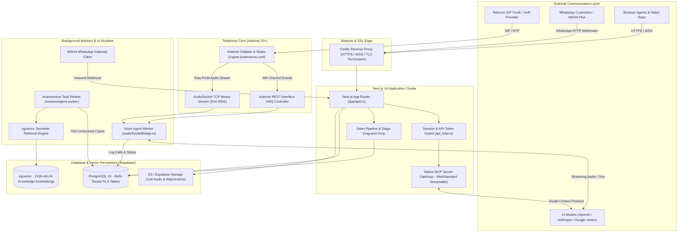
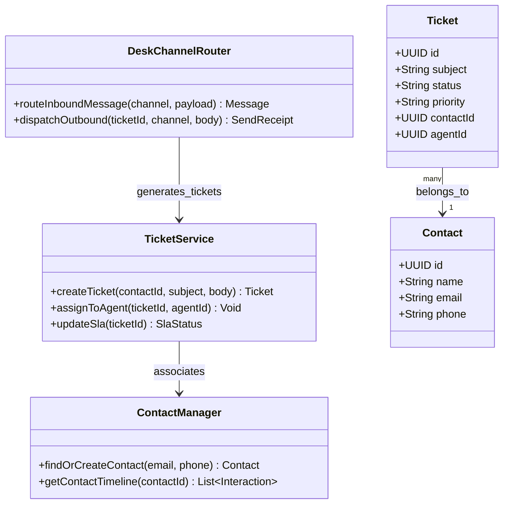
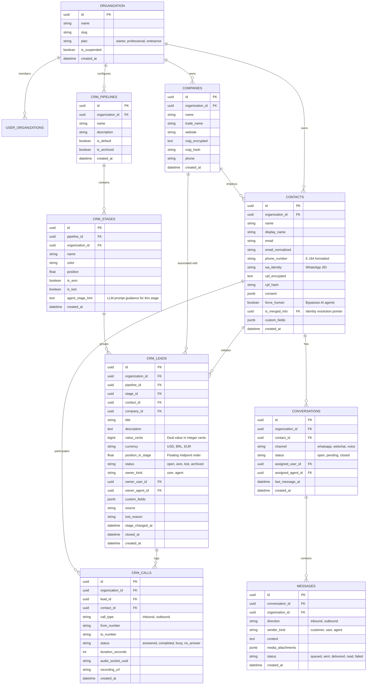
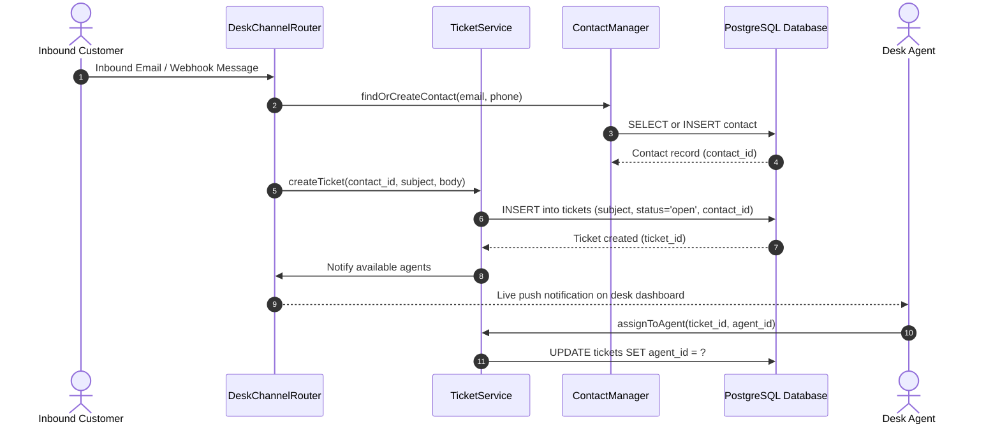

# DeskcommCRM - Architecture & Technical Wiki

> **Autonomous Sales Operating System with Native AI Agents, Asterisk AudioSocket Telephony & Model Context Protocol**  
> GitHub: [melgarafael/DeskcommCRM](https://github.com/melgarafael/DeskcommCRM.git) | Stack: TypeScript, Node.js 22+, Next.js 14, Supabase (PostgreSQL + pgvector), Asterisk PBX, WAHA WhatsApp, Caddy | License: MIT

---

## 1. Executive Summary & Value Proposition

**DeskcommCRM** is an open-source, AI-native sales operating system and customer relationship management engine engineered in TypeScript, Next.js 14, and Supabase. Tailored for high-velocity outbound dialers, inbound call centers, and automated WhatsApp sales channels, DeskcommCRM treats **AI agents as first-class team members** rather than passive chatbots. The system features dual-ownership pipelines where leads can be owned either by human sales reps or autonomous AI agents (`owner_kind: "user" | "agent"`), complete with native Model Context Protocol (MCP) server endpoints (`/api/mcp`), direct binary AudioSocket telephony streaming into LLMs, and deterministic Customer 360 identity resolution.

### Core Problems Solved
- **High-Latency Telephony for AI Voice**: Solves sluggish VoIP response latency by discarding lossy WebRTC mixing bridges in favor of direct TCP binary audio streaming via Asterisk's **AudioSocket** (`workers/voice-agent`), connecting caller audio directly to speech-to-text and streaming LLM pipelines in milliseconds.
- **AI-to-Human Pipeline Handoff**: Overcomes rigid bot boundaries with a native handoff engine (`lib/mcp/tools/handoff.ts`), allowing AI agents to qualify prospects, schedule appointments, and smoothly escalate to live human reps (`force_human: true`) with full conversational transcripts.
- **Standardized AI Agent Access (MCP)**: Implements an official Model Context Protocol server at `/api/mcp`, enabling Claude, OpenAI, and Gemini agents to invoke CRM tools (`leads_update`, `conversations_send`, `agendamento_criar`) with structured JSON-RPC 2.0 validation.
- **Deterministic Identity Resolution**: Eliminates duplicate customer records by automatically linking WhatsApp contacts, web leads, and inbound telephone callers through E.164 phone normalization, cryptographic CPF hashing, and deterministic merge pointers (`is_merged_into`).
- **Multi-Tenant Security & LGPD Compliance by Design**: Enforces strict database Row-Level Security (RLS) policies per tenant (`organization_id`), encrypted sensitive customer columns via PostgreSQL `pgcrypto`, and automated right-to-be-forgotten redaction cascades.

---

## 2. High-Level System Architecture

DeskcommCRM features an event-driven, multi-tenant architecture designed for self-hosted or cloud deployments. Incoming telecom traffic from SIP trunks routes through Asterisk PBX and AudioSocket TCP streams, while web traffic and webhooks terminate at a Caddy reverse proxy before reaching the Next.js 14 application and Supabase PostgreSQL.



---

### 2.1 Core Domain & Service Class Architecture



---

## 3. Technology Stack & Key Dependencies

- **Language & Runtime**: TypeScript 5.5+, Node.js 22+ (ESM native, strict mode)
- **Application Framework**: Next.js 14+ (App Router, Server Actions, Route Handlers, React Server Components)
- **Database & Extensions**: PostgreSQL 16+ via Supabase:
  - `vector`: 1536-dimensional embeddings for RAG semantic search
  - `pgcrypto`: Deterministic AES encryption for sensitive customer identifiers (CPF/CNPJ)
  - `uuid-ossp`: UUID generation for all primary keys
  - Row-Level Security (RLS) on all multi-tenant tables
- **Telephony & VoIP Engine**:
  - Asterisk PBX 20+ with Asterisk REST Interface (ARI)
  - AudioSocket binary audio streaming over pure TCP (bypassing WebRTC mixing jitter)
  - PJSIP SIP stack for external VoIP trunk registration
- **Artificial Intelligence & Agents**:
  - Model Context Protocol: `@modelcontextprotocol/sdk` ^1.32
  - LLM SDK: Vercel AI SDK (`@ai-sdk/openai`, `@ai-sdk/anthropic`, `@ai-sdk/google`)
  - Schema Validation: Zod 3.23+
- **Messaging & Channels**: WAHA Plus (WhatsApp HTTP API), Meta Cloud API webhooks
- **Edge Reverse Proxy**: Caddy 2 (automated Let's Encrypt certificates, WebSocket reverse proxying)
- **Frontend Architecture**: TailwindCSS, Radix UI Primitives, `@hello-pangea/dnd` (accessible drag-and-drop Kanban), Phosphor Icons, Sentry

---

## 4. Repository Layout & Key Modules

```
DeskcommCRM/
├── app/                              # Next.js App Router root
│   ├── api/
│   │   ├── mcp/                      # Official Model Context Protocol (MCP) server route
│   │   └── v1/                       # RESTful API endpoints
│   │       ├── leads/                # Lead creation, pipeline stages, reordering
│   │       ├── contacts/             # Customer 360, phone normalization, merge endpoints
│   │       ├── companies/            # B2B Account entities
│   │       ├── calls/                # Asterisk call logs, recordings, CDR
│   │       ├── voice/                # AI Voice agent session initiation & events
│   │       └── webhooks/             # WAHA (WhatsApp), Nuvemshop, and Meta Ads webhooks
│   └── (dashboard)/                  # UI dashboard pages (Kanban, Inbox, Customers, Analytics)
├── asterisk/                         # Asterisk PBX configurations
│   ├── extensions.conf               # Stasis and AudioSocket dialplans
│   ├── pjsip.conf.example            # SIP trunk and WebRTC endpoint definitions
│   └── ari.conf.example              # Asterisk REST Interface credentials
├── lib/                              # Core business logic and libraries
│   ├── mcp/                          # MCP server implementation
│   │   ├── server.ts                 # MCP tool registry and JSON-RPC router
│   │   ├── auth.ts                   # Bearer token validation and tenant scoping
│   │   └── tools/                    # Tool definitions (leads, contacts, conversations, handoff)
│   ├── ai/                           # RAG retriever, vector similarity search, prompts
│   ├── voip/                         # ARI client, AudioSocket bridge, call originator
│   ├── kanban/                       # Floating-point position calculations
│   └── database.types.ts             # Complete TypeScript types generated from Supabase
├── workers/                          # Standalone long-running daemon processes
│   ├── voice-agent/                  # Real-time AudioSocket voice bridge to speech/LLM
│   └── agent-worker/                 # Autonomous lead triage and background follow-up worker
├── supabase/
│   └── migrations/                   # PostgreSQL DDL migrations, RLS policies, vector schemas
├── caddy-sites/                      # Caddy reverse proxy templates
└── Dockerfile                        # Multi-stage production container build
```

---

## 5. Core Features & Capabilities

### 5.1 Native Model Context Protocol (MCP) Server (`/api/mcp`)
DeskcommCRM is built ground-up for the agentic era. Located at `app/api/mcp/route.ts`, the system runs a stateless, streaming HTTP MCP transport using `@modelcontextprotocol/sdk`:
- External AI models (such as Claude Desktop, Cursor, or autonomous background workers) authenticate via Bearer tokens mapped to `api_tokens`.
- Exposes structured tools including `leads_create`, `leads_move_stage`, `contacts_get_history`, `conversations_send_message`, `agendamento_criar`, and `handoff_to_human`.
- Automatically enforces tenant isolation: an AI agent can only read or mutate records within its authenticated `organization_id`.

### 5.2 Real-Time AudioSocket Telephony & Low-Latency AI Voice Agents
Traditional CRM telephony bridges WebRTC through Asterisk mixing conferences, causing latency, packet loss, and audio clipping when paired with voice AI. DeskcommCRM completely redesigns this pipeline:
- Inbound and outbound phone calls enter Asterisk's `Stasis` application (`asterisk/extensions.conf`).
- The call is immediately handed off to an **AudioSocket** (`workers/voice-agent/audioSocketBridge.ts`) which streams bidirectional 16-bit 8kHz raw PCM audio over a pure TCP connection directly into the voice worker.
- The voice worker feeds audio into streaming speech-to-text, queries the tenant's RAG knowledge base (`ai_chunks`), generates streaming LLM responses, and streams synthetic voice back through the AudioSocket with sub-second latency.

### 5.3 Deterministic Customer 360 & Identity Resolution
Customer identities often fragment across phone calls, WhatsApp numbers, and web forms. DeskcommCRM resolves this with an automated identity resolver:
- Normalizes all incoming phone numbers into E.164 format.
- Uses `pgcrypto` to hash and encrypt national identification numbers (`cpf_encrypted`, `cpf_hash`).
- When a secondary channel reveals a common identifier, the system executes `is_merged_into` link updates, combining lead timelines, chat transcripts, and purchase histories under a single canonical contact.

### 5.4 Dual-Ownership Sales Pipelines (`owner_kind`)
In DeskcommCRM, sales leads are not restricted to human assignees. The `crm_leads` schema incorporates:
- `owner_kind`: Enum (`"user"` for human reps, `"agent"` for autonomous AI agents).
- `owner_agent_id`: References the specific AI persona (`ai_agents`) responsible for automated qualification.
- `agent_stage_hint`: A prompt instruction embedded directly in `crm_stages` (e.g., *"In this stage, verify company employee count and budget before booking a demo"*), dynamically guiding the AI's conversational strategy.

### 5.5 Floating-Point Kanban Position Calculation
To prevent catastrophic database deadlocks and slow queries when dragging cards on the sales Kanban board, DeskcommCRM uses floating-point stage positioning (`position_in_stage: number`):
- Instead of re-indexing every card in a column (`UPDATE crm_leads SET position = position + 1`), dragging a card between two existing cards calculates a midpoint value:
  $$\text{position} = \frac{\text{position}_{\text{prev}} + \text{position}_{\text{next}}}{2}$$
- Updates execute in $O(1)$ time with a single row update, eliminating database write contention across concurrent users.

### 5.6 WhatsApp Multi-Session Orchestration (WAHA Plus)
Integrates directly with self-hosted WAHA (WhatsApp HTTP API) instances. Each sales representative or company department can connect independent WhatsApp numbers (`channel_sessions`). Incoming messages trigger real-time updates via Supabase Realtime and can be handled concurrently by human agents or automated AI co-pilots.

---

## 6. Data Models & Schema Architecture

DeskcommCRM features a multi-tenant relational schema enforced via PostgreSQL Row-Level Security.



### Core Schema Entity Details
1. **`crm_leads`**:
   - `value_cents`: Stores financial values as integers to eliminate IEEE-754 floating point rounding discrepancies.
   - `position_in_stage`: Floating-point numeric representation enabling $O(1)$ drag-and-drop reordering.
   - `owner_kind` and `owner_agent_id`: Explicit schema recognition of AI agents as deal owners.
2. **`contacts`**:
   - Encrypted PII (`cpf_encrypted`) via PostgreSQL `pgcrypto`.
   - `is_merged_into`: Canonical pointer for deterministic identity resolution.
   - `force_human`: Hard Boolean flag that halts AI conversational agents immediately when triggered.
3. **`crm_stages`**:
   - `agent_stage_hint`: Injects stage-specific system prompts directly into AI agent reasoning loops.

---

### 6.1 Comprehensive Database Schema Specification

DeskcommCRM persists customer desk interactions and support tickets within PostgreSQL with indexing on ticket statuses and agent assignments.

#### Table: `tickets`
Central helpdesk and sales enquiry tickets.

| Column | Type | Constraints | Default | Description |
| :--- | :--- | :--- | :--- | :--- |
| `id` | `UUID` | `PRIMARY KEY` | `gen_random_uuid()` | Unique ticket record ID |
| `subject` | `VARCHAR(255)` | `NOT NULL` | - | Subject line / issue summary |
| `status` | `VARCHAR(50)` | `NOT NULL` | `'open'` | Lifecycle state (`open`, `pending`, `resolved`, `closed`) |
| `priority` | `VARCHAR(50)` | `NOT NULL` | `'normal'` | Urgency (`low`, `normal`, `high`, `urgent`) |
| `contact_id` | `UUID` | `NOT NULL, FK -> contacts(id)` | - | Submitting customer profile |
| `agent_id` | `UUID` | `NULLABLE, FK -> users(id)` | `NULL` | Assigned support representative |
| `created_at` | `TIMESTAMPTZ` | `NOT NULL` | `NOW()` | Ingestion timestamp |

*Indexes:* `idx_tickets_status` (`(status)`), `idx_tickets_contact` (`(contact_id)`).

---

#### Table: `contacts`
Customer directory profiles linked across omnichannel channels.

| Column | Type | Constraints | Default | Description |
| :--- | :--- | :--- | :--- | :--- |
| `id` | `UUID` | `PRIMARY KEY` | `gen_random_uuid()` | Contact profile ID |
| `name` | `VARCHAR(255)` | `NOT NULL` | - | Customer full name |
| `email` | `VARCHAR(255)` | `NOT NULL, UNIQUE` | - | Primary email address |
| `phone` | `VARCHAR(50)` | `NULLABLE` | `NULL` | Telephone contact |
| `created_at` | `TIMESTAMPTZ` | `NOT NULL` | `NOW()` | Registration timestamp |

*Indexes:* `idx_contacts_email` (`UNIQUE (email)`).

---

## 7. API Architecture, Webhooks & Key Endpoints

DeskcommCRM exposes a modern Next.js 14 REST API and an official streaming Model Context Protocol (MCP) server.

### Key Endpoints

| HTTP Method | Endpoint | Description |
|:---|:---|:---|
| `POST` | `/api/mcp` | Model Context Protocol JSON-RPC 2.0 endpoint for external AI agents |
| `GET` | `/api/v1/leads` | List leads with pipeline, stage, and owner filters |
| `POST` | `/api/v1/leads` | Create a lead with associated contact and company references |
| `PUT` | `/api/v1/leads/{id}/stage` | Update lead pipeline stage and Kanban floating position |
| `POST` | `/api/v1/contacts/resolve` | Deterministic identity resolution matching phone and document |
| `POST` | `/api/v1/calls/originate` | Trigger Asterisk outbound call via ARI and AudioSocket |
| `POST` | `/api/v1/webhooks/waha` | Inbound WhatsApp webhook receiver for WAHA Plus |
| `POST` | `/api/v1/ai/rag/query` | Perform vector similarity search against knowledge chunks |

### Sample Request: MCP Tool Invocation (`POST /api/mcp`)
```json
{
  "jsonrpc": "2.0",
  "id": "req-9841",
  "method": "tools/call",
  "params": {
    "name": "leads_move_stage",
    "arguments": {
      "lead_id": "8d39f4a1-b852-473d-9d4e-d01878ec9012",
      "stage_id": "4b611e92-7489-4b68-bf09-c121e737c355",
      "summary": "Prospect confirmed budget of $50,000; advancing to Proposal stage."
    }
  }
}
```

### Sample Response: MCP Tool Invocation
```json
{
  "jsonrpc": "2.0",
  "id": "req-9841",
  "result": {
    "content": [
      {
        "type": "text",
        "text": "Lead successfully moved to Proposal stage. Updated stage hint: 'Present enterprise pricing tier and schedule technical review.'"
      }
    ]
  }
}
```

### Sample Payload: Inbound WAHA WhatsApp Webhook (`POST /api/v1/webhooks/waha`)
```json
{
  "event": "message",
  "session": "sales-team-number-1",
  "payload": {
    "id": "wamid.HBgLNTU",
    "from": "5511999998888@c.us",
    "body": "Hello, I want to see a demonstration of your sales software.",
    "timestamp": 1729770000,
    "hasMedia": false
  }
}
```

---

### 7.5 End-to-End Operational Lifecycle Sequence

The following sequence details how DeskcommCRM ingests inbound messages, creates tickets, and alerts agents.



---

## 8. Strategic Value & Takeaways for MarketingStudio

### Reusable Architectural Patterns
1. **Native Model Context Protocol (MCP) Server Integration**:
   - DeskcommCRM’s `/api/mcp` endpoint demonstrates how to expose CRM operations directly to AI models using the open standard. MarketingStudio should build a first-class MCP server so autonomous marketing and sales agents can read campaigns, fetch qualified leads, move deal stages, and schedule meetings through standardized tool calls.
2. **Dual Human/Agent Pipeline Ownership (`owner_kind`)**:
   - Rather than treating AI agents as external chat widgets, DeskcommCRM treats them as actual CRM users (`owner_kind: "user" | "agent"`). MarketingStudio can implement this pattern so AI agents can be assigned inbound leads directly, conduct automated outreach, qualify prospects, and transfer ownership to human account executives once ready.
3. **Floating-Point Stage Positioning (`position_in_stage`)**:
   - Using floating midpoints rather than sequential integer arrays enables instant $O(1)$ Kanban drag-and-drop operations with zero database locking. MarketingStudio should implement this mathematical reordering pattern across its sales pipeline and marketing workflow boards.
4. **Binary AudioSocket Telephony Streaming**:
   - For real-time voice applications, avoiding WebRTC conference bridges in favor of direct AudioSocket TCP binary streams reduces latency to near-instantaneous levels. If MarketingStudio implements outbound AI phone dialing, DeskcommCRM's Asterisk AudioSocket architecture provides the exact production blueprint.
