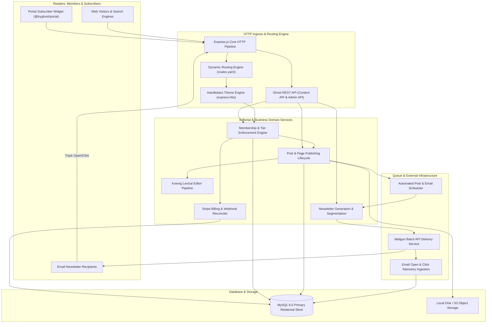
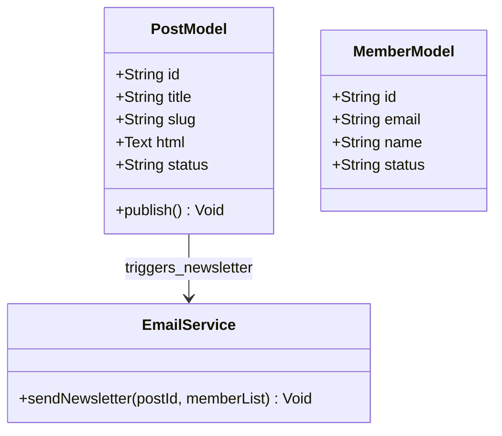
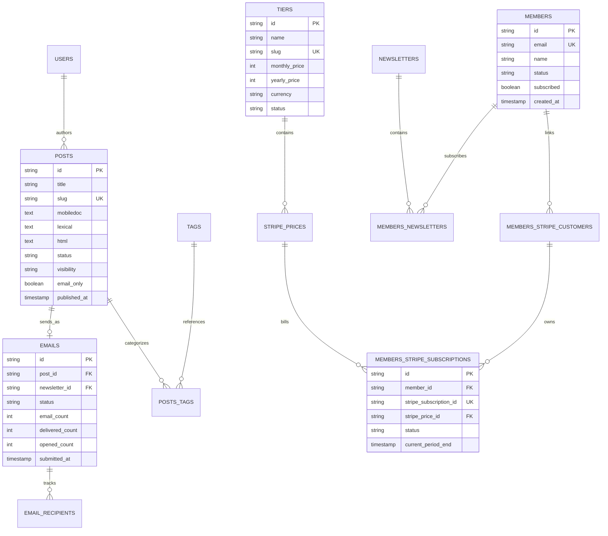
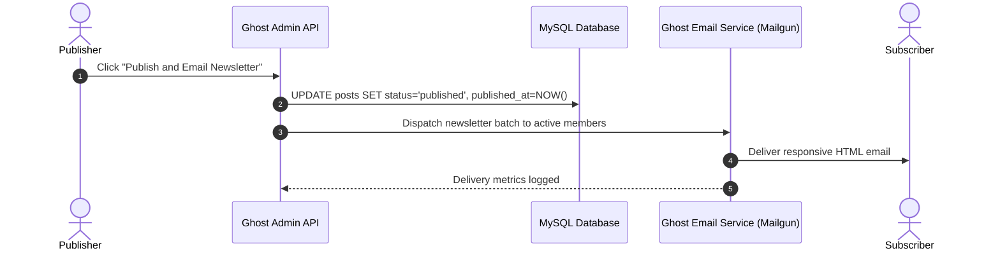

# Ghost - Architecture & Technical Wiki

> **Professional Publishing Platform, Membership Monetization Engine & Enterprise Newsletter Delivery Monorepo**  
> GitHub: [TryGhost/Ghost](https://github.com/TryGhost/Ghost.git) | Stack: Node.js (v20/v22), Express, Bookshelf/Knex ORM, MySQL 8 / SQLite, React / Ember, Mailgun API, Stripe Billing | License: MIT

---

## 1. Executive Summary & Value Proposition

**Ghost** is the premier open-source professional publishing platform, headless content management system, and creator monetization ecosystem engineered in **Node.js**, **Express**, and **Bookshelf.js / Knex.js**, backed by **MySQL 8.0** and **SQLite 3**. Trusted by world-class publications, high-growth startups, and independent writers, Ghost provides a unified, production-ready alternative to fragmented WordPress, Substack, and Medium setups.

Ghost integrates three traditionally disconnected systems into an atomic publishing pipeline: an advanced block-based document editor (**Koenig Lexical**), a multi-tier paid membership and subscription engine backed by **Stripe Connect & Stripe Billing**, and a high-volume email newsletter dispatch pipeline natively integrated with **Mailgun**.

### Core Problems Solved
- **Content-to-Newsletter Disconnect**: Eliminates the operational friction of copying blog posts into external email service providers (Mailchimp/Klaviyo) by converting posts directly into optimized responsive email newsletters with open and click tracking.
- **Paywall & Monetization Fragmentation**: Replaces complex third-party paywall plugins with native, database-level member access tiers (`Tier`, `StripePrice`, `StripeSubscription`), supporting monthly/annual recurring revenue, trials, and promotional discount offers.
- **Modern Extensible Editing Experience**: Powers content creation through Koenig Lexical—a custom editor built on Meta's Lexical framework supporting cards for dynamic images, markdown, HTML, video, callouts, and email-only snippets.
- **Declarative Dynamic Routing**: Enables deep publication customization via a declarative `routes.yaml` file that specifies collections, channels, taxonomy permalinks, and custom theme template mappings without editing core code.
- **Developer-First Headless Architecture**: Exposes complete Content and Admin REST APIs protected by JWT and API Keys, enabling decoupled Next.js/Gatsby frontends while preserving the native Ghost editing UI.

---

## 2. High-Level System Architecture

Ghost operates as a **Modular Monorepo Application** orchestrated via Nx and PNPM. The backend core (`ghost/core`) coordinates incoming HTTP requests, content rendering via Handlebars themes, and REST API access, while specialized frontend packages (`@tryghost/admin`, `@tryghost/portal`, `@tryghost/koenig-lexical`) deliver reactive user interfaces.



### Architectural Lifecycle of Publishing & Newsletter Dispatch
1. **Authoring & Lexical Card Assembly**: An author composes content in `@tryghost/admin` using Koenig Lexical. The document state is captured as a structured JSON abstract syntax tree (AST). Cards can be tagged with visibility modifiers (`email-only`, `web-only`, or `paid-members-only`).
2. **Post Publishing & Access Control**: Publishing triggers state validation in `PostService`. Posts are assigned visibility scopes (`public`, `members`, `paid`, or specific `tiers`). If scheduled, Ghost's internal job scheduler registers a timer for future publication.
3. **Handlebars Content Rendering**: For web visitors, Handlebars templates execute content helpers (e.g., `{{#if @member}}` or `{{content}}`). If a visitor lacks the requisite tier access, content is truncated and a paywall banner is rendered prompting membership checkout via `@tryghost/portal`.
4. **Newsletter Batching & Mailgun Transmission**: If configured to "Publish and Email", `NewsletterEngine` renders an email-optimized HTML payload from the Lexical tree. It queries the `members` table for active subscribers matching the target tier segment, groups them into batches of 1,000, and submits them to the Mailgun API with individualized tracking tokens.
5. **Telemetry Aggregation**: Incoming webhooks from Mailgun record delivery, open, and click events, updating `EmailRecipient` rows to calculate publication engagement metrics.

---

### 2.1 Core Domain & Service Class Architecture



---

## 3. Technology Stack & Key Dependencies

- **Language & Runtime**: Node.js 20.x or 22.x LTS executing in strict ES module and CommonJS compatibility mode.
- **Web Application Framework**: Express.js 4.x handling routing, middleware chains, and static asset serving.
- **Database & Query Builders**: Knex.js (SQL query builder) and Bookshelf.js (relational ORM); MySQL 8.0+ in production, SQLite 3 for local development and CI testing.
- **Frontend Admin & Editor**: React 19 and Ember.js for administrative dashboards; Koenig Lexical (`@tryghost/koenig-lexical`) built on Meta's Lexical document engine.
- **Templating & Presentation**: `express-hbs` (Handlebars) executing semantic server-rendered themes.
- **Email Infrastructure & Payment Gateways**: Mailgun API (REST batch sending), Nodemailer (transactional emails), Stripe API (Subscriptions, Invoices, Webhooks).

---

## 4. Repository Layout & Key Modules

```
inspire/Ghost/
├── apps/                            # Frontend & Client Applications
│   ├── admin/                       # Ghost Admin SPA (Ember.js & React)
│   ├── portal/                      # Member signup, login & checkout modal SPA
│   ├── comments-ui/                 # Embedded reader comment widget
│   └── sodo-search/                 # Embedded publication search dialog
├── ghost/
│   ├── core/                        # Primary Ghost server codebase
│   │   ├── core/server/
│   │   │   ├── api/                 # Content API & Admin API controllers
│   │   │   ├── data/                # Database migrations, schema, and models
│   │   │   │   ├── models/          # Bookshelf models (Post, Member, Tier, Email)
│   │   │   │   └── schema/          # Database table specifications & default data
│   │   │   ├── services/            # Domain services
│   │   │   │   ├── email-analytics/ # Mailgun webhook telemetry & aggregation
│   │   │   │   ├── mail/            # Transactional & bulk email dispatching
│   │   │   │   ├── members/         # Membership auth, subscriptions & Stripe sync
│   │   │   │   ├── mega/            # Massive Email Generation & Delivery Engine
│   │   │   │   ├── routing/         # Dynamic route table parser & URL resolver
│   │   │   │   └── scheduling/      # Future publication timers
│   │   │   └── web/                 # Express route definitions & middleware
│   │   └── index.js                 # Server bootstrapper & process coordinator
├── packages/                        # Shared libraries and UI toolkits
│   ├── koenig-lexical/              # Rich document editor built on Lexical
│   ├── member-analytics/            # Member engagement scoring
│   ├── shade/                       # Design system and UI primitives
│   └── stripe/                      # Stripe API wrappers and webhook parsers
├── package.json                     # Monorepo dependency configuration
└── nx.json                          # Nx build and execution configuration
```

---

## 5. Core Features & Capabilities

### 5.1 Koenig Lexical Block Editor
Ghost replaces traditional monolithic textarea inputs with Koenig Lexical:
- Documents are stored as a JSON AST, ensuring structural integrity and multi-channel rendering fidelity.
- Native card architecture supports dynamic code snippets, audio embeds, responsive image galleries, file attachments, and customizable callout boxes.
- Supports card-level audience segmentation (e.g. an "Upgrade to Premium" card visible only to free members).

### 5.2 Membership Tiers, Paywalls & Stripe Billing
Monetization is embedded directly into the core publication model:
- **Tiers & Pricing**: Publishers configure multiple subscription tiers (`Tier`) with monthly and annual price points synchronized directly with Stripe Products and Prices.
- **Granular Access Control**: Content visibility is defined on a per-post basis (`public`, `members`, `paid`, `tiers`). The rendering engine filters Lexical AST nodes on the server, ensuring protected content is never leaked to unauthorized clients.
- **Self-Serve Portal**: `@tryghost/portal` provides an embeddable modal allowing readers to register, upgrade subscriptions, update payment cards, and manage newsletter preferences without leaving the article.

### 5.3 Massive Email Generation & Delivery Architecture (MEGA)
Ghost's internal email engine (MEGA) delivers newsletters at enterprise scale:
- Compiles the Lexical document into an inline-styled, email-client compliant HTML document optimized for Outlook, Apple Mail, and Gmail.
- Batches recipients into chunks of 1,000, sending personalized emails via Mailgun using recipient variables for individualized unsubscribes and open tracking.
- Tracks real-time open rates, click-through rates, and unsubscribes directly in the editorial analytics view.

### 5.4 Declarative Dynamic Routing via `routes.yaml`
Publishers have total architectural control over publication structure:
- Define distinct routing channels (e.g., `/podcast/`, `/tutorials/`) with dedicated pagination rules.
- Configure collection permalinks (e.g., `/{year}/{slug}/`) and custom taxonomy feeds.
- Control data loading (`data: page.home`) and redirect patterns natively without modifying web server reverse proxies.

---

## 6. Data Models & Schema Architecture



### Core Schema Definitions

#### `posts`
- `id` (varchar 24, PK): Nanoid unique identifier.
- `title` (varchar 2000): Post title.
- `slug` (varchar 191, Unique): Permalinks identifier.
- `lexical` (longtext): Serialized JSON AST generated by the Koenig Lexical editor.
- `visibility` (varchar 50): Access constraint (`public`, `members`, `paid`, `tiers`).
- `status` (varchar 50): Publication lifecycle (`draft`, `published`, `scheduled`, `sent`).

#### `members` & `tiers`
- `email` (varchar 191, Unique): Subscriber email address.
- `status` (varchar 50): Subscription standing (`free`, `paid`, `comped`).
- `monthly_price` / `yearly_price` (integer): Integer monetary cents for subscription tiers.

#### `emails` & `email_recipients`
- `post_id` (varchar 24, FK): Associated publication content.
- `email_count` (integer): Total recipients targeted in newsletter batch.
- `opened_count` (integer): Confirmed unique email opens.

---

### 6.1 Comprehensive Database Schema Specification

Ghost stores editorial publications and paid newsletter subscribers in MySQL / SQLite.

#### Table: `posts`
| Column | Type | Constraints | Default | Description |
| :--- | :--- | :--- | :--- | :--- |
| `id` | `VARCHAR(24)` | `PRIMARY KEY` | - | Post ID |
| `title` | `VARCHAR(2000)` | `NOT NULL` | - | Article title |
| `slug` | `VARCHAR(191)` | `NOT NULL, UNIQUE` | - | URL slug |
| `html` | `LONGTEXT` | `NULLABLE` | `NULL` | Rendered post HTML |
| `status` | `VARCHAR(50)` | `NOT NULL` | `'draft'` | State (`draft`, `published`, `scheduled`) |

*Indexes:* `idx_posts_slug` (`UNIQUE (slug)`), `idx_posts_status` (`(status)`).

---

#### Table: `members`
| Column | Type | Constraints | Default | Description |
| :--- | :--- | :--- | :--- | :--- |
| `id` | `VARCHAR(24)` | `PRIMARY KEY` | - | Member ID |
| `email` | `VARCHAR(191)` | `NOT NULL, UNIQUE` | - | Subscriber email |
| `status` | `VARCHAR(50)` | `NOT NULL` | `'free'` | Subscription tier (`free`, `paid`, `comped`) |

*Indexes:* `idx_members_email` (`UNIQUE (email)`).

---

## 7. API Architecture, Webhooks & Key Endpoints

Ghost exposes two decoupled REST APIs: **Content API** (read-only, public key) and **Admin API** (read/write, JWT token).

| Method | Endpoint | Description | Auth Scope |
| :--- | :--- | :--- | :--- |
| `GET`  | `/ghost/api/content/posts/` | Queries published posts, filters by tag or visibility | Content API Key |
| `GET`  | `/ghost/api/content/posts/{id}/` | Retrieves a single post by ID or slug with author data | Content API Key |
| `POST` | `/ghost/api/admin/posts/` | Creates or schedules a new post or newsletter | Admin JWT Token |
| `PUT`  | `/ghost/api/admin/posts/{id}/` | Updates post content, tags, or publishing status | Admin JWT Token |
| `GET`  | `/ghost/api/admin/members/` | Queries publication members and active subscription tiers | Admin JWT Token |
| `POST` | `/ghost/api/admin/webhooks/` | Registers an event webhook listener (e.g. `post.published`) | Admin JWT Token |

### Sample Payload: Post Creation (`POST /ghost/api/admin/posts/`)
```json
{
  "posts": [
    {
      "title": "Scaling Distributed Marketing Workflows",
      "slug": "scaling-distributed-marketing-workflows",
      "status": "published",
      "visibility": "paid",
      "lexical": "{\"root\":{\"children\":[{\"children\":[{\"detail\":0,\"format\":0,\"mode\":\"normal\",\"style\":\"\",\"text\":\"Marketing automation requires strict state machine determinism...\",\"type\":\"text\",\"version\":1}],\"direction\":\"ltr\",\"format\":\"\",\"indent\":0,\"type\":\"paragraph\",\"version\":1}],\"direction\":\"ltr\",\"format\":\"\",\"indent\":0,\"type\":\"root\",\"version\":1}}",
      "tags": [
        { "name": "Architecture", "slug": "architecture" }
      ]
    }
  ]
}
```

### Sample Response: Post Published
```json
{
  "posts": [
    {
      "id": "671aa820b91e4a00018f921a",
      "title": "Scaling Distributed Marketing Workflows",
      "slug": "scaling-distributed-marketing-workflows",
      "status": "published",
      "visibility": "paid",
      "url": "https://blog.marketingstudio.io/scaling-distributed-marketing-workflows/",
      "published_at": "2026-10-24T12:00:00.000Z"
    }
  ]
}
```

---

### 7.5 End-to-End Operational Lifecycle Sequence



---

## 8. Strategic Value & Takeaways for MarketingStudio

### Reusable Architectural Patterns
1. **Unified Content-and-Email Pipeline (MEGA)**: Traditional marketing stacks require publishing an article on a CMS and manually re-authoring the same message inside an email campaign builder. Ghost's pattern of maintaining a canonical document AST (Lexical) that compiles into both responsive web HTML and bulletproof email markup provides MarketingStudio with a unified content distribution model.
2. **Server-Side Paywall Token Truncation**: Ghost never leaks paywalled content to the browser and attempts to mask it with CSS overlays. The server truncates the Lexical AST prior to template rendering, rendering paid articles completely immune to inspect-element bypasses.
3. **Declarative Routing via `routes.yaml`**: The abstraction of routing rules into a version-controlled YAML configuration gives marketing operators full control over site structure, taxonomy URLs, and campaign redirects without requiring code deployments.

### Concrete Convergence Roadmap for MarketingStudio
- **Native Newsletter & Content Hub**: Incorporate Ghost's publishing and newsletter batching architecture into MarketingStudio, enabling agencies and businesses to publish content once and syndicate it across their blog and email subscribers automatically.
- **Paywalled Lead Magnets & Premium Content**: Utilize Ghost's `Tier` and `visibility` pattern to gate high-value educational whitepapers, video masterclasses, and software templates behind free email captures or paid member subscriptions.
- **Lexical Editor Integration**: Adopt Koenig Lexical as the primary rich text authoring component across MarketingStudio's blog, email broadcast, and landing page modules.
