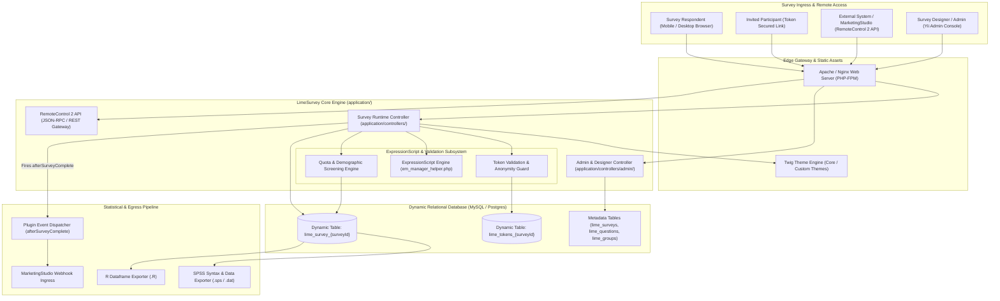
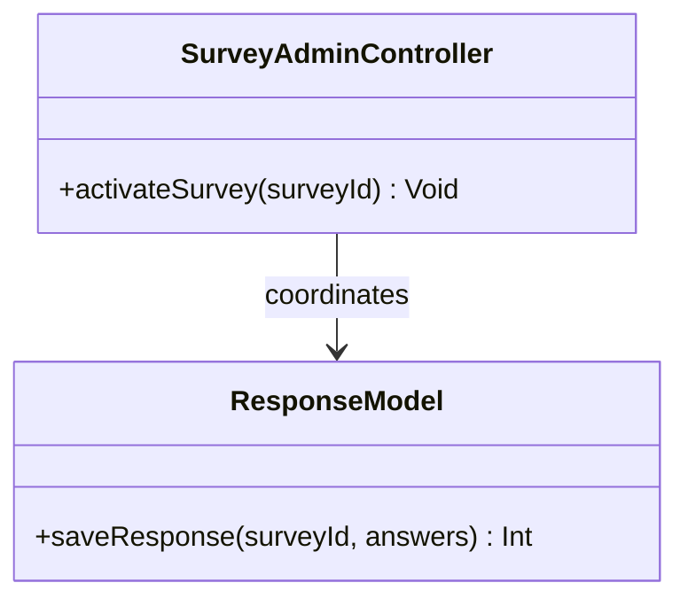
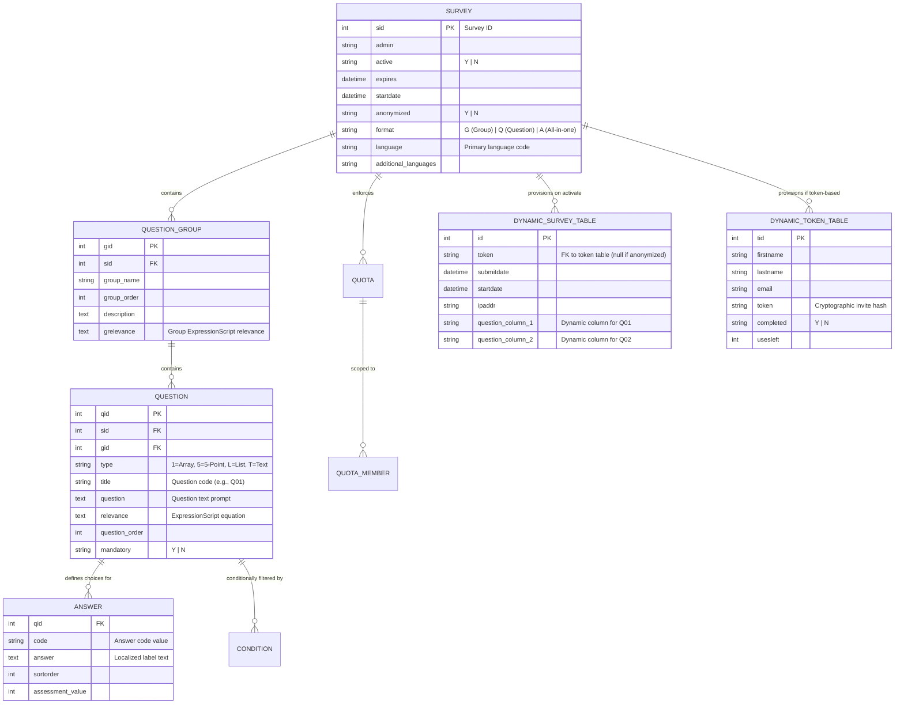

# LimeSurvey - Architecture & Technical Wiki

> **Enterprise-Grade Statistical Survey Engine, ExpressionScript Runtime & Multi-Lingual Research Platform**  
> GitHub: [LimeSurvey/LimeSurvey](https://github.com/LimeSurvey/LimeSurvey) | Stack: PHP 8.1+, Yii Framework, MySQL / MariaDB / PostgreSQL / MSSQL, Twig Templating, jQuery / Vanilla JS | License: GPLv2+

---

## 1. Executive Summary & Value Proposition

**LimeSurvey** is the gold-standard open-source statistical survey and research platform, widely deployed across academic institutions, enterprise market research firms, and governmental agencies. As an open alternative to Qualtrics, Confirmit, and SurveyMonkey, LimeSurvey provides complete sovereignty over sensitive questionnaire data, complex statistical sampling designs, and multi-lingual global deployments.

Unlike lightweight web form builders that fall short on complex survey methodology, LimeSurvey is specifically engineered for advanced research paradigms. It features the industry-leading **ExpressionScript Engine** (supporting micro-syntax relevance equations, dynamic mathematical scoring, and question piping), dynamic per-survey table generation in relational databases, closed-cohort participant token management with cryptographic anonymization, and direct export pipelines into statistical packages like SPSS, R, and Stata.

### Core Problems Solved
- **Complex Methodological Branching & Relevance Logic**: Replaces brittle nested if/else menus with declarative boolean equations (`relevance: "((Q1.NAOK == 'Y') and (Q2_SQ1.NAOK >= 4))"`), evaluated dynamically in real time.
- **Dynamic Relational Table Scaling**: Avoids generic EAV (Entity-Attribute-Value) anti-patterns by dynamically provisioning dedicated SQL tables (`lime_survey_{id}` and `lime_tokens_{id}`) upon survey activation, optimizing query plans for millions of responses.
- **Closed-Loop Anonymized Cohort Tracking**: Enforces strict participant token controls where invite tokens guarantee single-use access while cryptographically decoupling respondent identities from their recorded answer rows.
- **True Global Multi-Lingual Questionnaires**: Synchronizes question schemas across 80+ localized languages, allowing respondents to switch dialects mid-survey without desynchronizing data columns.
- **Direct Academic & Market Research Statistical Export**: Exports raw data directly formatted with SPSS syntax files (`.sps`), R statistical dataframes, CSV, and Excel without post-processing normalization.

---

## 2. High-Level System Architecture

LimeSurvey is built upon a modular MVC architecture utilizing the **Yii Framework** (ActiveRecord pattern), extensible Twig templating for presentation themes, and the **RemoteControl 2** JSON-RPC / REST API for headless orchestration.



### Architectural Lifecycle of an Activated Survey
1. **Dynamic Table Compilation**: When an administrator activates a survey, LimeSurvey executes DDL statements creating a dedicated table `lime_survey_{surveyId}`. Every question, array sub-question, and comment receives a dedicated typed SQL column (e.g., `1234X5X6SQ001`).
2. **Participant Token Ingress**: When closed-access mode is enabled, the participant arrives with a token (`limesurvey.org/index.php/{surveyId}?token={token}`). The `TokenAuthenticator` validates token status against `lime_tokens_{surveyId}`.
3. **ExpressionScript Runtime Execution**: As the respondent navigates through Question Groups, the client and server evaluate ExpressionScript syntax. Equations calculate real-time scores, hide irrelevant questions, and dynamically pipe text (e.g., replacing `{TOKEN:FIRSTNAME}` with the respondent’s actual name).
4. **Atomic Answer Persistence**: Upon submission, answers are committed directly into `lime_survey_{surveyId}`. If anonymized mode is toggled, the token table record is marked `completed: 'Y'` while all foreign key references between the token and the response ID are expunged.
5. **Statistical Export & Event Dispatch**: Data is immediately ready for export into SPSS or R data structures. The plugin event `afterSurveyComplete` executes registered webhook hooks, notifying external platforms like MarketingStudio.

---

### 2.1 Core Domain & Service Class Architecture



---

## 3. Technology Stack & Key Dependencies

- **Language & Runtime**: PHP 8.1 / 8.2 / 8.3 (PHP-FPM, CLI).
- **Core Framework**: **Yii 1.x / Yii 2 bridge** providing ActiveRecord, DB abstraction, and MVC routing.
- **Relational Databases Supported**:
  - MySQL 8.0+ / MariaDB 10.5+
  - PostgreSQL 13+
  - Microsoft SQL Server
- **Templating & Frontend Engines**:
  - **Twig 3**: Modern, sandboxed template engine for responsive survey themes.
  - jQuery, Bootstrap 5 / Vanilla JS for interactive matrix sliders and ranking widgets.
- **Expression & Mathematics Engine**:
  - `ExpressionManager`: LimeSurvey’s custom AST parser for syntax validation, logic branching, and dynamic score calculation.
- **Export & Document Libraries**:
  - `phpoffice/phpspreadsheet`: Excel and CSV document generation.
  - `tecnickcom/tcpdf`: PDF export generation.
- **Integration Protocols**:
  - RemoteControl 2 (JSON-RPC 2.0 / REST API).

---

## 4. Repository Layout & Key Modules

```
LimeSurvey/
├── application/
│   ├── config/                       # Database connections, security keys, Yii config
│   ├── controllers/                  # Core controllers (SurveyController.php)
│   │   ├── admin/                    # Survey administration, question editor, quotas
│   │   └── RemoteControl.php         # JSON-RPC 2.0 API gateway
│   ├── helpers/                      # Core helpers
│   │   ├── expressions/              # ExpressionScript engine (em_manager_helper.php)
│   │   └── export/                   # SPSS, R, CSV, and Excel export formatters
│   ├── models/                       # Yii ActiveRecord models
│   │   ├── Survey.php                # Master survey model & lifecycle management
│   │   ├── Question.php              # Question definitions, types, relevance equations
│   │   ├── QuestionGroup.php         # Question container blocks
│   │   ├── Answer.php                # Coded choices for multiple choice / matrix
│   │   ├── Participant.php           # Central participant database (CPDB)
│   │   ├── Token.php                 # Dynamic token table handler
│   │   └── Quota.php                 # Screening and completion caps
│   └── views/                        # Admin backend view templates
├── assets/                           # Bundled client scripts, CSS, and vendor assets
├── plugins/                          # Event-driven extension plugins (Webhooks, LDAP, SSO)
├── themes/
│   ├── survey/                       # Twig-based survey themes (fruity, vanilla, bootswatch)
│   └── admin/                        # Administrative dashboard themes
└── index.php                         # Public application entrypoint
```

---

## 5. Core Features & Capabilities

### 5.1 ExpressionScript Logic & Equation Engine
LimeSurvey’s core differentiator is ExpressionScript:
- **Relevance Equations**: Controls question and group visibility using raw micro-expressions (e.g., `is_empty(Q1) or Q2.value > 10`).
- **Dynamic Text Piping**: Pipes any answer, token attribute, or server variable into question descriptions (e.g., `"Earlier you indicated your primary challenge is {Q_CHALLENGE.shown}. How long has this affected your team?"`).
- **Inline Scoring Equations**: Computes complex indices (e.g., calculating SUS usability scores, NPS buckets, or weighted risk indices) live during the survey.

### 5.2 Dynamic Per-Survey Database Architecture
Unlike modern NoSQL or JSON-based form tools:
- Each active survey creates its own table: `lime_survey_{surveyId}`.
- Every question and matrix dimension maps to a dedicated column index.
- This relational purity guarantees maximum query execution speed when running statistical cross-tabulations across hundreds of thousands of submissions.

### 5.3 Closed-Loop Token Participant Management
- **Central Participant Database (CPDB)**: Maintains global contact cohorts across multiple research projects.
- **Cryptographic Token Anonymization**: When a survey is marked as anonymous, LimeSurvey records that token `XYZ` completed the survey (preventing second submissions), but writes the response data without storing the token in the response row.

### 5.4 Quota Screening & Routing
- Configures complex demographic quotas (e.g., restrict answers to exactly 250 Enterprise CTOs and 250 SMB Owners).
- When a quota is reached, subsequent respondents matching that demographic are gracefully terminated and redirected with an explanatory message.

---

## 6. Data Models & Schema Architecture

LimeSurvey’s schema combines static survey definition tables with dynamically generated survey response and token tables.



### Core Schema Invariants
1. **Dynamic Response Isolation**: Dynamic response tables `lime_survey_{sid}` only exist while `surveys.active == 'Y'`. Deactivating an active survey renames the table to an archive (`lime_old_survey_{sid}_{timestamp}`), preventing accidental loss of historical research data.
2. **Relevance Invariants**: Questions whose `relevance` equation evaluates to `false` automatically have their submitted values sanitized as `NULL` in the database to prevent statistical noise.
3. **Compound Key Answers**: The `lime_answers` table relies on a compound key of `(qid, code, language)` to support multi-language choice translations for a single question.

---

### 6.1 Comprehensive Database Schema Specification

#### Table: `lime_surveys`
| Column | Type | Constraints | Default | Description |
| :--- | :--- | :--- | :--- | :--- |
| `sid` | `INT` | `PRIMARY KEY` | - | Survey numeric ID |
| `active` | `VARCHAR(1)` | `NOT NULL` | `'N'` | Active flag |

---

## 7. API Architecture, Webhooks & Key Endpoints

LimeSurvey provides the **RemoteControl 2** API, accessible over JSON-RPC 2.0 or REST at `/index.php/admin/remotecontrol`.

### Key RemoteControl Endpoints (JSON-RPC Methods)

| Method Name | Parameters | Description |
|:---|:---|:---|
| `get_session_key` | `(username, password)` | Authenticates and returns a temporal session key |
| `add_survey` | `(sSessionKey, iSurveyID, sSurveyTitle, sSurveyLanguage)` | Programmatically provisions a new survey structure |
| `import_survey` | `(sSessionKey, sImportData, sImportDataType)` | Imports survey structure from LSS / XML / CSV definition |
| `activate_survey` | `(sSessionKey, iSurveyID)` | Compiles and executes DDL to provision response tables |
| `export_responses` | `(sSessionKey, iSurveyID, sDocumentType, sLanguageCode)` | Streams responses formatted as CSV, Excel, or SPSS syntax |
| `add_participants` | `(sSessionKey, iSurveyID, aParticipantData)` | Adds closed-cohort participant tokens and email invite queues |

### Sample JSON-RPC Request: Fetch Responses (`export_responses`)
```json
{
  "method": "export_responses",
  "params": [
    "sSessionKey_98214fa8120e",
    98124,
    "json",
    "en",
    "complete",
    "code",
    "short"
  ],
  "id": 1
}
```

### Sample Plugin Webhook Event (`afterSurveyComplete`)
```json
{
  "event": "afterSurveyComplete",
  "survey_id": 98124,
  "response_id": 4810,
  "submit_date": "2026-10-24 12:00:00",
  "token": "tok_99812401",
  "responses": {
    "NPS01": "9",
    "FEEDBACK": "Outstanding research fidelity and question piping.",
    "DEMO_ROLE": "Director of Product Analytics"
  }
}
```

---

### 7.5 End-to-End Operational Lifecycle Sequence

```mermaid
sequenceDiagram
    autonumber
    actor Participant as Participant
    participant Survey as LimeSurvey Engine
    participant DB as MySQL Database

    Participant->>Survey: Fill token & answers
    Survey->>DB: INSERT into lime_survey_1234
    Survey-->>Participant: Survey submitted
```

---

## 8. Strategic Value & Takeaways for MarketingStudio

### Reusable Architectural Patterns
1. **ExpressionScript Mathematical & Logic Parser**:
   - LimeSurvey’s model of evaluating inline relevance equations (`em_manager_helper.php`) provides an exceptional template for MarketingStudio’s advanced customer feedback and enterprise NPS assessments. Instead of building endless nested UI dropdowns for conditional logic, MarketingStudio can allow advanced power-users to write simple boolean formulas.
2. **SPSS / R Statistical Export Formatting**:
   - Incorporating standard statistical export metadata (variable labels, value labels, and SPSS syntax generation) allows MarketingStudio to pitch enterprise research and academic customers who require raw data feeds into data-science analysis tools.
3. **Cryptographically Anonymized Token Surveys**:
   - For sensitive employee feedback, internal culture reviews, and whistleblower questionnaires, MarketingStudio should adopt LimeSurvey’s pattern of tracking completion tokens while severing all database links between the token and the recorded answer row.
4. **Dynamic Table Scaling for Massive Datasets**:
   - When running continuous, long-running surveys collecting millions of responses, LimeSurvey’s dynamic table strategy demonstrates that provisioning dedicated relational tables circumvents the severe index-bloat and query bottlenecks associated with single multi-tenant tables.
