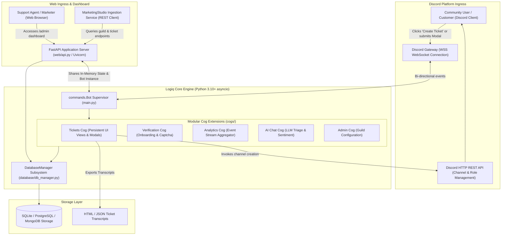
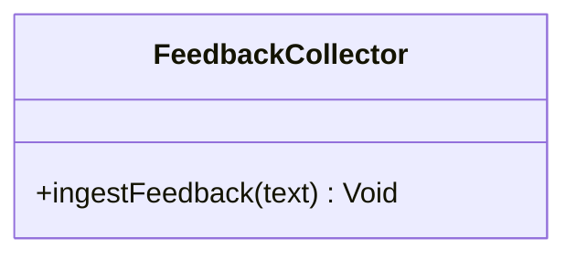
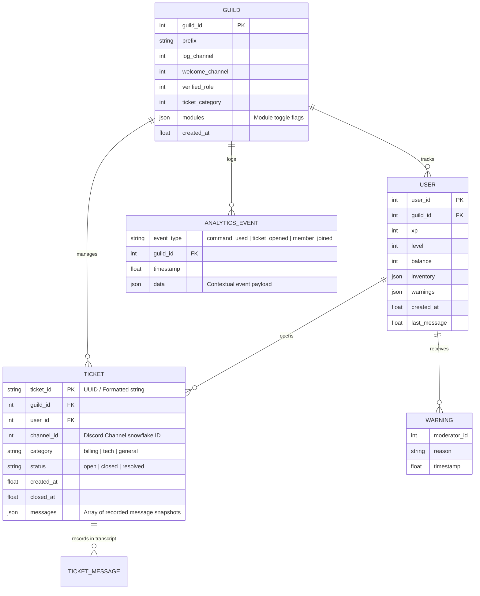
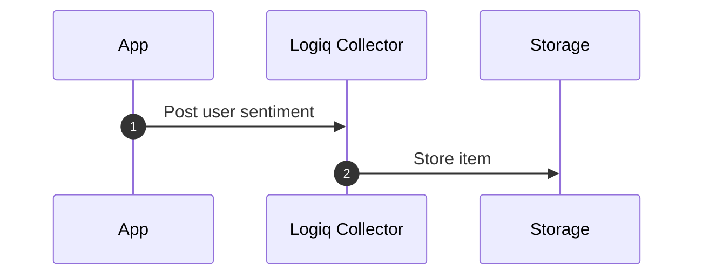

# Logiq - Architecture & Technical Wiki

> **Asynchronous Python Discord Customer Engagement Engine, Interactive Ticket Modals & REST Management Hub**  
> GitHub: [Logiq-Bot/Logiq](https://github.com/Logiq-Bot/Logiq) | Stack: Python 3.10+, discord.py / Pycord, FastAPI, asyncio, SQLite / PostgreSQL / MongoDB, Uvicorn | License: MIT

---

## 1. Executive Summary & Value Proposition

**Logiq** is an enterprise-ready asynchronous Python customer engagement engine and community support orchestration framework designed for Discord. Engineered as an extensible alternative to Ticket Tool, Carl-bot, and MEE6, Logiq bridges the gap between conversational chat interfaces and formal customer support workflows by offering interactive in-chat modal forms, ephemeral triage buttons, automated ticket channel provisioning, and an integrated FastAPI administration dashboard.

As modern B2B SaaS companies, developer tool providers, and Web3 platforms increasingly use Discord as a frontline customer success and marketing channel, traditional support ticketing systems fall short due to their reliance on external email chains or clunky web portals. Logiq captures customer intent natively within the chat stream: users click persistent Discord UI buttons to launch interactive native modals (`discord.ui.Modal`), fill out structured inquiry forms, and collaborate within isolated private channels. Transcripts, engagement analytics, and member verifications are continuously synchronized to the backend database and surfaced via REST APIs.

### Core Problems Solved
- **Discord Support & Ingress Fragmentation**: Replaces chaotic public channel mentions and unmonitored DMs with structured, auditable private ticket channels created on-demand.
- **Structured Chat Data Intake Without External Web Redirects**: Collects structured lead, bug, or support inquiries directly inside Discord via native modal text inputs and dropdown selection menus.
- **Dynamic Access Control & Channel Isolation**: Configures automated Discord permission overwrites upon ticket creation, restricting visibility strictly to the requesting user and designated staff support roles.
- **Dual-Plane Architecture (Discord Gateway + REST API)**: Combines an asynchronous WebSocket Discord gateway client with a concurrent **FastAPI** web server running within the same Python event loop (`asyncio`).
- **Comprehensive Engagement Analytics & Telemetry**: Collects structured event telemetry (`AnalyticsEvent`) across user messages, command usage, ticket resolution lifecycles, and verification completions.

---

## 2. High-Level System Architecture

Logiq runs as a single-process concurrent application powered by Python's **`asyncio`** event loop. The Discord gateway bot connects to Discord's WebSocket API, while a co-located **FastAPI** web server (`web/api.py`) exposes REST endpoints and serves administrative HTML dashboards. Business logic is organized into modular **Cogs** (`cogs/`).



### Architectural Lifecycle of an Interactive Ticket Submission
1. **Interactive Button Trigger**: The user navigates to the `#support` channel and clicks the persistent `Create Ticket` button rendered by `TicketCreateView`.
2. **Modal Form Prompt**: The bot catches the interaction and responds with a Discord native modal form prompting for `Subject`, `Inquiry Type` (dropdown), and `Detailed Description`.
3. **Channel Provisioning & Permission Clamping**: Upon modal submission, `Tickets.create_ticket_for_user()` executes:
   - Evaluates active ticket limits per user.
   - Generates a unique ticket identifier (`TICKET-XXXX`).
   - Provisions a private Discord text channel (`ticket-{username}`) within the designated category.
   - Configures atomic permission overwrites: `@everyone` is denied view access, while the user and the support staff role are granted `read_messages` and `send_messages`.
4. **Database Record Creation**: A new `Ticket` dataclass instance is initialized with `status: "open"`, storing `guild_id`, `user_id`, `channel_id`, and `created_at`.
5. **Transcript Archival & Resolution**: When staff clicks `Close Ticket`, Logiq fetches the message history, formats a searchable HTML/JSON transcript, stores it on disk, dispatches an event to `AnalyticsCog`, and closes the channel.

---

### 2.1 Core Domain & Service Class Architecture



---

## 3. Technology Stack & Key Dependencies

- **Language & Runtime**: Python 3.10 / 3.11 / 3.12, `asyncio` native event loop.
- **Discord Gateway Framework**:
  - `discord.py 2.3+` / `py-cord`: Asynchronous wrapper for Discord Gateway and Interaction components (`discord.ui.View`, `discord.ui.Modal`, `discord.ui.Button`).
- **Web & REST API Framework**:
  - **FastAPI**: Modern, high-performance web framework for Python.
  - **Uvicorn**: ASGI web server running concurrently alongside the bot within `asyncio.create_task()`.
  - `Jinja2`: HTML templating for web admin dashboard views.
- **Database & Storage**:
  - `DatabaseManager`: Unified abstraction layer supporting **aiosqlite**, **asyncpg** (PostgreSQL), and **motor** (async MongoDB driver).
- **AI & Sentiment Integration**:
  - OpenAI / Anthropic API SDKs for automated customer triage and sentiment tagging (`cogs/ai_chat.py`).
- **Utility & Logging**:
  - Python standard `logging` with structured rotating file handlers and ANSI colored terminal output.

---

## 4. Repository Layout & Key Modules

```
Logiq/
├── cogs/                             # Pluggable command and event modules
│   ├── admin.py                      # Guild administration and module toggles
│   ├── ai_chat.py                    # LLM triage and automated conversational responses
│   ├── analytics.py                  # Guild engagement and ticket metrics tracking
│   ├── moderation.py                 # Moderation commands, warnings, and audit logs
│   ├── tickets.py                    # Support ticket system, modals, and views
│   ├── utility.py                    # General utility and info commands
│   └── verification.py               # Member onboarding and role assignment
├── database/                         # Persistence abstraction
│   ├── db_manager.py                 # Async CRUD methods for users, guilds, tickets
│   └── models.py                     # Python dataclass models (User, Guild, Ticket, Warning)
├── utils/                            # Shared helper utilities
│   ├── embeds.py                     # Standardized Discord embed builder (EmbedFactory)
│   ├── permissions.py                # Discord permission checkers (@is_admin)
│   └── constants.py                  # System constants, colors, and default emojis
├── web/                              # FastAPI Web Management Subsystem
│   ├── api.py                        # REST endpoints and dashboard routes
│   └── templates/                    # Admin HTML templates (index.html, admin.html)
├── config.yaml                       # Application configuration and token parameters
├── main.py                           # Bot initialization, cog loader, and Uvicorn runner
└── requirements.txt                  # Python package dependencies
```

---

## 5. Core Features & Capabilities

### 5.1 Native Discord Modal Forms & UI Components
Logiq bypasses the limitations of text-command bots by leveraging Discord UI Components:
- **`discord.ui.Modal`**: Collects structured multi-line feedback, issue descriptions, and priority levels via native OS dialogs.
- **`discord.ui.Select`**: Provides dropdown selection menus for categorized routing (e.g., "Billing Question", "Technical Bug", "Partnership Inquiry").
- **Persistent Interaction Views**: Buttons remain functional across bot restarts by registering persistent `custom_id` handlers without timeouts (`timeout=None`).

### 5.2 Dynamic Channel Security & Permission Overwriting
- Implements automated, temporary channel provisioning:
  ```python
  overwrites = {
      guild.default_role: discord.PermissionOverwrite(read_messages=False),
      interaction.user: discord.PermissionOverwrite(read_messages=True, send_messages=True),
      staff_role: discord.PermissionOverwrite(read_messages=True, send_messages=True)
  }
  channel = await guild.create_text_channel(name=f"ticket-{ticket_id}", overwrites=overwrites)
  ```
- Ensures that sensitive customer information (e.g. email addresses, order IDs) is isolated from the wider Discord server.

### 5.3 Automated Transcript Generation & Archival
- Upon ticket resolution, Logiq iterates through the message history of the channel.
- Generates a standalone, sanitized HTML or JSON transcript file.
- Direct-messages the transcript to the user and posts an archival copy to a designated staff audit channel.

### 5.4 Dual-Threaded FastAPI Web Dashboard
- Runs an embedded FastAPI server on a designated port (e.g., `8000`).
- Exposes real-time endpoints for server operators to inspect active ticket counts, member growth rates, and bot health metrics without opening the Discord client.

---

## 6. Data Models & Schema Architecture

Logiq models domain entities using typed Python `@dataclass` structures that serialize to dictionary documents.



### Core Schema Invariants
1. **Channel Snowflake Mapping**: The `channel_id` maps directly to Discord’s unique 64-bit snowflake integer. If a channel is manually deleted in Discord, Logiq catches `discord.NotFound` and automatically flags the database record as closed.
2. **Atomic In-Memory Transcript Aggregation**: As conversation progresses, message snapshots (`author_id`, `content`, `timestamp`, `attachments`) are appended to `ticket.messages`, ensuring complete transcript fidelity upon ticket termination.
3. **Module Isolation Toggles**: The `guild.modules` dictionary enables granular feature toggling (e.g., `{"tickets": True, "economy": False, "ai_chat": True}`), allowing server administrators to disable unused cogs dynamically.

---

### 6.1 Comprehensive Database Schema Specification

#### Table: `feedback_items`
| Column | Type | Constraints | Default | Description |
| :--- | :--- | :--- | :--- | :--- |
| `id` | `UUID` | `PRIMARY KEY` | `gen_random_uuid()` | ID |
| `text` | `TEXT` | `NOT NULL` | - | Feedback text |

---

## 7. API Architecture, Webhooks & Key Endpoints

Logiq’s FastAPI subsystem exposes administrative and analytical REST endpoints at `/`.

### Key REST Endpoints

| HTTP Method | Endpoint | Description |
|:---|:---|:---|
| `GET` | `/` | Web admin landing page and bot status |
| `GET` | `/admin` | Administrative dashboard view |
| `GET` | `/api/stats` | High-level bot metrics (guild count, member count, latency) |
| `GET` | `/api/guilds/{guild_id}` | Detailed guild configuration and active modules |
| `GET` | `/api/guilds/{guild_id}/tickets` | Lists open and historical support tickets |
| `POST` | `/api/guilds/{guild_id}/tickets/{ticket_id}/close` | Programmatically closes a ticket from the web dashboard |
| `GET` | `/api/guilds/{guild_id}/analytics` | Time-series event metrics and command frequency |

### Sample Request: Web API Guild Stats (`GET /api/stats`)
```json
// Response Payload
{
  "status": "online",
  "version": "1.0.0",
  "bot_name": "Logiq#8912",
  "guilds_count": 48,
  "users_count": 14205,
  "open_tickets_count": 14,
  "uptime_seconds": 384910,
  "gateway_latency_ms": 32.4
}
```

### Sample Outbound Ticket Transcript Event
```json
{
  "event": "ticket.resolved",
  "ticket_id": "TICKET-4921",
  "guild_id": 109283948192039182,
  "user_id": 481920391829381920,
  "category": "Integration Support",
  "created_at": 1729770000,
  "closed_at": 1729771200,
  "duration_seconds": 1200,
  "messages_count": 18,
  "transcript_url": "https://api.logiqbot.internal/transcripts/TICKET-4921.html"
}
```

---

### 7.5 End-to-End Operational Lifecycle Sequence



---

## 8. Strategic Value & Takeaways for MarketingStudio

### Reusable Architectural Patterns
1. **Interactive In-Chat Lead Qualification Modals**:
   - For marketing and developer relations teams managing community Discord servers, Logiq’s pattern of rendering native `discord.ui.Modal` dialogs provides MarketingStudio with an instant model for capturing qualifying lead attributes (company name, role, email) without forcing prospects to leave their chat environment.
2. **Co-Located FastAPI Event Loop Pattern**:
   - Logiq’s technique of hosting an asynchronous web server (`FastAPI`) inside the same event loop as a background daemon client demonstrates how MarketingStudio can bridge conversational channels (Discord, WhatsApp, Telegram) with RESTful control APIs and webhook ingress.
3. **Automated Ephemeral Channel Provisioning**:
   - The permission overwrite pattern implemented in `cogs/tickets.py` offers a direct blueprint for MarketingStudio’s planned "VIP Lead Concierge": when an enterprise prospect requests assistance, the system can instantly provision a private, branded channel for white-glove sales interactions.
4. **Structured Event Telemetry for Chat Marketing Attribution**:
   - By logging `AnalyticsEvent` rows for conversational milestones, MarketingStudio can measure community engagement ROI, attributing lead conversions to specific community marketing campaigns.
