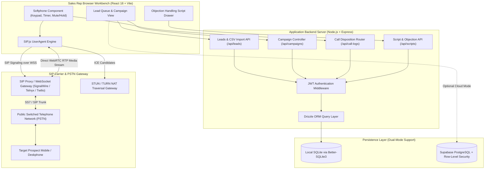
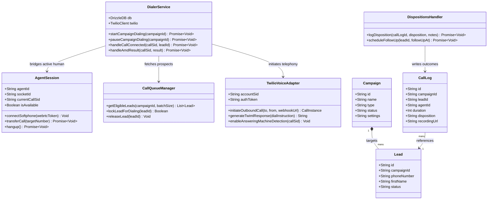
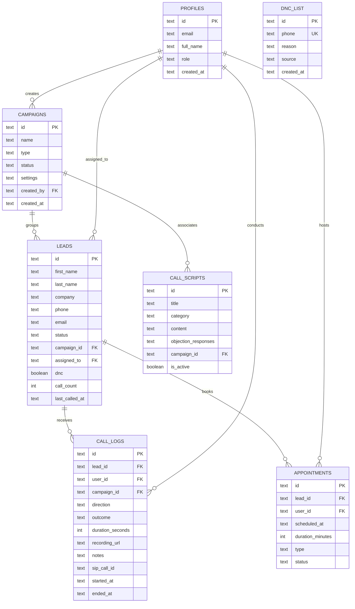
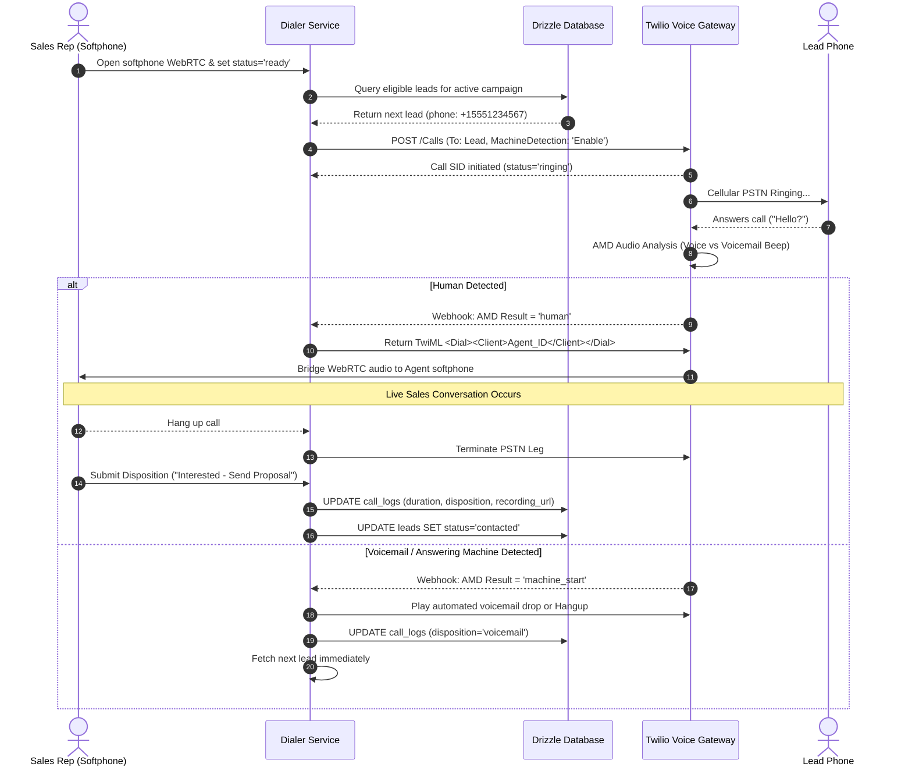

# Open-Cold-Dialer - Architecture & Technical Wiki

> **Open-Source Browser-Based Cold Calling Softphone & Power Dialer with Multi-Provider SIP Support**  
> GitHub: [6t9xstar/Open-Cold-Dialer](https://github.com/6t9xstar/Open-Cold-Dialer) | Stack: TypeScript, React 18, Vite, SIP.js (WebRTC), Node.js, Express, Drizzle ORM, SQLite / Supabase | License: MIT

---

## 1. Executive Summary & Value Proposition

**Open-Cold-Dialer** is a free, self-hosted browser-based cold calling and outbound dialing workbench engineered for high-velocity sales and business development teams. Designed as an open-source alternative to expensive proprietary dialers like RingCentral, Dialpad, and Five9, Open-Cold-Dialer runs directly inside any modern web browser without requiring desktop application installations or vendor telephony lock-in.

Leveraging standard SIP over WebSocket protocols via `SIP.js`, the platform connects to any VoIP carrier or private PBX (SignalWire, Telnyx, Twilio SIP, Asterisk, FreeSWITCH). It provides sales reps with streamlined lead management, instant CSV list imports, dynamic objection-handling call scripts, interactive DTMF dialpads, and one-click disposition logging.

### Core Problems Solved
- **High Per-Seat Software Licensing**: Replaces enterprise dialer subscriptions ($30–$150/user/month) with an open-source, self-hosted web app with zero per-user software fees.
- **Telephony Provider Lock-In**: Decouples the user interface from specific telecom carriers, allowing sales operations to bring their own SIP trunks and switch between Telnyx, SignalWire, Twilio, or Asterisk based on rate economics.
- **Desktop Client Installation Friction**: Operates completely within the browser using WebRTC audio and SIP over Secure WebSockets (WSS), eliminating softphone desktop client installations and firewall NAT traversal headaches.
- **Disjointed Lead Management & Rep Idle Time**: Combines contact lists, campaign assignments, live battle cards, objection scripts, and one-click disposition buttons on a single unified screen.
- **Do-Not-Call (DNC) Compliance Violations**: Features automatic DNC phone number checks (`dnc_list`) during import and dialing to prevent illegal outbound calls.

---

## 2. High-Level System Architecture

Open-Cold-Dialer features a decoupled architecture separating media signaling from administrative data persistence. The React frontend negotiates WebRTC audio directly with the SIP carrier via WebSockets, while persisting operational business records (leads, call logs, scripts, campaigns) to a lightweight Express/SQLite backend or cloud Supabase instance.



---

### 2.1 Core Domain & Service Class Architecture



---

## 3. Technology Stack & Key Dependencies

- **Language**: TypeScript 5.6+ across entire frontend and backend
- **Frontend Framework & Build**: React 18.3.1, Vite 6.0.5, React Router DOM 6.30, TanStack React Query 5.101
- **Telephony & Audio Protocols**:
  - `sip.js` 0.21.0: SIP UserAgent implementation managing SIP signaling over WebSocket (`ws://` / `wss://`)
  - WebRTC (Web Real-Time Communication): Direct peer-to-peer audio transmission using the Opus codec
- **Styling & UI Primitives**: Tailwind CSS 3.4, Lucide React 0.445 icons, React Hot Toast 2.6
- **Backend Framework**: Node.js 20+, Express 4.21 with TypeScript execution via `tsx`
- **Database & ORM**:
  - Drizzle ORM 0.38 with Drizzle Kit 0.30
  - `better-sqlite3` 11.7.0 (high-performance synchronous SQLite driver)
  - Optional: `@supabase/supabase-js` 2.111 for PostgreSQL cloud persistence
- **Security & Utilities**: `jsonwebtoken` 9.0, `bcryptjs` 2.4, `uuid` 11.0, `papaparse` 5.5 for high-speed CSV parsing, `multer` 1.4

---

## 4. Repository Layout & Key Modules

```
Open-Cold-Dialer/
├── backend/                         # Node.js Express REST API server
│   ├── src/
│   │   ├── db/
│   │   │   ├── database.ts          # Better-sqlite3 database connection & initialization
│   │   │   ├── schema.ts            # Drizzle ORM SQLite schema definitions
│   │   │   └── seed.ts              # Demo seed data (leads, campaigns, scripts, admin user)
│   │   ├── middleware/
│   │   │   └── auth.ts              # JWT extraction and validation middleware
│   │   ├── routes/
│   │   │   ├── auth.ts              # Login and token issuance endpoints
│   │   │   ├── callLogs.ts          # Call outcome disposition logging
│   │   │   ├── campaigns.ts         # Campaign CRUD and status updates
│   │   │   ├── leads.ts             # Lead filtering, creation, patch, and CSV bulk import
│   │   │   └── scripts.ts           # Dynamic objection and script endpoints
│   │   └── index.ts                 # Express app bootstrap, CORS, and port listener
│   ├── drizzle.config.ts            # Drizzle configuration
│   └── package.json
├── frontend/                        # Vite + React Web Application
│   ├── src/
│   │   ├── components/
│   │   │   ├── campaigns/           # Campaign creation modals and summary metrics
│   │   │   ├── common/              # Layout, navbar, and shared table primitives
│   │   │   ├── leads/               # Lead list tables, filters, and CSV uploader
│   │   │   ├── scripts/             # Script authoring and objection mapping forms
│   │   │   └── softphone/
│   │   │       └── Softphone.tsx    # 480-line SIP.js WebRTC dialpad, audio, and controls
│   │   ├── hooks/                   # React Query custom hooks (useLeads, useCallLogs, useCampaigns)
│   │   ├── pages/                   # Route views (Dashboard, Leads, Scripts, CallHistory, Admin)
│   │   ├── sip/
│   │   │   └── config.ts            # SIP provider presets (SignalWire, Telnyx, Twilio, Custom)
│   │   ├── App.tsx                  # Client router and React Query Provider
│   │   └── main.tsx                 # Entrypoint DOM mounting
│   ├── vite.config.ts               # Vite configuration with path aliases
│   └── package.json
├── docker/                          # Dockerfiles and compose orchestration
├── supabase/
│   └── migrations/                  # PostgreSQL schema migrations for Supabase deployment
└── README.md                        # Quick start guide and carrier credentials setup
```

---

## 5. Core Features & Capabilities

### 5.1 Multi-Carrier WebRTC SIP Softphone
The frontend `Softphone.tsx` component encapsulates a complete SIP UserAgent lifecycle powered by `sip.js`:
- Registers extension credentials over secure WebSockets with carrier endpoints.
- Establishes bi-directional WebRTC media channels directly from the browser microphone to PSTN gateways.
- Provides comprehensive in-call controls: mute/unmute microphone, active call timer, hold with background MOH, DTMF tone keypad transmission, and instant hangup.

```typescript
// Pre-configured carrier parameters in src/sip/config.ts
export const SIP_PRESETS: Record<string, SipPreset> = {
  signalwire: { wsPort: 5066, registrationInterval: 600, stunServer: "stun:signalwire.com" },
  telnyx:     { wsPort: 443,  registrationInterval: 3600, stunServer: "stun:telnyx.com" },
  twilio:     { wsPort: 443,  registrationInterval: 3600, stunServer: "stun:twilio.com" },
  custom:     { wsPort: 5066, registrationInterval: 3600, stunServer: "" }
};
```

### 5.2 Dynamic Objection-Handling Battle Cards
During live conversations, the interface displays contextual scripts tailored to the active campaign:
- Displays primary pitch scripts with dynamic variable interpolation (`{first_name}`, `{company}`).
- Features an instant accordion of common prospect objections (e.g., *"No budget right now"*, *"Already using a competitor"*, *"Send me an email"*).
- Reps click any objection to view instant rebuttal talking points, battle cards, and qualification pivots without leaving the call screen.

### 5.3 One-Click Call Outcome Dispositions
Upon call termination, the softphone forces a disposition prompt before queuing the next prospect:
- Predefined outcomes: `answered`, `no_answer`, `busy`, `voicemail`, `dnc`, `wrong_number`, `disconnected`.
- Automatically logs duration in seconds, saves call notes, increments the lead's `call_count`, and updates `last_called_at`.
- Selecting `dnc` immediately adds the prospect's phone number to the global `dnc_list` table.

### 5.4 High-Performance CSV Lead Ingestion
The lead manager features a bulk import endpoint powered by `papaparse`:
- Uploads and parses CSV files containing thousands of contacts.
- Executes batch transactional inserts inside SQLite transactions, importing large datasets in seconds.
- Normalizes phone numbers, tags, company domains, and geographic attributes.

---

## 6. Data Models & Schema Architecture

Open-Cold-Dialer's data architecture is implemented via Drizzle ORM over SQLite, mirrored in Supabase SQL migrations.



### Core Entity Definitions
- **`profiles`**: User accounts with role-based access (`admin`, `manager`, `agent`).
- **`campaigns`**: Telephony outreach campaigns (`type`: `outbound`, `inbound`, `blended`; `status`: `active`, `paused`, `completed`).
- **`leads`**: Prospect records tracking phone contact details, address, status (`new`, `contacted`, `interested`, `not_interested`, `callback`, `converted`, `do_not_contact`), `dnc` boolean flag, and historical call counts.
- **`call_logs`**: Detailed call records tracking `direction` (`outbound`/`inbound`), `outcome`, `duration_seconds`, `notes`, `recording_url`, `transcript`, and unique `sip_call_id`.
- **`call_scripts`**: Sales scripts containing core pitch copy and serialized JSON `objection_responses`.
- **`dnc_list`**: Compliance suppression list with unique constraint on `phone` numbers.

---

### 6.1 Comprehensive Database Schema Specification

The persistence layer uses Drizzle ORM configured with SQLite or PostgreSQL to handle high-frequency call signaling and disposition tracking.

#### Table: `profiles`
User accounts, roles, and softphone agent configurations.

| Column | Type | Constraints | Default | Description |
| :--- | :--- | :--- | :--- | :--- |
| `id` | `TEXT` | `PRIMARY KEY` | - | Unique user account ID |
| `email` | `TEXT` | `NOT NULL, UNIQUE` | - | Operator email address |
| `full_name` | `TEXT` | `NULLABLE` | `NULL` | Agent display name |
| `role` | `TEXT` | `NOT NULL` | `'agent'` | System role (`admin`, `agent`, `manager`) |
| `created_at` | `TEXT` | `NOT NULL` | `ISO8601` | Account creation timestamp |
| `updated_at` | `TEXT` | `NOT NULL` | `ISO8601` | Account modification timestamp |

*Indexes:* `idx_profiles_email` (`UNIQUE (email)`).

---

#### Table: `campaigns`
Dialing campaign configurations, pacing parameters, and caller ID assignments.

| Column | Type | Constraints | Default | Description |
| :--- | :--- | :--- | :--- | :--- |
| `id` | `TEXT` | `PRIMARY KEY` | - | Unique campaign ID |
| `name` | `TEXT` | `NOT NULL` | - | Campaign display label |
| `type` | `TEXT` | `NOT NULL` | `'outbound'` | Dialing mode (`outbound`, `inbound`, `blended`) |
| `status` | `TEXT` | `NOT NULL` | `'active'` | State (`active`, `paused`, `completed`) |
| `settings` | `TEXT` | `NULLABLE` | `NULL` | JSON string defining AMD thresholds and retry logic |
| `created_by` | `TEXT` | `NULLABLE` | `NULL` | Creator user ID |
| `created_at` | `TEXT` | `NOT NULL` | `ISO8601` | Creation timestamp |

*Indexes:* `idx_campaigns_status` (`(status)`).

---

#### Table: `call_logs`
Records every outbound call attempt, duration, AMD outcome, and agent disposition.

| Column | Type | Constraints | Default | Description |
| :--- | :--- | :--- | :--- | :--- |
| `id` | `TEXT` | `PRIMARY KEY` | - | Call record ID |
| `campaign_id` | `TEXT` | `NOT NULL` | - | Associated campaign |
| `lead_id` | `TEXT` | `NOT NULL` | - | Target lead called |
| `agent_id` | `TEXT` | `NULLABLE` | `NULL` | Softphone agent assigned |
| `call_sid` | `TEXT` | `NOT NULL` | - | Twilio / Telnyx Call SID |
| `duration` | `INTEGER` | `NOT NULL` | `0` | Call duration in seconds |
| `status` | `TEXT` | `NOT NULL` | `'initiated'` | Telephony status (`initiated`, `ringing`, `in-progress`, `completed`) |
| `amd_status` | `TEXT` | `NULLABLE` | `NULL` | AMD result (`human`, `machine_start`, `nonesuch`) |
| `disposition` | `TEXT` | `NULLABLE` | `NULL` | Agent disposition (`interested`, `callback`, `dnc`, `no_answer`) |
| `recording_url`| `TEXT` | `NULLABLE` | `NULL` | S3 / Twilio audio recording URL |
| `created_at` | `TEXT` | `NOT NULL` | `ISO8601` | Call initiation timestamp |

*Indexes:* `idx_call_logs_lead` (`(lead_id)`), `idx_call_logs_sid` (`(call_sid)`).

---

## 7. API Architecture, Webhooks & Key Endpoints

The backend exposes an authenticated REST API where protected routes require a `Bearer <token>` Authorization header parsed by `authMiddleware`.

### 7.1 Authentication
- **`POST /api/auth/login`**: Authenticates credentials and returns a signed JWT.

```json
// POST /api/auth/login Response
{
  "token": "eyJhbGciOiJIUzI1NiIsInR5cCI6IkpXVCJ9...",
  "user": {
    "id": "usr_99a812",
    "email": "agent@example.com",
    "fullName": "Jane Doe",
    "role": "agent"
  }
}
```

### 7.2 Lead Management & Bulk Ingestion
- **`GET /api/leads`**: Returns lead list ordered by creation date.
- **`POST /api/leads`**: Creates a single new lead record.
- **`POST /api/leads/import`**: Batch imports CSV rows within an atomic database transaction.

```json
// POST /api/leads/import Request
{
  "rows": [
    {
      "first_name": "David",
      "last_name": "Miller",
      "company": "Apex Global Logistics",
      "phone": "+14155552671",
      "email": "dmiller@apexlogistics.com",
      "status": "new"
    },
    {
      "first_name": "Sarah",
      "last_name": "Connor",
      "company": "Cyberdyne Systems",
      "phone": "+13125559812",
      "email": "sconnor@cyberdyne.com",
      "status": "new"
    }
  ]
}
```

### 7.3 Call Logging & Outcomes
- **`POST /api/call-logs`**: Creates a call log entry and automatically updates the lead's status and call counter.

```json
// POST /api/call-logs Request
{
  "lead_id": "lead_44a2bc",
  "campaign_id": "cmp_1190de",
  "direction": "outbound",
  "outcome": "answered",
  "duration_seconds": 142,
  "notes": "Discussed Q4 expansion plans. Prospect interested in demo on Tuesday.",
  "sip_call_id": "sip_call_8829013_telnyx",
  "started_at": "2026-10-24T10:30:00Z",
  "ended_at": "2026-10-24T10:32:22Z"
}
```

```json
// POST /api/call-logs Response
{
  "id": "clog_7718aa",
  "leadId": "lead_44a2bc",
  "outcome": "answered",
  "durationSeconds": 142,
  "createdAt": "2026-10-24T10:32:23Z"
}
```

---

### 7.5 End-to-End Operational Lifecycle Sequence

The following sequence shows the end-to-end power dialing loop with Answering Machine Detection (AMD) and WebRTC softphone bridging.



---

## 8. Strategic Value & Takeaways for MarketingStudio

### Reusable Architectural Patterns
1. **Carrier-Agnostic In-Browser Telephony via `SIP.js`**:
   Rather than building custom WebRTC server gateways or locking into proprietary Twilio Client JS SDKs, Open-Cold-Dialer demonstrates that a pure frontend `SIP.js` implementation over standard WebSockets provides universal VoIP compatibility. MarketingStudio can connect to low-cost wholesale SIP providers (Telnyx, SignalWire) without paying high platform margins.
2. **Instant Rebuttal Battle Card Drawer**:
   Cold calling SDRs experience hesitation when handling unexpected objections. Embedding dynamic objection buttons directly into the dialer interface—mapping real-time rebuttals to specific prospect pain points—provides a high-value blueprint for MarketingStudio's live sales assistance modules.
3. **Decoupled Dual-Mode Persistence (SQLite vs. Supabase)**:
   The ability to run a zero-configuration local SQLite database for individual reps or small teams while offering seamless migration to Supabase PostgreSQL for multi-user enterprise deployments is a compelling architectural pattern for MarketingStudio's self-hosted and cloud offerings.
4. **Automated Call Count & DNC Suppression Lifecycles**:
   Automatically incrementing prospect touch counts, tracking call timestamps, and enforcing real-time Do-Not-Call (DNC) list suppressions prevents compliance liabilities and duplicate dialing across distributed outbound teams.
