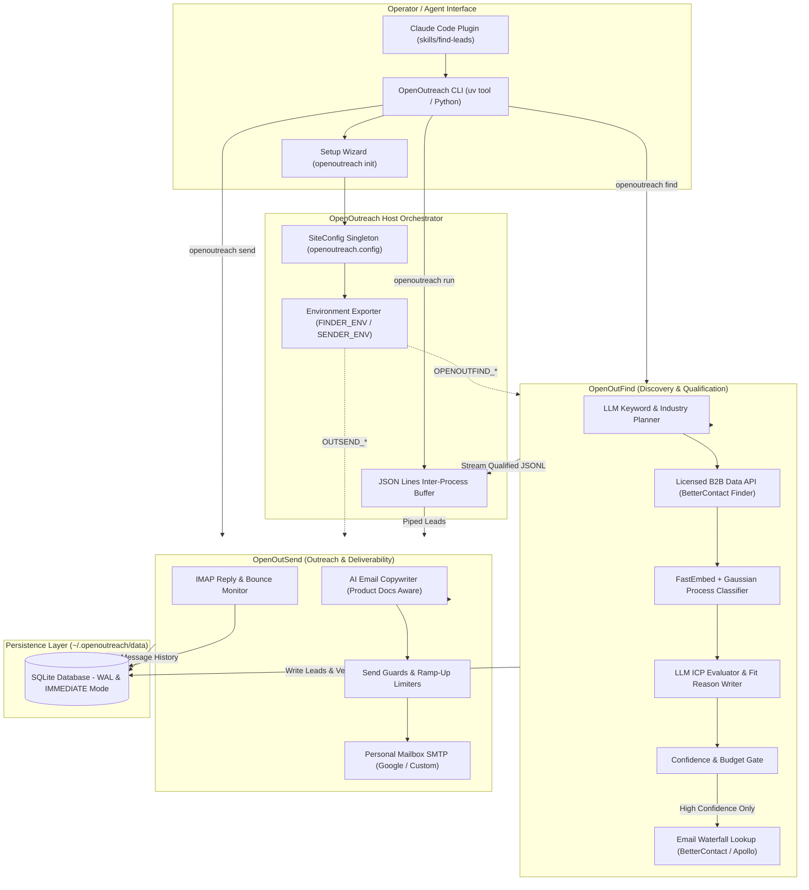
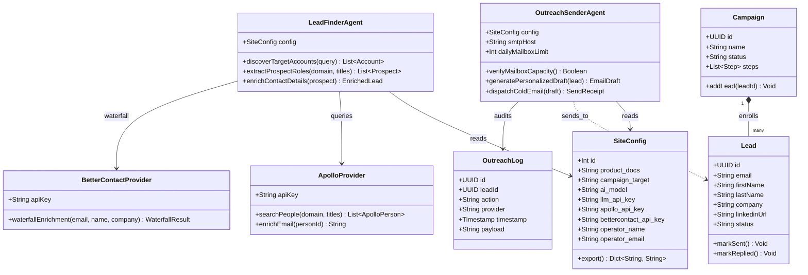
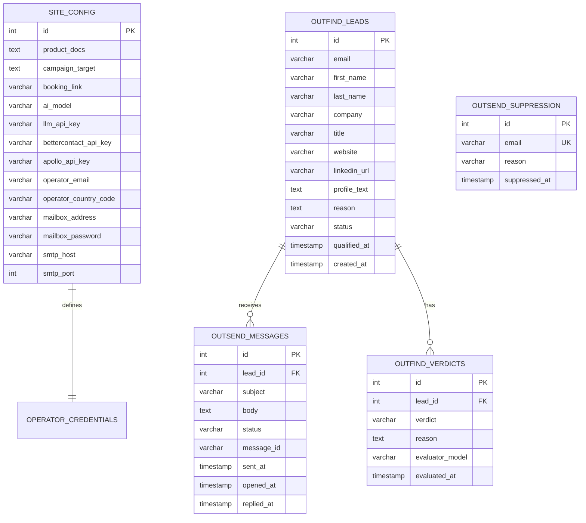
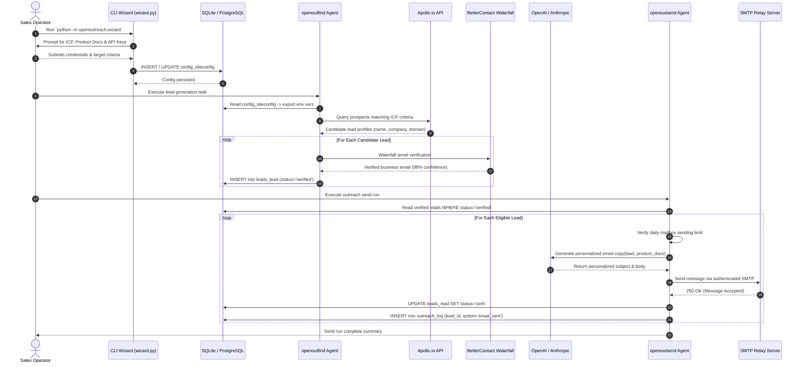

# OpenOutreach - Architecture & Technical Wiki

> **Autonomous AI-Driven B2B Lead Discovery, Qualification & Cold Outreach Orchestrator**  
> GitHub: [eracle/OpenOutreach](https://github.com/eracle/OpenOutreach) | Stack: Python 3.11+, Django 5.2+, SQLite (WAL), Pydantic AI, FastEmbed, BetterContact | License: GPL-3.0-or-later

---

## 1. Executive Summary & Value Proposition

**OpenOutreach** is a self-hosted, open-source outbound prospecting orchestrator designed to transform natural language product and target market descriptions into qualified, verified, and personalized cold email outreach. Rather than acting as a simple list scraper or generic email blaster, OpenOutreach operates as a bounded agentic pipeline that discovers candidate profiles from licensed B2B databases, evaluates each prospect against a semantic Ideal Customer Profile (ICP) using LLMs, writes human-readable fit rationales, and dispatches multi-touch emails directly from the user's personal mailbox.

By bundling two standalone engines—`openoutfind` (discovery and AI qualification) and `openoutsend` (outreach delivery and mailbox guards)—OpenOutreach unifies lead discovery, enrichment, verification, and email dispatch into a single zero-overhead CLI with zero platform-ToS scraping risk.

### Core Problems Solved
- **No Manual List Building**: Replaces tedious manual list curation and third-party CSV uploads with autonomous discovery driven by plain-text product documentation and buyer personas.
- **Explainable Lead Fit**: Solves the "black-box scoring" problem by generating explicit, human-readable fit reasons (`reason`) for every accepted lead that directly reference prospect backgrounds and company positioning.
- **Zero Platform-ToS Surface**: Operates completely browserless without scraping LinkedIn or social networks, preventing IP blocking and account bans by querying licensed data providers (BetterContact Lead Finder).
- **Rationed Verification Spend**: Protects operational budgets by keeping discovery and semantic qualification free, gating paid email waterfall lookups behind an empirical confidence threshold.
- **Active Learning Search Optimization**: Uses Gaussian Process classifiers over fast text embeddings to continuously adapt keyword search paths toward higher-density ICP clusters.

---

## 2. High-Level System Architecture

OpenOutreach functions as an orchestrator hosting both `openoutfind` and `openoutsend` within a unified Django app registry, sharing a single SQLite database running in Write-Ahead Logging (WAL) mode. The system is designed as a bounded execution process rather than an unconstrained daemon.



---

### 2.1 Core Domain & Service Class Architecture



---

## 3. Technology Stack & Key Dependencies

- **Language & Runtime**: Python >= 3.11, managed via `uv` or `pip`
- **Framework & App Host**: Django 5.2+ (used headlessly as an application registry, ORM, and migration coordinator; no admin, sessions, or web views)
- **Database Engine**: SQLite 3 with `PRAGMA journal_mode=WAL` and `transaction_mode=IMMEDIATE` to support non-blocking concurrent reads during batch writes
- **Packaging & Build System**: Hatchling (`pyproject.toml`)
- **Child Subsystems**:
  - `openoutfind` (0.1.37): Discovery, search planning, qualification, and waterfall email resolution
  - `openoutsend` (0.1.62): Outreach generation, mailbox throttling, SMTP/IMAP protocol handlers
- **AI & Embedding Libraries**:
  - `pydantic-ai`: Structured agent prompts and model-agnostic LLM orchestration (OpenAI, Anthropic, Ollama, OpenAI-compatible APIs)
  - `fastembed`: Lightweight local text embedding generation without PyTorch bloat
  - `scikit-learn` / `numpy`: Gaussian Process modeling for active learning search walks
- **External Data & Transport**:
  - BetterContact API (B2B candidate search and multi-vendor email waterfall resolution)
  - Apollo API (secondary address resolution)
  - Native Python `smtplib` / `imaplib` with TLS/SSL for Google Workspace and standard SMTP mailboxes

---

## 4. Repository Layout & Key Modules

```
OpenOutreach/
├── .claude-plugin/                  # Claude Code plugin manifest and marketplace definitions
├── compose/                         # Optional Docker Compose deployment profiles
├── data/                            # Persistent runtime storage directory
├── docs/                            # Visual assets and deployment documentation
├── openoutreach/                    # Core orchestrator Python package
│   ├── config/                      # Host configuration app
│   │   ├── migrations/              # Django migrations for SiteConfig
│   │   ├── apps.py                  # ConfigAppConfig definition
│   │   └── models.py                # SiteConfig singleton & FINDER_ENV/SENDER_ENV maps
│   ├── __init__.py
│   ├── __main__.py                  # CLI entrypoint, argument parser, and verb dispatcher
│   ├── settings.py                  # Django settings unifying openoutfind & openoutsend apps
│   └── wizard.py                    # Interactive onboarding wizard and env validator
├── skills/
│   └── find-leads/
│       └── SKILL.md                 # Agent contract, command specifications, and error taxonomy
├── tests/                           # Pytest integration and migration unit tests
├── local.yml                        # Docker configuration
├── manage.py                        # Django execution wrapper
├── pyproject.toml                   # Hatchling project specifications and child dependency pins
└── README.md                        # Primary documentation and CLI usage guide
```

---

## 5. Core Features & Capabilities

### 5.1 Explainable ICP Qualification & Reason Generation
When evaluating discovered candidates against user-supplied product specifications and buyer criteria, the LLM evaluator does not output arbitrary numeric scores. Instead, it generates an explicit qualitative verdict (`fit` or `no-fit`) paired with a natural language rationale (`reason`). This rationale details the prospect's tech stack, current organizational trajectory, and relevance, outputting directly to CSV headers compatible with Instantly, Smartlead, and Apollo.

### 5.2 Active Learning Discovery Walk via Embeddings
OpenOutreach optimizes candidate discovery by treating search as an active learning problem:
1. Candidate profiles retrieved from initial keyword queries are converted into dense vector embeddings via `fastembed`.
2. A Gaussian Process classifier trains dynamically on accepted and rejected candidate verdicts.
3. The engine computes expected information gain to steer subsequent keyword expansions toward domains and titles with the highest predicted density of positive fits.

### 5.3 Budget-Rationed Waterfall Email Resolution
Lead discovery and qualification operate at zero data provider cost. Address lookup is treated as a separate, gated step:
- Only prospects passing a strict confidence threshold are queued for email resolution.
- Calls BetterContact's multi-vendor waterfall enrichment, billing credits only when a verified, deliverable business email is confirmed.
- Running `openoutreach find 10` executes discovery without spending credits; running `openoutreach find 10 emails` caps paid resolutions to exactly 10 credits.

### 5.4 Dual-Mode Agentic Qualification (`--agent-qualify`)
For operators running within an active AI coding or agent session, OpenOutreach supports delegating qualification to the host agent without incurring secondary LLM API costs:
- Executing `openoutreach find 10 --agent-qualify --json` pauses execution upon finding an unjudged candidate, outputting error state `qualify_pending` with the prospect's complete profile.
- The parent agent evaluates the candidate and resumes execution by invoking `openoutreach find 10 --agent-qualify --verdict fit --reason "..."`.

### 5.5 Mailbox Send Guards & Delivery Protection
`openoutsend` operates under strict deliverability constraints:
- Configures personalized ramp-up schedules and max daily sends (defaulting to safe thresholds of 30-50 emails/day).
- Randomized dispatch intervals (120-300 seconds between outbound emails) mimicking human behavior.
- Automated unsubscribe detection and IMAP bounce harvesting populating a global suppression list.

---

## 6. Data Models & Schema Architecture

OpenOutreach maintains a unified SQLite database hosting models from `openoutreach.config`, `openoutfind`, and `openoutsend`.



### Core Schema Definitions
- **`SiteConfig` (`openoutreach_config_siteconfig`)**:
  - `product_docs` (`TextField`): Markdown specifications of the product or service being sold.
  - `campaign_target` (`TextField`): Target market, buyer seniority, and ICP qualification rules.
  - `ai_model` (`CharField`): Provider and model string in `provider:model` format (e.g., `anthropic:claude-3-5-sonnet-latest`).
  - `bettercontact_api_key` & `apollo_api_key`: Keys powering candidate discovery and verified email lookup.
  - `smtp_host`, `smtp_port`, `mailbox_address`, `mailbox_password`: Personal mailbox dispatch credentials.
- **`Lead` (`outfind_crm_lead`)**:
  - Primary contact record storing firmographics, parsed social profiles, verified email status, and the final LLM-authored `reason`.
- **`Message` (`outsend_emails_message`)**:
  - Outbound email history tracking generated drafts, Message-ID headers, send timestamps, and delivery statuses (`pending`, `sent`, `bounced`, `replied`).
- **`Suppression` (`outsend_emails_suppression`)**:
  - Global blocklist preventing outreach to unsubscribed prospects, bounced addresses, or user-excluded domains.

---

### 6.1 Comprehensive Database Schema Specification

The underlying persistence architecture utilizes Django ORM with SQLite or PostgreSQL backends, strictly separating operator configurations from transactional outreach logs.

#### Table: `config_siteconfig`
Persists operator inputs collected through the interactive CLI wizard and exports them as environment variables for child processes (`openoutfind` and `openoutsend`).

| Column | Type | Constraints | Default | Description |
| :--- | :--- | :--- | :--- | :--- |
| `id` | `INTEGER` | `PRIMARY KEY AUTOINCREMENT` | - | Primary configuration row identifier |
| `product_docs` | `TEXT` | `NOT NULL` | `''` | Value proposition, product markdown, and persona docs |
| `campaign_target` | `TEXT` | `NOT NULL` | `''` | Target ICP criteria (e.g. VP Sales, B2B SaaS, US/EU) |
| `ai_model` | `VARCHAR(100)` | `NOT NULL` | `'gpt-4o'` | LLM identifier for copywriting and scoring |
| `llm_api_key` | `VARCHAR(255)` | `NOT NULL` | `''` | API credential for OpenAI, Anthropic, or OpenRouter |
| `apollo_api_key` | `VARCHAR(255)` | `NOT NULL` | `''` | Apollo.io credential for prospect discovery |
| `bettercontact_api_key`| `VARCHAR(255)`| `NOT NULL` | `''` | Waterfall email enrichment credential |
| `operator_name` | `VARCHAR(255)` | `NOT NULL` | `''` | Human operator name appearing in signatures |
| `operator_email` | `VARCHAR(255)` | `NOT NULL` | `''` | Primary administrative contact and sender identity |
| `operator_country_code`| `VARCHAR(10)` | `NOT NULL` | `''` | Jurisdiction ISO code for CAN-SPAM / GDPR compliance |

*Indexes:* Primary key index on `id`.

---

#### Table: `leads_lead`
Stores prospect contacts discovered by `openoutfind` alongside enrichment metadata.

| Column | Type | Constraints | Default | Description |
| :--- | :--- | :--- | :--- | :--- |
| `id` | `UUID` | `PRIMARY KEY` | `uuid4` | Unique prospect contact identifier |
| `email` | `VARCHAR(255)` | `NOT NULL, UNIQUE` | - | Primary verified business email address |
| `first_name` | `VARCHAR(100)` | `NOT NULL` | `''` | Prospect given name |
| `last_name` | `VARCHAR(100)` | `NOT NULL` | `''` | Prospect family name |
| `company_name` | `VARCHAR(255)` | `NOT NULL` | `''` | Employer organization name |
| `job_title` | `VARCHAR(255)` | `NOT NULL` | `''` | Professional title (e.g. Head of Growth) |
| `linkedin_url` | `VARCHAR(500)` | `NULLABLE` | `NULL` | Public LinkedIn profile URL |
| `enrichment_score`| `FLOAT` | `NOT NULL` | `0.0` | ICP fit and email confidence score (0.0 - 1.0) |
| `status` | `VARCHAR(50)` | `NOT NULL` | `'discovered'`| Pipeline state (`discovered`, `verified`, `sent`, `replied`) |
| `created_at` | `TIMESTAMPTZ` | `NOT NULL` | `NOW()` | Discovery timestamp |

*Indexes:* `idx_lead_email` (`UNIQUE btree (email)`), `idx_lead_status` (`btree (status)`).

---

#### Table: `outreach_log`
Append-only operational audit log tracking every email transmission, bounce, or reply event.

| Column | Type | Constraints | Default | Description |
| :--- | :--- | :--- | :--- | :--- |
| `id` | `UUID` | `PRIMARY KEY` | `uuid4` | Unique audit event identifier |
| `lead_id` | `UUID` | `NOT NULL, FK -> leads_lead(id)` | - | Target prospect identifier |
| `action` | `VARCHAR(50)` | `NOT NULL` | - | Action type (`email_sent`, `open`, `reply`, `bounce`) |
| `subject` | `VARCHAR(500)` | `NOT NULL` | `''` | Subject line dispatched |
| `smtp_status` | `INTEGER` | `NOT NULL` | `250` | SMTP response code received from provider |
| `error_message` | `TEXT` | `NULLABLE` | `NULL` | Error details if dispatch failed |
| `created_at` | `TIMESTAMPTZ` | `NOT NULL` | `NOW()` | Event timestamp |

*Indexes:* `idx_outreach_lead` (`btree (lead_id)`), `idx_outreach_action_created` (`btree (action, created_at)`).

---

## 7. API Architecture, Webhooks & Key Endpoints

Because OpenOutreach is designed as a headless, zero-attack-surface CLI and agent plugin, its interfaces are exposed via command invocations, standard I/O streams, and JSON Lines rather than HTTP REST listeners.

### 7.1 CLI Verbs & Invocations
- **`openoutreach init`**: Interactive or headless initialization validating API keys and SMTP credentials.
- **`openoutreach find [N] [emails] [options]`**: Runs lead discovery and qualification.
  - `N`: Number of *additional* leads to find.
  - `emails`: Directs the pipeline to spend credits resolving verified email addresses.
  - `--new`: Outputs only leads qualified during the current invocation.
  - `--json`: Streams qualified lead records as JSON Lines on `stdout` and metadata on `stderr`.

```bash
# Example invocation streaming newly discovered leads as JSON Lines
openoutreach find 5 emails --new --json
```

```json
// Sample JSON Lines object output on stdout
{
  "lead_id": 482,
  "first_name": "Elena",
  "last_name": "Rostova",
  "email": "elena.rostova@cloudscale-security.io",
  "company": "CloudScale Security",
  "title": "VP Infrastructure & DevOps",
  "website": "https://cloudscale-security.io",
  "linkedin_url": "https://www.linkedin.com/in/elena-rostova-devops",
  "reason": "Matches ICP: Leading a 40-person infrastructure engineering team currently migrating to multi-region Kubernetes clusters; publicly documented recent hiring initiatives for cloud cost optimization engineers.",
  "qualified_at": "2026-10-24T10:15:30Z"
}
```

```json
// Sample Metadata output on stderr upon job completion
{
  "status": "complete",
  "goal": 5,
  "found": 5,
  "credits_spent": 5,
  "remaining_balance": 35,
  "next_action": "openoutreach send 5"
}
```

### 7.2 Human/Agent-in-the-Loop Interrupt Contract (`--agent-qualify`)
When running in cooperative agent mode, the command halts on ambiguous candidates:

```json
// Stderr output when an evaluation decision is pending
{
  "error": {
    "type": "qualify_pending",
    "lead_id": 483,
    "full_name": "Marcus Vance",
    "company": "RetailNext Solutions",
    "job_title": "Director of IT",
    "profile_text": "RetailNext Solutions specializes in point-of-sale hardware and retail inventory systems...",
    "prompt": "Evaluate whether RetailNext Solutions fits our cloud security tooling ICP."
  }
}
```

Resume command provided by the agent:
```bash
openoutreach find 5 --agent-qualify --verdict no-fit --reason "Retail physical POS hardware provider, not a cloud-native SaaS infrastructure buyer."
```

---

### 7.5 End-to-End Operational Lifecycle Sequence

The following sequence illustrates the complete OpenOutreach workflow from CLI configuration, Apollo/BetterContact waterfall enrichment, LLM copy generation, and SMTP dispatch.



---

## 8. Strategic Value & Takeaways for MarketingStudio

### Reusable Architectural Patterns
1. **Separation of Free Discovery and Paid Enrichment Gating**:
   MarketingStudio should replicate OpenOutreach's phased funnel: query candidate firmographics for free, run local or low-cost LLM semantic qualification, and only invoke paid data waterfall APIs (Apollo, BetterContact, Hunter) for leads whose fit is already established.
2. **Explainable Output Over Arbitrary Numerical Scoring**:
   Legacy platforms assign arbitrary lead scores (e.g. `87/100`). OpenOutreach demonstrates that users and downstream sales reps gain far higher conversion rates when provided a concrete paragraph detailing *why* the prospect is an ICP fit. MarketingStudio can use this rationale directly in outbound email opening lines.
3. **Active Learning Search Walks Over Hardcoded Filters**:
   Instead of forcing users to guess complex boolean filters (e.g., `(DevOps OR SRE) AND (Kubernetes)`), using vector embeddings and Gaussian Process classifiers to steer keyword discovery paths allows MarketingStudio to surface high-converting long-tail prospects competitors miss.
4. **Cooperative Agent Qualification Protocol**:
   The `--agent-qualify` interrupt pattern provides a clean mechanism for MarketingStudio's AI Agent orchestrator to pause subagent execution, present ambiguous prospects to the user for human-in-the-loop validation, and resume execution without losing state.
