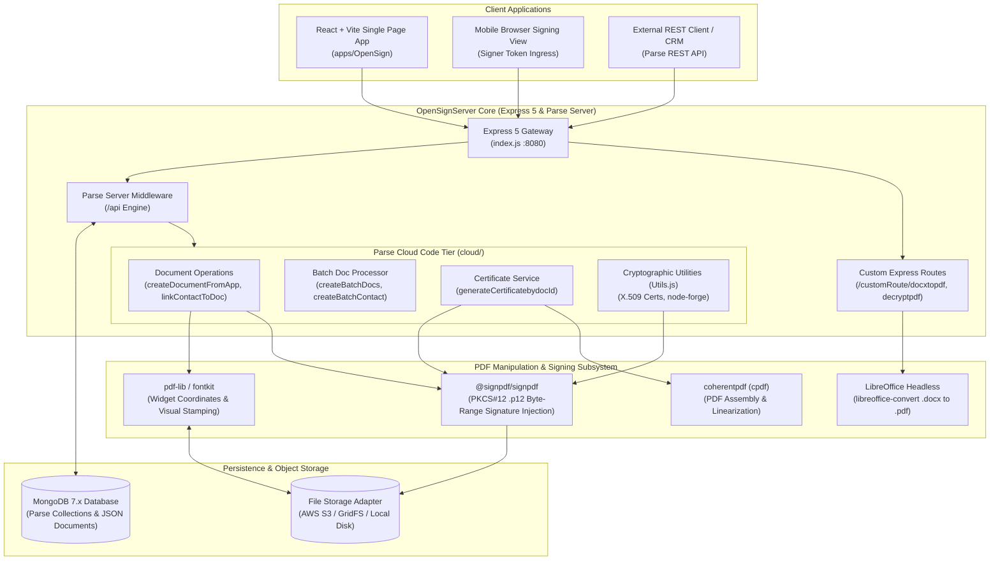
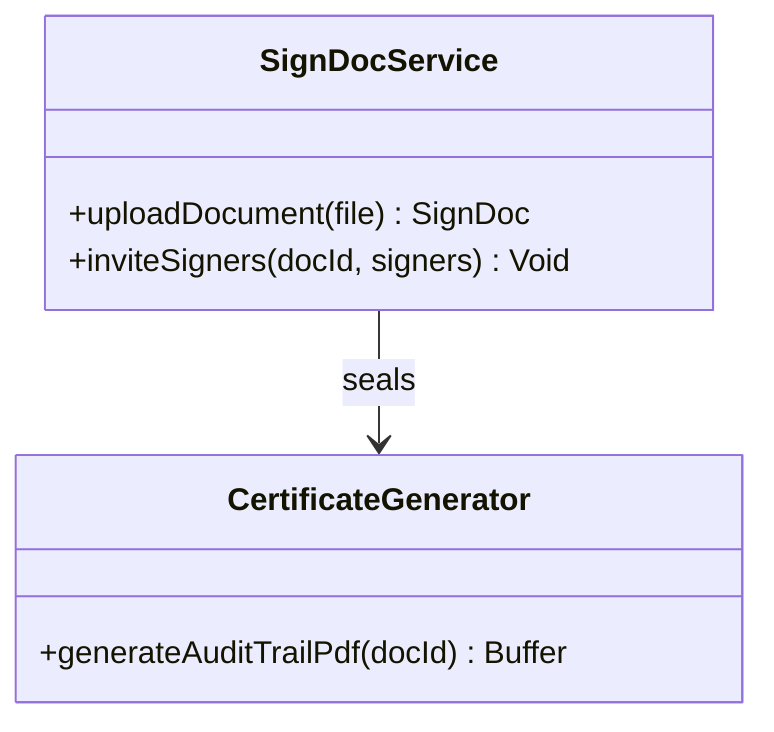
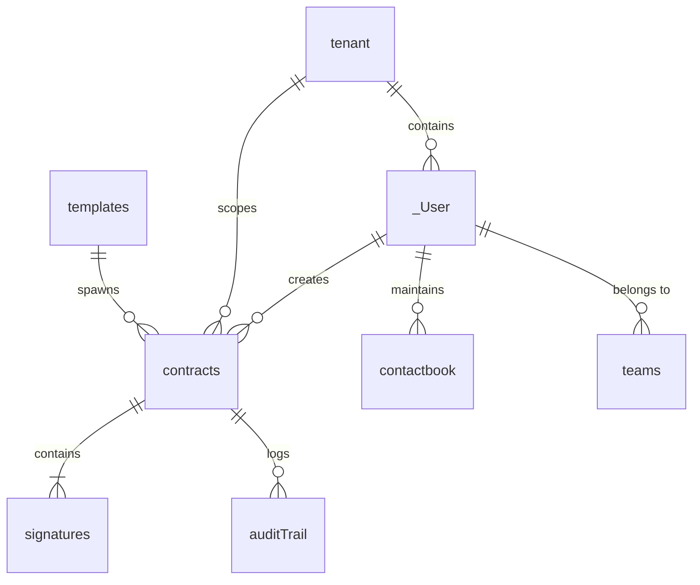
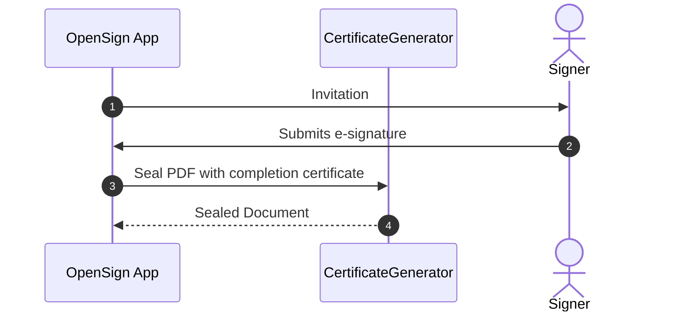

# OpenSign - Architecture & Technical Wiki

> **Open-Source Cryptographic Electronic Signature Engine, Parse Server Backend & PKCS#12 Document Sealing Platform**  
> GitHub: [OpenSignLabs/OpenSign](https://github.com/OpenSignLabs/OpenSign.git) | Stack: JavaScript, Node.js, Express 5, Parse Server, MongoDB, React, Vite, @signpdf, pdf-lib, LibreOffice, node-forge | License: MIT

---

## 1. Executive Summary & Value Proposition

**OpenSign** is a free, developer-friendly, open-source e-signature solution built to deliver secure, legally compliant digital signing workflows using standard open web technologies. Operating on an Express 5 backend powered by Parse Server and MongoDB, OpenSign provides a turnkey document management, signing, and templating infrastructure designed to run entirely on private cloud infrastructure or local servers.

Modern organizations seeking to automate signatures frequently encounter closed-source ecosystems that hold signing keys hostage, mandate third-party cloud storage, and enforce restrictive per-document fees. OpenSign solves this by granting developers full ownership over their signing infrastructure, including custom X.509 certificate generation, on-the-fly DOCX-to-PDF conversion via headless LibreOffice, and tamper-evident PDF digital signatures that strictly adhere to international e-signature statutes (ESIGN, UETA, eIDAS).

### Core Problems Solved
- **Costly Per-Transaction E-Sign Taxes**: Eliminates monthly user and document quotas with an MIT-licensed, self-hosted platform supporting unlimited signatures and documents.
- **Strict PDF Digital Signature Standard Compliance**: Implements authentic cryptographic digital signatures using `@signpdf/signpdf`, PKCS#12 (`.p12`) certificates, and SHA-256 byte-range hashes verified by standard PDF viewers (Adobe Acrobat, Apple Preview).
- **Office Document Ingestion Friction**: Features native server-side conversion of `.docx`, `.doc`, and `.odt` files into vector-perfect PDFs via headless LibreOffice integration.
- **Decentralized Enterprise Multi-Tenancy**: Built-in tenant isolation, team roles, contact books, and shared document drives powered by Parse Server's object-level Access Control Lists (ACLs).
- **Automated Audit Certificates with QR Verification**: Generates and appends a tamper-evident Certificate of Completion complete with public QR code verification, signer timeline, IP logs, and cryptographic digests.

---

## 2. High-Level System Architecture

OpenSign is structured into two main applications: `OpenSign` (the React/Vite frontend client) and `OpenSignServer` (an Express 5 server orchestrating Parse Server, PDF cryptographic signing, and conversion pipelines).



### PDF Processing & Digital Signing Pipeline
1. **Document Ingestion & Normalization**: Users upload a PDF or Microsoft Word document (`.docx`). If Word format, `docxtopdf.js` invokes headless LibreOffice via `libreoffice-convert` to render an equivalent PDF.
2. **Field Stamping**: When signers complete their signatures, `PDF.js` leverages `pdf-lib` to draw visual signatures, dates, initials, and form text onto the targeted $(X, Y)$ coordinates of the document buffer.
3. **Audit Certificate Generation**: `GenerateCertificate.js` constructs a separate Certificate of Completion PDF containing signer metadata, timestamps, client IPs, and an embedded QR code linking to verification endpoints.
4. **PDF Assembly & Placeholder Allocation**: `coherentpdf` merges the source PDF with the generated certificate. `Placeholder.js` and `@signpdf/placeholder-pdf-lib` inject a reserved signature dictionary space into the PDF's xref table.
5. **Cryptographic Sealing**: `@signpdf/signer-p12` loads the organization's X.509 private certificate, hashes the entire PDF byte range excluding the signature container, creates a PKCS#7 signature token, and embeds it directly into the PDF.

---

### 2.1 Core Domain & Service Class Architecture



---

## 3. Technology Stack & Key Dependencies

| Component | Framework / Library | Role & Details |
|---|---|---|
| **Server Framework** | Express 5.x, Node.js | Next-generation Node.js HTTP framework with modern async/await routing |
| **Backend Framework** | Parse Server 7.x/8.x | BaaS framework providing schema validation, Cloud Code hooks, and user auth |
| **Database** | MongoDB 7.x | Document database persisting contracts, templates, contact books, and audit logs |
| **Frontend Stack** | React 18, Vite, Tailwind CSS | High-performance SPA with rapid hot-module reloading and responsive layouts |
| **Cryptographic Signing** | `@signpdf/signpdf`, `@signpdf/signer-p12` | Standards-compliant digital PDF signing via PKCS#7/CMS containers |
| **PDF Manipulation** | `pdf-lib`, `@pdf-lib/fontkit` | Vector-level PDF creation, visual signature drawing, and font embedding |
| **PDF Tools & Conversion** | `coherentpdf` (cpdf), `libreoffice-convert` | PDF linearization, merging, and automated MS Word to PDF compilation |
| **Cryptography Utilities** | `node-forge`, `jose` | X.509 digital certificate generation, RSA keypair generation, and JWT validation |
| **Storage Adapters** | `@parse/s3-files-adapter`, `@parse/fs-files-adapter` | Swappable object storage across AWS S3 and local file systems |
| **Email Transports** | Nodemailer, Mailgun, SendGrid | Transactional email delivery for document invitations and signed copy delivery |

---

## 4. Repository Layout & Key Modules

```text
inspire/OpenSign/
├── apps/
│   ├── OpenSign/                    # Vite + React single-page frontend application
│   │   ├── src/components/          # Document editor canvas, signature pads, field overlays
│   │   └── src/pages/               # Dashboard, signing view, templates, contact book
│   └── OpenSignServer/              # Express 5 & Parse Server application
│       ├── index.js                 # Server entrypoint, middleware, Parse initialization
│       ├── Utils.js                 # Certificate generator, email utilities, encryption
│       ├── cloud/                   # Parse Cloud Code logic
│       │   ├── main.js              # Cloud Code root index and trigger bindings
│       │   ├── customRoute/         # Express endpoints: docxtopdf.js, decryptpdf.js
│       │   └── parsefunction/       # Cloud functions: documents, users, templates
│       │       └── pdf/             # Core PDF logic
│       │           ├── PDF.js       # Field drawing and visual signature stamping
│       │           ├── GenerateCertificate.js # Audit Certificate PDF builder
│       │           ├── Placeholder.js # PKCS#7 signature container allocation
│       │           └── PDFArrayCustom.js # Byte stream array helpers
│       ├── cert/                    # Default X.509 root certificates and .p12 signing keys
│       └── databases/               # MongoDB schema definitions and indexes
├── docker-compose.yml               # Multi-container orchestration (App, Server, Mongo)
└── Caddyfile                        # Reverse proxy and automatic SSL/TLS configuration
```

---

## 5. Core Features & Capabilities

### 5.1 Standards-Compliant PKCS#12 Digital Signatures
Unlike software that merely overlays signature images onto a PDF, OpenSign implements genuine cryptographic digital signatures. Using `@signpdf/signpdf` and `node-forge`, it binds an X.509 digital certificate (`.p12` format) to the document binary. Any subsequent alteration of text, images, or pages invalidates the digital signature, triggering warning banners in Adobe Acrobat and PDF viewers.

### 5.2 Server-Side DOCX to PDF Conversion
OpenSign removes the burden of manual document conversion for users. Via its custom `/customRoute/docxtopdf` endpoint, incoming Microsoft Office `.docx`, `.doc`, or OpenDocument `.odt` files are streamed through headless LibreOffice binaries in Docker, producing high-fidelity PDFs ready for immediate signature field tagging.

### 5.3 Audit Certificate of Completion with QR Code
When all signers execute an agreement, OpenSign compiles a dedicated audit page. The certificate includes:
- Universal Document ID and SHA-256 binary hash.
- Complete audit trail of signers with UTC timestamps, email confirmation status, and IP addresses.
- Dynamically rendered QR code allowing any third party to scan and verify document authenticity directly against the OpenSign verification endpoint.

### 5.4 Batch Document Generation & Bulk Contact Linking
OpenSign provides native batch processing utilities (`createBatchDocs.js`, `createBatchContact.js`). Sales and HR teams can upload CSV contact lists and automatically generate hundreds of individualized signing requests from a single master template with personalized field pre-fills.

### 5.5 Granular Parse Server Object-Level Security (ACL)
Leveraging Parse Server's underlying security architecture, every document (`contracts` class) is protected by document-level Access Control Lists (ACLs). Only explicit signers, the document creator, and authorized organization admins possess read/write permissions, preventing horizontal authorization bypasses in multi-tenant environments.

---

## 6. Data Models & Schema Architecture

OpenSign stores data in MongoDB through Parse Server schema collections (`_User`, `contracts`, `templates`, `contactbook`, `teams`).



### Core MongoDB / Parse Collections

#### `contracts` (Document Entity)
- `objectId` (`String`, PK): Unique Parse document ID.
- `Name` (`String`): Title of the agreement or document.
- `URL` (`String`): Storage URL of the current working PDF binary.
- `SignedUrl` (`String`, nullable): Storage URL of the final signed and sealed PDF.
- `Status` (`String`): Current state: `draft`, `pending`, `completed`, `declined`.
- `Signers` (`Array<Object>`): Array of signer objects:
  - `email` (`String`), `name` (`String`), `status` (`pending` / `signed`), `order` (`Number`).
- `Widgets` (`Array<Object>`): Form field coordinates:
  - `type` (`signature`, `initials`, `text`, `date`), `page` (`Number`), `x` (`Number`), `y` (`Number`), `width` (`Number`), `height` (`Number`).
- `CreatedBy` (`Pointer<_User>`): Creator reference.
- `IsCompleted` (`Boolean`): Completion status flag.

#### `templates` (Template Entity)
- `objectId` (`String`, PK): Template ID.
- `Title` (`String`): Template title.
- `PDFUrl` (`String`): Master blank document file link.
- `Placeholders` (`Array<Object>`): Configured field coordinates and role mappings.
- `Roles` (`Array<String>`): Defined roles (e.g., `["Client", "Authorized Rep"]`).

#### `contactbook` (Address Book)
- `objectId` (`String`, PK): Contact record ID.
- `Name` (`String`), `Email` (`String`), `Phone` (`String`): Signer identity.
- `UserId` (`Pointer<_User>`): Owning user.
- `OrgId` (`String`): Organization tenancy tag.

#### `signatures` (Saved Signatures)
- `objectId` (`String`, PK): Signature ID.
- `SignatureUrl` (`String`): Storage link to transparent PNG signature glyph.
- `Type` (`String`): `draw`, `type`, `upload`.
- `UserId` (`Pointer<_User>`): Owning user.

---

### 6.1 Comprehensive Database Schema Specification

OpenSign manages signer verification and certified documents.

#### Table: `documents`
| Column | Type | Constraints | Default | Description |
| :--- | :--- | :--- | :--- | :--- |
| `id` | `VARCHAR(255)` | `PRIMARY KEY` | - | Doc ID |
| `name` | `VARCHAR(255)` | `NOT NULL` | - | Doc name |
| `status` | `VARCHAR(50)` | `NOT NULL` | `'pending'` | Status |

---

## 7. API Architecture, Webhooks & Key Endpoints

OpenSign exposes endpoints via Parse Server's Cloud Function RPC interface (`/api/functions/*`) and standard REST endpoints.

### Key API Endpoints

| Method | Path | Description | Auth |
|---|---|---|---|
| `POST` | `/api/functions/createDocumentFromApp` | Create a new document with signers and field widgets | Parse Session / MasterKey |
| `POST` | `/api/functions/linkContactToDoc` | Associate contacts and dispatch signature invitations | Parse Session / MasterKey |
| `POST` | `/api/functions/generateCertificatebydocId`| Seal completed document and generate audit certificate | Parse Session / MasterKey |
| `POST` | `/api/functions/declinedocument` | Signer declines document with recorded reason | Public Token |
| `POST` | `/customRoute/docxtopdf` | Convert raw DOCX buffer to vector PDF | API Key / Session |
| `POST` | `/api/functions/triggerEvent` | Outbound webhook trigger dispatcher | Internal |

### API Payload Example: Create and Send Document
```http
POST /api/functions/createDocumentFromApp HTTP/1.1
Host: opensign.internal.net
X-Parse-Application-Id: opensignAppId
X-Parse-Session-Token: r:89a2b719c832df0
Content-Type: application/json

{
  "name": "Consulting_Services_SOW.pdf",
  "url": "https://storage.internal.net/raw/sow_blank.pdf",
  "signers": [
    {
      "name": "Sarah Connor",
      "email": "sarah.connor@cyberdyne.io",
      "role": "Client",
      "order": 1
    }
  ],
  "widgets": [
    {
      "type": "signature",
      "page": 2,
      "x": 120,
      "y": 450,
      "width": 180,
      "height": 50,
      "signerEmail": "sarah.connor@cyberdyne.io"
    }
  ]
}
```

### Outbound Webhook Event: `document.completed`
```json
{
  "event": "document.completed",
  "docId": "cN98K1l0Xw",
  "name": "Consulting_Services_SOW.pdf",
  "status": "completed",
  "signedUrl": "https://storage.internal.net/signed/sow_cN98K1l0Xw_sealed.pdf",
  "certificateUrl": "https://storage.internal.net/certs/cert_cN98K1l0Xw.pdf",
  "completedAt": "2026-10-24T12:10:00Z",
  "signers": [
    {
      "email": "sarah.connor@cyberdyne.io",
      "signedAt": "2026-10-24T12:09:55Z",
      "ip": "198.51.100.42"
    }
  ]
}
```

---

### 7.5 End-to-End Operational Lifecycle Sequence



---

## 8. Strategic Value & Takeaways for MarketingStudio

### Reusable Architectural Patterns
1. **Headless Document Format Normalization**: OpenSign's pattern of executing headless LibreOffice (`libreoffice-convert`) inside container runtimes allows MarketingStudio to accept proposals, briefs, and contracts created in Word, Google Docs, or LibreOffice and normalize them into signing-ready PDFs instantly.
2. **Cryptographic PKCS#12 Digital Sealing**: Adopting `@signpdf/signpdf` with X.509 `.p12` certificates gives MarketingStudio the capability to digitally sign documents with enterprise-grade cryptographic guarantees recognized by legal software worldwide.
3. **Parse Cloud Code Function Separation**: Encapsulating multi-step signing, certificate generation, and notification dispatch into transactional Cloud Functions ensures clean separation of concerns and database consistency.

### Convergence Blueprint for MarketingStudio
- **Contract & Proposal Automation**: Integrate OpenSign's conversion and digital signing engine with MarketingStudio's CRM, enabling sales teams to generate, convert, send, and seal service contracts from a unified interface.
- **Batch Client Agreement Dispatch**: Use OpenSign's batch document processing to dispatch updated terms of service, compliance agreements, or agency retainer updates to hundreds of clients simultaneously.
- **Audit Verification Portal**: Provide clients and auditors with a branded verification page where scanning a signed document's QR code instantly validates the SHA-256 checksum and displays the complete signing history.
