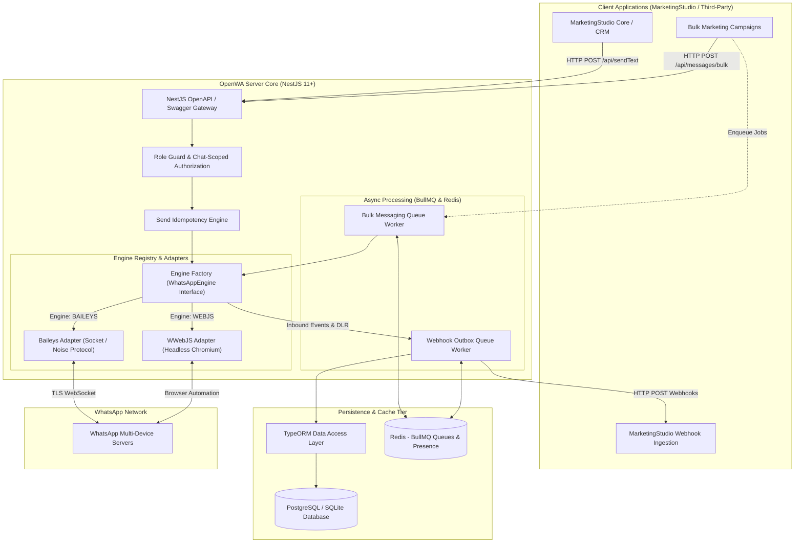
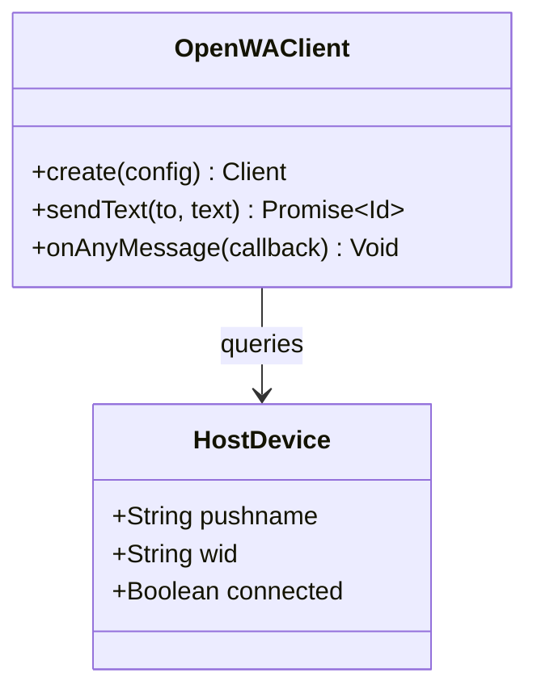
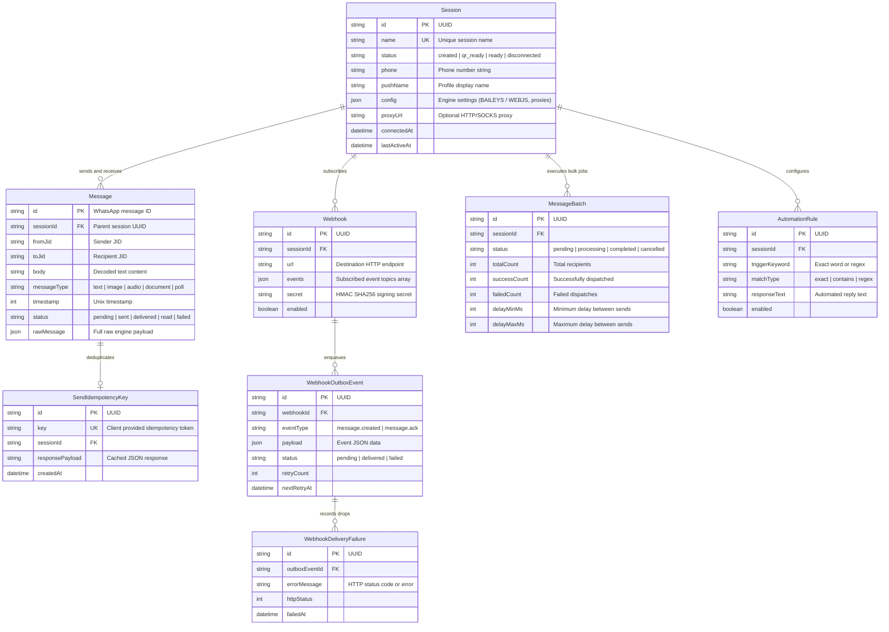
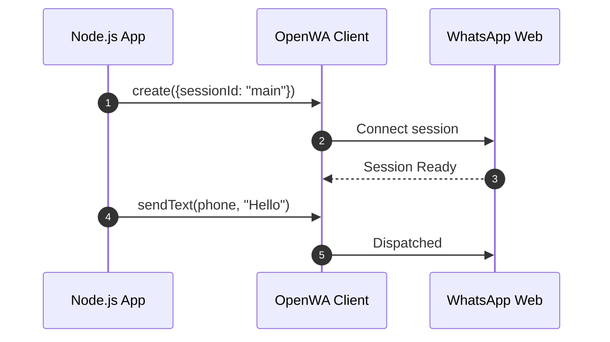

# OpenWA - Architecture & Technical Wiki

> **Enterprise Multi-Engine WhatsApp HTTP Gateway & Automation Platform**  
> GitHub: [rmyndharis/OpenWA](https://github.com/rmyndharis/OpenWA.git) | Stack: TypeScript, Node.js 22+, NestJS, TypeORM, PostgreSQL/SQLite, BullMQ, Redis, Baileys & WWebJS Dual Engines | License: MIT

---

## 1. Executive Summary & Value Proposition

**OpenWA** is an enterprise-grade, self-hosted WhatsApp HTTP API gateway engineered with NestJS and TypeORM. Designed to offer maximum operational resilience, OpenWA introduces a **dual-engine architecture** that seamlessly supports both `@whiskeysockets/baileys` (lightweight binary WebSocket protocol) and `whatsapp-web.js` (Puppeteer-driven browser automation) behind a single unified OpenAPI REST specification. It provides SaaS platforms and high-volume marketing teams with a production-ready, horizontally scalable messaging gateway featuring transactional webhook outbox delivery, batch queuing, audit logging, and role-based API access controls.

### Core Problems Solved
- **Vendor & Protocol Lock-in via Dual Engine Abstraction**: Isolates application code from underlying WhatsApp driver implementations. Operators can switch individual sessions between pure-socket Baileys (low RAM, high concurrency) and headless Chromium WWebJS (anti-ban resilience, full browser DOM fidelity) using a single configuration flag.
- **Transactional Webhook Reliability (Outbox Pattern)**: Prevents lost webhook notifications during network partitions or downstream receiver downtime by persisting events in a database outbox table before asynchronous delivery via BullMQ.
- **Enterprise-Grade Multi-Tenancy & RBAC**: Provides granular role-based authentication (`admin`, `readwrite`, `readonly`, `session-scoped`), chat-level authorization fences, and cryptographic API key hashing.
- **High-Throughput Campaign Bulk Dispatching**: Built-in batch orchestrator with Redis/BullMQ that enforces per-session rate limits, human-like jitter delays, and delivery tracking across thousands of outbound messages.

---

## 2. High-Level System Architecture

OpenWA is structured as a modular NestJS monolith. The platform decouples API routing, session engine lifecycles, background message queues, and webhook delivery. When an outbound message is submitted, it validates against NestJS DTOs, checks idempotency keys to prevent duplicate sends, resolves the target session's active engine adapter (`BaileysAdapter` or `WhatsappWebJsAdapter`), and streams delivery receipts into TypeORM and the webhook event fabric.



---

### 2.1 Core Domain & Service Class Architecture



---

## 3. Technology Stack & Key Dependencies

- **Language & Runtime**: TypeScript 5.7+, Node.js 22 LTS (ES2022 target).
- **Backend Framework**: NestJS 11+ with Fastify/Express platform adapters, `@nestjs/swagger` for auto-generated OpenAPI 3.0 specs, and class-validator/class-transformer for strict DTO parsing.
- **WhatsApp Gateway Engines**:
  - `@whiskeysockets/baileys` (v6.7+): Pure TypeScript binary protocol client.
  - `whatsapp-web.js` (v1.26+): Puppeteer-based browser automation client.
- **ORM & Databases**: TypeORM 0.3+ supporting PostgreSQL 15+ (production) and SQLite 3 (lightweight/embedded), complete with migration tooling (`src/database/migrations`).
- **Distributed Queues & Caching**: BullMQ (v5.x) backed by Redis 7+ via `ioredis` for reliable asynchronous job management.
- **Media & File Processing**: `sharp` for lazy WebP image transcoding, `music-metadata` for audio probing and voice note duration checks.
- **Monitoring & Security**: Prometheus metrics exporter (`/api/metrics`), bcrypt for API key hashing, Winston logger with JSON formatting.

---

## 4. Repository Layout & Key Modules

```
inspire/OpenWA/
├── dashboard/                       # Embedded management web UI (Next.js / Vite)
├── src/
│   ├── main.ts                      # Application bootstrap, Swagger setup, global pipes
│   ├── common/                      # Common transformers, pagination utils, decorators
│   ├── config/                      # Environment schema validation and typed configs
│   ├── database/                    # TypeORM data sources, migration scripts, base entities
│   │   ├── migrations/              # Production database migration ledger
│   │   └── data-source.ts           # Central TypeORM database connection config
│   ├── engine/                      # Core engine abstraction and adapter implementations
│   │   ├── interfaces/              # WhatsAppEngine abstract interface contract
│   │   ├── adapters/                # BaileysAdapter and WhatsappWebJsAdapter implementations
│   │   ├── engine.factory.ts        # Dynamic engine instantiation and lifecycle registry
│   │   └── identity/                # LID (Linked Identity) mapping utilities and entity
│   └── modules/                     # Modular NestJS domain feature modules
│       ├── session/                 # Session controller, entity, QR code & pairing service
│       ├── message/                 # Outbound sending, bulk batches, idempotency fence
│       ├── webhook/                 # Outbox event publisher, delivery failure retries
│       ├── group/                   # Group admin, participants, invite links
│       ├── channel/                 # WhatsApp Newsletters / Broadcast Channels
│       ├── contact/                 # Contact synchronization, blocklist, vCards
│       ├── automation/              # Keyword autoreply rules and execution engine
│       ├── auth/                    # API keys, role-based guards, workspace scoping
│       ├── audit/                   # Security audit logging entity and interceptors
│       └── metrics/                 # Prometheus metrics endpoints and health checks
├── docker-compose.yml               # Multi-container production compose stack
└── package.json                     # Dependency manifests and build scripts
```

---

## 5. Core Features & Capabilities

### Pluggable Dual-Engine Architecture
OpenWA decouples all messaging abstractions from the driver. Every session defines its driver type via `config.engine`:
- `BAILEYS`: Consumes minimal RAM (~80MB per session), boots in under 3 seconds, and communicates directly via binary WebSockets.
- `WEBJS`: Spawns headless Chromium via Puppeteer (~350MB per session), rendering full browser DOM contexts to bypass aggressive bot detection heuristics.
Switching engines does not require altering upstream API calls or webhook ingestion pipelines.

### Transactional Webhook Outbox Pattern
To prevent lost events during downstream receiver crashes:
1. Inbound messages and status receipts are atomically written to `webhook_outbox_events` in PostgreSQL.
2. A BullMQ worker reads pending outbox events, executing HTTP POST requests with exponential backoff retries.
3. Unrecoverable failures are written to `webhook_delivery_failures` for operator inspection and manual redrive.

### Send Idempotency Engine
Duplicate message prevention is critical in automated marketing campaigns. OpenWA includes a dedicated `send_idempotency_keys` table. Clients provide a unique `Idempotency-Key` HTTP header. If a network hiccup causes the client to retry an HTTP request, OpenWA returns the original response payload without firing a secondary message across WhatsApp.

### High-Volume Bulk Message Batching
The bulk messaging subsystem (`/api/messages/bulk`) ingests arrays of recipient payloads:
- Queues jobs into BullMQ.
- Applies user-defined minimum and maximum random delay intervals (jitter) between sends to emulate natural human typing.
- Monitors delivery percentages and allows real-time batch cancellation or pausing.

### Granular Role-Based Access Control (RBAC)
API keys (`api_keys` table) support scoped capabilities:
- `ADMIN`: Full cluster management, session creation, and API key provisioning.
- `READWRITE`: Complete messaging, contact, and group operations across permitted sessions.
- `SESSION_SCOPED`: Locks an API key strictly to a single WhatsApp session ID, preventing cross-tenant data leaks.

---

## 6. Data Models & Schema Architecture

OpenWA relies on TypeORM entities to persist cluster state, message history, webhook events, and security logs.



### Core Schema Entity Specifications
- **`Session`**: The foundational multi-tenant unit. Retains operational flags, engine choice, proxy assignments, and session connectivity timestamps.
- **`SendIdempotencyKey`**: Guarantees at-most-once execution for outbound API requests by caching responses against unique client tokens.
- **`WebhookOutboxEvent`**: Implements the transactional outbox pattern, buffering outbound webhook events in PostgreSQL before Redis queue worker execution.
- **`MessageBatch`**: Governs large-scale marketing campaigns, tracking progress, delay windows, and completion states across batches of contacts.

---

### 6.1 Comprehensive Database Schema Specification

OpenWA stores local session tokens and client state via SQLite or persistent file directories.

#### Table: `openwa_sessions`
| Column | Type | Constraints | Default | Description |
| :--- | :--- | :--- | :--- | :--- |
| `id` | `VARCHAR(100)` | `PRIMARY KEY` | - | Session name |
| `auth_state` | `TEXT` | `NOT NULL` | - | Serialized auth tokens |

---

## 7. API Architecture, Webhooks & Key Endpoints

### 1. Session Lifecycle: Start & Pair Session
- **POST** `/api/sessions`
- **Headers**: `X-Api-Key: <ADMIN_KEY>`, `Content-Type: application/json`

**Request Payload:**
```json
{
  "name": "sales-team-eu",
  "config": {
    "engine": "BAILEYS",
    "proxy": "socks5://proxy.marketingstudio.internal:1080",
    "webhooks": [
      {
        "url": "https://api.marketingstudio.io/v1/webhooks/openwa",
        "events": ["message", "message.ack", "session.status"]
      }
    ]
  }
}
```

**Response Payload (`201 Created`):**
```json
{
  "id": "7f8b9123-bcde-4321-a123-9876543210ab",
  "name": "sales-team-eu",
  "status": "qr_ready",
  "engine": "BAILEYS",
  "qr": {
    "code": "2@dGhpc2lzYXNhbXBsZXFyY29kZQ==...",
    "base64": "data:image/png;base64,iVBORw0KGgoAAAANSUhEUgAA..."
  }
}
```

### 2. Messaging: Send Text Message with Idempotency
- **POST** `/api/sendText`
- **Headers**: 
  - `X-Api-Key: <SESSION_KEY>`
  - `Idempotency-Key: msg_camp_9921_rec_441`
  - `Content-Type: application/json`

**Request Payload:**
```json
{
  "session": "sales-team-eu",
  "chatId": "15559876543@c.us",
  "text": "Hello Michael, here is the exclusive 20% discount code for your subscription renewal: RENEW20",
  "linkPreview": true
}
```

**Response Payload (`200 OK`):**
```json
{
  "id": "3EB091FA883201B",
  "timestamp": 1729768340,
  "from": "15550192834@c.us",
  "to": "15559876543@c.us",
  "body": "Hello Michael, here is the exclusive 20% discount code for your subscription renewal: RENEW20",
  "ack": 1,
  "status": "sent"
}
```

### 3. Bulk Messaging: Initiate Marketing Broadcast Batch
- **POST** `/api/messages/bulk`
- **Headers**: `X-Api-Key: <ADMIN_KEY>`, `Content-Type: application/json`

**Request Payload:**
```json
{
  "session": "sales-team-eu",
  "delayMinMs": 3000,
  "delayMaxMs": 8000,
  "messages": [
    {
      "chatId": "15551112222@c.us",
      "text": "Hi Sarah, our webinar starts in 1 hour!"
    },
    {
      "chatId": "15553334444@c.us",
      "text": "Hi David, our webinar starts in 1 hour!"
    }
  ]
}
```

**Response Payload (`202 Accepted`):**
```json
{
  "batchId": "a91b2c3d-4e5f-6a7b-8c9d-0e1f2a3b4c5d",
  "total": 2,
  "status": "pending",
  "estimatedCompletionTime": "2026-10-24T12:05:00.000Z"
}
```

### 4. Webhook Event Delivery Format (`message.ack`)
Pushed to MarketingStudio upon delivery acknowledgment:
```json
{
  "event": "message.ack",
  "session": "sales-team-eu",
  "timestamp": "2026-10-24T11:55:10.000Z",
  "payload": {
    "messageId": "3EB091FA883201B",
    "chatId": "15559876543@c.us",
    "ack": 2,
    "ackName": "DEVICE_DELIVERED"
  }
}
```

---

### 7.5 End-to-End Operational Lifecycle Sequence



---

## 8. Strategic Value & Takeaways for MarketingStudio

### Reusable Architectural Patterns
1. **Engine-Agnostic Interface Segregation (`WhatsAppEngine`)**:
   - *Problem*: Directly binding application business logic to a single WhatsApp engine (such as Baileys or Puppeteer) creates massive technical debt when breaking protocol changes occur.
   - *Solution*: OpenWA encapsulates every WhatsApp capability behind an explicit TypeScript contract (`WhatsAppEngine`). MarketingStudio should standardize on this exact interface pattern, enabling hot-swappable gateway backends without rewriting campaign controllers.

2. **The Webhook Outbox Pattern with BullMQ**:
   - *Problem*: High-concurrency incoming WhatsApp messages can overwhelm downstream webhook receivers, resulting in 502/504 errors and permanently lost message threads.
   - *Solution*: OpenWA writes event records to an outbox table within the same transaction that processes the message, delegating delivery to BullMQ workers with exponential backoff. MarketingStudio must implement this pattern to guarantee zero message loss during peak traffic.

3. **Built-in Send Idempotency Guard**:
   - *Problem*: Distributed microservices often retry HTTP requests during transient timeouts, leading to duplicate promotional messages sent to customers and immediate spam reports.
   - *Solution*: OpenWA records an MD5/UUID idempotency key for each outbound request. MarketingStudio's marketing automation workflow engine should mandate `Idempotency-Key` headers on all dispatch endpoints.

### Concrete Convergence Roadmap for MarketingStudio
- **Core Messaging Infrastructure**: Deploy OpenWA as an enterprise-grade WhatsApp cluster within MarketingStudio's Docker / Kubernetes infrastructure.
- **Bulk Outreach Campaigns**: Route multi-thousand-contact cold outreach and re-engagement campaigns through OpenWA's bulk batch engine to take advantage of automated human-like jitter delays.
- **Unified OpenAPI Client**: Auto-generate TypeScript client SDKs using OpenWA's `/openapi.json` schema, simplifying front-end and worker integrations across MarketingStudio.
