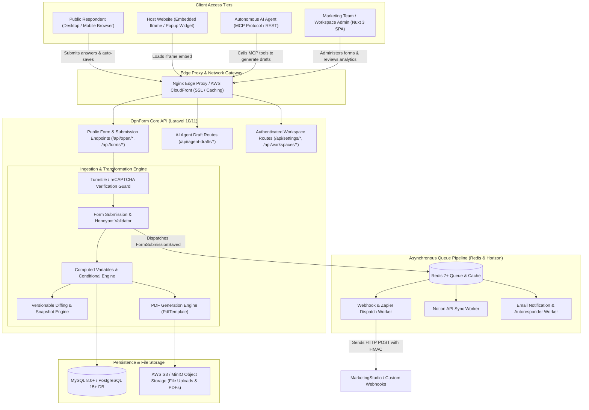
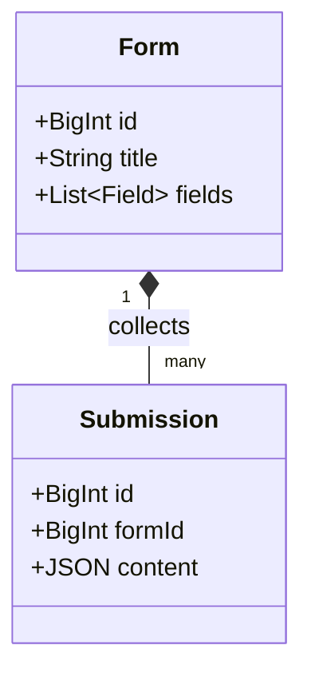
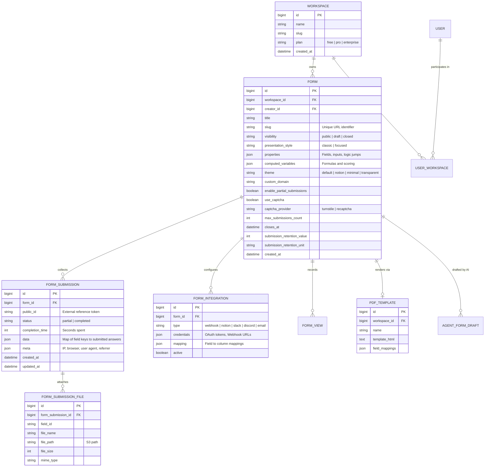
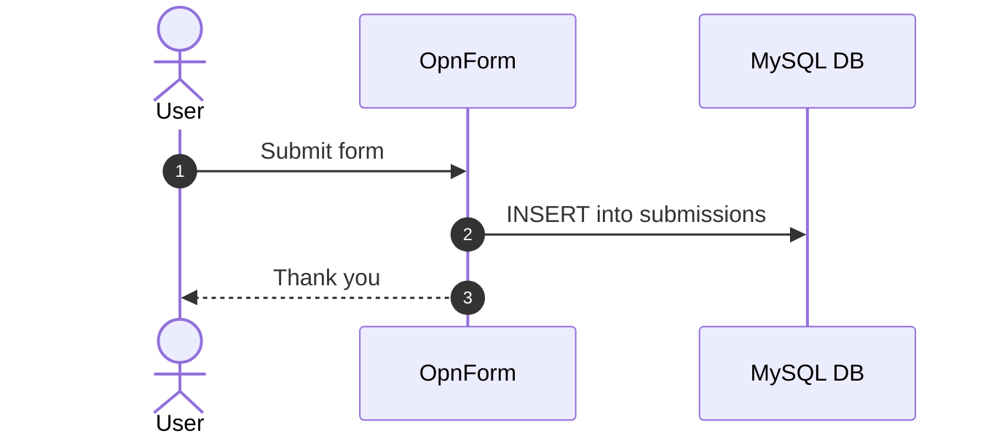

# OpnForm - Architecture & Technical Wiki

> **Open-Source Form Builder, Notion-Inspired Dynamic Form Engine & Headless Ingestion Platform**  
> GitHub: [JhumanJ/OpnForm](https://github.com/JhumanJ/OpnForm) | Stack: PHP 8.2+, Laravel 10/11, Nuxt 3, Vue 3, MySQL / PostgreSQL, Redis, Horizon, Tailwind CSS | License: AGPLv3 / Commercial

---

## 1. Executive Summary & Value Proposition

**OpnForm** is a modern, full-featured open-source form builder and data ingestion platform engineered for high customizability, privacy, and seamless third-party synchronization (most notably Notion, Slack, Discord, and Webhooks). Positioned as an open alternative to Typeform, Google Forms, and Tally, OpnForm empowers marketing and operations teams to construct beautiful, brand-aligned forms in minutes using either a block-based document builder or a conversational focused view.

Traditional form tools suffer from rigid database models that require complex table alters for every added question, lack native version control, and present severe data lock-in. OpnForm solves this through a clean, decoupled architecture: a robust **Laravel** backend stores dynamic form structures and logic trees within JSON columns, tracks atomic historical revisions with diffing (`VersionableNestedDiff`), and provides dual presentation styles (`classic` full-page layouts and `focused` one-question-at-a-time flows) rendered by a **Nuxt 3 / Vue 3** reactive frontend.

### Core Problems Solved
- **Complex Dynamic Field Modeling Without Schema Alterations**: Encapsulates form properties, custom input blocks, validation rules, and logic jumps in structured JSON attributes, eliminating relational schema migrations for user-defined forms.
- **Data Loss & Accidental Overwrites**: Implements comprehensive document-level versioning (`Mpociot\Versionable`), maintaining the last 5 revisions of form definitions and allowing instant rollbacks.
- **Partial Submission Abandonment Recovery**: Features `enable_partial_submissions` and `auto_save` functionality, streaming incremental form inputs to capture leads who abandon multi-page questionnaires.
- **AI-Agent Integration & Automated Drafts**: Pioneered MCP (Model Context Protocol) and AI Agent endpoints (`agent-drafts`), allowing autonomous agents to generate, preview, and hand off complete form drafts programmatically.
- **Direct Notion Database Synchronization**: Native bi-directional integration that maps form fields directly to Notion database properties, transforming forms into seamless external data entry portals.

---

## 2. High-Level System Architecture

OpnForm is organized as a decoupled full-stack application featuring a Laravel API backend (`api/`) and a Nuxt 3 frontend client (`client/`).



### Architectural Lifecycle of a Form Submission
1. **Schema Retrieval & Hydration**: The respondent visits `opnform.com/forms/{slug}`. Nuxt 3 fetches the cached form definition via `GET /api/open/forms/{slug}`. The payload includes `properties` (input blocks, choices, logic conditions), `theme`, `presentation_style`, and `captcha_provider`.
2. **Interactive Input & Partial Auto-Save**: In `focused` mode, the client advances step-by-step. If `enable_partial_submissions` is active, the frontend issues debounced `POST /api/open/forms/{slug}/partial-submissions`, creating an initial `status: partial` submission in MySQL.
3. **Validation & Spam Filter Execution**: Upon submission, Laravel validates incoming keys against declared fields. It checks honeypot fields (`_hp`), validates Google reCAPTCHA or Cloudflare Turnstile tokens, and verifies that `closes_at` or `max_submissions_count` thresholds have not been breached.
4. **Atomic Versioning & Record Persistence**: Laravel saves the completed `FormSubmission` with `status: completed` and execution runtime (`completion_time`). Any attached documents are securely uploaded to S3 storage via `FormSubmissionFile`.
5. **Event Emission & Async Queueing**: The Eloquent event `FormSubmissionSaved` triggers listeners that push jobs onto Redis. Laravel Horizon workers execute webhook dispatches, trigger Notion database inserts, and email PDF confirmation receipts to the respondent.

---

### 2.1 Core Domain & Service Class Architecture



---

## 3. Technology Stack & Key Dependencies

- **Language & Runtime**: PHP 8.2 / 8.3, Node.js 20+ (Nuxt 3 compilation).
- **Backend Application Framework**:
  - **Laravel 10 / 11**: MVC framework providing routing, Eloquent ORM, events, and queues.
  - **Laravel Horizon**: Redis queue monitoring dashboard and job supervisor.
  - **Laravel Sanctum / Multi-Auth**: Token-based authentication and session cookies.
  - `mpociot/versionable`: Object versioning tracking JSON diffs between revisions.
  - `spatie/laravel-sluggable`: Automatic URL slug generation for public form links.
- **Database & Object Storage**:
  - **MySQL 8.0+** or **PostgreSQL 14+**: Relational storage leveraging JSON columns for dynamic properties.
  - **Redis 7+**: Application caching, rate limiting, and queue management.
  - **AWS S3 / MinIO**: Storage for uploaded user attachments and generated PDF export files.
- **Frontend Architecture**:
  - **Nuxt 3 & Vue 3**: Universal SSR / SPA framework with Pinia state management.
  - **Tailwind CSS**: Responsive styling with support for custom CSS overrides and dark mode.
- **Third-Party Integrations**:
  - Notion API client, Stripe Connect (payments), Google Drive, Slack, Discord Webhooks, Cloudflare Turnstile.

---

## 4. Repository Layout & Key Modules

```
OpnForm/
├── api/                              # Laravel Backend Application
│   ├── app/
│   │   ├── Contracts/                # Interfaces (VersionableNestedDiff.php)
│   │   ├── Events/                   # Model & Domain events (FormSubmissionSaved.php)
│   │   ├── Http/
│   │   │   ├── Controllers/          # API Controllers (FormController, SubmissionController)
│   │   │   ├── Middleware/           # MCP, Auth, CORS, and RateLimit middleware
│   │   │   └── Requests/             # Form submission and creation request validators
│   │   ├── Jobs/                     # Queued workers (DispatchWebhookJob, SyncNotionJob)
│   │   ├── Models/                   # Eloquent models
│   │   │   ├── Forms/                # Form.php, FormSubmission.php, AgentFormDraft.php
│   │   │   ├── Integration/          # FormIntegration.php, FormZapierWebhook.php
│   │   │   └── Workspace.php         # Multi-tenant workspace boundary
│   │   └── Services/                 # Business logic (NotionService, CaptchaService)
│   ├── config/                       # Laravel configuration files
│   ├── database/                     # Migrations, seeders, factories
│   └── routes/
│       ├── api.php                   # Core REST routes and AI Agent MCP routes
│       └── web.php                   # Web and OAuth redirect routes
├── client/                           # Nuxt 3 Frontend Application
│   ├── components/                   # Vue 3 UI components, form builder canvas
│   ├── composables/                  # Vue composables (useForm, useSubmissions, useAuth)
│   ├── layouts/                      # App and public form presentation layouts
│   ├── pages/                        # Nuxt page routes (/forms, /submissions, /settings)
│   ├── stores/                       # Pinia state stores
│   └── nuxt.config.ts                # Nuxt 3 build & runtime configuration
├── plugins/opnform/                  # MCP Plugin metadata & skills definitions
└── docker-compose.yml                # Local orchestration configuration
```

---

## 5. Core Features & Capabilities

### 5.1 Dual Presentation Styles: Classic vs. Focused
OpnForm gives form creators immediate control over user experience:
- **`classic`**: Vertical scrolling layout displaying all fields simultaneously. Ideal for complex business agreements, medical intake, or order forms with many inputs.
- **`focused`**: Conversational, one-question-at-a-time interactive view with smooth vertical sliding transitions, automated scroll-to-next on input selection, and keyboard hotkeys.

### 5.2 Dynamic Logic Jumps & Computed Variables
- **Rule-Based Routing**: Fields conditionally show, hide, or alter required status based on previous selections (e.g., if "Company Size" is $>500$, reveal "Procurement Contact Name").
- **Computed Variables (`computed_variables`)**: Evaluates real-time mathematical expressions in the browser (e.g., `total = quantity * 49.99`), updating summary blocks dynamically.

### 5.3 Automated PDF Document Generation
- Integrates with `PdfTemplate` models: when a submission completes, OpnForm maps submitted answers into predefined PDF templates (invoices, certificates, or NDAs).
- The generated PDF is instantly downloadable by the respondent or emailed as an attachment.

### 5.4 Native AI Agent & MCP Integration
- Incorporates dedicated AI agent draft endpoints (`/api/agent-drafts/*`) powered by the Model Context Protocol (MCP).
- External LLM agents can create, preview, modify, and claim form drafts, allowing automated creation of complex forms from conversational agent prompts.

### 5.5 Privacy, Retention & Compliance Controls
- **Submission Retention Policies**: Automatically schedules deletion of sensitive form submissions after a configurable window (`submission_retention_value`, `submission_retention_unit`: days, weeks, months, or years).
- **IP Address Anonymization**: Configurable `enable_ip_tracking` toggle to maintain strict GDPR compliance.
- **Password Protection**: Allows password-protecting sensitive internal surveys.

---

## 6. Data Models & Schema Architecture

OpnForm uses Eloquent models backed by MySQL / PostgreSQL, isolating records by `workspace_id`.



### Core Schema Invariants
1. **JSON Properties Column**: All user-defined inputs, choices, order sequences, and logic conditions live inside `forms.properties`. This allows zero-downtime additions of new input types.
2. **Versionable Snapshots**: Whenever a form’s `properties` or `title` changes, the `VersionableTrait` automatically serializes a diff into the `versions` table, preserving an audit trail of changes.
3. **Soft Deletions**: Uses Laravel's `SoftDeletes` on `Form` and `FormSubmission` to allow immediate recovery from accidental user deletions.

---

### 6.1 Comprehensive Database Schema Specification

#### Table: `submissions`
| Column | Type | Constraints | Default | Description |
| :--- | :--- | :--- | :--- | :--- |
| `id` | `BIGINT` | `PRIMARY KEY AUTO_INCREMENT` | - | ID |
| `form_id` | `BIGINT` | `NOT NULL` | - | Parent form |
| `content` | `JSON` | `NOT NULL` | - | Submitted values |

---

## 7. API Architecture, Webhooks & Key Endpoints

OpnForm exposes a RESTful JSON API divided into public ingestion routes, AI agent MCP routes, and authenticated management routes.

### Key Endpoints

| HTTP Method | Endpoint | Description |
|:---|:---|:---|
| `GET` | `/api/open/forms/{slug}` | Fetches public form definition, styling, and fields |
| `POST` | `/api/open/forms/{slug}/submissions` | Submits answers and triggers integration webhooks |
| `POST` | `/api/open/forms/{slug}/partial-submissions` | Ingests or updates an incomplete draft submission |
| `GET` | `/api/agent-drafts/preview/{draft}` | Previews an AI-generated form draft |
| `POST` | `/api/agent-drafts/editor/claim` | Claims an AI-generated draft into an authenticated workspace |
| `GET` | `/api/forms/{id}/submissions` | Retrieves paginated submissions for form owner |
| `POST` | `/api/forms/{id}/integrations` | Configures outbound webhooks or Notion sync rules |

### Sample Request: Form Submission (`POST /api/open/forms/{slug}/submissions`)
```json
{
  "answers": {
    "first_name": "Marcus",
    "work_email": "marcus.aurelius@stoicgrowth.com",
    "company_headcount": "250-500",
    "annual_marketing_budget": "$250,000+",
    "primary_channels": ["LinkedIn Ads", "Outbound Email"]
  },
  "completion_time": 52,
  "turnstile_token": "0.3A1b8Z...test_token"
}
```

### Sample Outbound Webhook Payload
```json
{
  "event": "form_submission.created",
  "form": {
    "id": 1420,
    "title": "B2B Marketing Audit Request",
    "slug": "b2b-marketing-audit-request"
  },
  "submission": {
    "id": 89412,
    "public_id": "sub_92k4019a820",
    "status": "completed",
    "completion_time_seconds": 52,
    "submitted_at": "2026-10-24T12:00:00Z",
    "data": {
      "first_name": "Marcus",
      "work_email": "marcus.aurelius@stoicgrowth.com",
      "company_headcount": "250-500",
      "annual_marketing_budget": "$250,000+",
      "primary_channels": ["LinkedIn Ads", "Outbound Email"]
    },
    "meta": {
      "ip": "203.0.113.195",
      "referrer": "https://marketingstudio.internal/campaigns"
    }
  }
}
```

---

### 7.5 End-to-End Operational Lifecycle Sequence



---

## 8. Strategic Value & Takeaways for MarketingStudio

### Reusable Architectural Patterns
1. **Dynamic JSON Form Schema with Field Versioning**:
   - OpnForm’s strategy of housing dynamic form definitions in a JSON `properties` column while maintaining revision histories via `VersionableTrait` provides a proven pattern for MarketingStudio’s landing page form builder. Marketers can alter form fields without requiring database migrations.
2. **First-Class AI Agent Draft Handoff (MCP)**:
   - OpnForm’s `/api/agent-drafts/` architectural subsystem demonstrates how MarketingStudio can allow its autonomous marketing agents (e.g., AgentSDR or Copywriter Agent) to programmatically draft lead capture forms, generate preview URLs, and hand them off to human operators for one-click approval.
3. **Automated Submission Retention & GDPR Scrubbing**:
   - Incorporating configurable data retention rules directly on the form model (`submission_retention_value` and `submission_retention_unit`) allows MarketingStudio to automatically clean up lead PII after marketing qualification, minimizing regulatory compliance liability.
4. **Instant PDF Receipt Generation Pipeline**:
   - The decoupling of HTML form submissions from downloadable `PdfTemplate` rendering provides MarketingStudio with an instant blueprint for offering gated lead-magnets (e.g., automatically generating customized marketing audit reports or certificates upon form completion).
