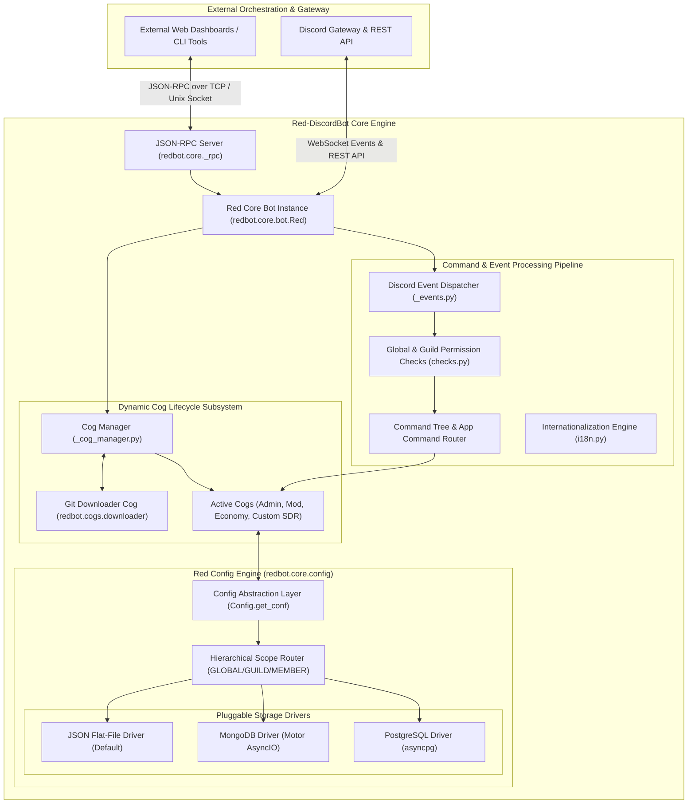
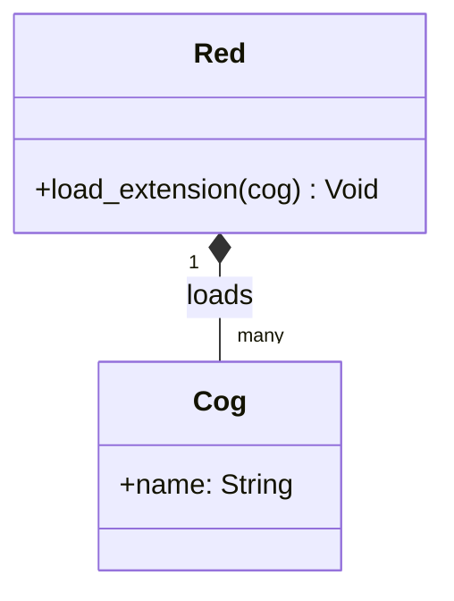
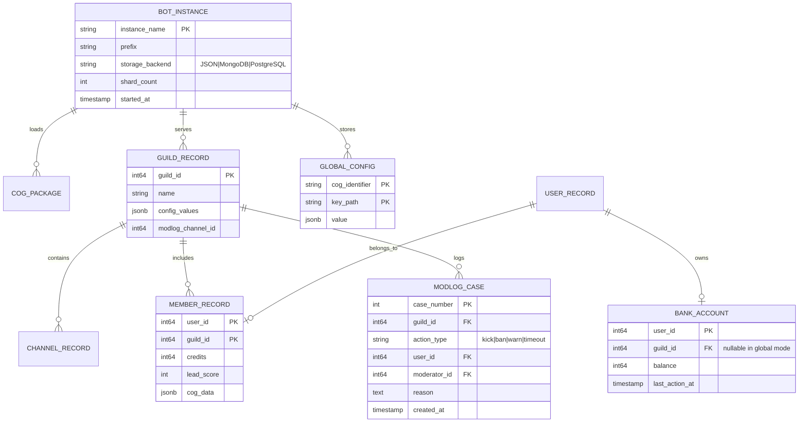
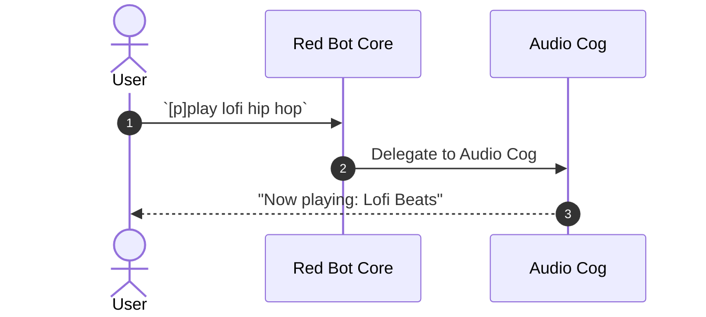

# Red-DiscordBot - Architecture & Technical Wiki

> **Modular, Extensible Multi-Server Discord Bot Framework with Pluggable Cogs & Unified Data Engine**  
> GitHub: [Cog-Creators/Red-DiscordBot](https://github.com/Cog-Creators/Red-DiscordBot) | Stack: Python 3.9-3.12+, discord.py 2.x, AsyncIO, Red Config Data Engine (JSON, MongoDB, Postgres), Dynamic Cog Lifecycle, JSON-RPC | License: GNU GPLv3

---

## 1. Executive Summary & Value Proposition

**Red-DiscordBot** (commonly known as Red) is the industry benchmark for modular, multi-server, self-hosted Discord bot architectures in Python. Developed and refined over a decade, Red bridges Discord's low-level Gateway protocol and high-level community management by providing a fully asynchronous plugin engine ("Cogs"), a multi-driver hierarchical persistence engine (`Config`), an integrated virtual economy system (`bank`), and a headless JSON-RPC interface.

Red's core value proposition lies in its unyielding commitment to modularity and operator autonomy. Rather than forcing administrators into a rigid, monolithic feature set, Red operates as an extensible micro-kernel. Operators can dynamically load, unload, update, and install third-party functionality at runtime without restarting the bot process. Its unified configuration layer abstracts the underlying database—allowing seamless migration between JSON flat-files, MongoDB, and PostgreSQL while providing hierarchical state scoping across global, guild, channel, and member dimensions.

### Core Problems Solved
- **Monolithic Inflexibility & Deployment Downtime**: Provides a dynamic Cog Manager (`_cog_manager.py`) allowing features to be hot-reloaded, enabled, or disabled on the fly without breaking active Discord Gateway connections.
- **Multi-Tenant State Complexity**: Solves the nightmare of managing settings across thousands of independent servers and users via the 6-tier `Config` engine (`GLOBAL`, `GUILD`, `CHANNEL`, `ROLE`, `USER`, `MEMBER`).
- **Database Vendor Lock-In**: Features a driver-agnostic data layer where identical Python async calls read and write to flat JSON files, MongoDB (via Motor), or PostgreSQL without modifying cog application code.
- **Third-Party Plugin Governance & Distribution**: Built-in `Downloader` cog manages external Git repositories, semver dependency resolution, and security warnings for community-authored plugins.
- **Headless & Multi-Interface Administration**: Built-in JSON-RPC server (`_rpc.py`) allows external web dashboards, command-line interfaces, and AI orchestration scripts to manage the bot programmatically.

---

## 2. High-Level System Architecture

Red-DiscordBot's architecture is centered around the `Red` class (subclassing `discord.ext.commands.AutoShardedBot`), which coordinates event dispatching, command invocation, permission checks, data drivers, and cog lifecycle management.



### Architectural Data Flow Narrative
1. **Gateway Event Ingestion**: Inbound Discord WebSocket updates reach `redbot.core.bot.Red`. The internal event dispatcher routes messages through internationalization translators (`i18n.py`) and standardizes payloads.
2. **Permission Checks & Command Dispatch**: When a command (prefix or slash command) is invoked, Red evaluates a multi-tiered check pipeline: global bot owner checks, guild admin rules, channel restrictions, and custom cog checks. If any check fails, execution aborts with localized user feedback.
3. **Dynamic Cog Execution**: The command delegates to the loaded Cog instance. If an operator updates or unloads a cog via `[p]cog unload <name>`, Red cleans up listeners, deregisters slash commands from Discord's API, and removes the module from memory without dropping active voice streams or shard connections.
4. **Hierarchical State Access**: Inside a cog, state operations route through `Config.get_conf(cog_instance, identifier=...)`. Developers access scoped variables (`await conf.guild(guild).welcome_message.set("Hello!")`) without writing raw SQL queries or managing database connections.
5. **Headless Control**: External services query `_rpc.py` via JSON-RPC 2.0 to trigger commands, fetch loaded cog statuses, or adjust server settings without requiring Discord user impersonation.

---

### 2.1 Core Domain & Service Class Architecture



---

## 3. Technology Stack & Key Dependencies

- **Language & Runtime**: Python 3.9, 3.10, 3.11, 3.12+ (Type-annotated, modern asyncio async/await patterns)
- **Discord Gateway Framework**: `discord.py` 2.x (Fork maintained with latest Discord API v10 capabilities, slash commands, context menus, and UI components)
- **Data Persistence & Drivers**:
  - `redbot.core.config`: Native custom hierarchical persistence engine
  - Flat JSON with atomic write buffers (default self-contained storage)
  - `motor` (3.0+) for asynchronous MongoDB persistence
  - `asyncpg` for PostgreSQL driver integration
- **Packaging & Dynamic Code Execution**:
  - `GitPython`: Clones and tracks remote git repositories for third-party cogs
  - `pip` programmatic invocation for on-the-fly wheel dependency installation
- **Networking & RPC**:
  - `aiohttp` (3.9+) for HTTP requests and external webhook consumption
  - JSON-RPC 2.0 daemon running over local TCP or Unix Domain Sockets
- **Internationalization**: GNU gettext / Crowdin integration for multi-language community localization

---

## 4. Repository Layout & Key Modules

```
Red-DiscordBot/
├── redbot/
│   ├── cogs/                          # 20+ Core built-in cogs
│   │   ├── admin/                     # Server configuration, announce, and self-roles
│   │   ├── alias/                     # User-defined macro aliases for complex commands
│   │   ├── audio/                     # Lavalink-powered high-fidelity voice and music streaming
│   │   ├── cleanup/                   # High-speed bulk message deletion and pruning
│   │   ├── customcom/                 # Dynamic server custom commands with variable substitution
│   │   ├── downloader/                # Git-based third-party cog package manager
│   │   ├── economy/                   # Server economy and payroll integration
│   │   ├── filter/                    # Advanced word-filtering and regex anti-abuse
│   │   ├── mod/                       # Kick, ban, tempban, slowmode, and infraction commands
│   │   ├── modlog/                    # Tamper-evident moderation audit logging and case tracking
│   │   ├── permissions/               # Granular override engine for command permissions
│   │   └── warnings/                  # Progressive disciplinary strike and warning actions
│   ├── core/                          # Micro-kernel framework components
│   │   ├── app_commands/              # Slash command and context menu bridging
│   │   ├── commands/                  # Command decorators, argument converters, and context
│   │   ├── _drivers/                  # Storage driver implementations (JSON, Mongo, Postgres)
│   │   ├── bank.py                    # Unified economy API (balances, currency, bank limits)
│   │   ├── bot.py                     # Red core class inheriting AutoShardedBot
│   │   ├── checks.py                  # Global and custom permission predicates
│   │   ├── config.py                  # 6-Tier Scoped Config data engine
│   │   ├── data_manager.py            # Instance directory paths and file resolution
│   │   ├── modlog.py                  # Modlog case registration and dispatch
│   │   ├── _cog_manager.py            # Dynamic cog importer, loader, and unloader
│   │   └── _rpc.py                    # Headless JSON-RPC 2.0 daemon
│   ├── logging.py                     # Rotating file and console logging subsystem
│   ├── setup.py                       # CLI instance setup wizard (`redbot-setup`)
│   └── __main__.py                    # Main startup entrypoint
├── pyproject.toml                     # Python packaging and linting configurations
├── setup.py                           # Setuptools package installer
└── tox.ini                            # Multi-version test runner configuration
```

---

## 5. Core Features & Capabilities

### 5.1 Dynamic Cog Lifecycle & Git Downloader
Red treats every functionality module as a "Cog". Through `redbot.core._cog_manager`:
- Cogs can be loaded, unloaded, and reloaded in real time using commands (`[p]load <cog>`, `[p]reload <cog>`).
- The `Downloader` cog connects to community repositories on GitHub or GitLab, inspects manifest files (`info.json`), verifies Python dependency requirements, installs missing PyPI packages via pip, and loads the extension seamlessly.

### 5.2 Red Hierarchical `Config` Data Engine
The standout architectural innovation of Red is `redbot.core.config.Config`:
- Provides a clean asynchronous API that completely hides SQL or document database complexity.
- Offers 6 distinct scopes of persistent state:
  1. `GLOBAL`: Applied bot-wide (e.g., bot owners, API tokens, global blacklists).
  2. `GUILD`: Per-server configuration (e.g., prefix, welcome channel, lead alerts).
  3. `CHANNEL`: Specific text/voice channel settings.
  4. `ROLE`: Role-specific attributes and permissions.
  5. `USER`: Global user profile spanning across all servers.
  6. `MEMBER`: Server-specific user state (e.g., guild level, warnings, guild-scoped notes).

```python
# Real Red Config usage example
from redbot.core import Config, commands

class LeadCapture(commands.Cog):
    def __init__(self, bot):
        self.bot = bot
        self.config = Config.get_conf(self, identifier=8923748923)
        self.config.register_guild(sales_channel=None, alert_role=None)
        self.config.register_member(lead_score=0, qualified=False)

    @commands.command()
    async def qualify(self, ctx: commands.Context):
        await self.config.member(ctx.author).qualified.set(True)
        await ctx.send("Prospect marked as qualified!")
```

### 5.3 Virtual Economy Engine (`bank.py`)
Red includes a robust, thread-safe virtual economy engine directly in its core:
- Supports both *Global* (currency shared across all servers) and *Guild-specific* (independent economies per server) modes.
- Enforces atomic balance updates, preventing double-spend race conditions during concurrent transactions.
- Provides standard transactional primitives (`get_balance`, `deposit_credits`, `withdraw_credits`, `transfer_credits`, `set_max_balance`).

### 5.4 Unified ModLog & Case Tracking System
The `modlog` module provides tamper-evident audit logging for administrative actions:
- Every action (warn, kick, ban, timeout, channel wipe) creates an incremental `Case` with a cryptographic-style sequence ID.
- Stores moderator ID, target user, timestamp, reason, and automated action.
- Allows retrospective reason editing (`[p]reason <case_id> <new_reason>`) while preserving the original action's audit trail.

### 5.5 Headless JSON-RPC Control Server (`_rpc.py`)
Red embeds a JSON-RPC 2.0 server enabling external process orchestration:
- Accepts authenticated RPC requests over TCP or local Unix sockets.
- Allows external software (e.g., MarketingStudio's central orchestrator) to trigger bot commands, fetch guild statistics, or dynamically load new campaign cogs without interacting with Discord's UI.

---

## 6. Data Models & Schema Architecture

Red's data architecture is conceptually modeled around instances, cogs, scopes, and modlog cases.



### Core Schema Semantics
- **`Config Storage Hierarchy`**: Keys are addressed via `[COG_IDENTIFIER][SCOPE][ENTITY_ID][CUSTOM_KEY]`. This provides mathematical collision prevention between independent cogs.
- **`MODLOG_CASE`**: Represents an irreversible audit log entry for user governance and compliance.
- **`BANK_ACCOUNT`**: Tracks virtual balance and transaction history with boundary assertions.

---

### 6.1 Comprehensive Database Schema Specification

Red-DiscordBot manages JSON / MongoDB / PostgreSQL data layers.

#### Table: `red_configs`
| Column | Type | Constraints | Default | Description |
| :--- | :--- | :--- | :--- | :--- |
| `cog_name` | `VARCHAR(100)` | `PRIMARY KEY` | - | Cog name |
| `settings` | `JSON` | `NOT NULL` | `'{}'` | Stored attributes |

---

## 7. API Architecture, Webhooks & Key Endpoints

### 7.1 JSON-RPC 2.0 Interface (`redbot.core._rpc`)
Provides headless external management without relying on chat commands.

#### Sample RPC Request: Load Cog
```json
{
  "jsonrpc": "2.0",
  "method": "COG__LOAD",
  "params": ["marketing_sdr_outreach"],
  "id": 101
}
```

#### Sample RPC Response:
```json
{
  "jsonrpc": "2.0",
  "result": {
    "status": "success",
    "cog": "marketing_sdr_outreach",
    "loaded_commands": ["sdr_qualify", "sdr_broadcast", "sdr_stats"],
    "elapsed_ms": 142
  },
  "id": 101
}
```

### 7.2 Programmatic Bank Credit Transfer (`bank.py`)
```python
from redbot.core import bank

# Atomic deposit into prospect or member ledger
await bank.deposit_credits(member_instance, amount=500)
current_balance = await bank.get_balance(member_instance)
```

---

### 7.5 End-to-End Operational Lifecycle Sequence



---

## 8. Strategic Value & Takeaways for MarketingStudio

### Reusable Architectural Patterns
1. **The 6-Tier Scoped Configuration Model**:  
   Red's `Config` engine (`GLOBAL`, `GUILD`, `CHANNEL`, `ROLE`, `USER`, `MEMBER`) is the single best architectural model for multi-tenant SaaS. In MarketingStudio, lead and campaign configuration should follow this exact hierarchy: `ORGANIZATION` -> `WORKSPACE` -> `CAMPAIGN` -> `CHANNEL` -> `PROSPECT`.

2. **Hot-Reloadable Micro-Kernel / Cog Plugin Architecture**:  
   Instead of forcing complete application restarts when deploying new marketing outreach playbooks, adopting Red's dynamic Cog architecture allows MarketingStudio to hot-reload conversational playbooks, integrations, and compliance filters on running worker nodes without dropping active prospect chats.

3. **Virtual Bank Engine for Usage Quotas & Lead Credits**:  
   Red's atomic `bank.py` implementation provides the perfect reference architecture for managing customer campaign budgets, AI generation tokens, and outbound SMS/Call credits across multiple team members with fail-safe balance checking.

4. **Headless JSON-RPC Gateway for AI Multi-Agent Orchestration**:  
   Embedding an internal JSON-RPC daemon inside bot worker processes enables MarketingStudio's background autonomous agents (AgentSDR, cold dialers) to inspect state, trigger announcements, and control messaging workers programmatically.
