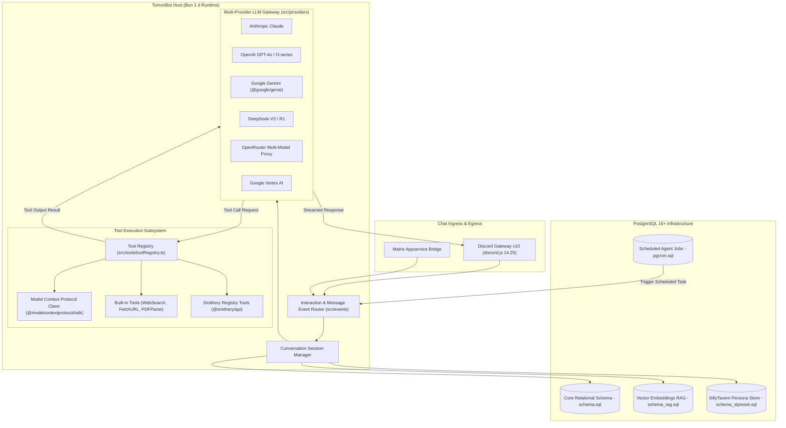
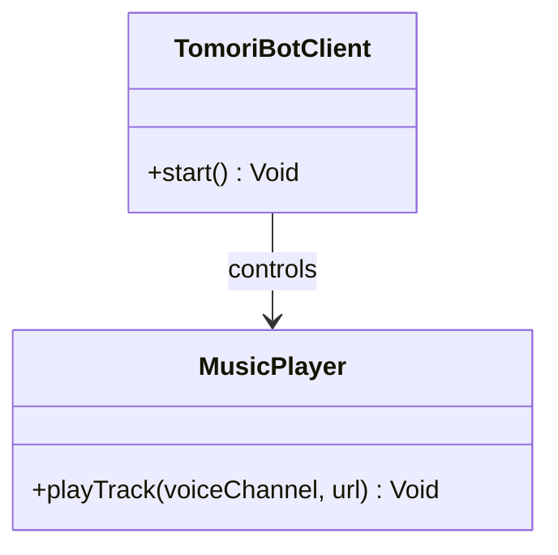
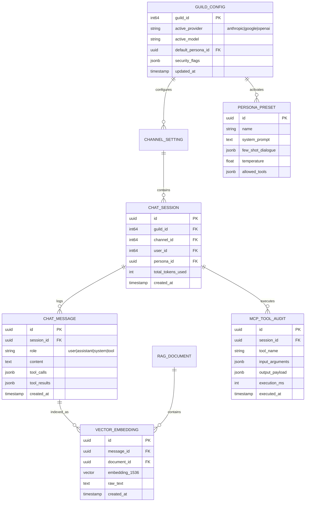
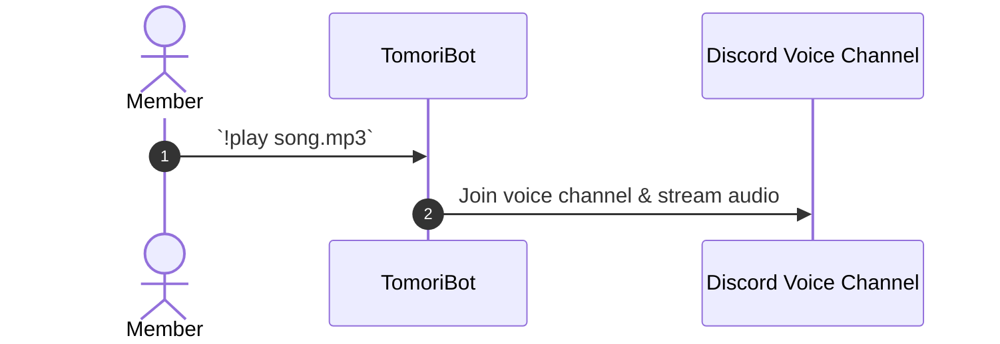

# TomoriBot - Architecture & Technical Wiki

> **Next-Generation Customizable AI Assistant Discord Bot Powered by Bun, Multi-Provider LLMs, & Model Context Protocol (MCP)**  
> GitHub: [Bredrumb/TomoriBot](https://github.com/Bredrumb/TomoriBot) | Stack: TypeScript, Bun 1.4+, discord.js 14.25+, PostgreSQL, pgvector, pg_cron, Model Context Protocol (MCP) | License: ISC

---

## 1. Executive Summary & Value Proposition

**TomoriBot** is an advanced, production-grade conversational AI assistant and multi-agent Discord bot engineered on the high-performance Bun runtime. Built to transcend basic chatbots, TomoriBot combines multi-provider LLM orchestration (Anthropic Claude, OpenAI, Google Gemini, DeepSeek, Vertex AI, OpenRouter, NVIDIA, NovelAI), standardized tool execution via the Model Context Protocol (MCP), deep episodic memory using vector embeddings in PostgreSQL (`pgvector`), and extensive character/persona modeling compatible with SillyTavern presets.

By executing natively on Bun, TomoriBot achieves instantaneous startup times, minimal memory consumption, and ultra-low latency response streaming. Its tool registry decouples the conversational reasoning loop from external side-effects, allowing the assistant to browse the web, ingest PDFs, execute arbitrary REST APIs, interface with Smithery and MCP tool registries, and schedule autonomous background cron jobs via `pg_cron`.

### Core Problems Solved
- **LLM Vendor Monoculture & Fragility**: Implements a universal provider abstraction layer (`src/providers`) supporting 10+ model vendors with automatic rate-limit failovers and cost-optimized routing.
- **Unstructured & Proprietary Tool Calling**: Adopts the industry-standard Model Context Protocol (`@modelcontextprotocol/sdk`), enabling the bot to execute local and remote MCP tools with zero custom glue code.
- **Catastrophic Context Amnesia**: Employs a dual-tier memory system combining short-term sliding context windows with long-term semantic memory powered by PostgreSQL and `pgvector` (`schema_rag.sql`).
- **Rigid AI Personalities**: Features a dynamic persona and preset engine (`schema_stpreset.sql`), allowing operators to define distinct behavioral personas (e.g., technical SDR, consultative executive, community manager) with customized system instructions and few-shot examples.
- **Platform Siloing**: Includes an integrated Matrix Appservice Bridge (`matrix-appservice-bridge`), allowing conversational AI interactions to bridge seamlessly between Discord communities and federated Matrix chat rooms.

---

## 2. High-Level System Architecture

TomoriBot is organized around a high-speed event loop driven by the Bun JavaScript runtime, interfacing with Discord Gateway v10 via `discord.js` and delegating reasoning to an extensible array of LLM backends and MCP tools.



### Architectural Data Flow Narrative
1. **Event Capture & Context Hydration**: Inbound messages or slash commands strike `src/events/messageCreate.ts` or `src/events/interactionCreate.ts`. TomoriBot verifies guild permissions, identifies the active persona preset for the channel, and initializes a conversation session.
2. **Episodic Memory & RAG Retrieval**: Before dispatching to the LLM, the system generates embeddings for recent dialogue turns and executes a vector similarity search in PostgreSQL via `pgvector` (`schema_rag.sql`). Relevant past facts, account details, and documentation excerpts are prepended to the system prompt.
3. **Provider Selection & Reasoning Loop**: The aggregated prompt is routed through the configured model provider (e.g., Anthropic Claude 3.5 Sonnet or Google Gemini 1.5 Pro). If the model decides to invoke a tool, it outputs a tool-call structure.
4. **Tool Execution via MCP**: `src/tools/toolRegistry.ts` resolves the function call. If it is an MCP tool, the request is dispatched over STDIO or Server-Sent Events (SSE) to the target MCP server, validated against the tool's JSON schema, and executed.
5. **Observation Synthesis & Response**: The tool output is appended to the message sequence as a `tool` role message. The LLM synthesizes the final conversational response, which is streamed in real time back to the Discord channel using message chunking and markdown rendering.
6. **Background Task Scheduling**: Automated recurring prompts or channel summaries are scheduled directly in PostgreSQL using `pg_cron`, waking up the bot to execute autonomous workflows without requiring external cron services.

---

### 2.1 Core Domain & Service Class Architecture



---

## 3. Technology Stack & Key Dependencies

- **Language & Runtime**: TypeScript 5.9+, Bun 1.4.0+ (`bunfig.toml`, `bun.lock` for rapid native dependency resolution)
- **Discord & Gateway Client**: `discord.js` 14.25.1
- **Agent Protocols & Tool Ecosystem**:
  - Model Context Protocol SDK: `@modelcontextprotocol/sdk` (1.31+)
  - Tool Discovery: `@smithery/api` (0.68+)
- **AI Models & Multi-Provider SDKs**:
  - `@google/genai` (1.44+) & Google Vertex AI
  - `@openrouter/sdk` (0.1.27)
  - Native OpenAI-compatible REST adapters for DeepSeek, Groq, Mistral, and NovelAI
  - `gpt-tokenizer` (3.4+) for precise multi-model context window management
- **Database & Persistent Storage**:
  - PostgreSQL 16+
  - `pgvector` for high-dimensional vector similarity indexing
  - `pg_cron` for in-database cron task orchestration
- **Document & Media Ingestion**:
  - `pdf-parse` (1.1.4) and `turndown` (7.2+) for HTML-to-Markdown conversion
  - `sharp` (0.35+) and `@resvg/resvg-js` for image processing and canvas rendering
  - `ffmpeg-static` for audio transcoding
- **Logging & Quality**: `pino` (10.3+) with `pino-pretty`, Biome 2.4+

---

## 4. Repository Layout & Key Modules

```
TomoriBot/
├── apps/                              # Workspace sub-applications
├── assets/                            # Bot icons, character avatars, and default assets
├── docker/                            # Dockerfile and compose configurations
├── docs/                              # Architecture and setup documentation
├── scripts/                           # Database migration and devtools scripts
│   ├── checks/                        # Schema drift, limits, and runtime import checks
│   ├── db/                            # Migration runner (migrate.ts, migrate-down.ts)
│   └── devtools/                      # Key rotation, backup, and environment diagnosis
├── src/                               # Main TypeScript source code
│   ├── commands/                      # Slash commands (/chat, /persona, /model, /rag)
│   ├── constants/                     # Default provider endpoints, token limits, and timeouts
│   ├── db/                            # Database schemas and migration routines
│   │   ├── schema.sql                 # 189KB core database tables and indexes
│   │   ├── schema_rag.sql             # pgvector embedding tables and cosine search functions
│   │   ├── pgcron.sql                 # Automated periodic agent jobs
│   │   └── schema_stpreset.sql        # SillyTavern character preset schema
│   ├── events/                        # Discord event listeners (messageCreate, interactionCreate)
│   ├── handlers/                      # Streaming response, attachment, and error handlers
│   ├── init/                          # Startup sequence, database connection, tokenizer init
│   ├── locales/                       # Multi-language localization bundles
│   ├── providers/                     # Multi-provider LLM connector implementations
│   │   ├── anthropic/                 # Anthropic Claude 3.5 API integration
│   │   ├── google/                    # Google Gemini GenAI integration
│   │   ├── deepseek/                  # DeepSeek Reasoner & Chat integration
│   │   ├── openrouter/                # OpenRouter fallback gateway
│   │   └── openaiCompatible/          # Standardized OpenAI endpoint client
│   ├── timers/                        # In-process timers and heartbeat monitors
│   ├── tools/                         # MCP and local tool registry
│   │   ├── toolRegistry.ts            # Central registry and function caller
│   │   ├── toolInitializer.ts         # MCP connection initialization
│   │   ├── webSearch/                 # Live search engine integrations
│   │   └── fetchUrl/                  # URL scraping and markdown extraction
│   ├── types/                         # Strongly typed TypeScript interfaces
│   ├── utils/                         # Token counters, markdown formatters, image encoders
│   └── index.ts                       # Application entrypoint
├── bun.lock                           # Pinned Bun lockfile
├── bunfig.toml                        # Bun configuration file
├── docker-compose.yaml                # Multi-service deployment (Postgres, PGVector, TomoriBot)
└── package.json                       # Project manifest and npm dependencies
```

---

## 5. Core Features & Capabilities

### 5.1 Multi-Provider LLM Gateway with Dynamic Fallback
TomoriBot's `src/providers` architecture completely decouples the bot from any single AI vendor. The gateway features:
- Unified streaming interface returning tokens asynchronously to the Discord channel.
- Automatic failover: If an API returns HTTP 429 or 503, the provider gateway retries across secondary backup providers (e.g., falling back from Anthropic Direct to OpenRouter).
- Precise token tracking: Utilizes `gpt-tokenizer` to enforce hard ceiling budgets and truncate message history before overflowing model context limits.

### 5.2 Model Context Protocol (MCP) Tool Execution
TomoriBot is an early adopter of Anthropic's Model Context Protocol:
- Connects to external MCP servers running locally or over the network.
- Automatically exposes MCP tools to the active LLM context with input validation schemas.
- Supports native tools: URL scraping, PDF parsing, DuckDuckGo web search, and custom REST API invocation.

### 5.3 Vector-Backed RAG & Long-Term Episodic Memory
Implemented via `src/db/schema_rag.sql`:
- All messages and user interactions can be indexed into vector collections using embedding models (OpenAI `text-embedding-3-small` or local embedding servers).
- Searches use cosine distance indexing (`<=>` operator in `pgvector`).
- Enables the bot to remember prospect facts across months of interactions (e.g., "What was the budget range Acme Corp mentioned during our call last month?").

### 5.4 Character Persona Modeling & SillyTavern Preset Support
Through `src/db/schema_stpreset.sql`, TomoriBot supports rich character presets:
- Imports JSON/PNG character cards conforming to the SillyTavern / Character Card V2 specification.
- Configures distinct personas per channel or server (e.g., an analytical AI SDR in `#sales-leads`, an energetic community host in `#announcements`).
- Presets include persona background, personality traits, scenario context, and few-shot dialogue examples.

### 5.5 Scheduled Agent Tasks via `pg_cron`
Rather than running fragile in-memory Node.js cron timers that die on restarts, TomoriBot delegates scheduled tasks to PostgreSQL's native `pg_cron`:
- Recurring scheduled jobs (e.g., daily morning lead digests, automated weekly KPI summaries) trigger database-level events.
- Ensures persistent execution schedules regardless of bot instance updates or restarts.

---

## 6. Data Models & Schema Architecture

TomoriBot stores its relational state, vector collections, and character definitions in a unified PostgreSQL schema.



### Core Schema Semantics
- **`VECTOR_EMBEDDING`**: Uses PostgreSQL's `vector(1536)` datatype with IVFFlat or HNSW indexing for sub-10ms semantic similarity queries.
- **`CHAT_MESSAGE`**: Tracks complete multi-turn conversational traces, including intermediate `tool_calls` and `tool_results` for full transparency.
- **`PERSONA_PRESET`**: Encapsulates complete behavioral steering profiles including temperature, top_p, and tool permissions.

---

### 6.1 Comprehensive Database Schema Specification

#### Table: `guild_configs`
| Column | Type | Constraints | Default | Description |
| :--- | :--- | :--- | :--- | :--- |
| `guild_id` | `VARCHAR(64)` | `PRIMARY KEY` | - | Guild Snowflake |
| `volume` | `INTEGER` | `NOT NULL` | `100` | Playback volume |

---

## 7. API Architecture, Webhooks & Key Endpoints

### 7.1 Model Context Protocol (MCP) Tool Invocations
TomoriBot executes MCP tools using JSON-RPC messages routed over STDIO or SSE:

```json
// Tool Call to External CRM MCP Server
{
  "jsonrpc": "2.0",
  "method": "tools/call",
  "params": {
    "name": "lookup_crm_account",
    "arguments": {
      "domain": "acme-enterprises.com",
      "includeDeals": true
    }
  },
  "id": "call_mcp_998811"
}
```

### 7.2 Slash Command Execution (`/chat`)
- **`/chat prompt:<text> [persona:<name>] [model:<model>]`**: Starts a high-priority conversation turn overriding default channel configurations.
- **`/rag search query:<text>`**: Directly queries the vector database to inspect indexed knowledge excerpts and relevance distances.
- **`/model set provider:<name> model:<model_id>`**: Configures the active model for the current guild.

---

### 7.5 End-to-End Operational Lifecycle Sequence



---

## 8. Strategic Value & Takeaways for MarketingStudio

### Reusable Architectural Patterns
1. **Model-Agnostic LLM Provider Layer**:  
   MarketingStudio should replicate TomoriBot's multi-provider abstraction (`src/providers`). By separating the high-level SDR dialogue flow from specific model APIs, MarketingStudio can instantly switch between Anthropic Claude, OpenAI, and DeepSeek depending on task complexity, cost targets, and API availability.

2. **Standardized Model Context Protocol (MCP) Integration**:  
   Adopting `@modelcontextprotocol/sdk` gives MarketingStudio an open, future-proof mechanism to plug external sales tools (Apollo, Hunter, LinkedIn scrapers, CRM databases) into conversational agents without writing bespoke SDK wrappers.

3. **In-Database RAG with pgvector & PostgreSQL**:  
   Rather than introducing a separate vector database (Pinecone, Weaviate, Qdrant), TomoriBot proves that a single PostgreSQL database with `pgvector` handles relational data, dialogue history, and semantic vector embeddings with unified ACID transactions and simplified operations.

4. **Bun 1.4 Runtime for Conversational Agents**:  
   Migrating conversational bot workers to the Bun runtime reduces cold-start latency, slashes memory overhead, and allows seamless native TypeScript execution without complex compilation pipelines.
