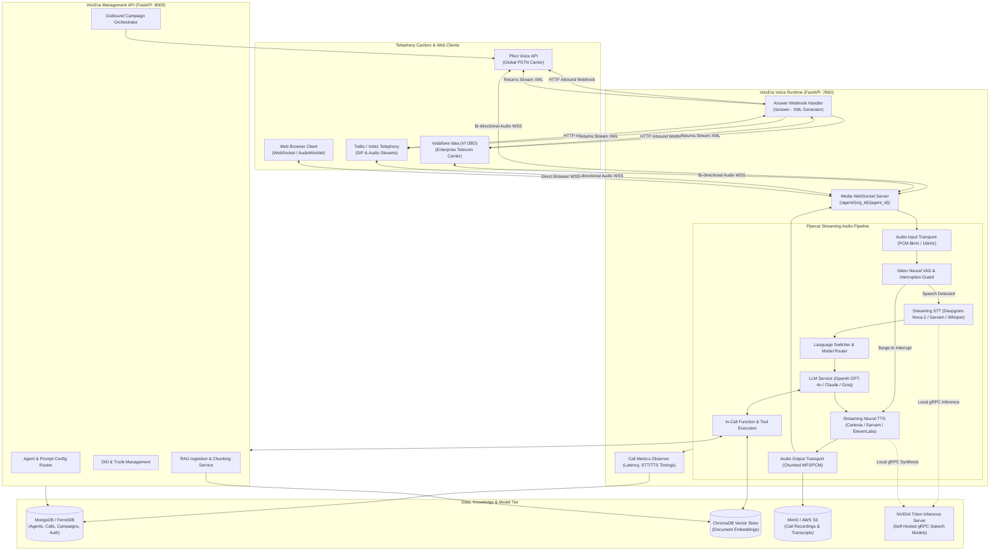
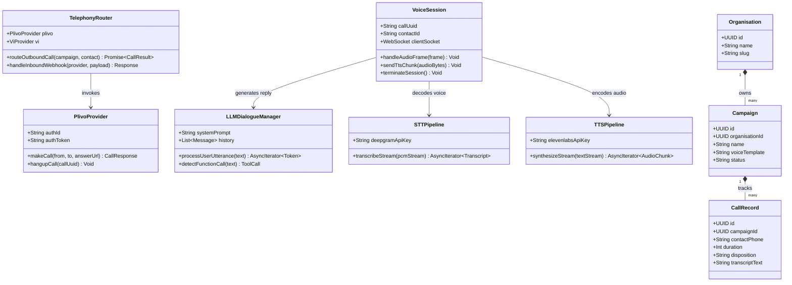
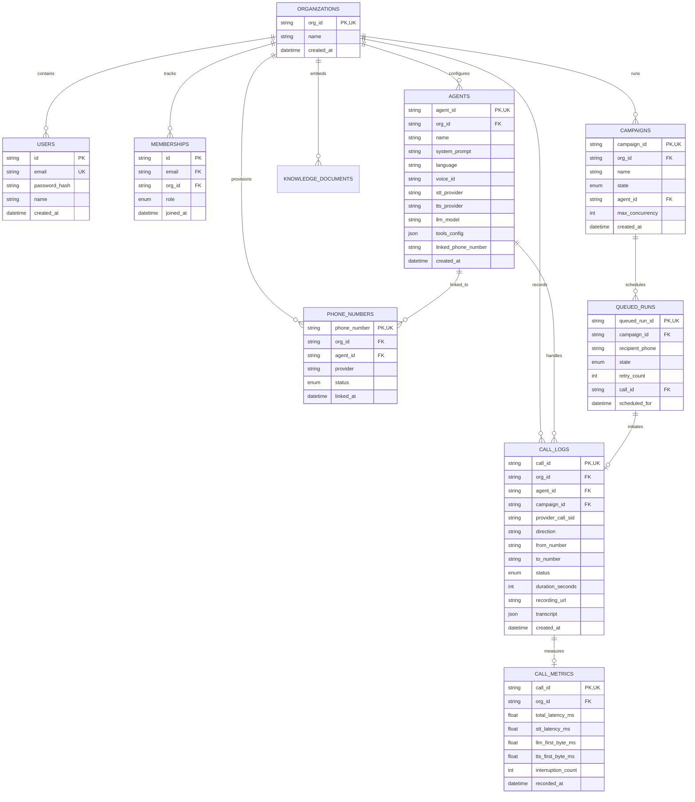
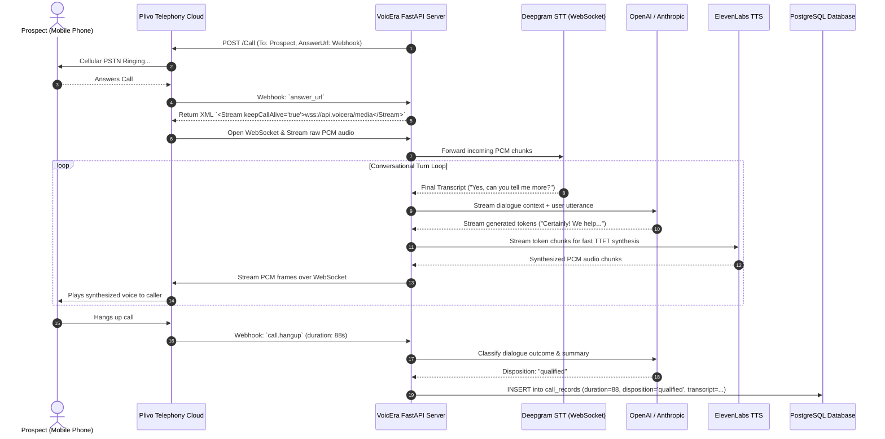

# VoicEra - Architecture & Technical Wiki

> **Multilingual Conversational Voice AI Platform, Real-Time Speech Pipeline & Telephony Automation Engine**  
> GitHub: [COSS-India/VoicEra](https://github.com/COSS-India/VoicEra.git) | Stack: Python 3.11+, FastAPI, Pipecat AI, Deepgram, Cartesia, Sarvam, Silero VAD, Triton, MongoDB, MinIO | License: Apache-2.0

---

## 1. Executive Summary & Value Proposition

**VoicEra** is an enterprise-grade, open-source conversational voice AI platform engineered for real-time telephone and web voice automation. Developed in Python 3.11+ using FastAPI and the Pipecat streaming framework (`pipecat-ai`), VoicEra powers autonomous inbound receptionists, outbound sales qualification bots, lead qualification campaigns, and customer support agents capable of sustaining natural, interruptible voice dialogues with sub-500ms end-to-end response latency.

Traditional voice agents suffer from disjointed conversational cadence, robotic delays caused by sequential request-response APIs, inability to handle human speech interruptions (barge-in), and brittle single-language configurations. VoicEra solves these limitations by streaming audio frames asynchronously through an integrated pipeline of neural Voice Activity Detection (Silero VAD), streaming Speech-to-Text (STT), speculative Large Language Model (LLM) generation, and chunked Text-to-Speech (TTS). Furthermore, it uniquely incorporates dynamic mid-call language switching for multilingual geographies, carrier-agnostic telephony abstraction (Plivo, Vodafone Idea OBD, Vobiz, Twilio), and support for self-hosted speech models via NVIDIA Triton Inference Server.

### Core Problems Solved
- **Conversational Latency Bottlenecks**: Achieves sub-500ms turnarounds by piping streaming LLM text tokens into neural TTS synthesizers sentence-by-sentence rather than waiting for complete LLM generations.
- **Natural Interruption Handling (Zero-Lag Barge-In)**: Employs Silero VAD to detect user vocalizations within 100ms, immediately dispatching interruption frames that flush active TTS audio buffers and cancel in-flight LLM generations.
- **Seamless Mid-Call Language Switching**: Dynamically transitions STT, TTS, and system prompt contexts on the fly between English, Hindi, and regional Indic languages without dropping the call leg or restarting the session.
- **Carrier Independence & Cost Optimization**: Decouples telephony from proprietary cloud platforms by providing a unified XML/WebSocket dispatcher supporting global carriers (Plivo, Twilio) and cost-effective regional telecommunications providers (Vodafone Idea Outbound Dialing, Vobiz).
- **Self-Hosted AI Inference for Margin Defense**: Integrates an optional Triton Inference Server (`model-server`) using gRPC to execute self-hosted Whisper ASR and local TTS models, avoiding third-party API costs on high-volume campaigns.
- **Enterprise RAG & Function Calling**: Connects real-time agents to internal vector stores (ChromaDB) and external REST APIs via structured tool calling to retrieve customer data and book appointments mid-dialogue.

---

## 2. High-Level System Architecture

VoicEra’s architecture separates the administrative REST API, the high-throughput WebSocket voice runtime (:7860), vector search services, external telephony carrier networks, and object storage.



### Architectural Narrative & Data Flow
1. **Telephony Ingress & Stream Negotiation**: When a customer calls a provisioned DID or an outbound campaign dials a lead, the carrier triggers the `/answer` endpoint on the VoicEra Runtime (`apps/runtime/routes/telephony.py`). The runtime identifies the target `org_id` and `agent_id`, generating provider-specific XML (e.g. `<Stream url="wss://voice.domain/agent/{org_id}/{agent_id}?call_id={id}" />`) instructing the carrier to pipe raw media to VoicEra over WebSockets.
2. **Audio Intake & Voice Activity Detection**: The carrier establishes a persistent WebSocket connection to `/agent/{org_id}/{agent_id}`. Raw 8kHz/16kHz linear PCM audio frames enter the Pipecat pipeline (`apps/runtime/services/pipecat/pipeline.py`). Frames pass through `SileroVAD`. If speech is detected, audio is buffered and forwarded to STT. If the user begins speaking while the agent is playing audio, Silero dispatches an immediate interruption signal, terminating TTS generation and emptying audio queues within milliseconds.
3. **Real-Time Speech Processing & Language Routing**: Audio is transcribed by Deepgram Nova-2, Sarvam (for Indic dialects), or a local Triton-hosted Whisper server. If the caller switches languages (e.g., from English to Hindi), the `LanguageRoute` mixin automatically updates the STT language model and switches the active TTS voice and persona prompt without breaking the session.
4. **LLM Generation & Grounded RAG Execution**: Transcribed text enters the streaming LLM processor. When necessary, the LLM triggers tools (`rag_lookup`, `check_availability`, `transfer_call`). Knowledge base queries search the local `ChromaDB` collection to retrieve contextual excerpts from uploaded manuals or CRM data.
5. **Speech Synthesis & Artifact Archival**: Generated tokens are synthesized into chunked audio by Cartesia Sonic or Sarvam AI and streamed back to the carrier WebSocket. Concurrently, `CallMetricsObserver` tracks turn-taking latency, STT delay, and TTS first-byte timing. When the call terminates, raw audio and full transcripts are archived to MinIO/S3, and execution metrics are logged into MongoDB.

---

### 2.1 Core Domain & Service Class Architecture



---

## 3. Technology Stack & Key Dependencies

| Layer | Component / Technology | Specification & Purpose |
|---|---|---|
| **Language & Runtime** | Python 3.11+ (asyncio, uvicorn) | High-concurrency asynchronous runtime with `StrEnum` support |
| **Voice Framework** | `pipecat-ai[deepgram,cartesia,openai,silero,websocket,sarvam]==1.8.1` | Modular frame-based audio pipeline, VAD, and streaming primitives |
| **Neural VAD** | `silero-vad` (ONNX Runtime) | Sub-100ms speech onset and offset detection for barge-in |
| **Speech-to-Text (STT)**| Deepgram Nova-2, Sarvam AI, Whisper | Ultra-low latency cloud and local speech transcription |
| **Large Language Models**| OpenAI GPT-4o, Anthropic Claude 3.5, Groq | Streaming conversation reasoning and function calling |
| **Text-to-Speech (TTS)**| Cartesia Sonic, Sarvam Indic, ElevenLabs | Chunked streaming neural voice synthesis (<150ms TTFB) |
| **Self-Hosted Inference**| NVIDIA Triton Server (`tritonclient[grpc]>=2.45.0`) | On-premise / private cloud GPU inference for speech models |
| **Database & Metadata** | MongoDB 6+ / FerretDB (`pymongo`) | Multi-tenant document storage for agents, calls, campaigns, and logs |
| **Vector Storage (RAG)**| ChromaDB (`chromadb`) | In-memory and persistent vector store for knowledge document chunks |
| **Object Storage** | MinIO / AWS S3 (`minio>=7.2.0`) | Storage for stereo call recordings, voicemails, and transcript JSONs |
| **Telephony Interfaces**| Plivo, Vodafone Idea OBD, Vobiz, Twilio | Telco provider adapters, dynamic XML generators, and webhooks |

---

## 4. Repository Layout & Key Modules

```
VoicEra/
├── apps/
│   ├── api/                     # Core business logic and management API (:8000)
│   │   ├── app/
│   │   │   ├── config.py        # Pydantic environment configurations
│   │   │   ├── database.py      # MongoDB / FerretDB client connection pools
│   │   │   ├── database_init.py # Idempotent collection and index creation
│   │   │   ├── main.py          # FastAPI application entrypoint and CORS setup
│   │   │   ├── models/schemas.py# Pydantic schemas for auth, agents, organizations
│   │   │   ├── rag/             # Ingestion pipeline: PDF parsing, chunking, embeddings
│   │   │   └── routers/         # API routes (agents, calls, campaigns, knowledge, numbers)
│   │   └── Dockerfile           # Management API container specification
│   ├── runtime/                 # Real-time WebSocket voice runtime (:7860)
│   │   ├── app.py               # Runtime FastAPI entrypoint
│   │   ├── routes/              # Inbound telephony (/answer) & media WebSockets (/agent)
│   │   └── services/
│   │       ├── agent_routing.py # Resolves agent configuration from org/agent IDs
│   │       ├── language_switch/ # Mid-call language detection & dynamic service switcher
│   │       ├── pipecat/         # Core Pipecat pipeline builders, VAD, audio mixers, metrics
│   │       └── storage/         # Call artifact uploader (MinIO recording & transcript writer)
│   ├── telephony/               # Carrier abstraction layer
│   │   ├── base.py              # Abstract telephony provider interface
│   │   ├── registry.py          # Telephony provider factory and registry
│   │   ├── xml.py               # Universal Answer-Stream XML dispatcher
│   │   └── providers/           # Provider implementations (plivo, vi, vobiz)
│   └── schemes/                 # Shared data contracts and enums
├── frontend/                    # Next.js web application for agent creation and analytics
├── model-server/                # Triton Inference Server configurations and model repos
├── docker-compose.yaml          # Full multi-service compose file (API, Runtime, Mongo, MinIO)
└── pyproject.toml               # Poetry/pip project metadata and dependency definitions
```

---

## 5. Core Features & Capabilities

### 5.1 Frame-Based Streaming Pipeline (`pipecat-ai`)
VoicEra builds on Pipecat's frame-based architecture. Instead of processing calls in discrete conversational turns, audio and text travel through a continuous pipeline of frame processors. Audio input frames (`AudioRawFrame`) flow through VAD into STT; text tokens flow through LLM processors; text chunks flow into TTS synthesizers; and generated audio frames stream back down the WebSocket. This pipeline overlap eliminates serialization delays, enabling rapid conversational turn-taking.

### 5.2 Dynamic Mid-Call Language & Voice Switching
In multilingual environments, callers frequently start in English and switch to Hindi or regional dialects. In `apps/runtime/services/language_switch/switcher.py`, VoicEra implements `LanguageRoute` mixins. When the STT engine or an intent detector notices a language transition, the runtime dispatches a `LanguageSwitchFrame`. This instruction updates STT model settings, switches the active TTS voice and speed profile, and loads the corresponding language system prompt in the LLM context without interrupting the audio stream.

### 5.3 Neural VAD & Zero-Lag Interruption Handling
Human conversations require graceful interruption. When the caller speaks while the agent is uttering a response, `SileroVAD` detects voice activity within 100 milliseconds. The pipeline immediately dispatches a `UserStartedSpeakingFrame`, which cancels in-flight LLM token generation, commands the TTS engine to halt synthesis, and sends an audio clear frame over the WebSocket to flush the carrier's internal playback buffer.

### 5.4 Multi-Carrier Telephony XML Abstraction
VoicEra supports multi-carrier deployments through a pluggable provider registry (`apps/telephony`). The engine dynamically detects whether an incoming webhook originated from Plivo, Vodafone Idea OBD, Vobiz, or Twilio, formatting the required XML response dialect (`<Stream>`, `<Speak>`, or `<Record>`) to establish the WebSocket audio link. This allows enterprises to route calls across local carriers for maximum cost efficiency.

### 5.5 Grounded Knowledge Retrieval (ChromaDB RAG)
Agents can be grounded with corporate knowledge bases through the `apps/api/app/rag/` pipeline. PDF, DOCX, and text files are parsed, chunked, and embedded into a local ChromaDB collection. Mid-call, the LLM uses vector search tools to pull relevant policy clauses or product specifications, incorporating the retrieved facts into its voice responses.

### 5.6 Self-Hosted Model Inference via Triton Server
To minimize operational costs during large-scale outbound dialing, VoicEra integrates with NVIDIA Triton Inference Server via gRPC (`model-server`). Organizations can host local Whisper ASR and open-weight speech synthesis models on internal GPU nodes, eliminating per-minute cloud API costs while maintaining full control over voice data privacy.

---

## 6. Data Models & Schema Architecture

VoicEra utilizes MongoDB (or FerretDB with PostgreSQL backing) for multi-tenant data persistence. The entity relationship diagram below details the core database architecture:



### Key Collection Descriptions
- **`Agents`**: Contains LLM prompts, voice models, provider selections, and tool schemas. Indexed on `[("org_id", 1), ("agent_id", 1)]` and `linked_phone_number`.
- **`CallLogs`**: Central log of all voice sessions. Records provider call SIDs, direction (`inbound`/`outbound`), audio recording URLs in MinIO, and conversational transcripts.
- **`CallMetrics`**: Fine-grained performance profiling capturing STT latency, LLM time-to-first-token, TTS time-to-first-byte, and barge-in interruption frequency.
- **`QueuedRuns`**: Outbound dialer queue entries for automated campaigns with retry counts and execution timestamps.

---

### 6.1 Comprehensive Database Schema Specification

VoicEra utilizes PostgreSQL managed via SQLAlchemy and Alembic, orchestrating multi-tenant telephony credentials, agent dialogue policies, and call recordings.

#### Table: `organisations`
Root workspace entity managing enterprise permissions and telephony quotas.

| Column | Type | Constraints | Default | Description |
| :--- | :--- | :--- | :--- | :--- |
| `id` | `UUID` | `PRIMARY KEY` | `uuid_generate_v4()` | Unique organisation ID |
| `name` | `VARCHAR(255)` | `NOT NULL` | - | Organisation display name |
| `slug` | `VARCHAR(100)` | `NOT NULL, UNIQUE` | - | URL slug identifier |
| `created_at` | `TIMESTAMPTZ` | `NOT NULL` | `NOW()` | Creation timestamp |

*Indexes:* `idx_org_slug` (`UNIQUE (slug)`).

---

#### Table: `campaigns`
Outbound voice calling campaigns linking lead lists to AI conversational prompts.

| Column | Type | Constraints | Default | Description |
| :--- | :--- | :--- | :--- | :--- |
| `id` | `UUID` | `PRIMARY KEY` | `uuid_generate_v4()` | Campaign identifier |
| `organisation_id` | `UUID` | `NOT NULL, FK -> organisations(id)` | - | Tenant scope key |
| `name` | `VARCHAR(255)` | `NOT NULL` | - | Campaign title |
| `system_prompt` | `TEXT` | `NOT NULL` | - | System instructions provided to LLM |
| `voice_provider` | `VARCHAR(50)` | `NOT NULL` | `'elevenlabs'` | Synthesizer provider (`elevenlabs`, `cartesia`) |
| `voice_id` | `VARCHAR(100)` | `NOT NULL` | - | Specific voice persona identifier |
| `status` | `VARCHAR(50)` | `NOT NULL` | `'draft'` | State (`draft`, `running`, `paused`, `completed`) |
| `created_at` | `TIMESTAMPTZ` | `NOT NULL` | `NOW()` | Campaign creation timestamp |

*Indexes:* `idx_campaigns_org` (`(organisation_id)`), `idx_campaigns_status` (`(status)`).

---

#### Table: `call_records`
Detailed logs of every voice call session including transcription, metrics, and outcomes.

| Column | Type | Constraints | Default | Description |
| :--- | :--- | :--- | :--- | :--- |
| `id` | `UUID` | `PRIMARY KEY` | `uuid_generate_v4()` | Call log record ID |
| `campaign_id` | `UUID` | `NOT NULL, FK -> campaigns(id)` | - | Associated campaign |
| `call_uuid` | `VARCHAR(100)` | `NOT NULL, UNIQUE` | - | Plivo / VI Telephony Call UUID |
| `phone_number` | `VARCHAR(50)` | `NOT NULL` | - | Destination prospect phone number |
| `status` | `VARCHAR(50)` | `NOT NULL` | `'initiated'` | Telephony status (`initiated`, `completed`, `failed`) |
| `duration` | `INTEGER` | `NOT NULL` | `0` | Conversational duration in seconds |
| `transcript` | `TEXT` | `NULLABLE` | `NULL` | Complete dialogue transcript |
| `disposition` | `VARCHAR(50)` | `NULLABLE` | `NULL` | AI-classified disposition (`qualified`, `not_interested`, `callback`) |
| `recording_url` | `TEXT` | `NULLABLE` | `NULL` | S3 audio recording URL |
| `created_at` | `TIMESTAMPTZ` | `NOT NULL` | `NOW()` | Call start timestamp |

*Indexes:* `idx_call_records_campaign` (`(campaign_id)`), `idx_call_records_uuid` (`UNIQUE (call_uuid)`).

---

## 7. API Architecture, Webhooks & Key Endpoints

VoicEra exposes management REST endpoints on port 8000 and high-speed telephony WebSockets on port 7860.

### Key API & Runtime Endpoints

| Method | Endpoint | Port | Description |
|---|---|---|---|
| `POST` | `/api/v1/auth/login` | :8000 | Authenticates user and returns JWT containing `org_id` and role |
| `POST` | `/api/v1/agents` | :8000 | Creates or updates a voice AI agent configuration |
| `POST` | `/api/v1/calls/outbound` | :8000 | Triggers an outbound voice AI call to a destination phone number |
| `POST` | `/api/v1/campaigns` | :8000 | Configures and launches an outbound automated calling campaign |
| `GET/POST`| `/answer` | :7860 | Telephony carrier answer webhook returning dynamic Stream XML |
| `WSS` | `/agent/{org_id}/{agent_id}`| :7860 | Bidirectional WebSocket media stream for raw audio exchange |

### Sample Telephony Answer Webhook Response (Plivo Dialect)
```xml
<?xml version="1.0" encoding="UTF-8"?>
<Response>
  <Speak voice="WOMAN">Connecting you to VoicEra AI...</Speak>
  <Stream bidirection="true" keepCallAlive="true" contentType="audio/x-l16;rate=8000">
    wss://voice.voicera.internal:7860/agent/org_48a1c9/agent_sales_rep?call_id=c_92a71e2f
  </Stream>
</Response>
```

### Outbound Call Initiation Request
```http
POST /api/v1/calls/outbound HTTP/1.1
Host: api.voicera.internal:8000
Authorization: Bearer <jwt_access_token>
Content-Type: application/json

{
  "agent_id": "agent_sales_rep",
  "to_number": "+14155552671",
  "from_number": "+18005550199",
  "variables": {
    "lead_name": "Jordan Smith",
    "company": "Acme Corp",
    "interest": "Enterprise Marketing Automation"
  }
}
```

---

### 7.5 End-to-End Operational Lifecycle Sequence

The following sequence diagram details the full bidirectional streaming lifecycle between Plivo, FastAPI WebSockets, Deepgram STT, OpenAI LLM, and ElevenLabs TTS.



---

## 8. Strategic Value & Takeaways for MarketingStudio

### Reusable Architectural Patterns
1. **Pipecat Streaming Voice Loop for Sub-Second Latency**:
   - *Pattern*: VoicEra’s streaming pipeline eliminates conversational hesitation by synthesizing speech on first-clause completion rather than full-sentence generation.
   - *MarketingStudio Convergence*: Adopt the Pipecat frame-based streaming architecture inside MarketingStudio's voice AI worker nodes to deliver sub-500ms conversational turn-taking.
2. **Mid-Call Multilingual & Model Switching**:
   - *Pattern*: The `LanguageRoute` switcher dynamically replaces STT language models, TTS voices, and prompts on detected language shifts without breaking the active WebSocket audio stream.
   - *MarketingStudio Convergence*: Incorporate dynamic language switching into MarketingStudio's AI SDR agents, allowing them to converse in diverse global languages automatically.
3. **Local Triton Model Server Integration for Margin Defense**:
   - *Pattern*: High-volume outbound dialing campaigns encounter steep cloud STT/TTS fees. Offloading transcription and voice synthesis to a local NVIDIA Triton cluster drastically reduces per-minute telecommunication expenses.
   - *MarketingStudio Convergence*: Build an optional Triton inference adapter in MarketingStudio so enterprise self-hosted customers can run Whisper and open-source TTS without recurring third-party API costs.
4. **Carrier-Agnostic Telephony XML Engine**:
   - *Pattern*: Decoupling the media server from vendor-specific APIs (Twilio, Plivo, Telnyx, VI) through a modular XML/WebSocket dispatcher simplifies international expansion and carrier redundancy.
   - *MarketingStudio Convergence*: Standardize MarketingStudio’s voice media ingress to accept standard WebSockets, allowing instant pairing with any SIP carrier or PBX.
