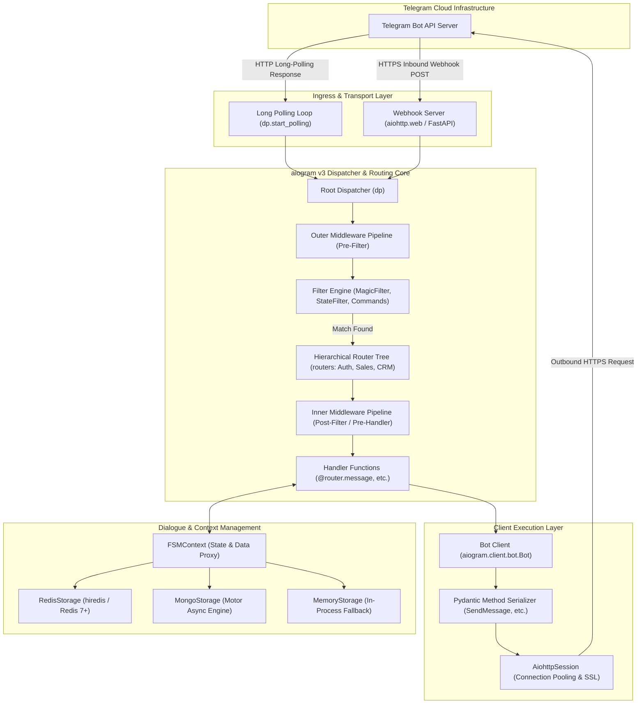
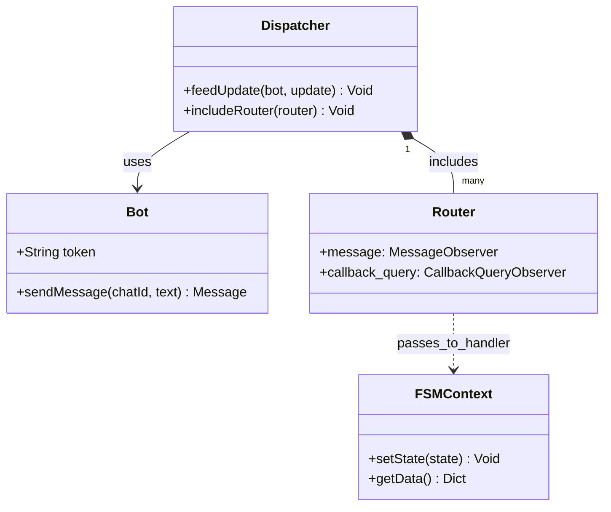
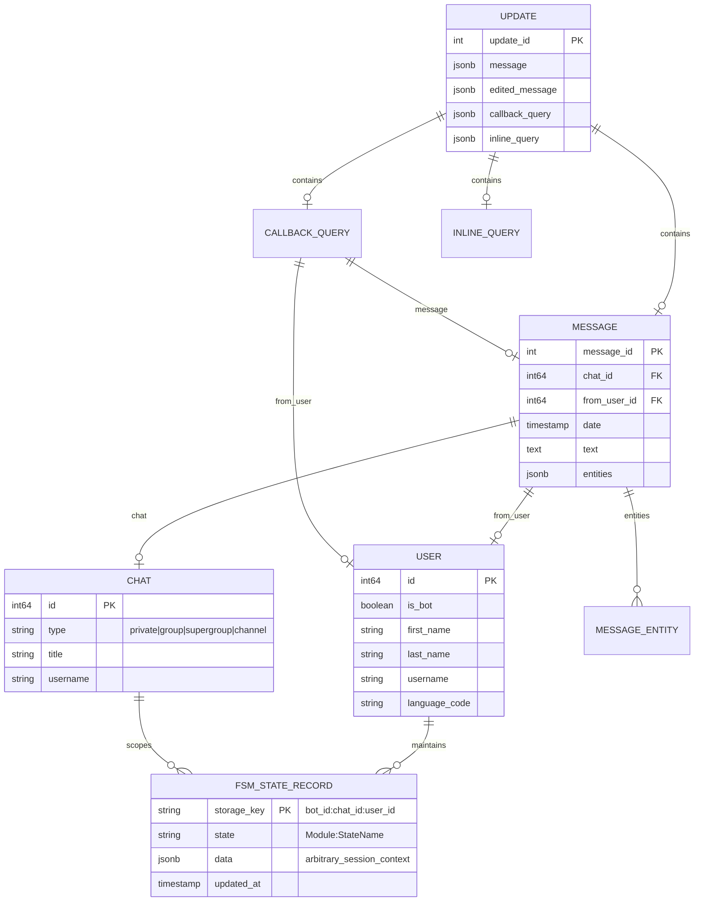
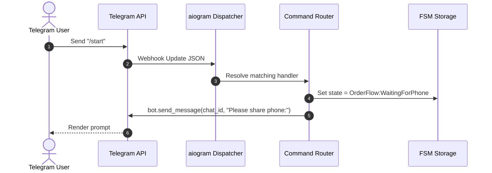

# aiogram - Architecture & Technical Wiki

> **Modern, High-Performance Asynchronous Python Framework for Telegram Bot API**  
> GitHub: [aiogram/aiogram](https://github.com/aiogram/aiogram) | Stack: Python 3.10-3.14, AsyncIO, uvloop, aiohttp, Pydantic v2, Magic Filter, Redis/Mongo FSM Storage | License: MIT

---

## 1. Executive Summary & Value Proposition

**aiogram** (specifically aiogram v3) is the gold standard asynchronous framework for developing Telegram bots in Python. Completely redesigned around Python's `asyncio` ecosystem, `aiogram` combines pure asynchronous non-blocking I/O, rigorous data parsing and schema validation via Pydantic v2, a modular router-based dispatcher, and a granular two-tier middleware pipeline.

For developers and engineering teams building high-scale conversational systems, Telegram mini-apps, and marketing automation bots, `aiogram` solves the performance degradation, threading deadlocks, and untyped payload fragility that plague synchronous bot wrappers. Its pluggable Finite State Machine (FSM) engine enables complex multi-turn dialogues, user onboarding funnels, and transaction wizards with native support for in-memory, Redis, and MongoDB persistence.

### Core Problems Solved
- **High-Concurrency I/O Bottlenecks**: Fully asynchronous architecture running on `asyncio` (with optional C-based `uvloop` and `aiodns`) handles tens of thousands of concurrent Telegram updates without thread contention.
- **Untyped & Fragile API Payloads**: Utilizes Pydantic v2 models for 100% of Telegram Bot API types and methods, providing compile-time type hints, automatic JSON serialization/deserialization, and validation.
- **Monolithic Dispatching & Spaghetti Code**: Introduces a hierarchical `Router` system that allows large bot applications to be decomposed into isolated, domain-specific modules with independent filters and middlewares.
- **Dialogue State Explosion**: Delivers a clean Finite State Machine (`aiogram.fsm`) abstraction that decouples state storage (Redis, Mongo, Memory) from business logic, ensuring session persistence across bot restarts and horizontal scale.
- **Complex Event Filtering Overhead**: Integrates `magic-filter`, enabling expressive, readable inline declarative filtering expressions (`F.text.startswith('/promo') & (F.from_user.id.in_(vip_users))`) without writing custom predicate functions.

---

## 2. High-Level System Architecture

`aiogram` v3 is architected as an event-driven processing pipeline centered on the `Dispatcher`, `Router` trees, and the `Bot` client session.



### Architectural Data Flow Narrative
1. **Update Ingestion**: Incoming updates (messages, callback queries, inline queries, chat member changes) arrive either through continuous long polling (`getUpdates`) via `LongPolling` or via high-performance HTTPS push through `WebhookServer` (using `aiohttp.web` or an ASGI framework like FastAPI).
2. **Outer Middleware Execution**: The update passes through the *Outer Middleware* pipeline. Outer middlewares run before any filters are evaluated, making them ideal for metrics collection, i18n locale detection, rate limiting, and database session injection.
3. **Filter Matching & Router Delegation**: The `Dispatcher` propagates the update down the `Router` hierarchy. Filters—including `Command`, `StateFilter`, and `magic-filter` expressions—evaluate whether a given handler matches. If an outer middleware cancelled the event or filters fail, processing halts with zero handler overhead.
4. **Inner Middleware Execution**: Once a target handler is matched, the update enters the *Inner Middleware* pipeline. Inner middlewares run only for matched handlers, facilitating handler-specific transaction rollbacks, user authorization, and dependency injection.
5. **FSM State & Handler Execution**: The handler receives the update and injected dependencies (such as `FSMContext`). It reads or mutates the conversational state stored in Redis or MongoDB, executes domain logic, and prepares an API method call.
6. **Outbound API Call**: The `Bot` client serializes the request using Pydantic models and dispatches the HTTPS call through `AiohttpSession` with connection pooling and retry handling.

---

### 2.1 Core Domain & Service Class Architecture



---

## 3. Technology Stack & Key Dependencies

- **Language & Runtime**: Python 3.10 to 3.14 (Full type annotations conforming to PEP 484 / PEP 561)
- **Concurrency & Event Loop**: Native Python `asyncio`; optional high-performance C-based `uvloop` (`uvloop>=0.21.0`) and `aiodns` for Linux/macOS deployments
- **HTTP Client & Server**:
  - `aiohttp` (3.9.0 to 3.14+) for asynchronous connection pooling, client sessions, and built-in webhook web server
  - `certifi` for trusted TLS/SSL root certificate bundles
- **Data Validation & Typing**:
  - `pydantic` (2.7.0 to 2.13+) for high-speed Rust-backed data parsing and JSON serialization
  - `typing-extensions` for modern Python type features
- **Declarative Filtering**: `magic-filter` (1.0.12+) for dynamic attribute introspection and filtering
- **State & FSM Storage Engines**:
  - `redis[hiredis]` (6.2.0+) for production Redis-backed FSM storage
  - `motor` (3.6.0+) and `pymongo` (4.9+) for MongoDB-backed FSM storage
- **Package & Dependency Management**: Modern `pyproject.toml` managed via Hatchling and `uv.lock`

---

## 4. Repository Layout & Key Modules

```
aiogram/
├── aiogram/
│   ├── client/                        # Telegram Bot API client implementations
│   │   ├── bot.py                     # Primary Bot class with method bindings
│   │   ├── session/                   # HTTP transport session providers (AiohttpSession)
│   │   └── default.py                 # Default bot properties (parse_mode, link_preview)
│   ├── dispatcher/                    # Update dispatching and routing subsystem
│   │   ├── dispatcher.py              # Root Dispatcher orchestrating routers and feeds
│   │   ├── router.py                  # Modular Router for organizing handlers and filters
│   │   ├── event/                     # Event observer and nested middleware manager
│   │   └── middlewares/               # Built-in middlewares (user context, error handling)
│   ├── enums/                         # Strongly typed enums (ChatType, ParseMode, UpdateType)
│   ├── filters/                       # Built-in filters and predicate interfaces
│   │   ├── command.py                 # Command argument parsing (/start, /promo CODE)
│   │   ├── state.py                   # StateFilter for FSM state matching
│   │   └── base.py                    # Filter ABC for custom user predicates
│   ├── fsm/                           # Finite State Machine subsystem
│   │   ├── context.py                 # FSMContext: async proxy for getting/setting state & data
│   │   ├── state.py                   # State and StatesGroup declarations
│   │   ├── scene.py                   # Complex multi-step conversational scenes
│   │   └── storage/                   # Storage drivers (MemoryStorage, RedisStorage, MongoStorage)
│   ├── handlers/                      # Base class-based handler abstractions
│   ├── methods/                       # Pydantic-based definitions for 100+ Telegram Bot API calls
│   ├── types/                         # Pydantic models for Telegram objects (Message, User, Chat)
│   ├── utils/                         # Helper utilities (keyboard builders, markdown helpers)
│   ├── webhook/                       # Webhook handlers and aiohttp/FastAPI security adapters
│   └── exceptions.py                  # Typed Telegram API exceptions (TelegramBadRequest, etc.)
├── examples/                          # Reference bots (FSM, webhooks, mini-apps, i18n)
├── pyproject.toml                     # Hatchling build specification and dependency bounds
└── uv.lock                            # Deterministic pinned lockfile
```

---

## 5. Core Features & Capabilities

### 5.1 Hierarchical Router & Dispatcher Architecture
`aiogram` v3 replaces monolithic handler lists with a composite Router pattern. Sub-routers can be mounted to other routers or directly to the `Dispatcher`. Each router maintains its own event observers (`message`, `callback_query`, `inline_query`, `poll_answer`), allowing distinct business domains (e.g., LeadGen Router, Support Router, Billing Router) to encapsulate their own middlewares and error boundaries.

### 5.2 Two-Tier Middleware Pipeline (Outer vs. Inner)
A hallmark feature of `aiogram` v3 is the separation of middlewares into two distinct execution rings:
1. **Outer Middlewares (`router.<event>.outer_middleware`)**: Triggered immediately upon update ingestion before any filter evaluation. Used for database connection lifecycle, distributed tracing, request throttling, and bot-wide analytics.
2. **Inner Middlewares (`router.<event>.middleware`)**: Triggered only after all registered filters pass and a matching handler is guaranteed to execute. Used for transaction commit/rollback, permission authorization, and heavy data fetching.

### 5.3 Finite State Machine (FSM) & Distributed Persistence
Multi-turn conversations are defined cleanly using `StatesGroup`:

```python
from aiogram.fsm.state import State, StatesGroup

class SDRQualify(StatesGroup):
    company_name = State()
    employee_count = State()
    target_budget = State()
    schedule_demo = State()
```

The `FSMContext` provides an atomic async API (`await state.set_state(SDRQualify.employee_count)`, `await state.update_data(company="Acme Corp")`). When configured with `RedisStorage`, states and context data are saved as Redis keys with configurable TTLs, enabling zero downtime deployments and horizontal worker clustering.

### 5.4 Declarative Magic Filtering (`magic-filter`)
Instead of writing verbose lambda functions, `aiogram` integrates `magic-filter`. The magic attribute `F` provides deep object introspection:
- `F.text.startswith('/start')`
- `F.from_user.id.in_({12345, 67890})`
- `F.photo[-1].file_size > 1024 * 1024`
- `F.data.regexp(r"^item_(\d+)$").as_("item_id")` (Extracts regex groups directly into handler kwargs).

### 5.5 High-Throughput Webhook & Long Polling Transport
`aiogram` provides dual-mode execution:
- **Long Polling (`dp.start_polling(bot)`)**: Uses a self-tuning backoff loop with adaptive `allowed_updates` and timeout configurations.
- **Webhook Handlers (`aiogram.webhook.aiohttp_server`)**: Exposes `SimpleRequestHandler` and `TokenBasedRequestHandler` with built-in secret token validation (`X-Telegram-Bot-Api-Secret-Token`) to prevent spoofed webhook requests.

---

## 6. Data Models & Schema Architecture

All Telegram data models in `aiogram` inherit from `aiogram.types.TelegramObject`, which wraps `pydantic.BaseModel`.



### Key Object Schemas
- **`Update`**: The root polymorphic event object containing update metadata and one of 18 specific event types (`message`, `callback_query`, `chat_member`, etc.).
- **`Message`**: Represents chat messages, including rich media, forward origin, and formatting entities (`bold`, `code`, `text_link`).
- **`CallbackQuery`**: Emitted when users click inline keyboard buttons. Contains `data` payload and the associated message origin.
- **`StorageKey`**: Internal `aiogram.fsm.storage.base.StorageKey` structure combining `bot_id`, `chat_id`, `user_id`, and `thread_id` to provide pinpoint context isolation.

---

### 6.1 Comprehensive Database Schema Specification

Aiogram utilizes Redis or Memory storage for Finite State Machine (FSM) contexts.

#### Table: `fsm_states`
| Column | Type | Constraints | Default | Description |
| :--- | :--- | :--- | :--- | :--- |
| `key` | `TEXT` | `PRIMARY KEY` | - | Bot+User+Chat state key |
| `state` | `TEXT` | `NULLABLE` | `NULL` | Active FSM state |
| `data` | `TEXT` | `NOT NULL` | `'{}'` | Serialized state JSON |

---

## 7. API Architecture, Webhooks & Key Endpoints

### 7.1 Telegram Bot Method Execution
All Telegram Bot API methods are implemented as individual Pydantic classes in `aiogram.methods`. Methods can be called directly on the bot instance or returned from handlers.

```python
# Direct asynchronous method call
await bot.send_message(
    chat_id=123456789,
    text="*Welcome to MarketingStudio!* Please select your target SDR persona:",
    parse_mode="MarkdownV2",
    reply_markup=inline_keyboard
)
```

### 7.2 Webhook Registration & Ingress Endpoint
`aiogram` includes a high-performance aiohttp webhook runner with secret token verification:

```python
from aiohttp import web
from aiogram.webhook.aiohttp_server import SimpleRequestHandler, setup_application

app = web.Application()
webhook_requests_handler = SimpleRequestHandler(
    dispatcher=dp,
    bot=bot,
    secret_token="SECURE_RANDOM_SECRET_TOKEN_HERE"
)
webhook_requests_handler.register(app, path="/webhook/telegram")
setup_application(app, dp, bot=bot)
```

#### Incoming Webhook Payload (POST `/webhook/telegram`):
```json
{
  "update_id": 987654321,
  "message": {
    "message_id": 42,
    "from": {
      "id": 1122334455,
      "is_bot": false,
      "first_name": "Elena",
      "username": "elenamarketing",
      "language_code": "en"
    },
    "chat": {
      "id": 1122334455,
      "type": "private"
    },
    "date": 1729771200,
    "text": "/qualify"
  }
}
```

---

### 7.5 End-to-End Operational Lifecycle Sequence



---

## 8. Strategic Value & Takeaways for MarketingStudio

### Reusable Architectural Patterns
1. **Outer vs. Inner Middleware Decoupling**:  
   MarketingStudio's AI conversational pipelines can adopt aiogram's two-tier middleware model. Global tasks (rate-limiting prospects, tracking inbound UTM parameters, refreshing CRM tokens) should execute in the Outer ring before running expensive LLM evaluations. High-touch logic (database transaction commits, CRM contact creation) executes in the Inner ring only when qualification conditions match.

2. **Redis-Backed Distributed FSM with StorageKeys**:  
   Structuring multi-turn lead qualification dialogues around atomic `StorageKey(workspace_id, lead_id, channel_id)` tuples backed by Redis ensures that user progress in an AI SDR conversation persists seamlessly across application restarts and worker scaling.

3. **Pydantic v2 Type-Safe API Method Contracts**:  
   Defining all outbound marketing API operations as strongly typed Pydantic models ensures that malformed payloads are rejected immediately in-process before reaching external messaging APIs, saving round trips and API quota.

4. **Declarative Magic Filters for Dialogue Branching**:  
   Adopting a declarative filter pattern allows marketing non-engineers and bot authors to express qualification rules (e.g., `(F.lead_score >= 80) & F.country.in_(['US', 'CA'])`) cleanly, making conversational funnels easier to audit and maintain.
