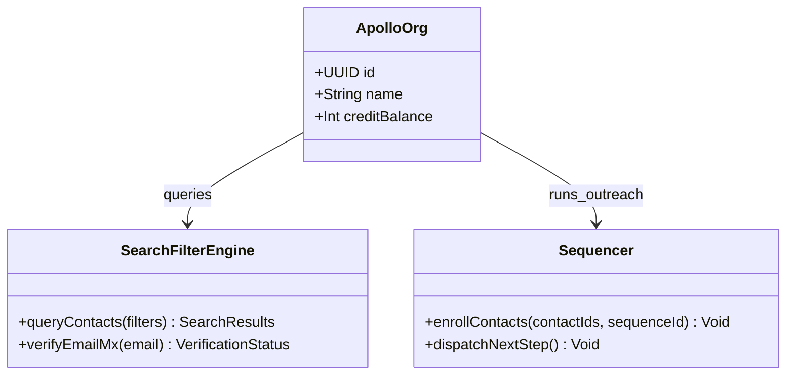
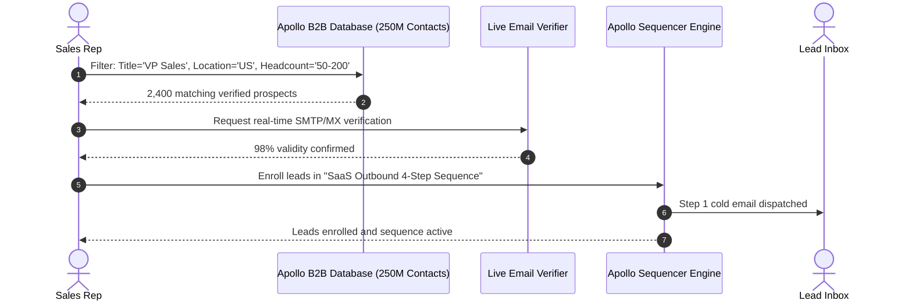

# Apollo.io System and Functional Architecture

> Comprehensive technical and functional reference for Apollo.io: the all-in-one B2B sales intelligence database, multichannel sequence automation, cloud power dialer, and conversation intelligence platform.

---

## 1. Executive Overview and Market Positioning

Apollo.io established itself as the comprehensive go-to-market platform for modern B2B sales teams. Historically, high-performing sales organizations were required to assemble a complex, expensive software stack:
- Contact data from ZoomInfo
- Email sequencing from Salesloft or Outreach
- Dialing infrastructure from Gong or PhoneBurner
- Conversation intelligence from Chorus or Gong
- Deliverability monitoring from standalone tools

Apollo consolidated this entire operational surface into a single integrated platform, combining a 275M+ contact database directly with multichannel execution, calling, pipeline tracking, and AI meeting analytics.

### Core Value Proposition
- **Massive Proprietary B2B Database:** Access to 275M+ verified contacts and 73M+ companies with extensive technographic, firmographic, and Bombora intent signals.
- **Unified Multichannel Execution:** Seamless orchestration of email sequences, phone dialer tasks, LinkedIn touchpoints, and custom sales activities in a single workflow.
- **Embedded WebRTC Cloud Calling:** Native in-browser power dialer with local presence area-code spoofing, one-click voicemail drop, and call transcription.
- **Built-In Conversation Intelligence:** Automated recording bot for Zoom, Google Meet, and Microsoft Teams providing AI summaries, objection analysis, and deal health insights.
- **Bi-directional CRM Hygiene:** Automatic data enrichment, contact deduplication, and job change tracking syncing directly with Salesforce and HubSpot.

---

## 2. Core Entities and Data Model

```
┌────────────────────────────────────────────────────────┐
│                      Workspace                         │
│  (Users, Teams, Role Permissions, Credits, Phone Nos)  │
└───────────┬────────────────────────────────┬───────────┘
            │ 1:N                            │ 1:N
            ▼                                ▼
┌───────────────────────┐        ┌───────────────────────┐
│     Company Account   │        │       Sequence        │
│ (Firmographics, Tech, │        │ (Steps: Email, Call,  │
│  Intent, Org Chart)   │        │  LinkedIn, Tasks)     │
└───────────┬───────────┘        └───────────┬───────────┘
            │ 1:N                            │
            ▼                                │ Enrolls Leads
┌───────────────────────┐                    │
│     Contact / Lead    │◄───────────────────┘
│ (Email, Phone, Title, │
│  Seniority, Signals)  │
└───────────┬───────────┘
            │ 1:N
            ▼
┌────────────────────────────────────────────────────────┐
│                   Sales Activities                     │
│  ┌──────────────────┬─────────────────┬──────────────┐ │
│  │   Email Event    │    Call Event   │  Task Event  │ │
│  │ (Sent, Open, Rep)│ (Record, Trans) │ (LinkedIn)   │ │
│  └──────────────────┴─────────────────┴──────────────┘ │
└───────────┬────────────────────────────────────────────┘
            │ Associated With
            ▼
┌────────────────────────────────────────────────────────┐
│                 Opportunity / Deal                     │
│  (Pipeline Stages, Value, Forecast, Health Score)      │
└───────────┬────────────────────────────────────────────┘
            │ Associated With
            ▼
┌────────────────────────────────────────────────────────┐
│               Meeting Conversation                     │
│  (Bot Recording, AI Transcript, Objections, Next Steps)│
└────────────────────────────────────────────────────────┘
```

### Entity Definitions
1. **Company Account:** Aggregated firmographic profile including company size, estimated revenue, detected technologies, active job openings, and Bombora intent topic surges.
2. **Contact / Lead:** Individual buyer profile populated with corporate email, direct-dial phone number, LinkedIn URL, work history, and seniority rank.
3. **Sequence:** Automated cadence combining multiple touches (Email, Call, LinkedIn message/action, Manual Task) with defined delay schedules and business hour constraints.
4. **Call Event:** Telephony record containing call audio recording, WebRTC connection logs, duration, disposition code, and AI transcript.
5. **Opportunity / Deal:** Revenue tracking record linking contacts, company accounts, and communication history to a formal sales pipeline stage.
6. **Conversation:** Video conference meeting recorded by the Apollo bot with speaker diarization, conversational topics, and action item checklists.

---

### 2.1 Core Domain and Service Class Architecture



---

### 2.2 Comprehensive Database Schema Specification

#### Table: `contacts`
| Column | Type | Constraints | Default | Description |
| :--- | :--- | :--- | :--- | :--- |
| `id` | `VARCHAR(100)` | `PRIMARY KEY` | - | Contact ID |
| `first_name` | `VARCHAR(100)` | `NOT NULL` | - | Given name |
| `last_name` | `VARCHAR(100)` | `NOT NULL` | - | Family name |
| `email` | `VARCHAR(255)` | `NOT NULL` | - | Verified email |
| `email_status` | `VARCHAR(50)` | `NOT NULL` | `'verified'` | Status (`verified`, `guessed`, `unavailable`) |
| `company_name` | `VARCHAR(255)` | `NOT NULL` | - | Company |

---

## 3. Comprehensive Feature and Functional Breakdown

### 3.1 B2B Database and Lead Search Engine

The proprietary data asset powering Apollo includes over 275 million prospective contacts across global markets.

#### 3.1.1 Advanced Search Filtering (65+ Dimensions)
- **People Filters:** Job Title, Management Level (Owner, C-Suite, VP, Director, Manager, Senior, Entry), Department / Sub-department (Sales, Engineering, Marketing, Finance, HR), Years in Current Role, Total Experience.
- **Company Filters:** Employee Count range, Annual Revenue brackets, Industry taxonomy, Headquarters Location, Regional Office Locations.
- **Technographic Filters:** Thousands of detected software footprints (e.g., Salesforce, Marketo, AWS, Snowflake, Shopify, Stripe, React).
- **Buying Intent Filters (Bombora Integration):** Intent topic surges indicating when a company's IP network is actively researching specific solutions (e.g., "Cybersecurity Software", "Cloud Migration", "Sales Enablement").
- **Hiring & Job Postings:** Companies currently advertising open roles, filterable by role title, department, and posting date.
- **Funding & Financials:** Total capital raised, most recent funding round type (Seed, Series A-D, IPO), investor names, and announcement dates.
- **Visual Org Charts:** Interactive hierarchical chart displaying company leadership, department heads, and direct reporting lines.

#### 3.1.2 Verification and Credit Mechanics
- **Real-Time Email Verification:** Built-in email validation performing 5-step deliverability checks before contact export.
- **Mobile Direct Dials:** Access to verified mobile numbers for cold calling.
- **Credit Consumption:** Credit model separating basic email exports from mobile phone number reveals.

---

### 3.2 Multichannel Sales Sequences

Apollo sequences automate complex outreach cadences combining multiple communication channels.

#### 3.2.1 Sequence Step Types
1. **Automated Email:** Triggered automatically according to the schedule; supports threading into previous messages or initiating a new subject line.
2. **Manual Email:** Drafts the email into the rep's queue for human review and bespoke personalization before dispatch.
3. **Phone Call Task:** Enqueues the prospect into the rep's Apollo Power Dialer list with script prompts and prospect context.
4. **LinkedIn Touchpoints:** Enqueues tasks for viewing profile, sending a connection request, sending an InMail, or interacting with recent posts.
5. **Action Item / Generic Task:** Prompts reps to perform external actions (e.g., send physical direct mail, connect at an industry conference).

#### 3.2.2 Scheduling, Delivery Windows, and Logic
- **Time Zone Routing:** Sends emails and enqueues calls strictly within the prospect's local business hours (e.g., 9:00 AM to 5:00 PM in their local time zone).
- **Weekend Suppression:** Automatically skips Saturdays and Sundays to protect corporate response rates.
- **Automated Exit Criteria:** Automatically un-enrolls prospects upon email reply, phone connect, meeting booked, hard bounce, or manual unsubscribe.
- **Multivariate A/B Testing:** Split-test subject lines, email copy variations, and call scripts across steps with automatic winning variant promotion.

---

### 3.3 Integrated Cloud Phone and Power Dialer

Apollo's built-in WebRTC dialer enables seamless calling directly from the browser without third-party phone systems.

#### 3.3.1 Calling Capabilities
- **Power Dialer:** Automatically advances through a pre-filtered list of phone numbers, dialing each contact sequentially upon completion of the previous call.
- **Local Presence:** Displays caller ID numbers matching the area code of the prospect, increasing call pick-up rates.
- **One-Click Voicemail Drop:** When reaching an answering machine, reps click a single button to drop a pre-recorded voicemail while instantly moving to the next call.
- **In-Call Scripts and Context:** Surfaces contact history, LinkedIn details, company background, and customizable objection-handling scripts on the call screen.
- **Call Recording and Transcription:** Full audio recording with automated speech-to-text transcription for coaching and compliance.
- **Custom Call Dispositions:** Categorize call outcomes (Connected, Left Voicemail, Gatekeeper Refusal, Wrong Number, Follow-up Requested) which automatically update sequence progress.

---

### 3.4 Conversation Intelligence and Meeting Assistant

Apollo automatically captures and analyzes sales conversations held over video conferencing tools.

#### 3.4.1 Recording Bot Automation
- **Meeting Bot Integration:** Automatically joins scheduled video calls on Zoom, Google Meet, and Microsoft Teams.
- **Dual-Stream Audio/Video Capture:** Records both host and participant video, screen shares, and separate audio channels.

#### 3.4.2 AI Meeting Insights
- **Speaker Diarization:** Identifies and separates speech turns for each participant, calculating talk-to-listen ratios.
- **Executive Summaries:** Generates concise structured summaries of the meeting discussion within minutes of call conclusion.
- **Key Moment Detection:** Automatically indexes mentions of competitors, pricing discussions, feature requests, and customer objections.
- **Action Item Extraction:** Identifies commitments made during the call (e.g., "Will send contract by Friday") and creates corresponding CRM tasks.

---

### 3.5 Deal Execution and Pipeline Management

Apollo provides a native CRM pipeline view to monitor deals from qualified discovery to closed revenue.

#### 3.5.1 Opportunity Management
- **Visual Kanban Board:** Drag-and-drop pipeline stages: Discovery, Demo Scheduled, Solution Validation, Negotiation, Closed Won, Closed Lost.
- **Weighted Forecasting:** Calculates expected revenue based on deal size and historical stage conversion probabilities.
- **Deal Health Scoring:** AI monitors deal velocity, alerting managers if a deal has had no inbound communication for 14 days or lacks multi-threaded executive engagement.

---

### 3.6 Data Enrichment and CRM Hygiene

Apollo functions as an active data enrichment layer across existing business systems.

#### 3.6.1 Bi-Directional CRM Synchronization
- **Salesforce & HubSpot Integrations:** Continuous synchronization of Contacts, Leads, Accounts, and Activities.
- **Automatic Field Enrichment:** Updates missing contact job titles, employee counts, revenue, and phone numbers in the CRM.
- **Job Change Alerts:** Notifies reps when a contact leaves their current company, providing their new company and verified email.
- **Inbound Form Enrichment:** Shortens web forms to 2 fields (work email + name), with Apollo automatically enriching all remaining firmographic fields in the background.

#### 3.6.2 Browser Extension (Chrome)
- **LinkedIn Prospecting:** Instantly reveals email addresses, phone numbers, and company insights while browsing LinkedIn or Sales Navigator, with one-click sequence enrollment.
- **Gmail Sidebar:** Surfaces Apollo contact intelligence, email tracking, and sequence templates directly inside the Gmail composer.

---

### 3.1 End-to-End Operational Lifecycle Sequence



---

## 4. Architectural Comparison and Key Differentiators

| Capability | Apollo.io | Standalone Sales Engagement (e.g., Salesloft) | Data-Only Vendors (e.g., ZoomInfo) |
| :--- | :--- | :--- | :--- |
| **B2B Contact Database** | Built-in (275M+ records, intent, technographics) | None (requires external data subscription) | Built-in (data vendor focus) |
| **Multichannel Sequences** | Built-in (Email, Call, LinkedIn, Tasks) | Primary focus | Basic or third-party add-on |
| **Power Dialer & WebRTC** | Built-in with local presence & voicemail drop | Add-on tier | Add-on tier |
| **Conversation Intelligence**| Built-in meeting recorder & AI summaries | Add-on tier | Add-on tier (Chorus acquisition) |
| **Single-Pane Workflow** | Complete prospecting through close in 1 platform | Execution only, requires data vendor | Data only, requires sequencing tool |