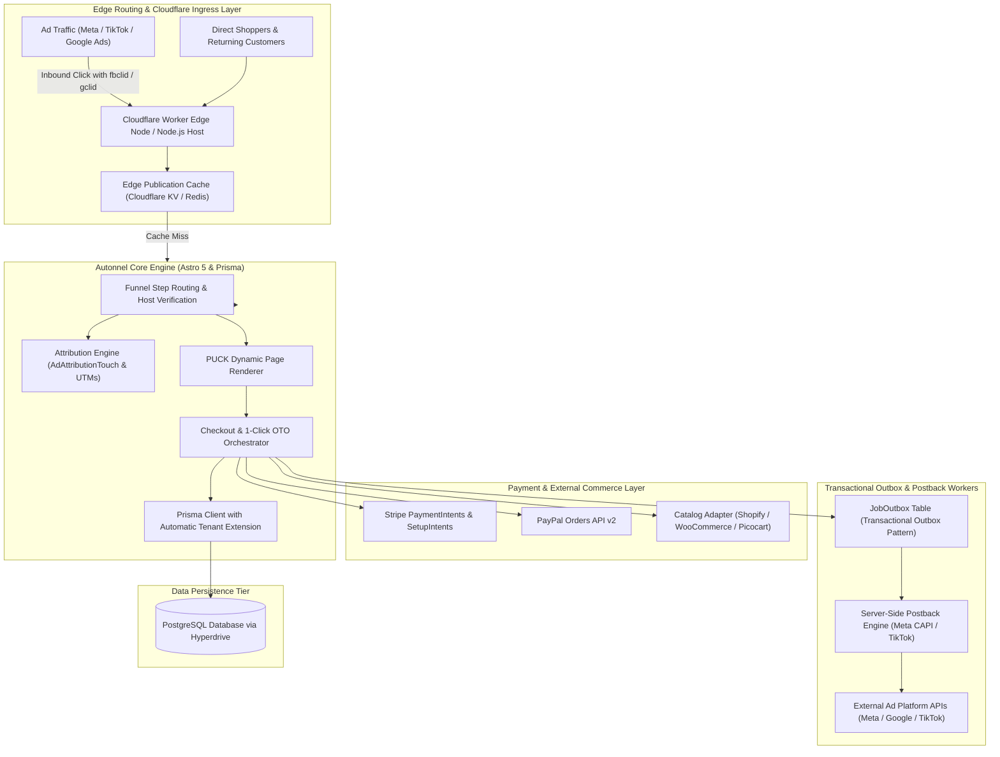
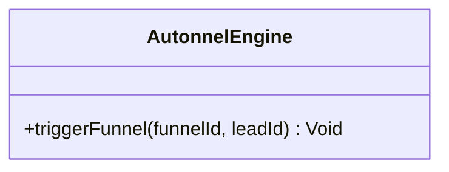
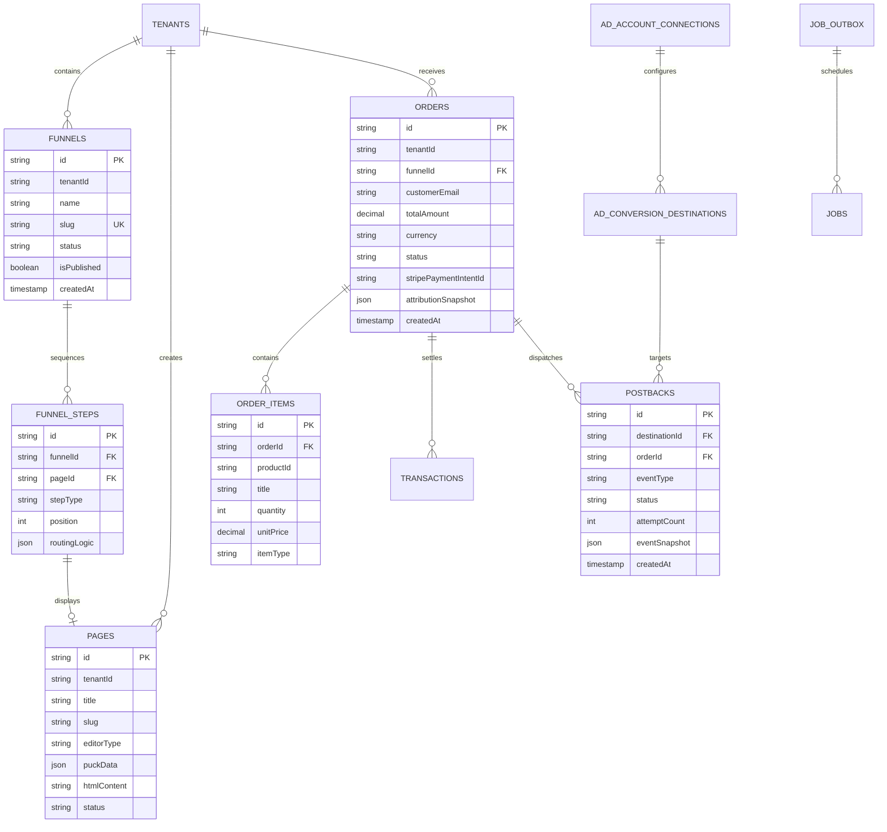
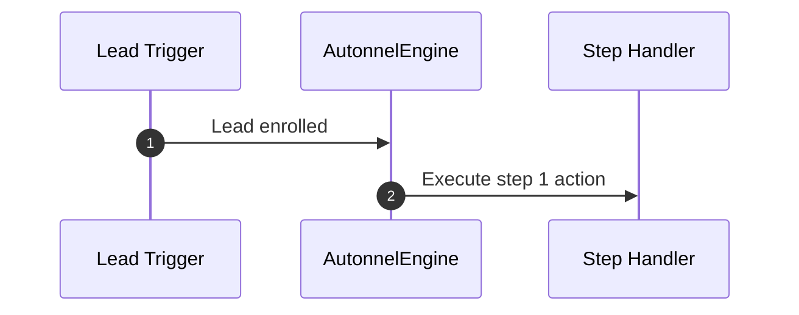

# autonnel - Architecture & Technical Wiki

> **Open-Source ClickFunnels Alternative, Multi-Step Checkout & Upsell Engine, Edge-Deployable Funnel Platform**  
> GitHub: [autonnel/autonnel](https://github.com/autonnel/autonnel.git) | Stack: TypeScript, Astro 5, Cloudflare Workers / Node.js, Prisma ORM, PostgreSQL, Redis / KV, PUCK Editor | License: Apache-2.0

---

## 1. Executive Summary & Value Proposition

**Autonnel** is an open-source, edge-ready sales funnel builder, multi-step checkout engine, and conversion optimization platform engineered in **TypeScript**, **Astro 5**, and **Prisma ORM**. Designed as an unencumbered, Apache-2.0 licensed alternative to ClickFunnels, CartFlows, and Systeme.io, Autonnel orchestrates the entire transactional conversion sequence—landing pages, high-converting checkout forms, pre-purchase order bumps, post-purchase one-click upsells/downsells (1-Click OTO), and dynamic order confirmation receipts.

Autonnel can be deployed either as a standard Node.js application or compiled to run at the network edge on **Cloudflare Workers** (leveraging Cloudflare Hyperdrive and Workers KV). To solve modern privacy constraints and ad signal degradation caused by browser tracking preventions (such as Apple iOS ITP), Autonnel incorporates a native server-side conversion postback engine that persists ad click identifiers throughout the checkout journey and dispatches server-side events directly to Meta Conversions API (CAPI), TikTok Events API, and Google Ads.

### Core Problems Solved
- **High-Converting Money-Path Orchestration**: Native multi-step funnel routing with zero-friction 1-Click Upsells where subsequent purchases are tokenized and charged against the existing customer profile without re-entering card details.
- **Server-Side Conversion Attribution Postbacks**: Preserves advertising campaign attribution across checkout redirects, firing server-to-server conversion events (Meta CAPI, TikTok, Google Ads) that bypass client-side ad blockers and cookie restrictions.
- **Dual-Runtime Edge Flexibility**: Runs seamlessly as a standard Node.js Docker container or as a globally distributed, ultra-low-latency Cloudflare Worker via `@astrojs/cloudflare` and Hyperdrive connection pooling.
- **Catalog Agnostic Architecture**: Decouples funnel presentation from fulfillment inventory, connecting interchangeably to Shopify, WooCommerce, or Autonnel's native headless commerce companion, Picocart.
- **Native AI Agent & MCP Integration**: Features a built-in Model Context Protocol (MCP) server allowing autonomous coding agents to inspect conversion analytics, assemble page components, and adjust funnel routing programmatically.

---

## 2. High-Level System Architecture

Autonnel leverages a modern **Astro 5 Hybrid Architecture**. Public storefront and funnel pages are server-rendered with zero client-side JavaScript overhead by default, while checkout and editor interfaces utilize interactive React components (including the PUCK visual component editor).



### Architectural Lifecycle of the "Money Path"
1. **Ad Click Ingestion & Attribution Pinning**: A prospect lands on a funnel URL with tracking parameters (`fbclid`, `ttclid`, `gclid`, UTM parameters). The `AttributionCapture` middleware extracts these parameters and persists an `AdAttributionTouch` record tied to the browser's visitor session cookie.
2. **Landing Page & Order Bump Assembly**: The request renders the primary landing step using the PUCK component tree. If an order bump is configured (e.g., a \$17 workbook accompanying a \$97 digital course), the client-side checkout bundle calculates the composite total without full-page reloads.
3. **Primary Checkout & Customer Vaulting**: Upon form submission, the checkout engine initiates a Stripe PaymentIntent with `setup_future_usage: 'off_session'`. Once authorized, Autonnel writes an `Order` row to PostgreSQL, decrements stock via the catalog connector, and stores the vault payment method token on the session.
4. **1-Click Upsell (OTO) Execution**: Rather than sending the buyer to a generic thank-you page, the router forwards them to an Upsell step. If the customer clicks "Yes, Add to My Order!", the backend immediately charges the vaulted payment method token via an off-session Stripe payment, appending a new `OrderItem` without requiring CVV re-entry.
5. **Transactional Postback Dispatch**: Concurrently, the engine writes an event to the `JobOutbox` table. An asynchronous worker queries the outbox, formats the event snapshot according to the destination platform schema (Meta CAPI or Google Ads), and fires the conversion server-to-server.

---

### 2.1 Core Domain & Service Class Architecture



---

## 3. Technology Stack & Key Dependencies

- **Language & Runtime**: TypeScript 5.x on Node.js 22+ LTS or Cloudflare Workers runtime (V8 isolates).
- **Application Framework**: Astro 5 configured with `@astrojs/node` for containerized hosting or `@astrojs/cloudflare` for serverless edge deployment.
- **Database & Data Access**: PostgreSQL 16+ accessed via Prisma ORM (`@prisma/client`); integrates with Cloudflare Hyperdrive for connection pooling and query acceleration.
- **Visual Page Canvas**: PUCK editor (`@measured/puck`) providing structured JSON component composition, responsive layouts, and drag-and-drop authoring.
- **Payment Processing**: Stripe Node SDK (PaymentIntents, SetupIntents, Webhook signature verification) and PayPal Checkout Server SDK.
- **Cache & Key-Value Storage**: Cloudflare Workers KV (Edge) or Redis 7+ (Node.js environments).
- **Asynchronous Processing**: In-database Transactional Outbox pattern (`JobOutbox`) with cron polling or edge-triggered scheduled handlers (`cf-worker.ts`).

---

## 4. Repository Layout & Key Modules

```
inspire/autonnel/
├── prisma/
│   ├── schema.prisma                # Master Prisma schema (Pages, Funnels, Orders, Postbacks)
│   └── migrations/                  # Versioned SQL migrations
├── public/                          # Static assets and checkout widget scripts
├── src/
│   ├── cf-worker.ts                 # Cloudflare Workers entrypoint & scheduled cron handler
│   ├── cli/                         # Autonnel administration CLI tools
│   ├── components/                  # PUCK visual canvas components & checkout UI
│   │   ├── checkout/                # Order forms, bump offers & credit card inputs
│   │   └── editor/                  # Visual page composition widgets
│   ├── lib/
│   │   ├── attribution/             # Ad click extraction (fbclid, gclid) & session tracking
│   │   ├── commerce/                # Adapters for Shopify, WooCommerce, and Picocart
│   │   ├── db/                      # Prisma client initialization & tenant extensions
│   │   ├── mcp/                     # Model Context Protocol server implementation
│   │   ├── payments/                # Stripe and PayPal payment orchestrators
│   │   └── postbacks/               # Meta CAPI, TikTok & Google Ads conversion delivery
│   ├── pages/                       # Astro file-based routing
│   │   ├── admin/                   # Secure back-office administration dashboard
│   │   ├── api/                     # REST API endpoints for checkouts, webhooks & MCP
│   │   └── [tenant]/                # Dynamic multi-tenant public funnel routes
│   └── styles/                      # Tailwind CSS v4 styling definitions
├── astro.config.mjs                 # Astro Node.js configuration
├── astro.config.cloudflare.mjs      # Astro Cloudflare Workers configuration
├── wrangler.toml.template           # Cloudflare deployment manifest template
└── package.json                     # Dependency definitions & build scripts
```

---

## 5. Core Features & Capabilities

### 5.1 One-Click Upsells (1-Click OTO) & Order Bumps
Autonnel maximizes Average Order Value (AOV) through frictionless post-purchase offers:
- Pre-purchase order bumps allow buyers to add supplementary digital products with a single checkbox on the checkout form.
- Post-purchase upsells utilize saved Stripe payment methods (`SetupIntent` or vaulted customer profiles), allowing buyers to purchase upsells with a single click—bypassing checkout friction entirely.
- If an upsell is declined, the router can branch automatically into a discounted Downsell step before rendering the final thank-you page.

### 5.2 Server-Side Conversion Postbacks (Meta CAPI, TikTok, Google)
To circumvent Safari ITP and browser ad-blocking extensions:
- Clicks arriving from ad networks have their query tokens (`fbclid`, `ttclid`, `gclid`) extracted and stored in `AdAttributionTouch`.
- When an order completes, Autonnel generates a server-side payload containing the client IP, user agent, hashed email, and the original ad click ID.
- The `Postback` worker dispatches these events directly to the ad network's REST API, ensuring high conversion match quality scores without relying on fragile client-side browser pixels.

### 5.3 Multi-Tenant Prisma Extension Architecture
Autonnel implements row-level multi-tenancy without requiring separate database instances:
- Every relational model includes a `tenantId` attribute.
- A custom Prisma Client Extension automatically injects `where: { tenantId }` into all read and write queries, preventing accidental data leakage across tenant boundaries.

### 5.4 Dual-Runtime Deployment: Node.js vs Cloudflare Workers
The application architecture is optimized for hybrid deployment:
- In containerized deployments (Docker), it runs under `@astrojs/node` backed by standard Redis queues.
- In serverless deployments, it compiles under `@astrojs/cloudflare`, using Cloudflare Hyperdrive to pool connections to PostgreSQL and Cloudflare KV to serve cached landing pages with sub-50ms TTFB globally.

---

## 6. Data Models & Schema Architecture



### Core Schema Definitions

#### `Page` & `FunnelStep`
- `stepType`: Enumeration describing the money-path stage (`LANDING`, `CHECKOUT`, `UPSELL`, `DOWNSELL`, `THANK_YOU`).
- `puckData` (json): Native PUCK editor component structure, holding layout blocks, typography, buttons, and form schemas.
- `routingLogic` (json): Dynamic conditional branching rules determining which step follows an accepted or declined offer.

#### `Order` & `OrderItem`
- `status`: Financial progression (`PENDING`, `AUTHORIZED`, `PAID`, `REFUNDED`, `FAILED`).
- `itemType`: Distinguishes primary checkout items from bumps and upsells (`PRIMARY`, `ORDER_BUMP`, `UPSELL_OTO`).
- `attributionSnapshot` (json): Frozen copy of advertising click IDs and UTM metadata captured at the time of purchase.

#### `Postback`
- `destinationId`: Reference to configured Meta CAPI, TikTok, or Google Ads endpoint.
- `status`: Execution state (`PENDING`, `SENT`, `FAILED`, `DEAD_LETTER`).
- `eventSnapshot` (json): Normalized conversion payload including customer identifiers, currency, value, and event ID for deduplication.

---

### 6.1 Comprehensive Database Schema Specification

#### Table: `autonnel_campaigns`
| Column | Type | Constraints | Default | Description |
| :--- | :--- | :--- | :--- | :--- |
| `id` | `UUID` | `PRIMARY KEY` | `gen_random_uuid()` | Funnel ID |
| `title` | `VARCHAR(255)` | `NOT NULL` | - | Funnel title |

---

## 7. API Architecture, Webhooks & Key Endpoints

Autonnel exposes standard JSON endpoints for checkout operations, tracking, and back-office management.

| Method | Endpoint | Description | Auth Scope |
| :--- | :--- | :--- | :--- |
| `POST` | `/api/checkout/session` | Initializes an order session and returns Stripe client secret | Public |
| `POST` | `/api/checkout/upsell` | Executes 1-Click Upsell charge against vaulted payment method | Session Cookie |
| `POST` | `/api/analytics/events` | Ingests user activity (page views, scroll depth, form interactions)| Public |
| `POST` | `/api/webhooks/stripe` | Ingests Stripe webhook events (`payment_intent.succeeded`) | Stripe Webhook Secret |
| `GET`  | `/api/admin/funnels` | Lists tenant funnels, conversion rates, and revenue | Admin Bearer Token |
| `POST` | `/api/mcp` | Model Context Protocol endpoint for AI funnel operations | MCP API Key |

### Sample Payload: One-Click Upsell Execution (`POST /api/checkout/upsell`)
```json
{
  "orderId": "ord_8829104",
  "funnelStepId": "step_upsell_vip_coaching",
  "productId": "prod_vip_mastermind",
  "unitPrice": 297.00,
  "currency": "USD"
}
```

### Sample Response: Upsell Accepted & Charged
```json
{
  "success": true,
  "transactionId": "txn_3N82bLA48v19Q",
  "orderId": "ord_8829104",
  "newOrderTotal": 394.00,
  "nextStepUrl": "https://offers.custombrand.com/thank-you"
}
```

---

### 7.5 End-to-End Operational Lifecycle Sequence



---

## 8. Strategic Value & Takeaways for MarketingStudio

### Reusable Architectural Patterns
1. **Server-Side Conversion Postback Pipeline**: In the modern advertising landscape, client-side pixel tracking fails up to 30-40% of the time due to ad blockers and browser privacy restrictions. Autonnel's `Postback` architecture—persisting click IDs through the funnel and firing server-to-server postbacks via an outbox worker—provides MarketingStudio with an enterprise-grade attribution blueprint.
2. **PUCK Component Schema Storage**: Autonnel stores pages not as unconstrained raw HTML, but as structured JSON component trees managed by the PUCK visual editor. This ensures clean programmatic inspection and modification by AI agents while eliminating Cross-Site Scripting (XSS) vectors.
3. **Frictionless 1-Click Upsell (OTO) State Machine**: By tokenizing the customer's payment method during the initial checkout and executing subsequent upsell charges via off-session payment intents, Autonnel achieves maximum conversion rates on high-margin backend offers.

### Concrete Convergence Roadmap for MarketingStudio
- **Embed 1-Click Upsells into Lead Funnels**: Incorporate Autonnel's checkout state machine into MarketingStudio's sales funnels, allowing digital product creators and agency clients to attach order bumps and post-purchase upsells to their lead capture flows.
- **Unified Ad Attribution Integration**: Adopt Autonnel's `AdAttributionTouch` data model across all MarketingStudio forms, ensuring that conversion events from inbound sales calls and digital checkouts are correctly reported back to Meta and Google Ads.
- **Edge Deployment for Global Funnel Speed**: MarketingStudio can leverage Autonnel's Cloudflare Workers + Hyperdrive deployment pattern to deliver lightning-fast funnel pages globally with zero server provisioning overhead.
