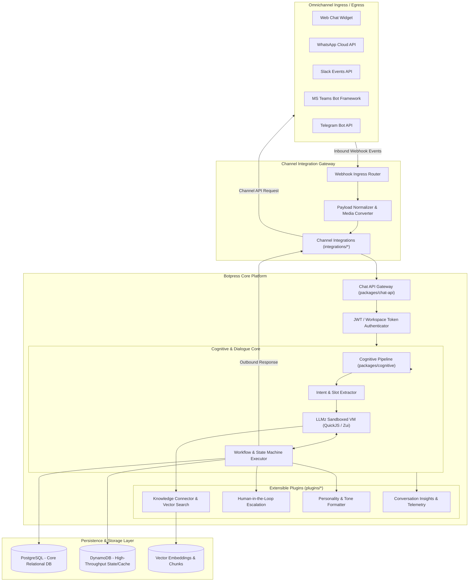
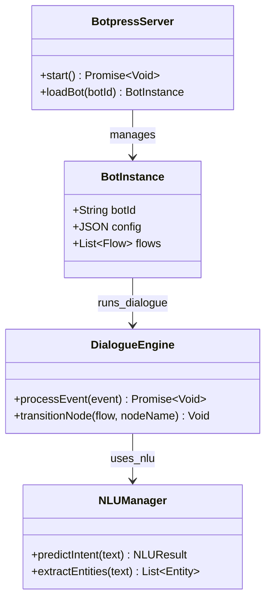
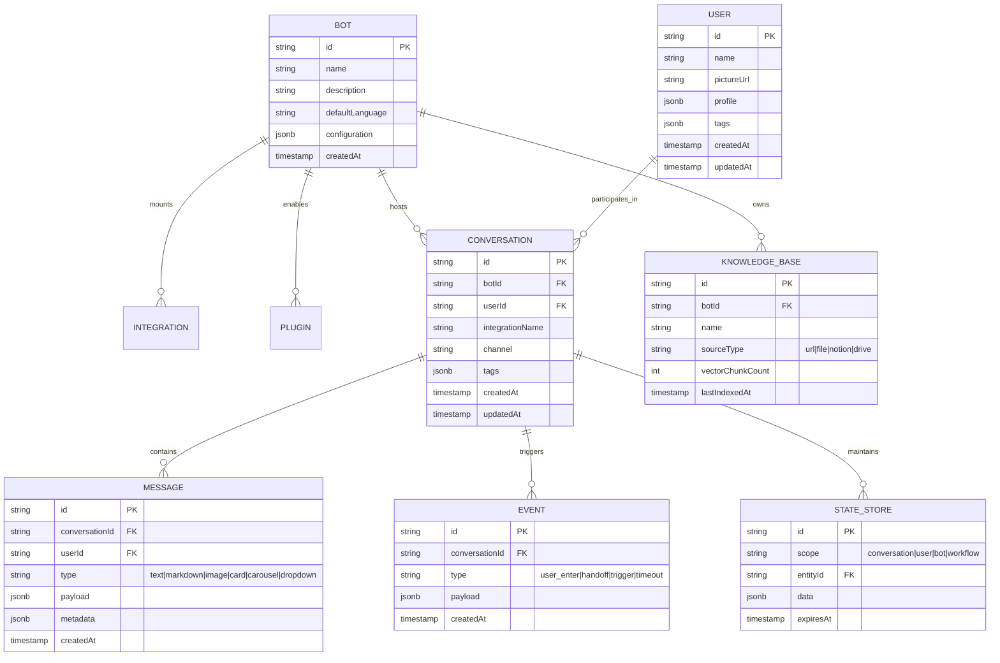
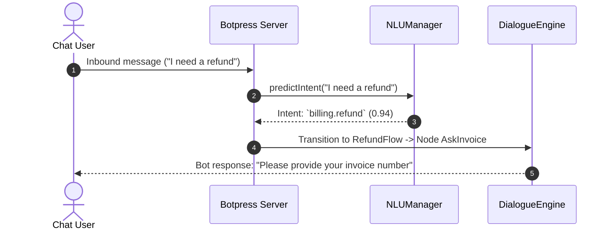

# botpress - Architecture & Technical Wiki

> **Enterprise Autonomous Conversational AI & Hybrid Visual Flow Engine**  
> GitHub: [botpress/botpress](https://github.com/botpress/botpress) | Stack: TypeScript, Node.js 22+, pnpm Workspaces, Turborepo, PostgreSQL, DynamoDB, QuickJS Emscripten (`llmz`), Zui | License: AGPL-3.0 / Enterprise

---

## 1. Executive Summary & Value Proposition

**botpress** is the industry-standard open-source conversational AI platform and next-generation bot operating system. Engineered to bridge the gap between traditional rule-based state machines and modern autonomous LLM agents, Botpress provides an enterprise-ready runtime environment where visual node-based execution graphs operate alongside non-deterministic cognitive agents.

At the core of Botpress's value proposition is its ability to eliminate the "black box" unpredictability of pure LLM agents while discarding the rigid fragility of pure rule-based decision trees. By combining a sandboxed TypeScript VM (`llmz`), an extensible plugin architecture, native Retrieval-Augmented Generation (RAG), and standardized multi-channel gateways, Botpress allows enterprises to build, orchestrate, test, and monitor conversational agents at massive scale.

### Core Problems Solved
- **Deterministic vs. Stochastic Dilemma**: Combines deterministic finite state machines (for billing, compliance, and structured forms) with probabilistic LLM reasoning (for intent classification, natural banter, and unstructured knowledge retrieval).
- **Knowledge Silos & Grounded RAG**: Built-in automated document parsing (PDF, HTML, DOCX, text) and vector search indexing prevent hallucinations by strictly grounding responses in enterprise knowledge sources.
- **Omnichannel Channel Protocol Fragmentation**: Normalizes proprietary payloads from WhatsApp Cloud API, Slack Events API, Telegram, Microsoft Teams, and Web Chat into unified conversation events.
- **Agent Sandbox Security**: Executes custom user actions and tool calls within an isolated WebAssembly QuickJS sandbox, preventing server-side remote code execution (RCE).
- **Human Escalation (HITL)**: Provides built-in protocols to pause bot execution and transfer live conversation context, session variables, and conversation transcripts to human contact center agents.

---

## 2. High-Level System Architecture

Botpress is structured as an event-driven TypeScript monorepo powered by Turborepo and pnpm workspaces. The architecture decouples message ingestion, channel protocol transformation, cognitive classification, state resolution, and dialogue execution into distinct, independently scalable layers.



### Architectural Data Flow Narrative
1. **Ingress & Normalization**: Incoming webhooks from external channels (WhatsApp, Slack, Telegram, WebChat) strike the `integrations/*` gateway. Payloads are validated against Zod/Zui schemas and translated into canonical Botpress `Event` and `Message` structures.
2. **Chat API Routing**: Canonical events enter `packages/chat-api`. The system resolves workspace authentication, checks rate limits, and loads the active session state from PostgreSQL / DynamoDB.
3. **Cognitive Analysis**: The message is passed into `packages/cognitive`. The system evaluates user input against intent classifiers, extracts registered entities, and resolves context matches.
4. **LLMz Execution & Dialogue Graph**: The dialogue engine evaluates the current node in the visual flow canvas. If the node delegates to an autonomous agent, `packages/llmz` spins up an isolated QuickJS WebAssembly virtual machine, executes prompt composition, invokes tools/APIs defined with Zui schemas, and queries the vector store for RAG context.
5. **State Transition & Egress**: Conversation, user, and workflow variables are committed transactionally to the database. Renderable responses (text, cards, carousel, quick replies) are mapped back to channel-specific payloads and dispatched via the outbound HTTP client.

---

### 2.1 Core Domain & Service Class Architecture



---

## 3. Technology Stack & Key Dependencies

- **Language & Runtime**: TypeScript 5.4+ / Node.js 22+ (Strict type-checking, ESM native)
- **Monorepo Architecture**: pnpm 10.29+ with Turborepo 2.3+ (`turbo.json`), Oxlint 1.77+, Oxfmt
- **Core Framework Packages**:
  - `@botpress/sdk`: Primary SDK for authoring bots, integrations, and plugins
  - `@botpress/client`: Strongly typed HTTP client for Botpress Cloud/Server APIs
  - `@botpress/chat-api`: High-performance conversation and event routing server
  - `@botpress/cognitive`: Natural language understanding, intent analysis, and slot filling
  - `@botpress/llmz`: LLM-native TypeScript VM running on QuickJS Emscripten
  - `@botpress/zui`: Schema validation and dynamic UI generation extending Zod
- **Database & State Storage**:
  - **Relational DB**: PostgreSQL 15+ (conversations, messages, users, integrations, audit logs)
  - **NoSQL / Fast Cache**: AWS DynamoDB (`@aws-sdk/client-dynamodb` 3.564+) for ultra-low latency state lookups
  - **Vector Storage**: pgvector / Cloud vector search engines for RAG retrieval
- **Sandbox & Execution**: `quickjs-emscripten-core` 0.31, `@jitl/quickjs-singlefile-browser-release-sync`, `acorn` 8.17, `jsonrepair` 3.10
- **AI & LLM Gateways**: OpenAI API (`openai`), Anthropic Claude SDK, Mistral, Groq, OpenRouter

---

## 4. Repository Layout & Key Modules

```
botpress/
├── bots/                              # Reference bot implementations and E2E bot fixtures
├── integrations/                      # 25+ Channel and service integration drivers
│   ├── chat/                          # Native Botpress WebChat integration
│   ├── slack/                         # Slack App Bolt & Webhooks integration
│   ├── telegram/                      # Telegram Bot API integration
│   ├── whatsapp/                      # Meta WhatsApp Business Cloud API integration
│   ├── teams/                         # Microsoft Bot Framework integration
│   ├── zendesk/                       # Zendesk human handoff & ticket integration
│   └── linear/                        # Linear issue tracker action integration
├── interfaces/                        # Standardized integration and bot interface contracts
├── packages/                          # Core platform monorepo libraries
│   ├── chat-api/                      # Canonical chat API endpoints, models, and operations
│   │   ├── src/models/                # Conversation, message, user, and event Zod models
│   │   └── src/operations/            # Paging, conversation CRUD, and webhook dispatch
│   ├── chat-client/                   # Front-end and Node client for chat-api
│   ├── cli/                           # Developer CLI tool (`bp deploy`, `bp dev`, `bp init`)
│   ├── client/                        # Core cloud management client
│   ├── cognitive/                     # Intent classifiers, entity extractors, NLU routines
│   ├── common/                        # Shared internal utilities and retry routines
│   ├── llmz/                          # LLM VM runtime, tool orchestration, and sandbox
│   │   ├── src/engine/                # QuickJS execution harness and prompt runner
│   │   └── src/tools/                 # Schema-guided autonomous tool dispatch
│   ├── sdk/                           # Public developer SDK (@botpress/sdk)
│   │   ├── src/bot/                   # Bot definition, state scopes, and event handlers
│   │   ├── src/integration/           # Channel integration builder and lifecycle hooks
│   │   └── src/plugin/                # Plugin definition system (HITL, Knowledge, etc.)
│   ├── vai/                           # Visual AI components
│   ├── zai/                           # Zod-based AI prompt wrappers
│   └── zui/                           # Schema and UI definition kit
├── plugins/                           # Modular pluggable subsystems
│   ├── analytics/                     # Bot execution telemetry and drop-off tracking
│   ├── conversation-insights/         # Automated conversation summarization and sentiment
│   ├── file-synchronizer/             # External file watcher and document pipeline
│   ├── hitl/                          # Human-in-the-loop escalation workflows
│   ├── knowledge/                     # RAG indexing and similarity querying
│   ├── knowledge-connector/           # Third-party knowledge base connectors (Notion, Drive)
│   ├── logger/                        # Structured cloud logging
│   └── personality/                   # System prompt persona steering
├── pnpm-workspace.yaml                # Monorepo workspace definition
└── turbo.json                         # Turborepo task pipeline cache configuration
```

---

## 5. Core Features & Capabilities

### 5.1 Hybrid Dialogue State Machine (FSM + LLMz)
Botpress utilizes a dual-engine architecture for conversational flow. Visual nodes on the canvas define deterministic state machines with enter, execute, and exit transitions. Inside any node, execution can yield control to `packages/llmz`—an in-process, LLM-native virtual machine running inside an isolated QuickJS WebAssembly environment. This enables bots to execute multi-turn, goal-seeking dialogues, dynamically calling functions until a terminal condition or user confirmation is satisfied.

### 5.2 Multi-Scope State Persistence (`conversation`, `user`, `bot`, `workflow`)
The SDK enforces clear separation across four persistence scopes:
- **`conversation`**: Bound to the active chat session (e.g., current booking details, temporary cart). Expires after inactivity.
- **`user`**: Long-term prospect memory spanning all conversations across any integration channel (e.g., user preferences, lead score, VIP status).
- **`bot`**: Global configuration and shared data accessible across all user conversations.
- **`workflow`**: Transient execution context for long-running multi-step operations (e.g., asynchronous identity verification).

### 5.3 Knowledge Connector & Autonomous RAG
Through `plugins/knowledge` and `plugins/knowledge-connector`, Botpress enables seamless document ingestion. Files uploaded via the studio or crawled from external URLs are chunked, embedded, and queried during conversational turns. When an incoming prompt matches knowledge base embeddings with high confidence, the bot synthesizes citations and responds without requiring visual flow transitions.

### 5.4 Tool Calling via Zui Schema Contracts
Tools in Botpress are declared with `@botpress/zui`, extending Zod schemas with metadata, parameter descriptions, and validation constraints. When the LLM decides to call a tool (e.g., checking lead availability or booking a CRM demo), the payload is parsed, strictly validated against the Zui schema, and dispatched within the secure QuickJS runtime, returning structured output directly into the prompt context.

### 5.5 Human-in-the-Loop (HITL) Protocol
When a conversation breaches sentiment thresholds, encounters an unhandled intent, or reaches an explicit escalation node, `plugins/hitl` triggers. The bot transitions to a paused state, emits a handoff event to Zendesk, Chatwoot, or the Botpress native inbox, and streams incoming operator messages back to the customer until the human agent closes the ticket.

---

## 6. Data Models & Schema Architecture

Botpress models all chat entities as strongly typed schemas declared with Zod/Zui in `packages/chat-api/src/models`.



### Core Schema Definitions
- **`CONVERSATION`**: The primary session aggregate. Keyed by ULID/UUID, tracking channel identity (`integrationName`, e.g., `whatsapp`, `slack`) and session tags.
- **`MESSAGE`**: Polymorphic message container supporting `text`, `markdown`, `image`, `audio`, `video`, `file`, `location`, `card`, `carousel`, and `dropdown`. Ensures consistent client rendering across heterogeneous platforms.
- **`USER`**: Represents a physical interlocutor. Profile attributes (`name`, `email`, custom attributes) persist across independent conversations.
- **`STATE_STORE`**: Key-value document store partitioned by `scope` (`conversation`, `user`, `bot`, `workflow`) with native TTL expiration.

---

### 6.1 Comprehensive Database Schema Specification

Botpress stores conversation states and bot definitions in PostgreSQL or SQLite.

#### Table: `bp_dialogue_sessions`
| Column | Type | Constraints | Default | Description |
| :--- | :--- | :--- | :--- | :--- |
| `id` | `VARCHAR(255)` | `PRIMARY KEY` | - | Session ID |
| `bot_id` | `VARCHAR(100)` | `NOT NULL` | - | Target bot ID |
| `channel` | `VARCHAR(50)` | `NOT NULL` | `'web'` | Medium |
| `state` | `JSON` | `NOT NULL` | `'{}'` | Dialog state variables |

---

## 7. API Architecture, Webhooks & Key Endpoints

Botpress exposes a RESTful Chat API via `packages/chat-api` authenticated via bearer tokens.

### 7.1 Message Dispatch (`POST /v1/chat/messages`)
Creates and sends a message into an active conversation.

```http
POST /v1/chat/messages
Authorization: Bearer <WORKSPACE_TOKEN>
Content-Type: application/json

{
  "conversationId": "conv_01HZX8P0Q5Q7M7Y6Z8A4B2C1D0",
  "type": "card",
  "payload": {
    "title": "MarketingStudio Demo Scheduled",
    "subtitle": "Your AI SDR demo has been confirmed for Tuesday at 2:00 PM EST.",
    "imageUrl": "https://marketingstudio.ai/assets/calendar-confirm.png",
    "actions": [
      {
        "action": "url",
        "label": "Add to Google Calendar",
        "value": "https://calendar.google.com/event?eid=abc123xyz"
      },
      {
        "action": "postback",
        "label": "Reschedule",
        "value": "EVENT_RESCHEDULE_DEMO"
      }
    ]
  }
}
```

### 7.2 Conversation Management
- **`GET /v1/chat/conversations`**: Lists active conversations filtered by user ID, tag, or updated timestamp.
- **`POST /v1/chat/conversations`**: Initializes a conversation thread tied to a specific user and integration channel.
- **`GET /v1/chat/conversations/:id/messages`**: Fetches paginated message history using cursor-based pagination (`nextToken`).

### 7.3 Webhook Events Dispatch
External channels deliver payloads to Botpress integration endpoints (`POST /webhooks/:integrationName`). Botpress issues outbound webhook notifications for state and conversation events:

```json
// Outbound Conversation Event Notification
{
  "event": "conversation.handoff",
  "botId": "bot_enterprise_sdr_v2",
  "conversationId": "conv_01HZX8P0Q5Q7M7Y6Z8A4B2C1D0",
  "userId": "usr_99887766",
  "payload": {
    "reason": "sentiment_escalation",
    "leadScore": 92,
    "lastUserMessage": "I want to speak with a human enterprise account executive right now.",
    "assignedQueue": "tier1_sales_reps"
  },
  "timestamp": "2026-10-24T12:00:00.000Z"
}
```

---

### 7.5 End-to-End Operational Lifecycle Sequence



---

## 8. Strategic Value & Takeaways for MarketingStudio

### Reusable Architectural Patterns
1. **Hybrid Execution Engine (FSM + LLMz VM)**:  
   MarketingStudio's AI SDR dialogues require absolute determinism for qualification gates (e.g., verifying budget, employee count, and company domain) while needing fluid natural language capability for objection handling. Adopting Botpress's model of embedding an isolated QuickJS LLM runner inside explicit state machine nodes eliminates conversational drift while retaining agentic flexibility.

2. **Strict Multi-Scope State Segregation**:  
   Separating ephemeral dialogue state (`conversation`) from persistent account memory (`user`/`lead`) and overarching tenant rules (`bot`) prevents context pollution in long-running outbound marketing sequences. MarketingStudio should implement identical state partitions in its conversational outreach engine.

3. **Zui/Zod-Contracted Tool Calling**:  
   Defining all external sales tools (enrichment APIs, calendar schedulers, CRM updates) using strict schema definitions guarantees that LLM parameter hallucinations are caught and rejected before making destructive API calls.

4. **Normalized Omnichannel Message Primitives**:  
   By standardizing complex visual components (Cards, Carousels, Dropdowns, Datepickers) into universal schema primitives and letting channel adapters handle platform quirks, MarketingStudio can write AI SDR dialogue scripts once and deploy across WhatsApp, Web Chat, LinkedIn InMail, and SMS effortlessly.
