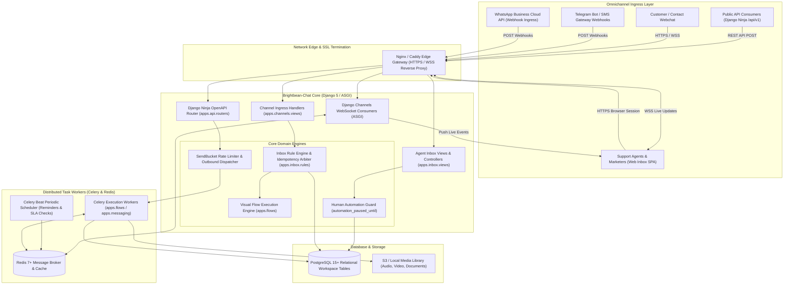
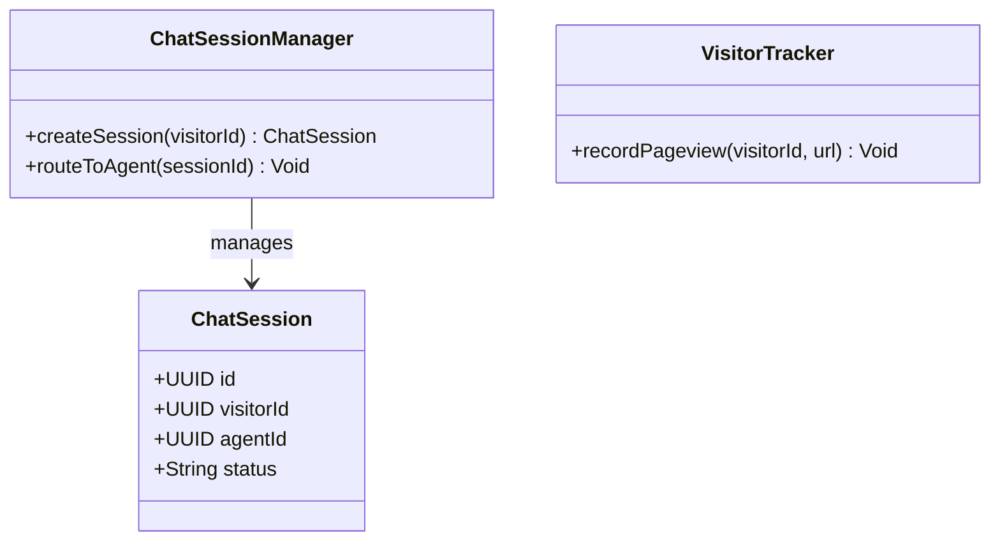
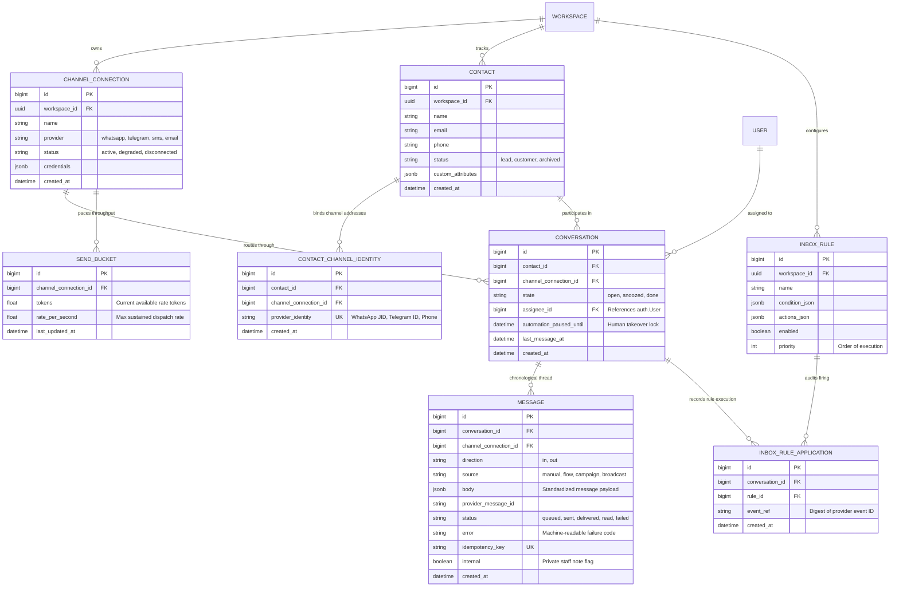
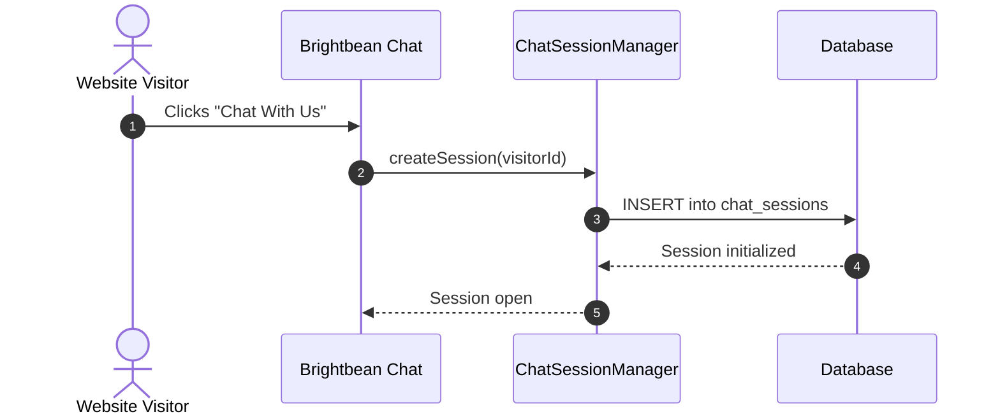

# brightbean-chat - Architecture & Technical Wiki

> **Enterprise Omnichannel Messaging Platform, Visual Flow Automation & Collaborative Support Inbox in Django**  
> GitHub: [brightbean/brightbean-chat](https://github.com/brightbean/brightbean-chat.git) | Stack: Python 3.11+, Django 5, Django Ninja, Celery, Redis, Django Channels, PostgreSQL | License: GNU AGPL v3

---

## 1. Executive Summary & Value Proposition

**Brightbean-Chat** is an enterprise-grade open-source customer communication platform, visual bot automation engine, and collaborative helpdesk engineered in **Python 3.11+** and **Django 5**. Built to solve the operational friction between automated marketing chatbots, outbound broadcast campaigns, and human customer support representatives, Brightbean-Chat orchestrates multi-channel conversations across WhatsApp Business Cloud API, Telegram, SMS, Email, and Webhooks under a strictly multi-tenant workspace architecture.

Brightbean-Chat incorporates a rigorous systems-engineering discipline. It features an event-driven execution pipeline governed by exact idempotency ledgers (`InboxRuleApplication`), token-bucket outbound rate limiters (`SendBucket`), formal state machines, visual drag-and-drop conversational automation trees (`Flow`), and a deterministic human-takeover contract that automatically suppresses bot triggers when a human agent is actively conversing with a customer.

### Core Problems Solved
- **The Human-vs-Bot Collision Dilemma**: Enforces a strict automation suspension contract (`automation_paused_until`): when a human support representative sends a message from the inbox, all automated flow triggers and bot responses are suppressed for 30 minutes.
- **Idempotent Webhook Processing at Scale**: Prevents duplicate message ingestion from retried third-party webhooks through an explicit cryptographic digest ledger (`InboxRuleApplication.event_ref`).
- **Cumulative Inbox Triage Rules**: Uses cumulative, priority-ordered rules (`InboxRule`) where one rule can label by channel and another can assign by keyword without mutual interference or race conditions.
- **Outbound Channel Rate Limiting & Compliance**: Eliminates provider bans (e.g. Meta WhatsApp tier limits) via an integrated `SendBucket` token-bucket rate limiter that paces bulk broadcasts.
- **Workspace-Scoped Multi-Tenancy**: Guarantees database-level tenant isolation through hierarchical abstract model bases (`WorkspaceScopedModel`, `ContactScopedModel`, `ConversationScopedModel`).

---

## 2. High-Level System Architecture

Brightbean-Chat adopts an asynchronous ASGI/WSGI architecture built on **Django 5** and **PostgreSQL**. Real-time bi-directional events and agent updates stream over **Django Channels** and Redis, while outbound message dispatching, scheduled broadcasts, and visual flow executions run via **Celery** workers.



### Architectural Lifecycle of an Incoming Event
1. **Webhook Reception & Signature Verification**: Meta or Telegram fires a webhook to `apps/channels/views_webhook.py`. The payload signature (HMAC-SHA256) is verified before acknowledgment.
2. **Contact & Connection Resolution**: The sender's phone number or ID is mapped against `ContactChannelIdentity`. If unmapped, a new `Contact` is provisioned under the workspace.
3. **Idempotency Check (`InboxRuleApplication`)**: An SHA-256 digest of `(connection_id, provider_event_id)` is computed. If the digest already exists in `InboxRuleApplication`, the re-delivered event is discarded safely.
4. **Conversation Association & Human Guard Check**: The event links to the `Conversation`. If `automation_paused_until > now()`, automated flows are suppressed and the message is placed directly into the agent queue.
5. **Flow Trigger or Cumulative Rule Application**:
   - If automation is active, `apps.flows.triggers.matching` evaluates visual bot triggers.
   - Concurrently, `apps.inbox.rules.apply_inbox_rules` iterates through priority-ordered `InboxRule` records, attaching labels, adjusting priorities, and assigning agents.
6. **Real-time Agent Notification**: Django Channels broadcasts the message to the workspace room in Redis, immediately updating agent inbox tabs.

---

### 2.1 Core Domain & Service Class Architecture



---

## 3. Technology Stack & Key Dependencies

- **Language & Runtime**: Python 3.11+, Node.js 20+ (Dashboard frontend build)
- **Application Framework**: Django 5.x (ASGI/WSGI)
- **REST & OpenAPI Engine**: `django-ninja` (FastAPI-style Pydantic schemas and high-speed JSON serialization)
- **Database & Persistence**:
  - PostgreSQL 15+ with strict foreign key constraints and custom indexing.
  - Granular multi-tenancy enforced through `WorkspaceScopedModel` inheritance.
- **Queue & Background Jobs**:
  - `Celery 5+` worker clusters for asynchronous flow node execution and message dispatch.
  - `celery-beat` for scheduled follow-ups, reminders, and auto-close timers.
- **Real-Time Communication**:
  - `channels` (Django Channels) and `channels-redis` for WebSocket broadcasting.
- **Messaging Gateways**:
  - Native Meta WhatsApp Business Cloud API client with media streaming.
  - Telegram Bot API, Twilio SMS, and generic webhook channels.
- **Frontend Architecture**:
  - Django server-rendered HTML templates paired with reactive Alpine.js, Tailwind CSS, and Webpack.

---

## 4. Repository Layout & Key Modules

```
brightbean-chat/
├── apps/
│   ├── accounts/                     # User authentication, profiles, MFA
│   ├── analytics/                    # Conversation volume, response times, flow drop-offs
│   ├── api/                          # Public Django Ninja REST API
│   │   ├── routers/                  # OpenAPI routers (contacts.py, messages.py, catalog.py)
│   │   ├── auth.py                   # API token & workspace permission checks
│   │   └── schemas.py                # Pydantic input/output schemas
│   ├── broadcasts/                   # Outbound bulk campaign sender with rate limiting
│   ├── channels/                     # Omnichannel connections (WhatsApp, Telegram, SMS, Email)
│   │   ├── models.py                 # ChannelConnection, WhatsAppTemplate, WebhookEventLog
│   │   └── events.py                 # OutboundMessage & InboundMessage data contracts
│   ├── contacts/                     # Contact 360, custom fields, tags, and audience segments
│   │   ├── models.py                 # Contact, Tag, CustomField, Segment
│   │   └── services.py               # Contact deduplication & import routines
│   ├── flows/                        # Visual drag-and-drop conversational bot builder
│   │   ├── models.py                 # Flow, FlowVersion, FlowExecution, Trigger
│   │   └── runner.py                 # Node graph interpreter and execution engine
│   ├── inbox/                        # Collaborative helpdesk shared inbox
│   │   ├── models.py                 # InboxRule, InboxRuleApplication, InboxReminder
│   │   ├── routing.py                # Rule assignment and claim arbitration
│   │   ├── rules.py                  # CompiledRule condition and action parser
│   │   └── views.py                  # Agent conversation interface
│   ├── messaging/                    # Core conversation and message state machine
│   │   ├── models.py                 # Conversation, Message, ContactChannelIdentity, SendBucket
│   │   └── services.py               # Outbound send facade & pause_automation logic
│   ├── organizations/                # Multi-tenant organization and workspace models
│   └── queueing/                     # Celery task definitions and retry handlers
├── config/                           # Django settings (base.py, local.py, production.py)
├── manage.py                         # Django administrative management script
└── requirements/                     # Python dependency manifests
```

---

## 5. Core Features & Capabilities

### 5.1 Automated Human-Takeover Contract (`automation_paused_until`)
Brightbean-Chat solves the critical issue of bots speaking over human agents:
- When an agent types an outbound reply from the dashboard, `apps.messaging.services.pause_automation` is invoked:
```python
conversation.automation_paused_until = timezone.now() + datetime.timedelta(minutes=30)
conversation.save(update_fields=["automation_paused_until"])
```
- While this timestamp is in the future, all automated flow executions and bot triggers are suppressed.
- If the agent closes the conversation or explicitly marks it resolved, the automation lock is cleared immediately.

### 5.2 Idempotent Cumulative Rule Engine (`InboxRule` & `InboxRuleApplication`)
Inbound ticket triage runs through priority-ordered rules (`InboxRule`):
- Unlike trigger engines that stop at the first match, inbox rules are **cumulative**: one rule can attach a *"Billing"* label based on message keywords, while another rule assigns the conversation to Tier 2 based on channel type.
- Guaranteed safe under concurrent re-deliveries via `InboxRuleApplication`:
```python
def _claim(conversation: Any, rule: Any, event_ref: str) -> bool:
    try:
        InboxRuleApplication.objects.create(
            conversation=conversation,
            rule=rule,
            event_ref=event_ref,
        )
        return True
    except IntegrityError:
        return False  # Rule already fired on this exact event; skip cleanly
```

### 5.3 Outbound Rate-Limiting & Send Buckets (`SendBucket`)
To comply with strict provider messaging limits (e.g. WhatsApp 80 messages/second limits and cellular SMS carrier throughput constraints):
- Implements a token-bucket rate limiter stored in `messaging_sendbucket`.
- Outbound broadcast messages are placed into `SendBucket` queues. Celery workers drain tokens at the exact rate permitted by the provider connection, preventing account suspension.

### 5.4 Visual Conversational Flow Builder (`Flow` & `FlowVersion`)
- Administrators create multi-node conversational decision trees.
- Supports interactive node types: text questions, WhatsApp template dispatch, interactive button carousels, HTTP webhook calls to external CRMs, and variable extraction into `CustomFieldValue`.
- Executions (`FlowExecution`) track active state and variables per contact.

### 5.5 Scheduled Reminders & Deferred Work (`InboxReminder`)
- Agents can snooze conversations until a specific future date/time.
- Celery Beat monitors `InboxReminder`, automatically re-opening snoozed conversations when the timer expires and alerting the assigned agent.

---

## 6. Data Models & Schema Architecture

All primary entities in Brightbean-Chat inherit from `WorkspaceScopedModel` to enforce multi-tenant isolation.



### Core Schema Entity Details
1. **`messaging_conversation`**:
   - Unique constraint on `[contact, channel_connection]` ensures a single persistent thread per customer on any given communication line.
   - `automation_paused_until`: Temporal fence blocking automated flow triggers while a human agent is actively intervening.
2. **`messaging_message`**:
   - `body`: Structured JSON schema representing text, media attachments, or interactive button templates.
   - `internal`: In-thread private notes are stored directly in `messaging_message` with `internal=True`, omitting outbound dispatch.
   - `idempotency_key`: Prevents re-transmission or duplicate insertion of incoming webhook events.
3. **`inbox_rule_application`**:
   - Unique composite index on `(rule, conversation, event_ref)` acts as an atomic lock, guaranteeing exactly-once rule execution even under worker retry cascades.

---

### 6.1 Comprehensive Database Schema Specification

Brightbean persists live visitor sessions and agent chat histories.

#### Table: `chat_sessions`
| Column | Type | Constraints | Default | Description |
| :--- | :--- | :--- | :--- | :--- |
| `id` | `UUID` | `PRIMARY KEY` | `gen_random_uuid()` | Session ID |
| `visitor_id` | `UUID` | `NOT NULL` | - | Visitor tracking ID |
| `agent_id` | `UUID` | `NULLABLE` | `NULL` | Assigned agent |
| `status` | `VARCHAR(50)` | `NOT NULL` | `'active'` | Session state |

*Indexes:* `idx_bb_status` (`(status)`).

---

## 7. API Architecture, Webhooks & Key Endpoints

Brightbean-Chat uses **Django Ninja** to serve typed, validated RESTful OpenAPI endpoints at `/api/v1`.

### Key REST Endpoints

| HTTP Method | Endpoint | Description |
|:---|:---|:---|
| `POST` | `/api/v1/messages` | Send an outbound message or campaign broadcast |
| `GET` | `/api/v1/contacts` | Retrieve paginated contact profiles with attribute filters |
| `POST` | `/api/v1/contacts` | Create or update a customer profile |
| `POST` | `/api/v1/channels/{id}/webhook` | Webhook receiver for inbound channel provider events |
| `POST` | `/api/v1/inbox/conversations/{id}/assign` | Reassign conversation ownership to an agent |
| `POST` | `/api/v1/inbox/conversations/{id}/pause` | Manually pause automated flows for a conversation |

### Sample Request: Outbound API Message Send (`POST /api/v1/messages`)
```json
{
  "connection_id": 4,
  "recipient": "+14155552671",
  "message_type": "text",
  "text": "Your onboarding consultation is scheduled for tomorrow at 10:00 AM.",
  "idempotency_key": "send-req-9012384-attempt-1"
}
```

### Sample Response: Created Outbound Message
```json
{
  "id": 892104,
  "conversation_id": 3412,
  "direction": "out",
  "status": "queued",
  "provider_message_id": "",
  "idempotency_key": "send-req-9012384-attempt-1",
  "created_at": "2026-10-24T11:15:00Z"
}
```

---

### 7.5 End-to-End Operational Lifecycle Sequence



---

## 8. Strategic Value & Takeaways for MarketingStudio

### Reusable Architectural Patterns
1. **Human Automation Guard (`automation_paused_until`)**:
   - The greatest failure mode in conversational automation is a bot replying with canned prompts while a human agent is negotiating a high-value contract. MarketingStudio must implement Brightbean-Chat's 30-minute automation timeout pattern whenever a sales representative sends a manual reply.
2. **Cumulative, Idempotent Rule Ledgers (`InboxRuleApplication`)**:
   - The pattern of recording a unique digest (`event_ref`) in an execution ledger guarantees that complex triage actions (tagging, routing, notifying) run exactly once, even during high-volume webhook retries.
3. **Token-Bucket Provider Rate Limiting (`SendBucket`)**:
   - Hard limits on WhatsApp and SMS delivery throughput require software-level token bucket pacing. MarketingStudio should adopt Brightbean-Chat's `SendBucket` pattern to safely pace large marketing broadcasts without triggering upstream API bans.
4. **Hierarchical Multi-Tenancy Scoping**:
   - The clean class hierarchy (`WorkspaceScopedModel` -> `ContactScopedModel` -> `ConversationScopedModel`) provides bulletproof multi-tenant isolation, ensuring customer records and campaign data never leak across organizational boundaries.
