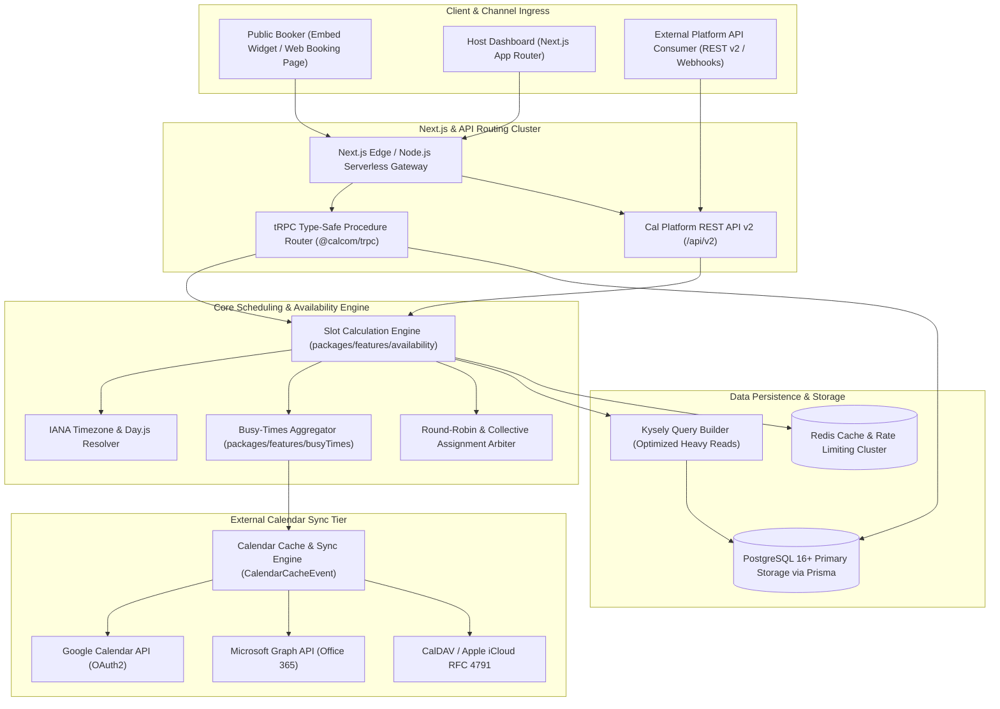
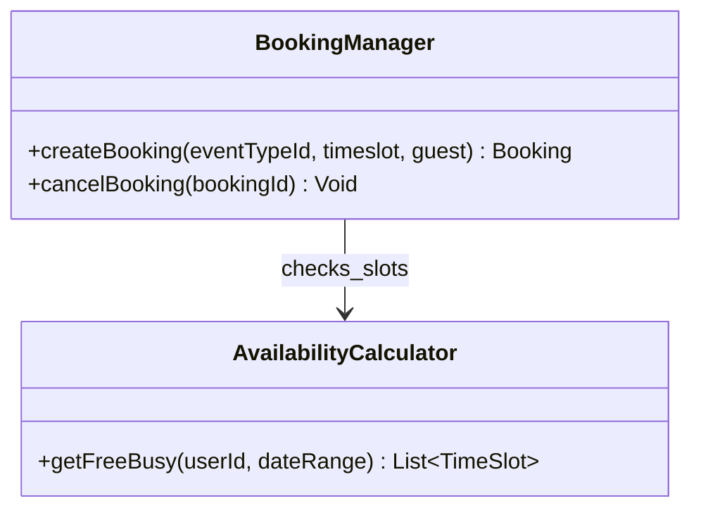
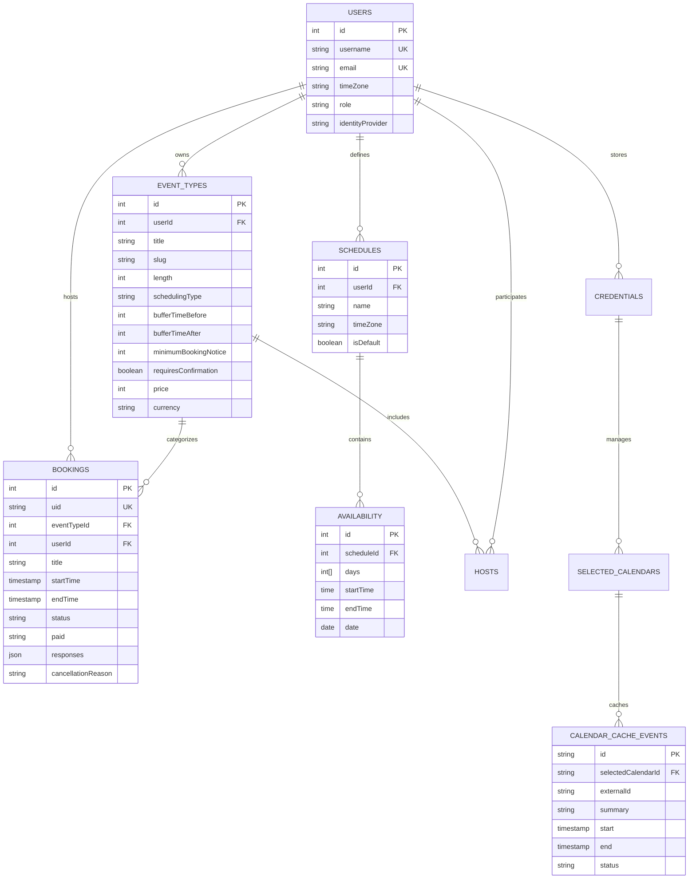
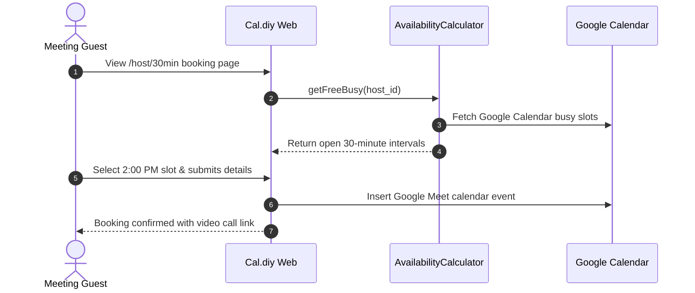

# cal.diy - Architecture & Technical Wiki

> **Enterprise Scheduling Infrastructure, Multi-Host Availability Engine & Calendar Orchestration Monorepo**  
> GitHub: [calcom/cal.com](https://github.com/calcom/cal.com.git) | Stack: TypeScript 5+, Next.js, Prisma ORM, tRPC, PostgreSQL, Redis, Tailwind CSS, Day.js | License: AGPLv3

---

## 1. Executive Summary & Value Proposition

**Cal.diy** (the open-source foundation of **Cal.com**) is an enterprise-grade scheduling infrastructure, availability coordination engine, and calendar integration monorepo engineered in **TypeScript 5+**, **Next.js**, **Prisma ORM**, and **tRPC**. Built to serve as the open-source standard for scheduling—countering proprietary SaaS lock-in from Calendly and Acuity—Cal.diy provides complex multi-party booking primitives: 1-on-1 meetings, collective team scheduling, round-robin lead distribution, managed enterprise organizational hierarchies, and paid appointments.

Cal.diy abstracts the immense mathematical complexity of global temporal coordination: time zone translations across International Daylight Saving Time boundaries, overlapping working schedules, multi-calendar busy-time conflict detection, buffer margins, travel times, and webhooks.

### Core Problems Solved
- **Cross-Timezone DST Boundary Errors**: Completely eliminates scheduling shifts caused by Daylight Saving Time transitions through strict UTC instant storage paired with canonical IANA timezone database identifiers (`Intl` / Day.js).
- **Multi-Calendar Busy-Time Ingestion**: Directly aggregates real-time busy blocks across heterogeneous external calendar systems (Google Calendar, Microsoft Outlook, Apple iCloud, Nextcloud CalDAV), preventing double-booking across fragmented personal and professional calendars.
- **Advanced Team Scheduling Topologies**: Natively supports `ROUND_ROBIN` (weighted or balanced lead distribution), `COLLECTIVE` (finding mutual availability across multiple team members), and `MANAGED` organizational event templates.
- **Embedded Extensibility & App Store Ecosystem**: Features a modular integration framework (`packages/app-store`) supporting video conferencing (Cal Video, Zoom, Google Meet), CRM synchronization (HubSpot, Salesforce), and payment gateways (Stripe, PayPal).
- **Auditable Booking Lifecycle**: Maintains an unalterable history of booking states (`PENDING`, `ACCEPTED`, `REJECTED`, `CANCELLED`) with cryptographic HMAC webhooks and automated workflow notifications.

---

## 2. High-Level System Architecture

Cal.diy utilizes a modular **TypeScript Monorepo Architecture** orchestrated with Turborepo and Yarn. The core computational logic is partitioned into decoupled packages (`@calcom/core`, `@calcom/prisma`, `@calcom/trpc`, `@calcom/features`), allowing the booking UI, administrative dashboard, and public API v1/v2 to share the identical availability calculation pipeline.



### Architectural Lifecycle of Slot Calculation & Booking
1. **Availability Query & Window Bounds**: A public client requests available slots for an `EventType` across a date range (`from`, `to`, `timeZone`). Cal.diy queries the host's configured `Schedule` (or team members' schedules in round-robin mode) and user `Availability` rows.
2. **Working Hours & Override Intersect**: The engine maps weekly recurring availability windows to the requested date range, incorporating one-off `DateOverride` records and public holidays.
3. **External Busy-Time Subtraction**: `busyTimes` concurrently dispatches requests to all enabled `SelectedCalendar` connections for the host. Busy intervals are returned as UTC `[start, end]` tuples (or read from the local `CalendarCacheEvent` cache) and merged with internal bookings from PostgreSQL.
4. **Slot Generation & Buffer Math**: The slot generator slices available windows into increments matching `eventType.length`. It subtracts busy periods, applies `bufferTimeBefore` and `bufferTimeAfter`, verifies `minimumBookingNotice`, and enforces daily booking frequency limits.
5. **Booking Creation & Side Effects**: Upon slot selection, a database transaction creates a `Booking` record with a unique `uid`. If payment is required, a Stripe PaymentIntent is captured. The engine then asynchronously creates external calendar events, provisions video room links (e.g. Daily.co WebRTC via Cal Video), and fires `BOOKING_CREATED` webhooks.

---

### 2.1 Core Domain & Service Class Architecture



---

## 3. Technology Stack & Key Dependencies

- **Language & Runtime**: TypeScript 5.x executing on Node.js 20+ LTS runtime with strict type safety.
- **Web Framework**: Next.js 14/15 leveraging mixed App Router (React Server Components) and Pages Router architectures.
- **Data Access & ORM**: Prisma ORM (`@prisma/client`) for relational schema modeling, paired with Kysely for high-performance raw SQL queries; Zod (`zod-prisma-types`) for automated runtime validation.
- **API Protocol**: tRPC v10 for end-to-end type safety between client components and backend routers; OpenAPI-compliant REST API v2.
- **Database & Cache**: PostgreSQL 16+ (relational data), Redis 7+ (distributed cache, calendar cache, session management, and rate limiting).
- **Timezone & Date Math**: Day.js with plugins (`timezone`, `utc`, `customParseFormat`, `isBetween`).

---

## 4. Repository Layout & Key Modules

```
inspire/cal.diy/
├── apps/
│   └── web/                         # Primary Next.js application (Dashboard, Booking UI, API)
│       ├── pages/api/               # REST API endpoints & OAuth callbacks
│       └── pages/                   # Next.js Pages router frontend views
├── packages/
│   ├── app-store/                   # Integration plugins (Stripe, Zoom, Google Calendar)
│   ├── features/                    # Core business domain packages
│   │   ├── availability/            # Working hours & date override calculation
│   │   │   └── lib/
│   │   │       ├── getUserAvailability.ts        # Single user availability resolver
│   │   │       └── getAggregatedAvailability/    # Multi-host collective/round-robin logic
│   │   ├── bookings/                # Booking creation, rescheduling & cancellation
│   │   ├── busyTimes/               # External calendar busy interval aggregation
│   │   ├── calendars/               # Connectors for Google, Microsoft, Apple, CalDAV
│   │   ├── eventtypes/              # Event type configuration & booking forms
│   │   ├── schedules/               # Recurring weekly availability models
│   │   └── webhooks/                # HMAC webhook delivery and event publishers
│   ├── kysely/                      # Optimized raw SQL query builders
│   ├── lib/                         # Shared utilities, date formatting, error classes
│   ├── prisma/                      # Primary database schema & migration files
│   │   ├── schema.prisma            # Master database schema definitions
│   │   └── zod/                     # Auto-generated Zod validation schemas
│   └── trpc/                        # tRPC routers (server side) & hooks (client side)
└── turbo.json                       # Turborepo task pipeline definition
```

---

## 5. Core Features & Capabilities

### 5.1 Multi-Topology Team Scheduling (`SchedulingType`)
Cal.diy supports sophisticated team booking rules:
- **`ROUND_ROBIN`**: Distributes meetings among team members based on least-recently-booked algorithms or assigned percentage weights (`Host.weight`).
- **`COLLECTIVE`**: Computes the strict mathematical intersection of all team members' schedules, surfacing only slots where all required hosts are simultaneously free.
- **`MANAGED`**: Allows organization administrators to publish immutable event templates that inherit individual member working schedules.

### 5.2 Deterministic Slot Availability & Buffer Calculation
The slot calculation algorithm in `packages/features/availability` executes a sequential reduction pipeline:
1. Translates requested calendar dates into the host's configured working schedule time zone.
2. Expands recurring days-of-week rules (`Availability.days`) into discrete UTC timestamps.
3. Overlays `DateOverride` records (vacation days, holiday exceptions, custom shifts).
4. Ingests all external calendar busy times (`CalendarCacheEvent`) and internal existing bookings.
5. Injects buffer intervals (`bufferTimeBefore` and `bufferTimeAfter`) around each busy block.
6. Filters candidate slots against `minimumBookingNotice` (preventing last-minute bookings) and `maxBookingsPerDay`.

### 5.3 Resilient Timezone Manipulation & DST Protection
Time is handled strictly via UTC instants and canonical IANA timezone names (e.g. `America/New_York`, `Europe/London`):
- Slots are calculated natively in the host's timezone and transformed to the visitor's detected browser timezone at serialization.
- By never caching static numerical offsets (`+05:00`), schedule calculations remain immune to sudden government daylight-saving policy changes.

### 5.4 Native Video Integration & WebRTC Rooms
Cal.diy features **Cal Video**—a zero-dependency, in-browser video conferencing platform powered by Daily.co WebRTC:
- Automatically provisions isolated meeting rooms upon booking confirmation.
- Includes automatic AI transcription, video recording to S3 buckets, and guest attendance tracking (`VideoCallGuest`).

---

## 6. Data Models & Schema Architecture



### Core Schema Definitions

#### `EventType`
- `id` (int, PK): Numeric auto-incrementing identifier.
- `title` (string): Human-readable event name (e.g., "30-Minute Consultation").
- `slug` (string): URL-friendly routing identifier.
- `length` (int): Meeting duration in minutes.
- `schedulingType` (enum): `ROUND_ROBIN`, `COLLECTIVE`, or `MANAGED`.
- `bufferTimeBefore` / `bufferTimeAfter` (int): Guard buffers in minutes wrapped around meetings.
- `minimumBookingNotice` (int): Minimum advance warning required prior to slot start time (minutes).

#### `Schedule` & `Availability`
- `timeZone` (string): Canonical IANA identifier governing the availability records.
- `days` (int array): Days of week where slot rules apply (`[1, 2, 3, 4, 5]` for Mon-Fri).
- `startTime` / `endTime` (time): Active working hours (e.g., `09:00:00` to `17:00:00`).

#### `Booking`
- `uid` (string, Unique): Public UUID string used in customer confirmation links.
- `startTime` / `endTime` (DateTime, UTC): Absolute temporal boundaries of the booked session.
- `status` (enum): Current booking status (`PENDING`, `ACCEPTED`, `REJECTED`, `CANCELLED`).
- `responses` (json): Dynamic questionnaire answers supplied during checkout.

---

### 6.1 Comprehensive Database Schema Specification

#### Table: `bookings`
| Column | Type | Constraints | Default | Description |
| :--- | :--- | :--- | :--- | :--- |
| `id` | `UUID` | `PRIMARY KEY` | `gen_random_uuid()` | Booking ID |
| `user_id` | `UUID` | `NOT NULL` | - | Host user |
| `start_time` | `TIMESTAMPTZ` | `NOT NULL` | - | Start time |
| `end_time` | `TIMESTAMPTZ` | `NOT NULL` | - | End time |
| `status` | `VARCHAR(50)` | `NOT NULL` | `'accepted'` | Booking status |

---

## 7. API Architecture, Webhooks & Key Endpoints

Cal.diy exposes comprehensive tRPC procedures internally and REST API v1/v2 endpoints externally.

| Method | Endpoint | Description | Auth Scope |
| :--- | :--- | :--- | :--- |
| `GET`  | `/api/v2/slots/available` | Queries available booking slots for a given event type | Public / API Key |
| `POST` | `/api/v2/bookings` | Commits a new booking and triggers calendar synchronization | Public / API Key |
| `GET`  | `/api/v2/bookings/{uid}` | Retrieves details, video link, and attendee info for a booking | Bearer Token / API Key |
| `PATCH`| `/api/v2/bookings/{uid}/cancel` | Cancels an existing booking and fires notification webhooks | Bearer Token / API Key |
| `POST` | `/api/v2/webhooks` | Registers an HMAC-signed webhook listener | Host API Key |

### Sample Payload: Book an Appointment (`POST /api/v2/bookings`)
```json
{
  "eventTypeId": 104,
  "start": "2026-11-04T14:00:00.000Z",
  "end": "2026-11-04T14:30:00.000Z",
  "timeZone": "Europe/London",
  "name": "Marcus Vance",
  "email": "marcus.vance@techcorp.io",
  "metadata": {
    "source_campaign": "q4_enterprise_outreach"
  },
  "responses": {
    "company_domain": "techcorp.io",
    "team_size": "25-50"
  }
}
```

### Sample Response: Booking Confirmed
```json
{
  "status": "success",
  "data": {
    "uid": "bk_98f12a4b-01c3",
    "title": "30-Minute Consultation between Marcus Vance and Operations",
    "startTime": "2026-11-04T14:00:00.000Z",
    "endTime": "2026-11-04T14:30:00.000Z",
    "status": "ACCEPTED",
    "videoCallUrl": "https://video.cal.diy/bk_98f12a4b-01c3",
    "iCalUID": "cal-bk_98f12a4b-01c3@cal.diy"
  }
}
```

---

### 7.5 End-to-End Operational Lifecycle Sequence



---

## 8. Strategic Value & Takeaways for MarketingStudio

### Reusable Architectural Patterns
1. **Multi-Calendar Busy-Time Ingestion Pipeline**: Cal.diy's strategy of maintaining local `CalendarCacheEvent` records while making concurrent external API requests provides a resilient model for MarketingStudio. Storing calendar busy times locally drastically accelerates booking widget loads while keeping external API quotas under control.
2. **Strict IANA Timezone Separation**: Cal.diy never calculates time by adding static hour offsets. By strictly isolating UTC storage from IANA timezone presentation, MarketingStudio's scheduling features can guarantee immunity from DST bugs.
3. **Round-Robin Lead Assignment Topology**: Cal.diy's weighted round-robin distribution model can be ported directly into MarketingStudio's sales inbound engine to allocate incoming demo requests evenly across account executives.

### Concrete Convergence Roadmap for MarketingStudio
- **Native Funnel-to-Calendar Conversion**: Integrate Cal.diy's embed and slot calculation logic directly into MarketingStudio's funnel steps, allowing visitors who reach a "Book a Demo" funnel step to select an open calendar slot and immediately register as a qualified CRM lead.
- **WebRTC Meeting Rooms for Consultations**: MarketingStudio can adopt the Cal Video paradigm, automatically generating branded video rooms upon meeting booking without forcing prospects to download external client software (e.g. Zoom).
- **HMAC Webhook Standard for Marketing Automations**: Replicate Cal.diy's webhook event catalog (`BOOKING_CREATED`, `BOOKING_CANCELLED`, `BOOKING_RESCHEDULED`) to trigger MarketingStudio automated follow-up email campaigns and SMS reminders.
