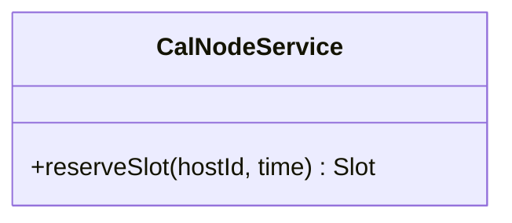
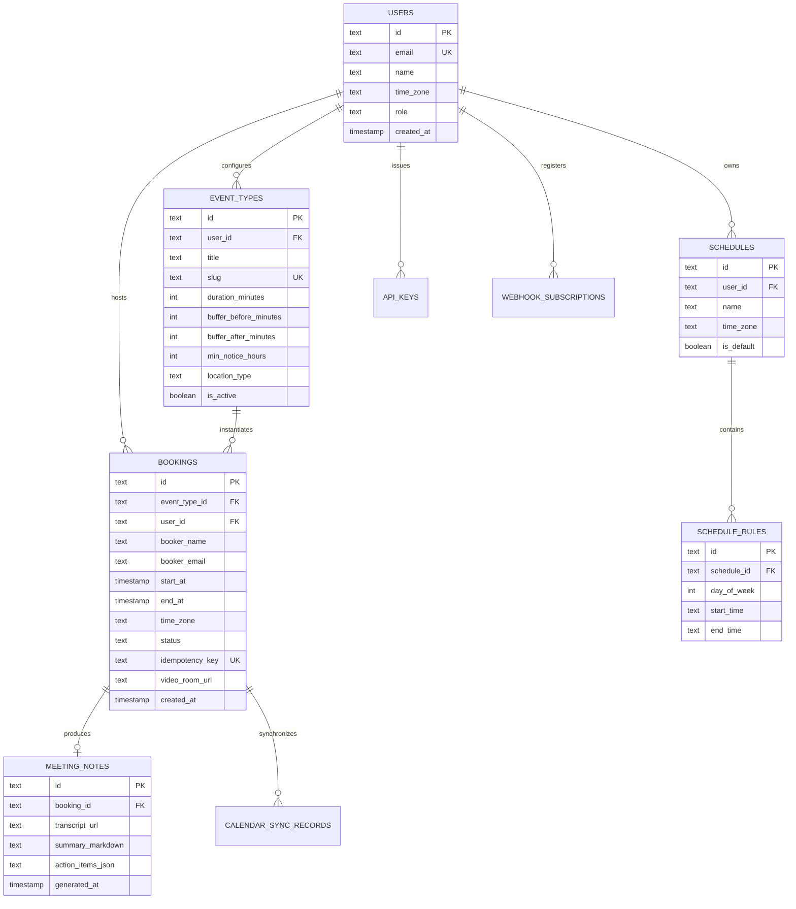
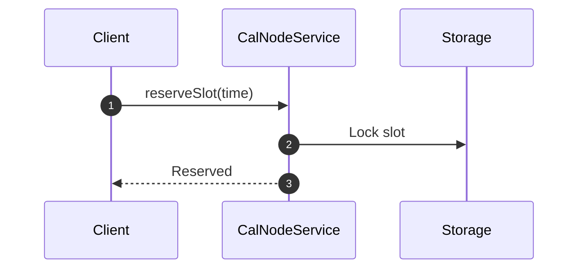

# calnode - Architecture & Technical Wiki

> **Single-Binary Go Scheduling Engine, Embedded SQLite with Litestream & Agent-Native MCP Calendar Platform**  
> GitHub: [Calnode/calnode](https://github.com/Calnode/calnode.git) | Stack: Go 1.26, Pure-Go SQLite, sqlc, goose, Litestream, SvelteKit 5, LiveKit, MCP Go SDK | License: Apache-2.0

---

## 1. Executive Summary & Value Proposition

**Calnode** is a lean, high-performance scheduling server, calendar automation engine, and AI-native booking platform engineered in **Go 1.26** with an embedded **pure-Go SQLite** database. Designed as a direct architectural counterpoint to sprawling, resource-intensive SaaS monoliths like Cal.com and Calendly, Calnode compiles into a **single static binary** that requires zero external runtime dependencies—no Redis broker, no PostgreSQL cluster, no Node.js runtime, and no multi-gigabyte container orchestration.

Calnode is purpose-built for modern agentic workflows. It incorporates a native **Model Context Protocol (MCP)** server directly within the daemon (supporting both stdio and Streamable HTTP transports), enabling autonomous AI agents to query host availability, evaluate calendar conflicts, schedule appointments, and retrieve post-call meeting transcripts. Furthermore, Calnode features built-in in-browser video meetings via LiveKit, automated call recording to Litestream S3 buckets, and an integrated AI notetaker that generates meeting summaries without third-party bot intrusions.

### Core Problems Solved
- **Monolithic Deployment Bloat**: Replaces multi-container scheduling architectures (requiring 4GB+ RAM and multiple managed services) with a single static Go binary running efficiently on a 512MB VPS.
- **Agent-First Booking Orchestration**: Natively exposes all 88 scheduling endpoints via a built-in MCP server, allowing LLM agents (Claude, ChatGPT, OpenCode) to inspect slots and book meetings programmatically.
- **Continuous Disaster Recovery via Litestream**: Solves SQLite high-availability and backup concerns through continuous, streaming WAL (Write-Ahead Log) replication to S3-compatible object storage (Cloudflare R2, AWS S3, MinIO).
- **DST-Proof Temporal Arithmetic**: Stores timestamps strictly as UTC instants paired with canonical IANA timezone strings, preventing slot corruption across Daylight Saving Time shifts.
- **Double-Booking Prevention with Idempotency**: Enforces strict transactional serialization with support for client-provided `Idempotency-Key` headers on booking endpoints.

---

## 2. High-Level System Architecture

Calnode operates as an **All-in-One Embedded Daemon**. The Go HTTP server serves both the server-rendered booking templates and the embedded SvelteKit 5 administrative dashboard via Go's native `embed.FS`, while all application persistence and job queues execute directly against local SQLite WAL files replicated to cloud storage via Litestream.

```mermaid
flowchart TD
    subgraph IngressTier ["Ingress & Consumer Channels"]
        PublicBooker["Public Booker (Server-Rendered Go Template)"]
        AdminUser["Administrator (Embedded SvelteKit 5 Admin SPA)"]
        CodingAgents["AI Agents & Workflows (MCP Protocol / JSON-RPC)"]
        RESTConsumers["API Clients & Webhook Consumers"]
    end

    subgraph GoDaemonCore ["Calnode Core Daemon (Go 1.26 Static Binary)"]
        HTTPRouter["Go HTTP / chi / net/http Multiplexer"]
        MCPServer["Native MCP Server Engine (Official Go SDK)"]
        AuthMiddleware["API Key & HMAC Signature Arbiter"]

        subgraph CoreEngines ["Internal Domain Engines"]
            SlotEngine["Slot Availability & Timezone Engine (UTC + IANA)"]
            BookingCoordinator["Booking Coordinator & Double-Booking Guard"]
            VideoService["LiveKit Video & WebRTC Gateway"]
            AINotetaker["AI Notetaker & Deepgram Transcription Pipeline"]
            JobQueue["In-Process Persistent Job Queue (SQLite Backed)"]
        end
    end

    subgraph StorageAndReplication ["Embedded Persistence & Backup"]
        SQLiteDB[("Embedded SQLite 3 (WAL Mode / pure-go modernc)")]
        LitestreamReplica["Litestream S3/R2 WAL Continuous Streamer"]
        ObjectStorage[("S3 / Cloudflare R2 (DB Backups & Recordings)")]
    end

    PublicBooker -->|HTTPS / GET| HTTPRouter
    AdminUser -->|HTTPS / REST API| HTTPRouter
    CodingAgents -->|stdio / Streamable HTTP| MCPServer
    RESTConsumers -->|REST API v1 (Bearer Token)| HTTPRouter

    HTTPRouter --> AuthMiddleware
    AuthMiddleware --> SlotEngine
    AuthMiddleware --> BookingCoordinator
    MCPServer --> SlotEngine
    MCPServer --> BookingCoordinator

    SlotEngine --> SQLiteDB
    BookingCoordinator -->|Tx Begin with IdempotencyKey| SQLiteDB
    BookingCoordinator --> JobQueue

    JobQueue --> VideoService
    VideoService --> AINotetaker
    AINotetaker --> ObjectStorage

    SQLiteDB <-->|WAL Streaming| LitestreamReplica
    LitestreamReplica -->|Continuous PITR Backup| ObjectStorage
```

### Architectural Lifecycle of an Agentic Booking
1. **MCP / REST Slot Query**: An AI agent or web client queries `GET /v1/event-types/{slug}/slots?from=YYYY-MM-DD&to=YYYY-MM-DD&tz=Region/City`. The `SlotEngine` reads the host's working hours, expands them in the target IANA timezone, and pulls conflicting appointments directly from SQLite.
2. **Conflict & External Calendar Intersect**: If an external Google or Microsoft calendar is linked, Calnode fetches fresh busy times via native APIs (avoiding stale `.ics` feeds) and subtracts them from candidate intervals.
3. **Transactional Commit with Idempotency**: The client issues `POST /v1/bookings` with an `Idempotency-Key` header. The `BookingCoordinator` opens a SQLite transaction with immediate locking, verifies that no overlapping booking exists in the chosen interval, inserts the booking row, and stores the idempotency digest.
4. **Asynchronous Side Effects & Meeting Provisioning**: An in-process background worker picks up the committed booking event from SQLite:
   - Synchronizes the event to external Google/Outlook calendars.
   - Generates a first-party LiveKit video room token (if video location is configured).
   - Enqueues automated email confirmations with `.ics` attachments.
   - Dispatches HMAC-signed `booking.created` webhooks to registered HTTP targets.

---

### 2.1 Core Domain & Service Class Architecture



---

## 3. Technology Stack & Key Dependencies

- **Language & Runtime**: Go 1.26 compiled to a single static CGO-free binary.
- **Database Engine**: Pure-Go SQLite (`modernc.org/sqlite`) running in WAL mode with memory-mapped I/O.
- **SQL Layer & Migrations**: `sqlc` for compile-time verified, zero-reflection type-safe Go code generation from raw SQL; `goose` for versioned schema migrations.
- **Continuous Durability & Backup**: Embedded Litestream streaming database changes continuously to AWS S3, Cloudflare R2, or MinIO for point-in-time recovery (PITR).
- **Admin Dashboard**: SvelteKit 2 / Svelte 5, Vite 8, Tailwind CSS v4, and shadcn-svelte compiled and bundled directly into the Go binary via `go:embed`.
- **Public Booking Interface**: Server-rendered Go `html/template` and vanilla JavaScript (zero client-side framework overhead).
- **AI & Video Stack**: Built-in LiveKit WebRTC client, Deepgram speech-to-text API integration, LLM summarization pipeline, and official Model Context Protocol (MCP) Go SDK.

---

## 4. Repository Layout & Key Modules

```
inspire/calnode/
├── cmd/
│   └── calnode/                     # Daemon entrypoint (main.go, flags, configuration)
├── frontend/                        # Admin Dashboard SPA
│   ├── src/                         # SvelteKit 5 source code (routes, components, stores)
│   ├── package.json                 # Node dependencies for frontend compilation
│   └── svelte.config.js             # SvelteKit adapter configuration
├── internal/                        # Private application packages
│   ├── api/                         # REST API handlers, middleware, request binding
│   ├── auth/                        # Session auth, API key hashing, envelope encryption
│   ├── booking/                     # Booking transaction coordinator & conflict guard
│   ├── calendar/                    # Google Calendar & Microsoft Graph API sync
│   ├── db/                          # sqlc-generated type-safe Go queries & models
│   ├── email/                       # Transactional email generation & SMTP dispatch
│   ├── livekit/                     # LiveKit WebRTC room creation and token signing
│   ├── mcp/                         # Model Context Protocol server (stdio & HTTP)
│   ├── notetaker/                   # AI transcription (Deepgram) & LLM note generation
│   ├── slots/                       # Slot calculation, buffers & timezone arithmetic
│   ├── storage/                     # SQLite connection pool & Litestream lifecycle
│   └── webhook/                     # HMAC webhook delivery engine with backoff retries
├── packaging/                       # Systemd units, Dockerfiles, and fly.toml configs
├── goose.yaml                       # Database migration metadata
├── litestream.yml                   # S3 replication and backup specification
├── sqlc.yaml                        # sqlc configuration mapping SQL queries to Go structs
└── README.md                        # Documentation and architecture guides
```

---

## 5. Core Features & Capabilities

### 5.1 Pure-Go Single-Binary Architecture with SQLite & Litestream
Calnode eliminates the operational overhead of running database daemons and external worker processes:
- Employs `modernc.org/sqlite`, a pure Go translation of the SQLite C library that compiles without CGO across Linux, macOS, and Windows.
- Runs SQLite in `WAL` (Write-Ahead Logging) mode with `busy_timeout` tuning to guarantee concurrent read performance and non-blocking transactional writes.
- Embedded Litestream monitors the SQLite WAL log, continuously streaming delta frames to S3/R2 storage with sub-second replication latency.

### 5.2 Agent-Ready Native MCP Server
Calnode treats autonomous software agents as first-class citizens:
- Implements the official Model Context Protocol (MCP) Go SDK directly inside the binary.
- Exposes tools such as `list_event_types`, `get_available_slots`, `create_booking`, `cancel_booking`, and `get_meeting_notes`.
- Agents can connect locally via `stdio` (e.g., inside Claude Desktop or Cursor) or remotely over Streamable HTTP with API key authentication.

### 5.3 DST-Resilient Slot Calculation & Double-Booking Guard
Scheduling bugs frequently occur when daylight saving time shifts local offsets:
- Calnode models all schedule definitions as local wall-clock times bound to an official IANA timezone identifier (e.g., `09:00:00` in `Europe/Paris`).
- Slot resolution calculates candidate UTC ranges dynamically per date.
- Double-booking prevention uses SQLite immediate transactions (`BEGIN IMMEDIATE`) coupled with explicit range queries (`WHERE start_at < ? AND end_at > ?`), eliminating concurrency race conditions.

### 5.4 First-Party Video Rooms & AI Meeting Notes
Unlike schedulers that simply link to external third-party Zoom or Meet accounts, Calnode offers end-to-end meeting ownership:
- Integrates with LiveKit to spin up browser-native WebRTC rooms automatically.
- Calls are recorded directly into the operator's Litestream S3 bucket.
- The built-in AI notetaker streams audio to Deepgram for word-level transcription and prompts an LLM to generate structured action items and meeting summaries, which are subsequently exposed via webhooks and MCP tools.

---

## 6. Data Models & Schema Architecture



### Core Schema Definitions (Managed via `sqlc`)

#### `event_types`
- `id` (text, PK): CUID/UUID unique identifier.
- `slug` (text, Unique): URL slug for public booking routing (`/book/{slug}`).
- `duration_minutes` (integer): Length of the booking session.
- `buffer_before_minutes` / `buffer_after_minutes` (integer): Guard intervals.
- `location_type` (text): Meeting venue (`livekit_video`, `phone`, `in_person`, `google_meet`).

#### `bookings`
- `id` (text, PK): Unique booking identifier.
- `start_at` / `end_at` (timestamp, UTC): Exact temporal boundaries of the appointment.
- `status` (text): Current booking status (`confirmed`, `rescheduled`, `cancelled`).
- `idempotency_key` (text, Unique): Cryptographic token ensuring duplicate requests return the original booking without double-allocation.
- `video_room_url` (text): Link to the in-browser LiveKit video room.

#### `meeting_notes`
- `booking_id` (text, FK): Associated completed appointment.
- `summary_markdown` (text): Structured AI-generated meeting summary.
- `action_items_json` (text): Extracted task list and commitments.

---

### 6.1 Comprehensive Database Schema Specification

#### Table: `slots`
| Column | Type | Constraints | Default | Description |
| :--- | :--- | :--- | :--- | :--- |
| `id` | `UUID` | `PRIMARY KEY` | `gen_random_uuid()` | Slot ID |
| `time` | `TIMESTAMPTZ` | `NOT NULL` | - | Reserved time |

---

## 7. API Architecture, Webhooks & Key Endpoints

Calnode exposes a high-throughput, RESTful JSON API with bearer token authentication alongside its native MCP server.

| Method | Endpoint | Description | Auth Scope |
| :--- | :--- | :--- | :--- |
| `GET`  | `/v1/event-types/{slug}/slots` | Queries available booking slots within a date range | Public / API Key |
| `POST` | `/v1/bookings` | Creates a booking (requires `Idempotency-Key` header) | Public / API Key |
| `GET`  | `/v1/bookings/{id}` | Retrieves booking status, attendee info, and video link | Bearer API Key |
| `POST` | `/v1/bookings/{id}/cancel` | Cancels a booking and dispatches webhooks | Bearer API Key |
| `GET`  | `/v1/bookings/{id}/notes` | Fetches AI-generated transcript and meeting notes | Bearer API Key |
| `POST` | `/v1/webhooks` | Configures an HMAC-signed webhook endpoint via API | Bearer API Key |
| `POST` | `/mcp` | Streamable HTTP endpoint for Model Context Protocol agents | MCP Bearer Key |

### Sample Payload: Booking Creation (`POST /v1/bookings`)
```json
{
  "event_type_slug": "architecture-consultation",
  "start_at": "2026-11-12T15:00:00Z",
  "booker_name": "Alexander Hayes",
  "booker_email": "a.hayes@vector-cloud.com",
  "time_zone": "America/Chicago",
  "notes": "Reviewing self-hosted scheduling infrastructure migration."
}
```

### Sample Response: Booking Confirmed
```json
{
  "id": "bk_01jm98234akz",
  "status": "confirmed",
  "start_at": "2026-11-12T15:00:00Z",
  "end_at": "2026-11-12T15:45:00Z",
  "event_type": "architecture-consultation",
  "video_room_url": "https://cal.marketingstudio.io/room/bk_01jm98234akz",
  "ics_url": "https://cal.marketingstudio.io/v1/bookings/bk_01jm98234akz/invite.ics"
}
```

---

### 7.5 End-to-End Operational Lifecycle Sequence



---

## 8. Strategic Value & Takeaways for MarketingStudio

### Reusable Architectural Patterns
1. **Single Static Binary + SQLite for Embedded Workspaces**: Calnode demonstrates that robust multi-tenant architectures do not strictly require heavy shared databases. By deploying isolated single-binary instances with Litestream streaming WAL replication to S3, MarketingStudio could offer private, dedicated calendar environments to enterprise customers at negligible infrastructure cost.
2. **First-Party Video & Notetaking Infrastructure**: Rather than sending users to third-party meeting links, Calnode's model of hosting WebRTC rooms directly and generating structured AI notes creates a closed-loop intelligence system. Meeting transcripts immediately become actionable CRM data.
3. **Native MCP Server Implementation**: Calnode's inclusion of an official MCP server allows AI agents to act as fully autonomous booking coordinators. MarketingStudio's SDR agents could directly query slots and book prospects without screen scraping or complex API handshakes.

### Concrete Convergence Roadmap for MarketingStudio
- **In-App Sales Consultation Rooms**: Adopt Calnode's LiveKit integration to embed branded video rooms directly inside MarketingStudio's client portal, eliminating prospect drop-off from external meeting software installs.
- **Automated Post-Call Intelligence**: Pipe Calnode's `meeting_notes` pipeline into MarketingStudio's CRM pipeline, automatically extracting deal sentiment, follow-up dates, and action items upon call completion.
- **Micro-Daemon Calendar Nodes**: For clients requiring localized data residency (e.g. EU GDPR or HIPAA compliance), MarketingStudio can package Calnode as a lightweight edge container with Litestream replication to local European buckets.
