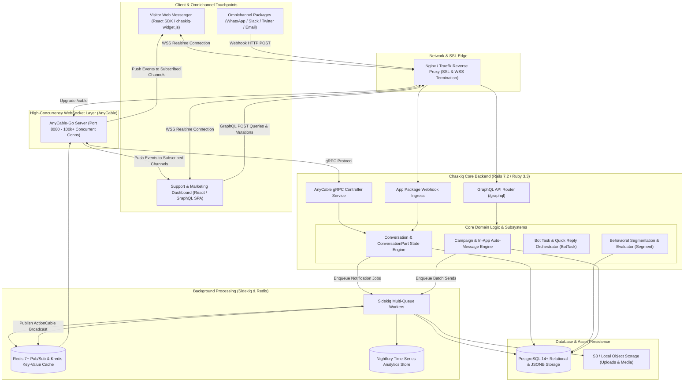
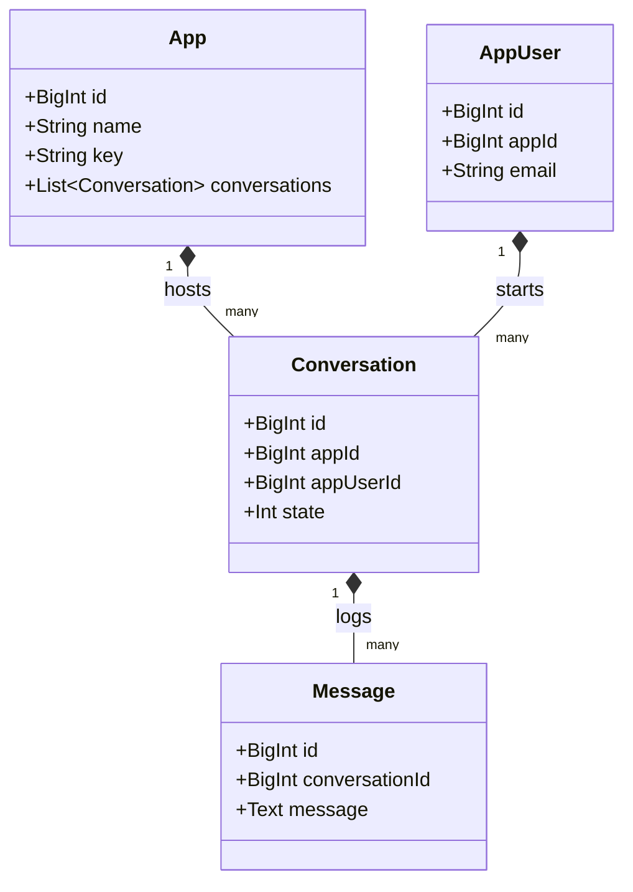
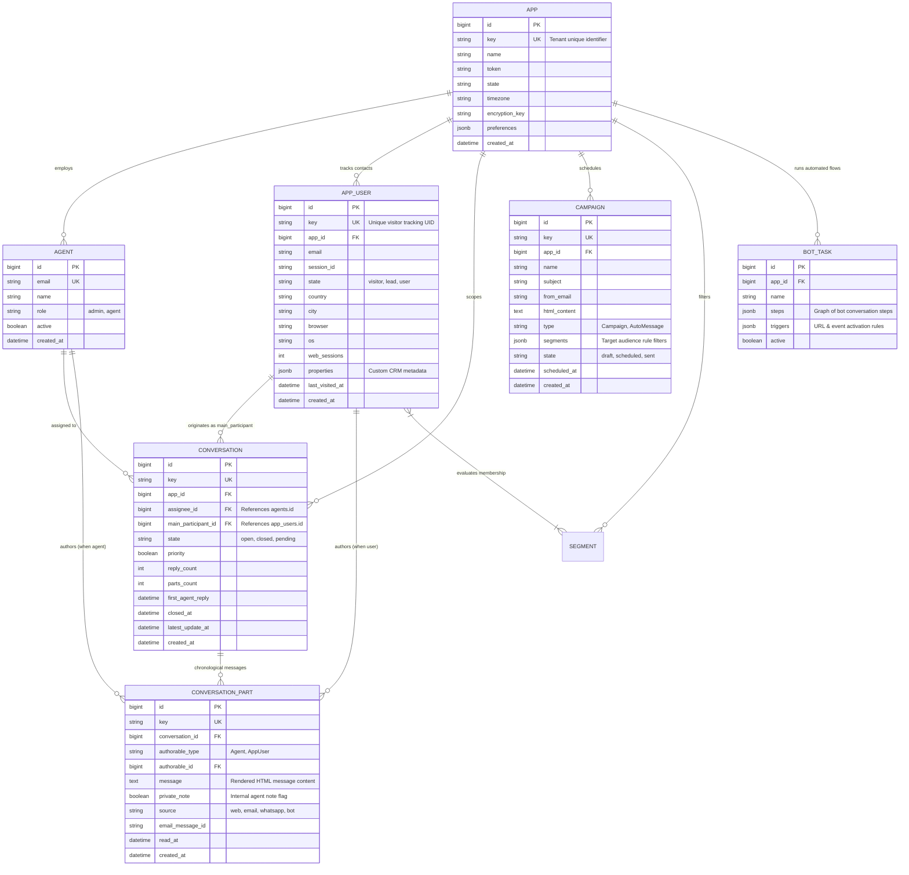
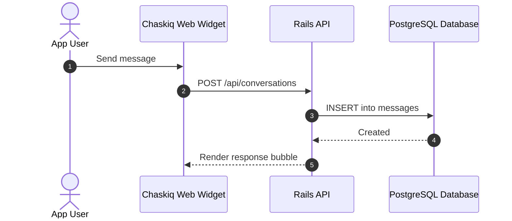

# chaskiq - Architecture & Technical Wiki

> **Open-Source Conversational Marketing, Support Suite & Intercom Alternative with AnyCable WebSockets & GraphQL**  
> GitHub: [chaskiq/chaskiq](https://github.com/chaskiq/chaskiq.git) | Stack: Ruby 3.3.5, Rails 7.2, AnyCable, PostgreSQL, Redis, Sidekiq, GraphQL Ruby, React, esbuild | License: GNU AGPL v3

---

## 1. Executive Summary & Value Proposition

**Chaskiq** is a modern, full-featured open-source conversational marketing, customer engagement, and helpdesk platform designed as a drop-in alternative to Intercom, Drift, and Crisp. Engineered in **Ruby on Rails 7.2** and **React**, Chaskiq bridges the operational divide between customer support ticketing and outbound marketing automation. Rather than treating customer communication as isolated helpdesk tickets, Chaskiq unifies omnichannel conversation streams with user event tracking, behavioral segmentation, automated onboarding bot tours, and targeted outbound email/in-app campaigns.

Chaskiq addresses the performance and scale bottlenecks that plague traditional real-time customer engagement stacks. By integrating **AnyCable** (which decouples the WebSocket connection tier to high-performance Go-based WebSocket daemons), Chaskiq handles over 100,000 concurrent visitor connections per server node while routing GraphQL queries, event-driven bot tasks, and multi-channel message distribution through a scalable Sidekiq worker pool.

### Core Problems Solved
- **The Support vs. Marketing Divide**: Collapses customer support inboxes, marketing drip campaigns (`Campaign`), in-app banners (`Banner`), and interactive product walkthroughs (`Tour`) into a single customer data platform.
- **WebSocket Connection Exhaustion**: Replaces Ruby thread-blocking WebSockets with **AnyCable-Go**, offloading persistent visitor and agent connections to a lightweight compiled binary while retaining Rails business logic via gRPC.
- **Fragmented User Attribute Tracking**: Tracks granular visitor sessions (`AppUser`), browser environments, IP geolocation coordinates, and custom JSONB properties (`properties`), recalculating dynamic audience segments (`Segment`) in real time.
- **Automated Conversational Triage (Bot Tasks)**: Guides prospective leads and support requests through multi-step conversational bots (`BotTask`), collecting qualifying data before escalating to live agents.
- **Extensible Integration Packages (`AppPackage`)**: Features a modular integration system connecting conversation channels directly to Slack, WhatsApp, Twitter, Zoom, and Calendly.

---

## 2. High-Level System Architecture

Chaskiq is architected around an asynchronous, event-driven pattern. The frontend client communicates via a dual transport layer: a **GraphQL API** for structured data fetching and mutations, and **AnyCable WebSockets** for sub-100ms real-time event distribution.



### Architectural Lifecycle of an Incoming Conversation Part
1. **Visitor Message Submission**: A visitor sends a message via the embedded web widget, triggering a GraphQL mutation (`createConversationPart`) or WebSocket event over `MessengerEventsChannel`.
2. **Contact Identification**: The session token matches or creates an `AppUser` record in PostgreSQL, capturing device metadata, IP address, and custom attributes.
3. **Conversation Part Insertion**: The record is persisted to `conversation_parts` with `authorable: app_user` and `messageable: conversation`.
4. **AnyCable Broadcast**: Rails broadcasts the event via `AnyCable.broadcast`. The Redis pub/sub channel notifies `anycable-go`, which streams the new message payload to all agents subscribed to `AgentChannel` and the visitor's channel.
5. **Bot Task & Segment Evaluation**: If the conversation is currently governed by a bot flow (`bot_tasks`), the system evaluates the response step, triggers automated quick replies (`quick_replies`), or executes an assignment rule (`assignment_rules`) to route the conversation to an agent team.

---

### 2.1 Core Domain & Service Class Architecture



---

## 3. Technology Stack & Key Dependencies

- **Language & Runtime**: Ruby 3.3.5+, Node.js 20+
- **Application Framework**: Ruby on Rails 7.2.1 (Puma 6+ application server)
- **High-Concurrency Real-Time Engine**:
  - `anycable-rails` paired with `anycable-go` for Go-based WebSocket offloading.
  - Channels: `AgentChannel`, `MessengerEventsChannel`, `EventsChannel`, `PresenceChannel`, `RtcChannel` (WebRTC video calls).
- **API Architecture**:
  - `graphql-ruby`: Unified GraphQL schema (`ChaskiqSchema`) handling all dashboard queries, mutations, and client subscriptions.
  - `action_policy-graphql`: Pundit-style authorization integrated into GraphQL field resolvers.
- **Database & Persistence**:
  - PostgreSQL 14+ with extensive JSONB columns (`properties`, `preferences`, `settings`).
  - Active Record with `goldiloader` for automated N+1 query prevention.
- **Caching & Time-Series Metrics**:
  - Redis 7+ via `kredis` and `redis-objects`.
  - `nightfury`: Redis-backed time-series metrics engine tracking hourly message volume, delivery rates, and agent response speeds.
- **Queue & Background Jobs**:
  - `Sidekiq` (multi-queue processing for campaigns, webhook dispatch, email imports).
- **Frontend Architecture**:
  - React 18, Apollo Client (GraphQL), Tailwind CSS, esbuild.

---

## 4. Repository Layout & Key Modules

```
chaskiq/
├── app/
│   ├── channels/                     # AnyCable WebSocket channels (agent, presence, rtc)
│   ├── controllers/                  # REST webhooks, authentication, and OAuth callbacks
│   ├── graphql/                      # Complete GraphQL API implementation
│   │   ├── mutations/                # GraphQL mutations (createConversation, sendReply)
│   │   ├── types/                    # GraphQL type declarations (UserType, AppType)
│   │   └── chaskiq_schema.rb         # Root GraphQL schema definition
│   ├── jobs/                         # Asynchronous Sidekiq jobs (campaigns, bots, mailers)
│   ├── models/                       # Active Record domain entities
│   │   ├── app.rb                    # Multi-tenant tenant boundary & preferences
│   │   ├── app_user.rb               # Customer contact, visitor session, geolocation
│   │   ├── conversation.rb           # Conversation container & lifecycle state
│   │   ├── conversation_part.rb      # Individual message/note entry (Intercom part model)
│   │   ├── campaign.rb               # Outbound marketing campaign & email scheduler
│   │   ├── segment.rb                # Dynamic behavioral audience segment engine
│   │   ├── bot_task.rb               # Multi-step conversational bot workflow
│   │   ├── tour.rb                   # Guided interactive product tour model
│   │   ├── banner.rb                 # In-app broadcast announcement banner
│   │   └── app_package.rb            # Third-party integration connector
│   ├── services/                     # Encapsulated business logic services
│   └── views/                        # Mailer templates and transactional HTML
├── config/                           # Rails configuration, anycable.yml, routes.rb
├── db/                               # Database migrations and schema.rb
├── esbuild/                          # Asset bundler scripts for widget and dashboard
└── package.json                      # Frontend package dependencies (React, Apollo)
```

---

## 5. Core Features & Capabilities

### 5.1 Hybrid Conversational Support & Outbound Marketing
Chaskiq rejects the artificial division between inbound customer support and outbound marketing:
- **Campaigns**: Marketers can compose automated email campaigns or in-app popups with rich WYSIWYG editors. Outbound messages appear directly inside the user's conversational messenger.
- **Dynamic Segments (`Segment`)**: Evaluates real-time customer properties using mathematical comparators (`segment_comparators`). For example: *"Users where `web_sessions > 5` AND `plan == 'trial'` AND `country == 'US'"`*.
- **Interactive Product Tours (`Tour`)**: Launches step-by-step element-highlighting onboarding tours within the client web application without external script dependencies.

### 5.2 Decoupled Message Modeling (`ConversationPart`)
Modeled after Intercom’s internal architecture, Chaskiq models conversation threads as composite parts:
- Each communication is a `ConversationPart` belonging to a `Conversation`.
- Supports polymorphic authorship (`authorable_type: "Agent" | "AppUser"`).
- Distinguishes between public customer interactions and internal team notes (`private_note: true`).
- Supports structured blocks (`conversation_part_blocks`) containing interactive widgets (calendar pickers, ratings, file downloads).

### 5.3 Automated Conversational Bot Workflows (`BotTask`)
Chaskiq includes a visual, event-driven chatbot builder:
- Triggers on visitor entrance, specific URL paths, or custom JavaScript events.
- Executes sequential steps (`step_id`), presenting users with interactive quick-reply buttons (`QuickReply`).
- Extracts prospect email addresses, telephone numbers, and project budgets, automatically updating `AppUser.properties` before transferring the conversation to an assigned agent team.

### 5.4 High-Scale Real-Time WebSocket Infrastructure (AnyCable)
By pairing Rails with AnyCable:
- Memory footprint for 10,000 active WebSocket connections drops from several gigabytes (under traditional ActionCable) to less than 50MB on `anycable-go`.
- Enables true broadcast presence (`PresenceChannel`), live typing indicators, and instant read receipts across high-traffic marketing sites without degrading backend Rails server performance.

### 5.5 In-App Banners & Notification Broadcasts (`Banner`)
- Deploy dismissible alert banners across target domains or authenticated dashboard pages.
- Supports call-to-action buttons that launch embedded conversational flows directly inside the live chat widget.

---

## 6. Data Models & Schema Architecture

Chaskiq’s schema isolates tenant environments under the `App` entity while linking customer profiles, conversations, and marketing campaigns to that tenant.



### Core Schema Entity Details
1. **`app_users`**:
   - Represents the complete identity lifecycle: begins as an anonymous `visitor`, becomes a `lead` once an email is captured, and converts to a `user` upon application signup.
   - `properties`: Flexible JSONB storage capturing arbitrary client attributes (e.g. `mrr`, `plan`, `signup_date`) used by the segment engine.
2. **`conversation_parts`**:
   - Implements polymorphic authorship (`authorable_type` and `authorable_id`), cleanly unifying messages generated by visitors, human agents, automated campaigns, and bot tasks into a unified chronological log.
   - `private_note`: Guarantees private internal agent discussions are never exposed to public GraphQL queries.
3. **`campaigns`**:
   - Stores targeting criteria in `segments` (JSONB), dynamically matching users against real-time property filters before scheduled mail or in-app delivery.

---

### 6.1 Comprehensive Database Schema Specification

Chaskiq persists conversational data using PostgreSQL and Ruby on Rails.

#### Table: `conversations`
| Column | Type | Constraints | Default | Description |
| :--- | :--- | :--- | :--- | :--- |
| `id` | `BIGINT` | `PRIMARY KEY AUTO_INCREMENT` | - | Conversation ID |
| `app_id` | `BIGINT` | `NOT NULL, FK -> apps(id)` | - | Parent app key |
| `app_user_id`| `BIGINT` | `NOT NULL, FK -> app_users(id)`| - | Participating user |
| `state` | `INTEGER` | `NOT NULL` | `0` | Active state |

*Indexes:* `idx_chaskiq_app` (`(app_id)`).

---

## 7. API Architecture, Webhooks & Key Endpoints

Chaskiq provides a unified GraphQL API endpoint at `/graphql` along with dedicated REST webhook ingress controllers.

### Key GraphQL Operations & REST Endpoints

| Type | Operation / Endpoint | Description |
|:---|:---|:---|
| `POST` | `/graphql` | Unified GraphQL endpoint executing queries, mutations, and subscriptions |
| `WS` | `/cable` | AnyCable-Go WebSocket connection endpoint for real-time streaming |
| `POST` | `/packages/whatsapp/webhook` | Webhook receiver for inbound WhatsApp messages |
| `POST` | `/packages/slack/events` | Bi-directional Slack sync (reply to conversations from Slack channels) |
| `POST` | `/email_inbound` | Inbound email webhook parsing incoming MIME replies |

### Sample GraphQL Mutation: Send Agent Reply (`POST /graphql`)
```graphql
mutation SendReply($conversationId: ID!, $body: String!, $privateNote: Boolean!) {
  createConversationPart(input: {
    conversationId: $conversationId,
    message: $body,
    privateNote: $privateNote
  }) {
    conversationPart {
      id
      key
      message
      privateNote
      createdAt
      authorable {
        ... on Agent {
          id
          name
          email
        }
      }
    }
    errors
  }
}
```

### Sample GraphQL Response
```json
{
  "data": {
    "createConversationPart": {
      "conversationPart": {
        "id": "184092",
        "key": "part-9f8a-4b2c",
        "message": "<p>We have updated your workspace billing plan to Enterprise.</p>",
        "privateNote": false,
        "createdAt": "2026-10-24T11:05:00Z",
        "authorable": {
          "id": "4",
          "name": "Sarah Connor",
          "email": "sarah@marketingstudio.internal"
        }
      },
      "errors": []
    }
  }
}
```

---

### 7.5 End-to-End Operational Lifecycle Sequence



---

## 8. Strategic Value & Takeaways for MarketingStudio

### Reusable Architectural Patterns
1. **Convergence of Inbound Helpdesk & Outbound Campaigns**:
   - Chaskiq demonstrates the powerful synergy of treating support tickets and outbound marketing campaigns as parts of the same conversation engine. MarketingStudio can replicate this unified architecture so automated marketing drip replies flow seamlessly into the sales team’s collaborative inbox.
2. **AnyCable High-Concurrency WebSocket Decoupling**:
   - Offloading persistent WebSocket connection management to a Go binary (`anycable-go`) while keeping business logic in Rails or Python allows MarketingStudio to maintain real-time presence, typing indicators, and message push to millions of website visitors with negligible CPU overhead.
3. **Dynamic Behavioral Segmentation (`Segment` + `properties`)**:
   - Chaskiq’s pattern of pairing a JSONB user property bag with dynamic boolean comparator queries enables marketing and sales teams to construct ad-hoc customer segments on the fly without database index restructuring.
4. **Interactive In-Chat Block Components (`conversation_part_blocks`)**:
   - Modeling conversation messages as extensible block payloads allows embedding interactive elements (calendar scheduling, product carousels, lead capture forms) directly within the conversation thread.
