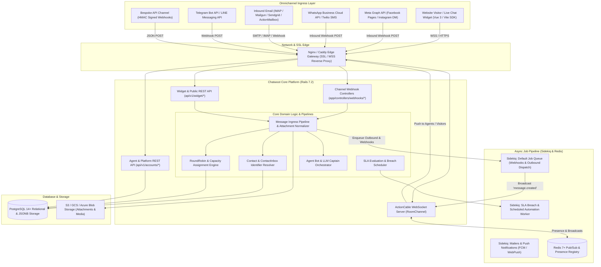
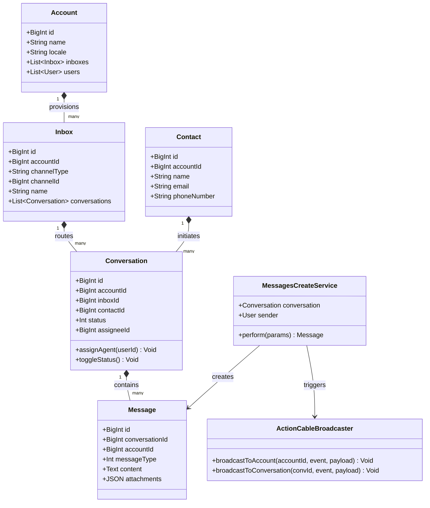
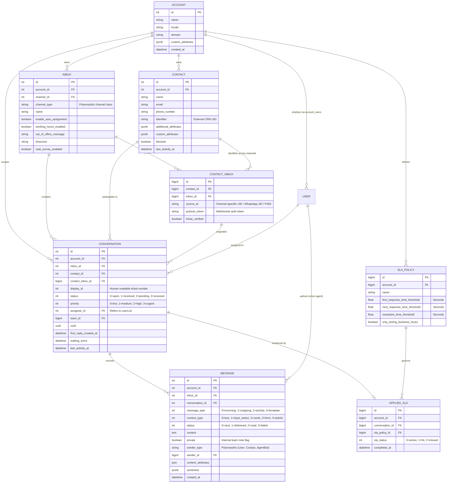
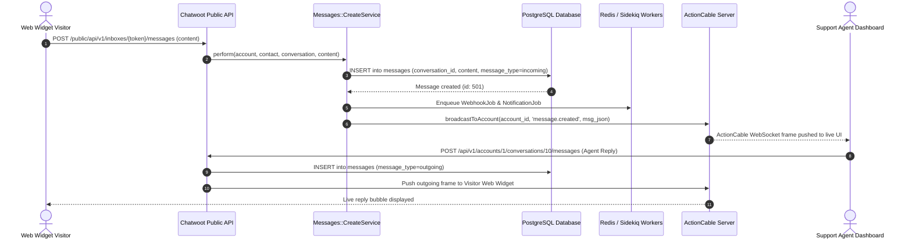

# chatwoot - Architecture & Technical Wiki

> **Enterprise-Grade Open-Source Customer Engagement Suite & Omnichannel Shared Inbox Multiplexer**  
> GitHub: [chatwoot/chatwoot](https://github.com/chatwoot/chatwoot.git) | Stack: Ruby 3.4, Rails 7.2, Vue.js 3, Vite, PostgreSQL 14+, Redis 7+, Sidekiq, ActionCable | License: MIT (Core) / EE (Enterprise)

---

## 1. Executive Summary & Value Proposition

**Chatwoot** is the preeminent open-source customer communication platform and omnichannel customer engagement engine. Engineered as an extensible, enterprise-ready alternative to proprietary stacks such as Intercom, Zendesk, and Front, Chatwoot collapses fragmented communication silos—live website chat widgets, email ticketing, WhatsApp Business Cloud API, Instagram direct messages, Facebook Messenger, Telegram, Line, SMS (via Twilio/Bandwidth), and bespoke API channels—into a unified, multi-tenant conversational hub.

At its core, Chatwoot solves the operational and architectural challenges of multi-channel customer engagement: synchronizing bi-directional conversations across disparate third-party messaging protocols while maintaining sub-second agent dispatch, real-time typing and presence synchronization, collision detection, automated triage, and conversation lifecycle management.

### Core Problems Solved
- **Omnichannel Protocol Fragmentation**: Standardizes disparate message formats, media types, attachments, and asynchronous communication streams into a normalized internal message schema across 10+ ingress channels.
- **Agent Collision & Concurrency Bottlenecks**: Prevents multiple support representatives from responding to the same conversation through distributed Redis presence tracking, ActionCable real-time typing indicators, and lock-to-single-conversation controls.
- **Deterministic Identity Resolution & Merging**: Solves the fractured customer identity problem by decoupling abstract `Contacts` from channel-specific identifiers (`ContactInboxes`), backed by atomic database transactions that reassign message histories and deduplicate contact records.
- **Intelligent Workload Balancing & Routing**: Offers automated ticket triage through round-robin agent assignment algorithms, custom team routing, business-hour filters, agent capacity policies, and auto-assignment backpressure limits.
- **Enterprise Service Level Agreements (SLA) & CSAT Tracking**: Provides real-time SLA breach countdowns across first-response and resolution thresholds, coupled with native, localized post-resolution CSAT surveys with webhook and analytics pipelines.

---

## 2. High-Level System Architecture

Chatwoot adopts an asynchronous, event-driven monolith architecture built on **Ruby on Rails 7.2** and **PostgreSQL**. Real-time bi-directional transport is handled by Rails **ActionCable** over WebSockets backed by Redis Pub/Sub, while CPU-bound and external API tasks are dispatched to **Sidekiq** worker queues.



### Architectural Lifecycle of an Incoming Message
1. **Webhook Ingestion**: External providers (e.g., Meta Graph API or Twilio) fire an HTTP POST to dedicated webhook endpoints (`Webhooks::WhatsappController` or `Webhooks::InstagramController`).
2. **Payload Parsing & Channel Resolution**: The channel controller locates the target `Inbox` via unique tokens (`channel_web_widgets.website_token` or `channel_whatsapp.phone_number`).
3. **Contact Inbox Resolution**: `ContactInboxWithContactBuilder` matches incoming channel identifiers (`source_id`, phone number, email, or external UUID). If no existing contact matches, a new `Contact` and associated `ContactInbox` are created atomically.
4. **Conversation Association**: The incoming message is assigned to an existing active `Conversation` under the `ContactInbox` or a new conversation is spawned.
5. **Event Emission & Sidekiq Scheduling**: Once persisted in PostgreSQL, an ActiveSupport notification (`conversation.created` or `message.created`) enqueues background jobs:
   - **ActionCable Broadcast**: Emits a JSON packet over `RoomChannel` to the agent's account room (`account_<id>`) and the visitor's channel token.
   - **Auto-Assignment**: `AutoAssignment::InboxRoundRobinService` inspects agent online statuses in Redis and updates the conversation's `assignee_id`.
   - **SLA Policy Attachment**: Evaluates matching `SlaPolicy` rules and schedules evaluation timers in Sidekiq.

---

### 2.1 Core Domain & Service Class Architecture



---

## 3. Technology Stack & Key Dependencies

- **Language & Runtime**: Ruby 3.4.4+, Node.js 20+ (Dashboard frontend build)
- **Application Framework**: Ruby on Rails 7.2.3.1 (API mode + ActionCable + ActionMailbox)
- **Database & Object Relational Mapper**: PostgreSQL 14+ with Active Record:
  - `pg_trgm`: Trigram indexing for fast, fuzzy full-text message search across millions of records.
  - JSONB attributes for custom contact properties, message metadata, and sentiment tags.
- **Queuing & Background Processing**:
  - `Sidekiq` (multi-threaded queue system connected to Redis 7+).
  - `Sidekiq Cron` for scheduled tasks (SLA breaches, conversation auto-resolution, CSAT timeouts).
- **Real-Time Communication**:
  - Rails `ActionCable` WebSocket engine over Redis Pub/Sub.
  - Custom `OnlineStatusTracker` utilizing Redis Sorted Sets and hashes for agent heartbeat presence.
- **Frontend Architecture**:
  - Vue.js 3, Vuex / Pinia state management, Vue Router.
  - Build System: Vite, TailwindCSS, PostCSS.
  - Web Chat SDK: Standalone pre-compiled vanilla JavaScript widget embed (`chatwoot-widget.js`).
- **File Storage**: ActiveStorage supporting Local Disk, Amazon S3, Google Cloud Storage, and Azure Blob Storage.

---

## 4. Repository Layout & Key Modules

```
chatwoot/
├── app/
│   ├── actions/                      # Atomic domain actions (e.g., contact_merge_action.rb)
│   ├── builders/                     # Composite object creators (contact_builder.rb, message_builder.rb)
│   ├── channels/                     # ActionCable WebSocket channels (room_channel.rb)
│   ├── controllers/                  # REST API & Webhook endpoints
│   │   ├── api/v1/accounts/          # Account-scoped agent endpoints (conversations, contacts, inboxes)
│   │   ├── api/v1/widget/            # Public web widget endpoints (session init, messages, typing)
│   │   ├── platform/api/v1/          # Superadmin / Multi-tenant provision API
│   │   └── webhooks/                 # Third-party ingress hooks (whatsapp, instagram, twilio, stripe)
│   ├── dispatchers/                  # PubSub event dispatchers (async notification propagation)
│   ├── javascript/dashboard/         # Vue 3 Agent Dashboard application source
│   ├── javascript/widget/            # Embeddable live chat widget source
│   ├── jobs/                         # Sidekiq async workers (sla, email, webhook, auto-assignment)
│   ├── mailers/                      # ActionMailer classes for agent notifications and customer emails
│   ├── models/                       # ActiveRecord database models & business invariants
│   │   ├── channel/                  # Polymorphic channel implementations (web_widget, email, sms, etc.)
│   │   ├── account.rb                # Core multi-tenant tenant boundary
│   │   ├── conversation.rb           # Conversation state machine & assignment logic
│   │   ├── message.rb                # Normalized message entity
│   │   └── contact.rb                # Master customer contact record
│   ├── policies/                     # Pundit authorization policies (account isolation guards)
│   └── services/                     # Encapsulated business service objects
│       ├── auto_assignment/          # Round-robin and capacity allocation services
│       ├── contacts/                 # Contact deduplication and custom attribute sync
│       ├── conversations/            # Filter, reply, and status mutation services
│       └── csat_survey_service.rb    # Post-resolution satisfaction survey pipeline
├── enterprise/                       # Enterprise Edition enhancements (Captain AI, Custom SLAs, Audits)
├── config/                           # Rails configuration, routes.rb, initializers, database.yml
├── db/                               # PostgreSQL migrations and schema.rb
└── spec/                             # Comprehensive RSpec test suite
```

---

## 5. Core Features & Capabilities

### 5.1 Polymorphic Omnichannel Inboxes
Chatwoot isolates communication mediums into individual channel tables (`channel_web_widgets`, `channel_email`, `channel_facebook_pages`, `channel_instagram`, `channel_line`, `channel_sms`, `channel_telegram`, `channel_twilio_sms`, `channel_whatsapp`, `channel_api`). Each channel is associated with a canonical `Inbox` via an Active Record polymorphic relationship:
```ruby
# app/models/inbox.rb
belongs_to :channel, polymorphic: true, dependent: :destroy
has_many :conversations, dependent: :destroy_async
has_many :contact_inboxes, dependent: :destroy_async
```
This architecture allows adding new external channels without altering the core `Conversation` and `Message` tables.

### 5.2 Deterministic Contact Identity Merging (`ContactMergeAction`)
When a user initiates contact via web chat and subsequently emails or sends a WhatsApp message, they initially occupy distinct `Contact` records. Chatwoot provides an atomic merge engine (`app/actions/contact_merge_action.rb`):
- Wraps execution in an explicit database transaction (`ActiveRecord::Base.transaction`).
- Re-points all associated `conversations` from the mergee contact to the base contact.
- Updates all message records where `sender == mergee_contact` to reference `base_contact`.
- Re-links all channel identities (`ContactInbox` rows) to the canonical contact, preventing disconnected session tokens.
- Executes attribute consolidation using `deep_merge`, preserving base contact attributes while populating missing values from the mergee contact before safely deleting the duplicate.

### 5.3 Automated Round-Robin & Capacity Routing
Chatwoot supports intelligent auto-assignment (`AutoAssignment::InboxRoundRobinService` and `AutoAssignment::AgentAssignmentService`):
- **Presence Filtering**: Queries Redis `OnlineStatusTracker` to extract only agents currently flagged as `online` or `busy`.
- **Fair Round-Robin**: Uses a Redis cyclic iterator per inbox to distribute unassigned incoming conversations sequentially among eligible agents.
- **Capacity Policy Limits**: In enterprise tiers, assigns workloads based on `agent_capacity_policies`, checking the agent's current count of open conversations against their configured concurrency limit before dispatching.

### 5.4 Multi-Tier SLA Policies & Breach Detection
Chatwoot tracks customer responsiveness via `sla_policies` and `applied_slas`:
- Policies define thresholds in seconds for `first_response_time_threshold`, `next_response_time_threshold`, and `resolution_time_threshold`.
- Supports business-hours calculation (`only_during_business_hours: true`), discounting non-operational hours according to the inbox's timezone.
- A scheduled worker continuously evaluates active conversations, triggering SLA breach events (`sla_events`), tagging conversations as overdue, and firing webhook alerts to management channels.

### 5.5 Canned Responses & Slash-Command Macros
Supports structured pre-defined agent snippets (`canned_responses`):
- Agents trigger responses in the rich text editor (`WootWriter`) using the slash shortcut (e.g., `/refund`).
- Supports Liquid templating tags, allowing dynamic interpolation of customer metadata (e.g., `{{ contact.name }}`, `{{ conversation.id }}`).

### 5.6 Automated CSAT Survey Feedback Pipeline
When a conversation state transitions to `resolved`, Chatwoot can automatically trigger a CSAT survey:
- Dispatches an interactive widget card or an email with a 1-to-5 star/emoji rating scale and feedback comment prompt.
- Answers are collected at `POST /api/v1/widget/csat_survey` and linked to `csat_survey_responses`, aggregating CSAT metrics by agent, team, and inbox.

---

## 6. Data Models & Schema Architecture

Chatwoot's multi-tenant architecture strictly enforces data isolation using `account_id` foreign keys across all domain tables.



### Core Schema Invariants
1. **`conversations.display_id`**: A composite unique index on `(account_id, display_id)` ensures user-facing conversation IDs (e.g. Ticket #402) increment cleanly within each tenant account without global sequence collision.
2. **`messages.private`**: Internal agent notes are stored directly within the `messages` table with `private: true`. The serialization layer strips private messages from public widget APIs while streaming them via ActionCable to authenticated agent rooms.
3. **`contact_inboxes.source_id`**: The unique index on `(inbox_id, source_id)` ensures that channel-level identifiers (such as a WhatsApp phone number or Facebook Page-Scoped ID) map unambiguously to one `ContactInbox`.

---

### 6.1 Comprehensive Database Schema Specification

Chatwoot uses PostgreSQL with multi-tenant partitioning by `account_id`, Redis-backed Sidekiq queues, and ActionCable WebSockets.

#### Table: `accounts`
Root multi-tenant workspace entity.

| Column | Type | Constraints | Default | Description |
| :--- | :--- | :--- | :--- | :--- |
| `id` | `BIGINT` | `PRIMARY KEY AUTO_INCREMENT` | - | Unique workspace account identifier |
| `name` | `VARCHAR(255)` | `NOT NULL` | - | Commercial company/team name |
| `locale` | `VARCHAR(10)` | `NOT NULL` | `'en'` | Default interface language |
| `created_at` | `TIMESTAMP` | `NOT NULL` | `NOW()` | Registration timestamp |

*Indexes:* Primary key on `id`.

---

#### Table: `inboxes`
Communication channel endpoints (Web Widget, WhatsApp, Email, Facebook, API).

| Column | Type | Constraints | Default | Description |
| :--- | :--- | :--- | :--- | :--- |
| `id` | `BIGINT` | `PRIMARY KEY AUTO_INCREMENT` | - | Inbox endpoint ID |
| `account_id` | `BIGINT` | `NOT NULL, FK -> accounts(id)` | - | Tenant scope key |
| `name` | `VARCHAR(255)` | `NOT NULL` | - | Inbox label |
| `channel_type` | `VARCHAR(255)` | `NOT NULL` | - | Channel class name (e.g. `Channel::WebWidget`) |
| `channel_id` | `BIGINT` | `NOT NULL` | - | Polymorphic ID pointing to specific channel config |

*Indexes:* `idx_inboxes_account` (`(account_id)`).

---

#### Table: `conversations`
Unified conversation threads aggregating messages between contact and agents.

| Column | Type | Constraints | Default | Description |
| :--- | :--- | :--- | :--- | :--- |
| `id` | `BIGINT` | `PRIMARY KEY AUTO_INCREMENT` | - | Unique conversation thread ID |
| `account_id` | `BIGINT` | `NOT NULL, FK -> accounts(id)` | - | Workspace isolation key |
| `inbox_id` | `BIGINT` | `NOT NULL, FK -> inboxes(id)` | - | Originating channel inbox |
| `contact_id` | `BIGINT` | `NOT NULL, FK -> contacts(id)` | - | Interacting customer entity |
| `status` | `INTEGER` | `NOT NULL` | `0` | Status enum (0=open, 1=resolved, 2=pending) |
| `assignee_id` | `BIGINT` | `NULLABLE, FK -> users(id)` | `NULL` | Assigned support agent |
| `created_at` | `TIMESTAMP` | `NOT NULL` | `NOW()` | Thread start timestamp |

*Indexes:* `idx_conv_account_status` (`(account_id, status)`), `idx_conv_contact` (`(contact_id)`).

---

## 7. API Architecture, Webhooks & Key Endpoints

Chatwoot provides a comprehensive RESTful JSON API organized into Account APIs, Widget APIs, and SuperAdmin Platform APIs.

### Key REST Endpoints

| HTTP Method | Endpoint | Description |
|:---|:---|:---|
| `GET` | `/api/v1/accounts/{account_id}/conversations` | Paginated conversation list filtered by status, inbox, assignee, or priority |
| `POST` | `/api/v1/accounts/{account_id}/conversations` | Programmatically create an outbound or inbound conversation |
| `POST` | `/api/v1/accounts/{account_id}/conversations/{id}/messages` | Send an outbound agent reply or create a private internal note |
| `POST` | `/api/v1/accounts/{account_id}/conversations/{id}/toggle_status` | Mutate conversation status (`open`, `resolved`, `pending`, `snoozed`) |
| `POST` | `/api/v1/accounts/{account_id}/actions/contact_merge` | Merge two contact records and re-point associated conversations |
| `GET` | `/api/v1/widget/inboxes/{inbox_token}/contacts` | Initialize or resume a web chat widget visitor session |
| `POST` | `/api/v1/widget/inboxes/{inbox_token}/contacts/{id}/conversations` | Create a conversation from the visitor chat widget |
| `POST` | `/api/v1/webhooks/whatsapp` | Inbound webhook processing Meta WhatsApp Cloud API events |

### Sample Request: Outbound Agent Reply (`POST /api/v1/accounts/{acc_id}/conversations/{id}/messages`)
```json
{
  "content": "Hello Jane, your refund request #RF-8921 has been processed successfully.",
  "message_type": "outgoing",
  "private": false,
  "content_attributes": {
    "in_reply_to": 18402
  }
}
```

### Sample Response: Message Created Payload
```json
{
  "id": 481902,
  "content": "Hello Jane, your refund request #RF-8921 has been processed successfully.",
  "message_type": "outgoing",
  "content_type": "text",
  "status": "sent",
  "private": false,
  "conversation_id": 1284,
  "created_at": 1729771200,
  "sender": {
    "id": 14,
    "name": "Alex Vance",
    "email": "alex@marketingstudio.internal",
    "type": "user"
  }
}
```

### Sample Payload: Inbound Webhook Event (`webhooks/whatsapp`)
```json
{
  "object": "whatsapp_business_account",
  "entry": [
    {
      "id": "100293849182",
      "changes": [
        {
          "value": {
            "messaging_product": "whatsapp",
            "metadata": {
              "display_phone_number": "1555029384",
              "phone_number_id": "1092837491"
            },
            "contacts": [
              {
                "profile": { "name": "Jane Doe" },
                "wa_id": "14155552671"
              }
            ],
            "messages": [
              {
                "from": "14155552671",
                "id": "wamid.HBgLMTQxNTU1NTI2NzEVAgARGBI2ODQ=",
                "timestamp": "1729771180",
                "text": { "body": "What is the status of my order?" },
                "type": "text"
              }
            ]
          },
          "field": "messages"
        }
      ]
    }
  ]
}
```

---

### 7.5 End-to-End Operational Lifecycle Sequence

The following sequence details how an inbound visitor message is parsed, saved, and pushed to agents in real time via ActionCable WebSockets.



---

## 8. Strategic Value & Takeaways for MarketingStudio

### Reusable Architectural Patterns
1. **Decoupled Identity Resolution (`Contact` vs. `ContactInbox`)**:
   - Rather than tying customer profiles directly to a specific phone number or email, Chatwoot’s pattern of placing channel-specific tokens (`source_id`) into an intermediate `ContactInbox` table is essential for MarketingStudio. This enables MarketingStudio to unify marketing lead profiles, inbound customer support tickets, and outbound sales conversations across WhatsApp, Webchat, and Email under a single canonical lead profile.
2. **Polymorphic Ingress Multiplexing**:
   - Chatwoot’s architecture of attaching arbitrary messaging technologies to a single `Inbox` entity through polymorphic associations (`channel_type` and `channel_id`) isolates channel-specific quirks (like WhatsApp template approval or Email MIME parsing) from the rest of the application. MarketingStudio should adopt this exact pattern when integrating custom SMS gateways or automated AI dialers.
3. **Private Internal Collaboration Notes in Core Stream**:
   - Maintaining private staff commentary (`messages.private: true`) directly inside the conversation event log—rather than in a detached notes table—simplifies conversation serialization, auditing, timeline rendering, and chronological context injection into LLM prompt windows.
4. **Redis-Backed Heartbeat Presence & Round-Robin Queue**:
   - The decoupled `OnlineStatusTracker` utilizing Redis keys with TTLs ensures that conversational assignments never get routed to idle or disconnected sales representatives, providing a resilient blueprint for MarketingStudio's live agent routing engine.
