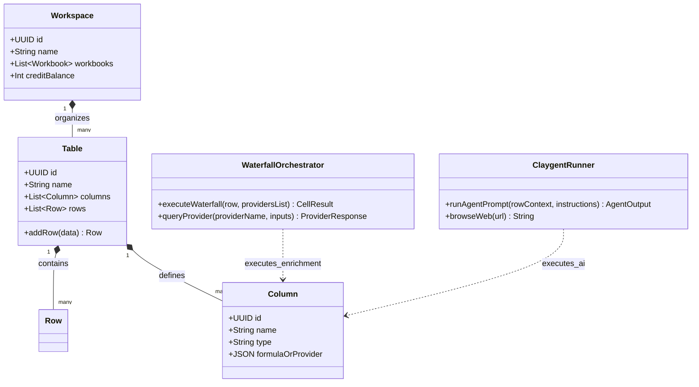
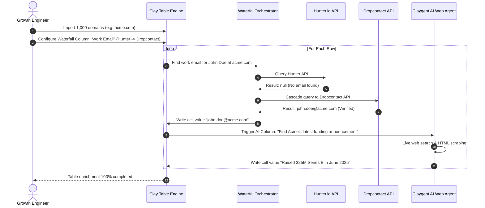

# Clay.com System and Functional Architecture

> Comprehensive technical and functional reference for Clay.com: the leading AI-powered data enrichment, waterfall prospecting, and outbound automation platform ("Spreadsheet with Superpowers").

---

## 1. Executive Overview and Market Positioning

Clay.com redefined outbound data operations by merging spreadsheet-like flexibility with multi-provider data waterfalls and autonomous AI web research agents. Before Clay, sales development teams were forced to purchase multiple disparate data subscriptions (such as ZoomInfo, Apollo, Clearbit, and BuiltWith) and manually stitch them together with CSV exports or complex Python scripts.

Clay solves this fragmentation by providing an integrated relational canvas that orchestrates over 75 premium data providers in cascade sequences, ensuring maximum contact coverage and data accuracy at the lowest marginal credit cost.

### Core Value Proposition
- **Waterfall Enrichment:** Automatically chain multiple data providers sequentially: if Provider A fails to locate an email or phone number, the query instantly falls back to Provider B, then Provider C, charging credits only for successful lookups.
- **Claygent (Autonomous AI Web Researcher):** An AI web crawler that navigates live company websites, LinkedIn profiles, news releases, and regulatory filings to answer qualitative questions with verified citations.
- **Relational Table Architecture:** Combines spreadsheet ease-of-use with developer-grade database structures, nested JSON parsing, formula columns, and external API action triggers.
- **Contextual Outbound Copywriting:** Leverages leading LLMs (OpenAI GPT-4o, Anthropic Claude 3.5 Sonnet) directly within table cells, using enriched signals to craft hyper-personalized outreach at scale.
- **Seamless Downstream Handoff:** Direct bi-directional synchronization with CRMs (Salesforce, HubSpot) and cold email sending engines (Instantly, Smartlead, Lemlist, Outreach).

---

## 2. Core Entities and Data Model

```
┌────────────────────────────────────────────────────────┐
│                      Workspace                         │
│   (Members, Roles, Credit Pool, Connected API Keys)   │
└───────────────────────────┬────────────────────────────┘
                            │ 1:N
                            ▼
┌────────────────────────────────────────────────────────┐
│                      Workbook                          │
│          (Project Folders, Shared Context)             │
└───────────────────────────┬────────────────────────────┘
                            │ 1:N
                            ▼
┌────────────────────────────────────────────────────────┐
│                        Table                           │
│     (Source Ingestion, Row Records, Table Views)       │
└───────────────────────────┬────────────────────────────┘
                            │ 1:N
                            ▼
┌────────────────────────────────────────────────────────┐
│                       Columns                          │
│   ┌───────────────────┬───────────────────┬──────────┐ │
│   │ Primitive Columns │ Formula / JS Cols │ Enriched │ │
│   │ (Text, Num, JSON) │ (Transformations) │ (Cascade)│ │
│   └───────────────────┴───────────────────┴──────────┘ │
└───────────────────────────┬────────────────────────────┘
                            │ Evaluates Across
                            ▼
┌────────────────────────────────────────────────────────┐
│                        Rows                            │
│  (Company / Contact Records, Dynamic Cell Evaluations) │
└───────────────────────────┬────────────────────────────┘
                            │ Export Action
                            ▼
┌────────────────────────────────────────────────────────┐
│                Downstream Destinations                 │
│    (Instantly, Smartlead, HubSpot, Salesforce, HTTP)   │
└────────────────────────────────────────────────────────┘
```

### Entity Definitions
1. **Workspace:** Top-level tenancy isolating team members, global credit consumption, shared data provider credentials, and workspace settings.
2. **Workbook:** Collaborative folder structure grouping related prospecting tables, campaign lists, and customer segments.
3. **Table:** The fundamental execution unit; contains a grid of rows and columns backed by a relational data engine capable of handling tens of thousands of records.
4. **Primitive Column:** Standard storage column holding strings, numbers, booleans, dates, file attachments, or raw JSON payloads.
5. **Formula Column:** Computes values dynamically using built-in spreadsheet functions, regex formulas, or custom JavaScript execution blocks.
6. **Enrichment Column:** Represents an outbound query to one or more third-party APIs (e.g., Hunter, Clearbit, BuiltWith) configured with dynamic input mappings.
7. **Action Column:** Triggers external side-effects (such as sending a webhook, inserting a row into a CRM, or pushing a lead into an Instantly campaign) upon manual click or automated condition.

---

### 2.1 Core Domain and Service Class Architecture



---

### 2.2 Comprehensive Database Schema Specification

Clay persists dynamic spreadsheets, waterfall configurations, and cell values in scalable document and relational stores.

#### Table: `tables`
Spreadsheet tables holding lead enrichment pipelines.

| Column | Type | Constraints | Default | Description |
| :--- | :--- | :--- | :--- | :--- |
| `id` | `UUID` | `PRIMARY KEY` | `gen_random_uuid()` | Table ID |
| `name` | `VARCHAR(255)` | `NOT NULL` | - | Table name |
| `workspace_id` | `UUID` | `NOT NULL` | - | Workspace key |
| `created_at` | `TIMESTAMPTZ` | `NOT NULL` | `NOW()` | Creation timestamp |

---

#### Table: `columns`
Column definitions including formulas, waterfall providers, and Claygent prompts.

| Column | Type | Constraints | Default | Description |
| :--- | :--- | :--- | :--- | :--- |
| `id` | `UUID` | `PRIMARY KEY` | `gen_random_uuid()` | Column ID |
| `table_id` | `UUID` | `NOT NULL` | - | Parent table |
| `name` | `VARCHAR(255)` | `NOT NULL` | - | Column header label |
| `type` | `VARCHAR(50)` | `NOT NULL` | `'text'` | Type (`text`, `enrichment`, `waterfall`, `ai_prompt`) |
| `config` | `JSONB` | `NOT NULL` | `'{}'` | Provider cascading rules and API parameters |

---

## 3. Comprehensive Feature and Functional Breakdown

### 3.1 The Relational Spreadsheet Canvas

Clay's interface mimics a spreadsheet, but every column acts as an asynchronous API pipeline.

#### 3.1.1 Data Types and Column Capabilities
- **Hierarchical JSON Support:** Native parsing of deeply nested JSON responses returned by third-party APIs; users can extract sub-properties into distinct child columns with one click.
- **Array Handling and List Views:** Automatic flattening or aggregation of multi-value fields (e.g., past job experiences, detected technologies, or secondary office locations).
- **Run Conditions and Filters:** Columns can be configured to run conditionally (e.g., "Only run mobile enrichment if company revenue > \$10M and contact title contains VP").
- **Manual vs. Automatic Execution:** Switch between auto-enriching new rows as they arrive or batch-triggering calculations manually to control credit burn.

#### 3.1.2 Formulas and Code Blocks
- **Spreadsheet Functions:** Standard text manipulation, math, date calculation, and logical operators (`IF`, `AND`, `OR`, `VLOOKUP`, `CONCATENATE`).
- **JavaScript Code Runner:** Run custom JavaScript (Node.js runtime environment) directly inside cell formulas for advanced data cleaning, parsing, and normalization.
- **Regex Extraction:** Extract clean company domains from messy email addresses or extract specific metrics from unstructured press release paragraphs.

---

### 3.2 Waterfall Data Enrichment Engine

The core innovation of Clay is the data waterfall: a programmatic cascade designed to maximize hit rates while minimizing API expenditure.

```
                           Target Contact Query
                      (e.g., First, Last, Company)
                                   │
                                   ▼
                      ┌─────────────────────────┐
                      │    Provider 1 (Hunter)  │
                      └────────────┬────────────┘
                                   │
                        Found? ────┴────► YES ──► Write to Cell & STOP
                                   │ NO
                                   ▼
                      ┌─────────────────────────┐
                      │  Provider 2 (Dropcontact│
                      └────────────┬────────────┘
                                   │
                        Found? ────┴────► YES ──► Write to Cell & STOP
                                   │ NO
                                   ▼
                      ┌─────────────────────────┐
                      │   Provider 3 (Prospeo)  │
                      └────────────┬────────────┘
                                   │
                        Found? ────┴────► YES ──► Write to Cell & STOP
                                   │ NO
                                   ▼
                      ┌─────────────────────────┐
                      │    Provider 4 (Apollo)  │
                      └────────────┬────────────┘
                                   │
                        Found? ────┴────► YES ──► Write to Cell & STOP
                                   │ NO
                                   ▼
                           Mark as Not Found
                       (Zero Credits Deducted)
```

#### 3.2.1 Contact Enrichment Providers
- **Work Email Waterfalls:** Integrates Hunter, Dropcontact, Prospeo, Findymail, Datanyze, Clearbit, ContactOut, LeadMagic, Icypeas, and BetterContact.
- **Email Validation Waterfall:** Validates deliverables in real time through Debounce, NeverBounce, and ZeroBounce before exporting, preventing cold email bounces.
- **Mobile Phone Waterfalls:** Cascades across Datagma, Cognism, Mobile Data Providers, and Lusha to discover direct dials and mobile numbers.

#### 3.2.2 Firmographic and Technographic Providers
- **Company Firmographics:** Enriches headcount, revenue, funding history, and SIC/NAICS classifications via Clearbit, Owler, PredictLeads, and Harmonic.
- **Technographic Footprints:** BuiltWith, Similarweb, and Store Leads integrations detect specific CMS platforms, analytics tags, payment gateways, and cloud providers.
- **Job Listings and Growth Signals:** Tracks live job postings from Greenhouse, Lever, and Workable to identify departmental expansion.

#### 3.2.3 Social and Public Footprints
- **LinkedIn Scraping:** Native enrichment of personal LinkedIn profile URLs, employment history, company LinkedIn pages, follower growth, and recent posts.
- **GitHub and Developer Signals:** Enriches developer GitHub activity, public repositories, and commit history for technical outbound targeting.

---

### 3.3 Claygent: Autonomous AI Web Research Agent

Claygent is Clay's native autonomous web agent. It bridges the gap between structured database fields and unstructured internet information.

#### 3.3.1 Capabilities and Architecture
- **Dynamic Web Browsing:** Navigates live web pages, handles redirects, scrolls through dynamic JavaScript-rendered content, and reads subpages (About Us, Careers, Case Studies, Terms of Service).
- **Multi-Hop Exploration:** Instructed to find information by following links: for example, navigating to the homepage, locating the "Team" or "Leadership" link, identifying the VP of Engineering, and extracting their name.
- **Contextual Reasoning:** Evaluates subjective criteria: for example, "Determine whether this B2B software targets enterprise clients or self-serve SMBs based on their pricing page."

#### 3.3.2 Common Claygent Use Cases
- "Find the pricing model: is it usage-based, flat monthly, or contact-sales enterprise?"
- "Verify whether the company displays a SOC 2 Type II or ISO 27001 badge in their footer."
- "Extract the names of the top three customer logos displayed on their homepage."
- "Read their latest blog post or press release and summarize the main product announcement in two bullet points."
- "Find who their Chief Information Security Officer reports to based on LinkedIn data."

---

### 3.4 AI Prompting and Dynamic Outbound Personalization

Clay transforms enriched raw data into outbound sales copy directly inside the table.

#### 3.4.1 Multi-LLM Model Integration
- Support for OpenAI (GPT-4o, GPT-4o-mini), Anthropic (Claude 3.5 Sonnet, Claude 3 Haiku), and Perplexity models.
- Native prompt engineering workbench with variable injection from any column in the row.

#### 3.4.2 Personalization Techniques
- **Dynamic Icebreakers:** Formulates context-rich opening lines: "Noticed you just expanded your engineering team with three senior distributed systems hires in London..."
- **Pain-Point Hypotheses:** Generates logical deductions: "Since your team is currently migrating to Kubernetes and hiring for DevOps, you are likely encountering configuration sprawl..."
- **Tone and Length Constraints:** Enforces strict outbound copywriting rules: under 65 words, casual lower-case formatting, no generic marketing buzzwords, and clear low-friction call-to-actions.

---

### 3.5 Buying Signals and Intent Ingestion

Clay excels at triggering outbound workflows based on real-time organizational events:

1. **Job Changes:** Detects when previous champions or power users change companies, generating automated reach-out tasks to their new organization.
2. **Hiring Surges:** Alerts when a company opens multiple job positions in a specific department (e.g., hiring 5 SDRs indicates upcoming software tool purchases).
3. **Funding Milestones:** Ingests Crunchbase and Harmonic signals on newly closed Seed, Series A, or Series B rounds.
4. **Website Visitor De-Anonymization:** Ingests IP-reveal data (e.g., RB2B, Factors.ai) to uncover the exact company visiting your website, then enriches decision-makers at that firm within minutes.

---

### 3.6 Ingestion and Downstream Export Integrations

#### 3.6.1 Data Ingestion Channels
- **CSV and Excel Upload:** Drag-and-drop batch imports with automatic column type inference.
- **CRM Ingestion:** Pull active leads, contacts, or accounts from HubSpot or Salesforce based on custom filter criteria.
- **Google Sheets Live Sync:** Real-time bi-directional connection.
- **Inbound Webhook Triggers:** Listen for incoming form submissions (Typeform, Formbricks) or product-qualified lead (PQL) events from your product database.

#### 3.6.2 Downstream Destinations and Hand-off
- **Cold Email Platforms:** Push verified leads with custom variables directly into active campaigns in Instantly.ai, Smartlead.ai, or Lemlist.
- **Enterprise Sales Engagement:** Push contacts and tasks directly to Outreach, Salesloft, or Apollo sequences.
- **CRM Writebacks:** Create or update Contacts, Companies, and Deals in HubSpot, Salesforce, or Pipedrive without manual CSV exports.
- **Custom Webhook Dispatch:** Post rows as JSON payloads to internal microservices, AWS Lambda, or automation platforms like n8n and Make.

---

### 3.7 Claybooks and Pre-built Templates

Clay provides pre-engineered workflow templates ("Claybooks") covering common GTM playbooks:
- **Local Business Map Scraper:** Scrapes local Google Maps listings, finds owner contact information, validates emails, and drafts outreach.
- **Competitor Follower Conquesting:** Scrapes users who engage with a competitor's LinkedIn posts and finds their corporate contact information.
- **Automated Inbound Lead Qualification:** Enriches incoming website demo requests, calculates lead score, and routes high-priority prospects directly to executive calendars.

---

### 3.1 End-to-End Operational Lifecycle Sequence



---

## 4. Architectural Comparison and Key Differentiators

| Capability | Clay.com | Legacy Data Vendors (e.g., ZoomInfo) | Spreadsheet Tools (e.g., Airtable) |
| :--- | :--- | :--- | :--- |
| **Data Source Model** | Waterfall aggregation of 75+ data providers | Monolithic single proprietary database | None (manual input or generic add-ons) |
| **AI Web Research** | Claygent autonomous live web browsing | None (static database fields only) | None |
| **Credit Consumption** | Pay only for verified hits across providers | Flat annual platform license | Standard operational quotas |
| **Copy Personalization** | Native cell-level LLM prompt execution | None | Third-party extension required |
| **Export Flexibility** | Direct sync to Instantly, Smartlead, CRMs | Direct CRM sync only | Webhook or Zapier required |