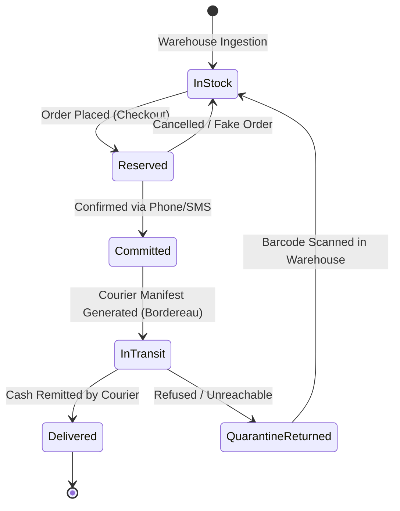
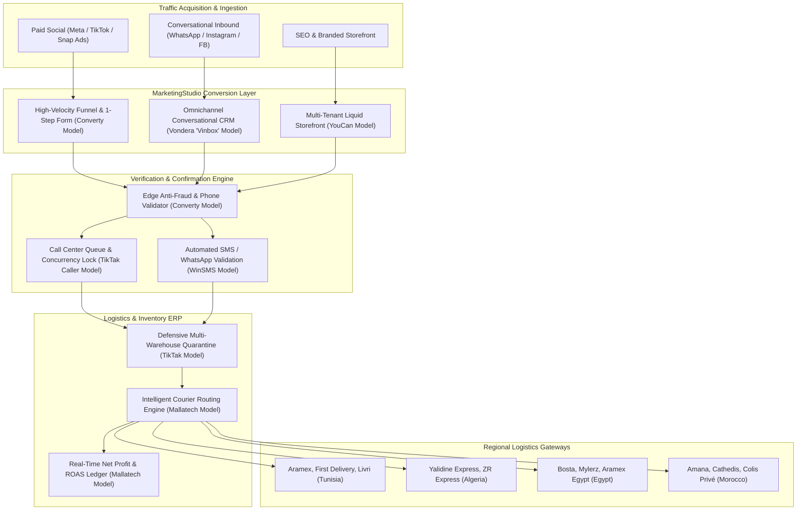

# North African & MENA Cash-on-Delivery (COD) E-Commerce Ecosystem: Architectural Comparison & Convergence Guide

> Definitive architectural, functional, and technological benchmark comparing **Mallatech**, **Vondera**, **Converty**, **TikTak PRO**, and **YouCan**, providing the unified engineering blueprint for **SGrowing / MarketingStudio**.

---

## 1. Executive Landscape & Strategic Context

In North Africa and the broader Middle East and North Africa (MENA) region, traditional Western e-commerce software (Shopify, WooCommerce, BigCommerce) encounters critical structural friction:
1. **The Cash-on-Delivery (COD) Reality:** 85% to 95% of consumer transactions are paid in physical cash upon delivery. The transaction is not complete when the customer clicks "Submit"; it is only complete when a courier delivers the parcel, collects the cash, and remits it to the merchant.
2. **High Return Rates (*Taux de Retour*):** Uncommitted impulse buyers, invalid phone numbers, delayed deliveries, and fake competitor orders cause return rates of 25% to 45% if left unmitigated.
3. **Colloquial Regional Addressing:** Standard street names and postal codes rarely exist; delivery relies on cascading administrative tiers (Governorates/Delegations in Tunisia, Wilayas/Communes in Algeria, Districts in Egypt) paired with verbal landmarks.
4. **Call Center Confirmation as a Core Requirement:** Every order must be vetted via a phone call, WhatsApp verification, or interactive SMS before the package leaves the warehouse.
5. **Logistics Fragmentation:** Merchants must integrate with dozens of disparate, non-standardized local courier APIs.

To conquer this market, five distinct platforms have emerged with specialized engineering architectures:

```
┌───────────────────────────────────────────────────────────────────────────────────────────────────┐
│                               North African & MENA COD E-Commerce Leaders                         │
├─────────────────────┬─────────────────────┬─────────────────────┬───────────────────┬─────────────┤
│   Mallatech.tn      │     Vondera.app     │    Converty.shop    │    TikTak PRO     │ YouCan.shop │
│  (Tunisian Courier  │  (Egyptian Mobile   │  (High-Velocity COD │ (Tunisian Call    │ (Pan-MENA   │
│   Routing & ERP)    │   Commerce & Vinbox)│   Funnel Builder)   │  Center & Stock)  │  Enterprise)│
└─────────────────────┴─────────────────────┴─────────────────────┴───────────────────┴─────────────┘
```

---

## 2. Definitive Head-to-Head Architectural Matrix

| Architectural Dimension | Mallatech (`mallatech.tn`) | Vondera (`vondera.app`) | Converty (`converty.shop`) | TikTak PRO (`tiktakpro.com`) | YouCan (`youcan.shop`) |
| :--- | :--- | :--- | :--- | :--- | :--- |
| **Primary Market** | Tunisia | Egypt & MENA | Tunisia, Algeria, Morocco | Tunisia & Francophone Africa | Morocco, GCC, Pan-MENA |
| **Core Value Prop** | Multi-courier auto-routing ERP & 0% sales commission | Mobile-first social commerce & unified inbox ("Vinbox") | Ultra-fast COD landing pages & anti-fraud funnel engine | Call center CRM ("TikTak Caller") & inventory ERP | Multi-tenant scale, developer theme SDK & YouCan Pay |
| **Primary Stack** | PHP 8.3 (Laravel 11), Vue 3, MySQL, Redis | Node.js (NestJS), Flutter, PostgreSQL, MongoDB | TypeScript, Node/Bun, Fastify, Edge Workers, Postgres | PHP 8.2 (Laravel 10), Vue 3, Laravel Reverb, MySQL | Go / Node.js, Liquid Engine, Celeste UI, Sharded Postgres |
| **Storefront Architecture** | 50+ conversion themes, localized mobile layouts | Visual page builder, mobile PWA, Shopify sync | Sub-second static landing pages, embedded 1-step form | 50+ mobile themes, drag-and-drop customizer | Liquid template engine, Theme SDK, YouCan CLI |
| **Checkout Mechanism** | 1-step COD form with 24 Gouvernorats selector | Mobile checkout with Egyptian zone pricing & 11-digit phone | Embedded 1-step form, cascading Wilayas/Govs | Fast COD form with delegation selector & upsells | Express Checkout (No-Cart), Order Bumps, Upsells |
| **Confirmation CRM** | Visual Kanban pipeline, anti-collision lock, Ka-ching sound | "Vinbox" omnichannel chat (WhatsApp, IG, FB) order creator | Agent order workbench & Google Sheets real-time stream | "TikTak Caller" auto-queue, screen pop, call history | Native Google Sheets real-time sync, Partner apps |
| **Logistics Integration** | Direct API with 15+ Tunisian couriers, auto-dispatch | Native Bosta, Mylerz, Aramex Egypt API bridges | Yalidine (DZ), ZR Express, Aramex, Tunisian carriers | Aramex, Livri, Express Courrier, bulk manifests | City & zone shipping rules, courier webhooks |
| **SMS & Messaging** | Free SIM bridge app & integrated SMS alerts | WhatsApp Cloud API, Instagram DM automation | Automated WhatsApp notification & confirmation links | Native **WinSMS** gateway integration, recovery links | Transactional email, WhatsApp partner apps |
| **Anti-Fraud Security** | Address auto-correction, duplicate phone blocking | Phone validation (010, 011, 012, 015), blocked users | IP velocity filter, canvas fingerprinting, blacklist | Past order history pop-up, delivery risk score | Cloudflare enterprise WAF, bot detection |
| **Pricing Model** | 0% sales commission, fixed monthly plans in TND | Monthly tiers in EGP (~400 to 1,500+ EGP/mo) | Free up to 10k TND, then ~0.3% commission / tiered | Tiered subscriptions in TND, free trial | Pay As You Sell (0% sub, ~0.25-0.5% commission) |

---

## 3. Deep Architectural Comparisons across Critical Subsystems

### 3.1 Addressing Models and Geographic Cascades

```
Tunisia (Mallatech, TikTak, Converty):
  [Gouvernorat (24)] ──► [Délégation (~264)] ──► [Localité / Street Landmark]

Algeria (Converty):
  [Wilaya (58)] ──► [Commune (~1541)] ──► [Address / Bureau de Stopdesk]

Egypt (Vondera):
  [Governorate (27)] ──► [Zone / District (e.g. Nasr City, Maadi)] ──► [Street, Building, Apt]

Morocco (YouCan, Converty):
  [Region (12)] ──► [Province / Prefecture] ──► [Ville / Commune] ──► [Quartier / Rue]
```

- **Mallatech & TikTak PRO:** Embed exhaustive static JSON trees of the 24 Tunisian Governorates and delegations. Selecting `Sousse` instantly populates `Hammam Sousse`, `Kantaoui`, `Msaken`, and `Akouda` with zero network overhead.
- **Vondera:** Translates complex Egyptian street vernacular into courier-specific delivery zones (`EG-01` Cairo, `EG-02` Giza, `EG-03` Alexandria), enabling sub-zone flat rate delivery pricing.
- **Converty:** Supports multi-country toggles, dynamically adapting from Tunisian governorates to Algerian 58 Wilayas or Moroccan cities based on the visitor's geo-IP.

---

### 3.2 Inventory Lifecycle: Blind Decrement vs. Defensive COD Quarantine

Traditional platforms decrement inventory at checkout:
$$\text{Stock}_{\text{available}} = \text{Stock}_{\text{physical}} - \text{Stock}_{\text{sold}}$$

In Cash-on-Delivery, 30% of placed orders are canceled during phone confirmation or returned by the courier. A naive decrement leads to artificial stockouts, while delayed decrement leads to overselling.

**The TikTak PRO & Mallatech Multi-State Model:**


1. **Order Placed:** Stock moves to `Reserved`. `Available = Physical - Reserved`.
2. **Call Center Outcome:**
   - *Confirmed:* Moves to `Committed`.
   - *Cancelled / Unreachable:* Lock released, returns to `Available`.
3. **Courier Return:** Marked `QuarantineReturned` upon delivery refusal; restored to `InStock` only after physical barcode verification in the warehouse.

---

### 3.3 Concurrency Control in Call Centers: Preventing Double-Dialing

When 10+ confirmation agents work on an active inbound queue, race conditions cause multiple agents to call the same customer simultaneously:

```
Agent A clicks Order #10023 ──┐
                              ├─► Race Condition: Who owns the customer?
Agent B clicks Order #10023 ──┘
```

- **Mallatech & TikTak PRO Resolution:** Redis-backed distributed locks with TTL and WebSocket notification:
  ```
  SET order_lock:10023 agent_42 EX 300 NX
  ```
- If Agent A acquires the lock, the WebSocket broadcasts a `lock_acquired` event. Agent B's interface instantly greys out the customer's phone number and renders a badge: `Locked by Sarah (4:45 remaining)`.
- Releasing the lock or saving a call outcome frees the record for the next agent.

---

### 3.4 Conversational Commerce vs. Static Landing Pages

- **Vondera ("Vinbox"):** Recognizes that modern Egyptian consumers prefer chatting on WhatsApp or Instagram before ordering. Instead of forcing them to a web URL, the agent chats, builds a cart in the sidebar, and dispatches a 1-tap checkout card directly in the conversation.
- **Converty ("High-Velocity Funnel"):** Optimizes for paid social media ads (TikTok/Meta) where traffic is cold. It strips out all navigation, menus, and distractions, presenting only high-impact product video/images and an immediate 1-step form with Order Bumps.

---

## 4. Master Convergence Blueprint for MarketingStudio / SGrowing

By synthesizing the core strengths of all five platforms, **MarketingStudio** achieves the definitive e-commerce and marketing automation engine:



### The 7 Core Architectural Pillars for MarketingStudio:

1. **Embedded 1-Step COD Checkout with Cascading Regional Selectors:**
   - Pre-pack normalized datasets for Tunisia (24 Govs), Algeria (58 Wilayas), Egypt (27 Govs), and Morocco (12 Regions).
   - Zero-reload form submission with native pre-purchase **Order Bumps** and post-purchase **1-Click Upsells**.

2. **Distributed Redis Call Center Concurrency Locks:**
   - Prevent agent collision with 5-minute atomic locks (`SET lock:order:id agent_id EX 300 NX`) and WebSocket broadcasts across agent screens.

3. **Defensive Multi-State Inventory Engine:**
   - Enforce explicit inventory states: `Available`, `Reserved`, `Committed`, `In-Transit`, and `QuarantineReturned`.
   - Provide mobile barcode scanning to restore returned parcels (*retours*) directly to active stock upon arrival.

4. **Omnichannel In-Chat Order Creation ("Vinbox" Pattern):**
   - Enable customer support agents in the shared inbox to configure products, apply discounts, select delivery zones, and generate confirmed orders without leaving the WhatsApp or Instagram conversation.

5. **Universal Courier Adapter Interface:**
   - Implement an extensible carrier driver interface supporting Bosta, Yalidine, Aramex, First Delivery, and Livri with standardized methods:
     ```typescript
     interface CourierDriver {
       createShipment(order: Order): Promise<ShipmentResult>;
       generateManifest(orderIds: string[]): Promise<ManifestPdf>;
       parseTrackingWebhook(payload: unknown): NormalizedTrackingStatus;
       reconcileCashRemittance(remittanceData: unknown): RemittanceReport;
     }
     ```

6. **Automated Escalation Matrix (SMS + WhatsApp Fallback):**
   - If a confirmation call goes unanswered (`no_answer`), automatically trigger an interactive verification SMS / WhatsApp message with a 1-click confirmation token before rescheduling a retry.

7. **True Net-Profitability & Real-Time ROAS Ledger:**
   - Calculate net profit dynamically per order:
     $$\text{Net Profit} = \text{COD Collected} - \text{Product COGS} - \text{Ad Spend (CAC)} - \text{Courier Fee} - (\text{Return Rate} \times \text{Return Penalty}) - \text{Call Center Cost}$$
