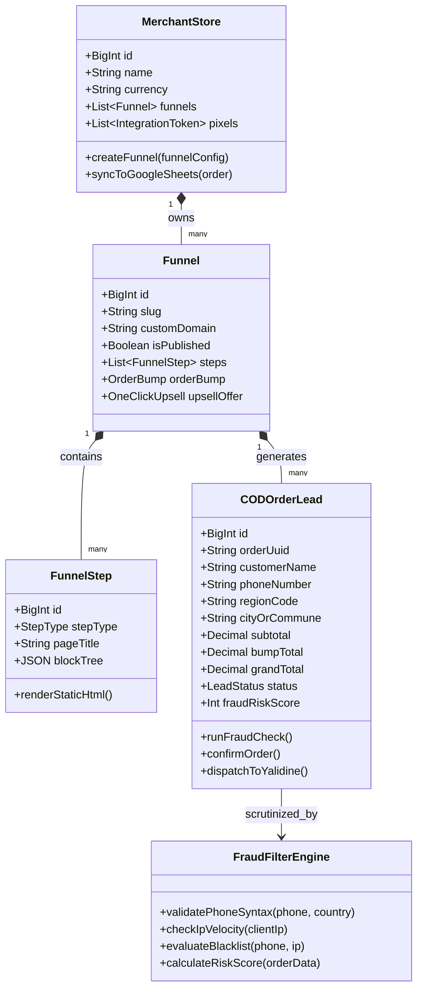
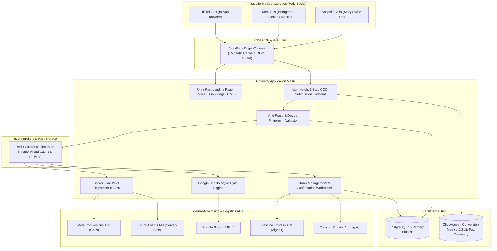
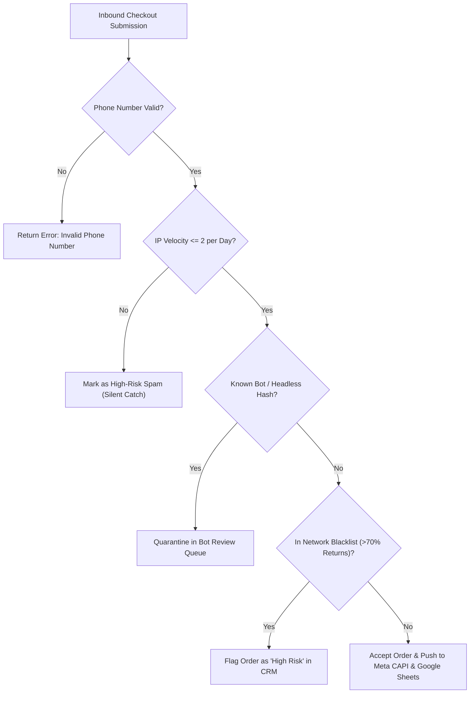

# Converty.shop System and Functional Architecture

> Comprehensive technical and functional reverse-engineered reference for **Converty** (`converty.shop`): the high-velocity Cash-On-Delivery (COD) sales funnel builder, landing page engine, and anti-fraud conversion platform in North Africa (Tunisia, Algeria, Morocco).

---

## 1. Executive Overview and Market Positioning

**Converty** was architected to serve high-performance media buyers and direct-to-consumer (DTC) e-commerce brands operating in **Cash-on-Delivery (COD)** markets across North Africa.

In performance marketing campaigns on **TikTok Ads, Meta (Facebook/Instagram) Ads, and Snapchat Ads**, mobile loading speeds and checkout friction dictate profitability:
- Standard multi-step e-commerce platforms (Cart Page ➔ Customer Information ➔ Shipping Method ➔ Payment Details) suffer catastrophic **cart abandonment rates exceeding 75%** on mobile devices in Africa.
- Competitor sabotage (rival stores placing fake orders with invalid phone numbers to deplete stock) and uncommitted impulse buyers lead to staggering **return rates (up to 35-45%)**, destroying advertising return on investment (ROAS).

Converty addresses these problems through a specialized architecture:
1. **Sub-Second Page Loads:** Static-rendered landing pages with inline checkout forms, loading in under 400ms on 3G/4G connections.
2. **Frictionless 1-Step COD Checkout:** Direct purchase on the product landing page with dynamic cascading geographic selectors (Tunisian Gouvernorats, Algerian 58 Wilayas, Moroccan Regions).
3. **High-Converting Funnel Architecture:** Native Order Bumps (pre-purchase checkbox add-ons) and 1-Click Post-Purchase Upsells/Downsells that boost Average Order Value (AOV) by 25-40%.
4. **Algorithmic COD Fraud Shield:** Real-time phone syntax verification, duplicate submission throttling, bot blocking, and device fingerprinting to prevent fake orders before they reach fulfillment.
5. **Real-Time Integration Fabric:** Instant server-side synchronization with Meta CAPI, TikTok Events API, Google Sheets, and regional delivery carriers (Yalidine Express, ZR Express, Aramex).

```
┌───────────────────────────────────────────────────────────────────────────────────────────────────┐
│                                       Converty Platform Core                                      │
│           High-Velocity COD Funnel Builder, Fraud Shield & Media Buyer Conversion Engine         │
└──────────────────────────────────────────────────┬────────────────────────────────────────────────┘
                                                   │
         ┌─────────────────────────────────────────┼────────────────────────────────────────┐
         ▼                                         ▼                                        ▼
┌─────────────────────────────┐       ┌─────────────────────────────┐      ┌─────────────────────────────┐
│   High-Velocity Funnel      │       │    COD Fraud Shield &       │      │   Omnichannel Tracking &    │
│   & Landing Page Builder    │       │    Data Hygiene Engine      │      │   Integration Hub           │
│  - Instant 1-Step COD form  │       │  - Phone syntax validation  │      │  - Meta CAPI & TikTok API   │
│  - Order Bumps & Upsells    │       │  - Anti-bot device hashing  │      │  - Google Sheets 2-way sync │
│  - Cascading Wilaya/Gouv    │       │  - Competitor fake-order ban│      │  - Yalidine / Aramex APIs   │
└─────────────────────────────┘       └─────────────────────────────┘      └─────────────────────────────┘
         │                                         │                                        │
         └─────────────────────────────────────────┼────────────────────────────────────────┘
                                                   ▼
                                      ┌─────────────────────────────┐
                                      │  Order Management (OMS) &   │
                                      │  Call Center Dispatcher     │
                                      │ - Agent lead distribution   │
                                      │ - Confirmation workflows    │
                                      │ - Real-time profit analytics│
                                      └─────────────────────────────┘
```

### Core Value Proposition & Market Differentiators
- **Embedded No-Cart Checkout:** Shoppers never leave the product landing page. The checkout form is embedded above or below the fold, capturing name, phone, state/wilaya, and quantity in a single tap.
- **Conversion-Boosting Order Bumps:** Seamless checkbox add-on (e.g., *"Add protective case for +15 TND"*) directly inside the checkout container, increasing AOV with zero additional clicks.
- **Cascading Regional Address Intelligence:** Pre-configured geo-datasets covering all 24 Tunisian Governorates/Delegations, 58 Algerian Wilayas/Communes, and Moroccan Provinces.
- **0.3% / Free-Tier Business Model:** Free to build and test up to 10,000 TND in turnover, transitioning to an ultra-low ~0.3% commission per sale, aligning Converty's revenue directly with merchant scaling.
- **AI-Powered Copywriting & Chat Assistance:** Embedded AI tools for generating high-converting product angles, headlines, and automated customer answering assistants.

---

## 2. Core Entities and Reverse-Engineered Data Model

### 2.1 Domain Entity Relationship Model

```
┌─────────────────────────────────────────────────────────────────┐
│                        Merchant Account                         │
│           (ID, Email, Brand Name, Commission Tier, Currency)    │
└───────────────────────────────┬─────────────────────────────────┘
                                │ 1:N
                                ▼
┌─────────────────────────────────────────────────────────────────┐
│                          Sales Funnel                           │
│        (Funnel Slug, Custom Domain, Pixel IDs, Traffic Source)  │
└───────────────┬───────────────────────────────┬─────────────────┘
                │ 1:N                           │ 1:N
                ▼                               ▼
┌───────────────────────────────┐   ┌─────────────────────────────┐
│          Funnel Step          │   │         Order Bump          │
│   (Type: Landing / Upsell,    │   │ (Trigger Product, Add-on    │
│    HTML/CSS Payload, Scripts) │   │  Product, Discount Price)   │
└───────────────┬───────────────┘   └─────────────┬───────────────┘
                │                                 │
                └───────────────┬─────────────────┘
                                ▼
┌─────────────────────────────────────────────────────────────────┐
│                           Order Lead                            │
│  (ID, Full Name, Phone, IP Address, Device Hash, Risk Score,    │
│   Wilaya/Governorate, Commune, Status: Pending/Confirmed/Spam)  │
└───────────────┬───────────────────────────────┬─────────────────┘
                │ 1:N                           │ 1:1
                ▼                               ▼
┌───────────────────────────────┐   ┌─────────────────────────────┐
│          Order Item           │   │      Fraud Audit Record     │
│  (Product ID, Variant, Qty,   │   │ (IP Velocity, Blacklist Hit,│
│   Is Bump, Is Upsell, Total)  │   │  Phone Carrier, Validation) │
└───────────────────────────────┘   └─────────────────────────────┘
```

### 2.2 Class Diagram Architecture



### 2.3 Comprehensive Database Schema Specification

#### Table: `funnels`
| Column | Type | Constraints | Default | Description |
| :--- | :--- | :--- | :--- | :--- |
| `id` | `BIGINT UNSIGNED` | `PRIMARY KEY AUTO_INCREMENT` | - | Unique Funnel ID |
| `store_id` | `BIGINT UNSIGNED` | `NOT NULL, INDEX` | - | Store reference |
| `title` | `VARCHAR(255)` | `NOT NULL` | - | Internal campaign name |
| `slug` | `VARCHAR(128)` | `UNIQUE NOT NULL` | - | URL slug: `converty.shop/p/creme-miracle` |
| `custom_domain` | `VARCHAR(191)` | `UNIQUE NULL` | `NULL` | Custom domain linked via CNAME |
| `country_code` | `VARCHAR(2)` | `NOT NULL` | `'TN'` | Target market: `TN`, `DZ`, `MA` |
| `facebook_pixel_id`| `VARCHAR(64)` | `NULL` | `NULL` | Meta Ads Pixel ID |
| `tiktok_pixel_id` | `VARCHAR(64)` | `NULL` | `NULL` | TikTok Ads Pixel ID |
| `snapchat_pixel_id`| `VARCHAR(64)` | `NULL` | `NULL` | Snapchat Pixel ID |
| `google_sheet_url` | `TEXT` | `NULL` | `NULL` | Webhook URL for Google Sheets sync |
| `is_active` | `BOOLEAN` | `NOT NULL` | `TRUE` | Funnel active status |

#### Table: `order_leads`
| Column | Type | Constraints | Default | Description |
| :--- | :--- | :--- | :--- | :--- |
| `id` | `BIGINT UNSIGNED` | `PRIMARY KEY AUTO_INCREMENT` | - | Unique Order Lead ID |
| `funnel_id` | `BIGINT UNSIGNED` | `NOT NULL, INDEX` | - | Originating funnel |
| `order_number` | `VARCHAR(32)` | `UNIQUE NOT NULL` | - | Formatted ID: `CNV-2026-9018` |
| `full_name` | `VARCHAR(120)` | `NOT NULL` | - | Customer full name |
| `phone` | `VARCHAR(20)` | `NOT NULL, INDEX` | - | Cleaned mobile phone string |
| `country` | `VARCHAR(2)` | `NOT NULL` | `'TN'` | Target country |
| `state_or_wilaya`| `VARCHAR(64)` | `NOT NULL, INDEX` | - | Governorate (TN) or Wilaya (DZ) |
| `commune_or_delegation`| `VARCHAR(100)` | `NOT NULL` | - | Local district or municipality |
| `total_amount` | `DECIMAL(10,2)` | `NOT NULL` | `0.00` | Net payable COD amount |
| `has_order_bump` | `BOOLEAN` | `NOT NULL` | `FALSE` | Flag whether bump was accepted |
| `has_upsell` | `BOOLEAN` | `NOT NULL` | `FALSE` | Flag whether upsell was taken |
| `client_ip` | `VARCHAR(45)` | `NOT NULL` | - | Visitor IP address |
| `device_hash` | `VARCHAR(64)` | `NOT NULL, INDEX` | - | Client fingerprint hash |
| `risk_level` | `ENUM('safe','suspect','fraud')` | `NOT NULL` | `'safe'` | Anti-fraud triage classification |
| `status` | `VARCHAR(32)` | `NOT NULL, INDEX` | `'new'` | `new`, `confirmed`, `cancelled`, `spam` |
| `created_at` | `TIMESTAMP` | `NOT NULL` | `CURRENT_TIMESTAMP` | Order timestamp |

---

## 3. Reverse-Engineered System Architecture & Engineering Blueprint



### 3.1 Technology Stack & Operational Efficiency
- **Edge Architecture:** Cloudflare Edge Workers and KV caching serving the HTML shell in < 50ms worldwide.
- **Backend Application Core:** High-throughput TypeScript on Node.js / Bun with Fastify or Go microservices, handling incoming checkout bursts of thousands of concurrent checkouts during flash sales without server degradation.
- **Frontend Engine:** Ultra-lean vanilla JavaScript / Alpine.js components embedded directly into the static HTML page, guaranteeing minimal bundle overhead (< 30KB total page weight including stylesheets).
- **Anti-Fraud Security:** Redis-backed rate-limiting counters calculating IP velocity, phone number regex validation, and client canvas fingerprint hashing.

---

## 4. Key Operational Mechanics & Deep Technical Differentiators

### 4.1 Frictionless 1-Step COD Form with Dynamic Cascading Geo-Selectors
Rather than navigating through a multi-step checkout wizard, the entire form lives directly on the landing page:
```html
<form id="converty-cod-form" class="cod-checkout-container">
  <input type="text" name="name" placeholder="Nom et Prénom" required />
  <input type="tel" name="phone" placeholder="Numéro de Téléphone (ex: 98123456)" required />
  
  <!-- Dynamic Cascading Selectors -->
  <select id="state-selector" name="state" required>
    <option value="">Sélectionnez votre Gouvernorat / Wilaya</option>
  </select>
  <select id="city-selector" name="city" required disabled>
    <option value="">Sélectionnez votre Ville / Délégation</option>
  </select>
  
  <!-- Order Bump Section -->
  <div class="order-bump-box">
    <label class="bump-label">
      <input type="checkbox" name="order_bump" value="1" />
      <span class="bump-tag">OFFRE SPÉCIALE</span>
      <span>Ajouter le gel apaisant pour seulement +12 TND (Au lieu de 25 TND)</span>
    </label>
  </div>
  
  <button type="submit" class="submit-button-pulse">
    Commander Maintenant (Paiement à la livraison)
  </button>
</form>
```
When the customer submits, the form asynchronously posts JSON to `/api/v1/checkout/submit` and seamlessly transitions to the Thank You / Upsell page without a full browser reload.

### 4.2 Algorithmic Anti-Fraud & Competitor Fake-Order Shield
In COD e-commerce, malicious actors often automate bot submissions to exhaust a merchant's inventory and inflate shipping return fees. Converty deploys a 4-layer defensive filter:
1. **Phone Number Syntax & Carrier Verification:** Validates prefix and length (e.g. Tunisia: 8 digits starting with 2, 4, 5, 9; Algeria: 10 digits starting with 05, 06, 07).
2. **IP Velocity Limiting:** Limits submissions from a single IP address to maximum 2 orders per 24 hours. Subsequent attempts are flagged as `SPAM`.
3. **Canvas & WebGL Fingerprinting:** Captures hardware rendering signatures to detect headless browsers (Puppeteer, Selenium) and repeated submissions from incognito tabs.
4. **Shared Regional Blacklist:** Orders matching phone numbers or device hashes with a historical return rate exceeding 70% across the Converty network trigger high-risk warnings on the merchant's dashboard.



### 4.3 1-Click Post-Purchase Upsell Architecture
When a buyer completes the initial order:
1. The server generates a temporary signed session token (`order_token`).
2. The user is redirected to `/upsell/{order_token}` showing a complementary product with a special 1-time discount (e.g. 50% off second unit).
3. Clicking **"Oui, Ajouter à ma commande"** makes a PATCH request appending the item directly to the existing COD order and updating the courier manifest amount, without creating a separate duplicate order.

---

## 5. Comprehensive REST & Webhook API Surface Specification

### 5.1 Fast Checkout Submission Endpoint
```http
POST /api/v1/checkout/submit
Content-Type: application/json
X-Funnel-Token: fnl_live_883a91bc7

{
  "full_name": "Sofiene Trabelsi",
  "phone": "24556677",
  "state": "Sousse",
  "city": "Hammam Sousse",
  "address": "Route Touristique, Résidence Les Palmiers",
  "items": [
    { "product_id": "prod_anti_acne_kit", "quantity": 1, "price": 69.00 }
  ],
  "order_bump_accepted": true,
  "bump_item": { "product_id": "prod_cleansing_gel", "price": 15.00 },
  "client_meta": {
    "ip": "197.3.12.89",
    "user_agent": "Mozilla/5.0 (iPhone; CPU iPhone OS 17_5 like Mac OS X)...",
    "fingerprint": "a9f8b2c1e8473910"
  }
}
```

#### Response (200 OK):
```json
{
  "success": true,
  "order_id": "CNV-2026-9018",
  "total_cod": 84.00,
  "currency": "TND",
  "next_action": "redirect",
  "redirect_url": "https://converty.shop/upsell/sec_tok_991823ab"
}
```

### 5.2 Bi-Directional Google Sheets Webhook Payload
Every valid order dispatches an immediate asynchronous event payload to the merchant's configured Google Apps Script endpoint:
```json
{
  "timestamp": "2026-10-26 11:22:15",
  "order_id": "CNV-2026-9018",
  "customer_name": "Sofiene Trabelsi",
  "phone": "24556677",
  "region": "Sousse",
  "city": "Hammam Sousse",
  "products": "Anti-Acne Kit (x1), Cleansing Gel Bump (x1)",
  "total_amount": 84.00,
  "status": "New",
  "utm_source": "tiktok_ads",
  "utm_campaign": "ugc_creative_v2"
}
```

---

## 6. Strategic Takeaways & Architecture Lessons for MarketingStudio / SGrowing

1. **Inline Single-Page COD Conversion:** Eliminate multi-step checkout completely for COD funnels. MarketingStudio must provide native 1-step checkout widgets embeddable on any page builder block.
2. **Integrated Order Bumps & Post-Purchase Upsells:** These CRO components directly increase AOV and absorb rising digital advertising customer acquisition costs (CAC).
3. **Automated Fraud Screening at Edge:** In COD marketing, bad leads cost real money in uncollected shipping fees. MarketingStudio should implement real-time phone validation and fraud velocity checks during form submission.
4. **Instant No-Code Google Sheets Streaming:** Media buyers demand instantaneous synchronization with Google Sheets so external call center agents can begin dialing within 30 seconds of form submission.
