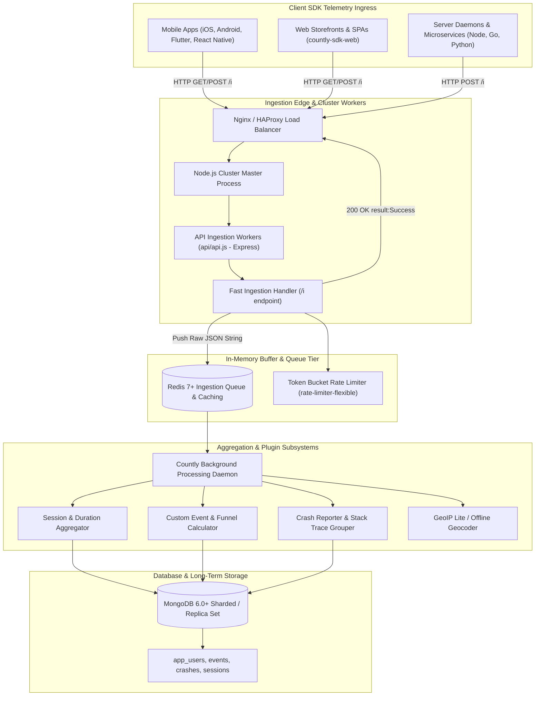
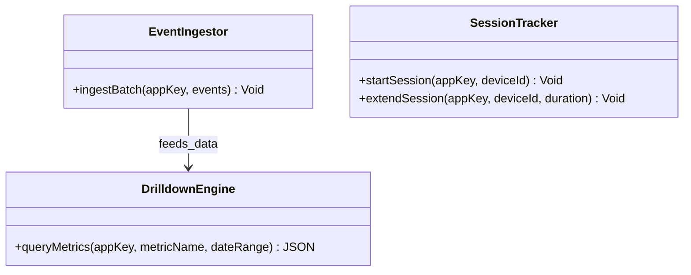
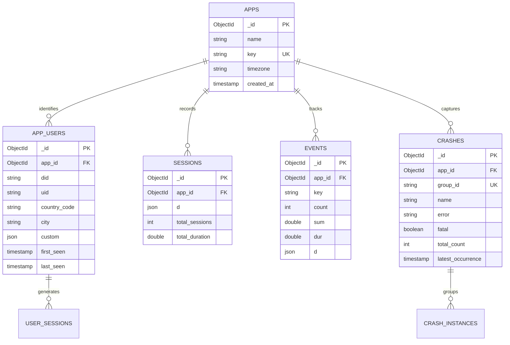
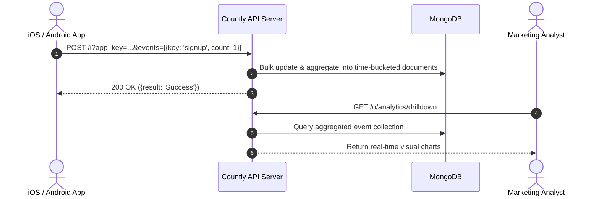

# countly-server - Architecture & Technical Wiki

> **Enterprise Real-Time Product Analytics, Mobile/Web Telemetry Engine, Crash Reporting & User Journey Platform**  
> GitHub: [countly/countly-server](https://github.com/countly/countly-server.git) | Stack: Node.js (v20/v22), Express, MongoDB 6+, Redis, Cluster Workers, EJS/Vue, GeoIP | License: AGPLv3

---

## 1. Executive Summary & Value Proposition

**Countly Server** is an enterprise-grade, real-time product analytics, digital user telemetry, and crash-reporting platform engineered in **Node.js**, **Express**, **MongoDB 6+**, and **Redis**. Designed as a privacy-centric, completely self-hostable alternative to Google Analytics, Mixpanel, and Firebase Analytics, Countly provides comprehensive observability across mobile applications (iOS, Android, Flutter, React Native), web applications, desktop clients, and IoT devices.

Countly's architecture is optimized for high-throughput, sub-second telemetry ingestion. Rather than executing expensive real-time aggregations over billions of raw telemetry rows at query time, Countly employs an in-memory Redis processing queue and an atomic, time-bucketed pre-aggregation database pattern. This ensures that executive dashboards, custom event breakdowns, funnel retention curves, and crash diagnostic reports render instantaneously regardless of data volume.

### Core Problems Solved
- **Strict Data Sovereignty & GDPR/HIPAA Compliance**: Eliminates the legal risks of transmitting proprietary customer behavioral data to third-party US cloud providers by running 100% on self-hosted enterprise infrastructure with built-in consent management.
- **High-Throughput Ingestion at Scale**: Processes tens of thousands of concurrent SDK telemetry events per second via Node.js cluster processes and Redis write-buffering.
- **Pre-Aggregated Time-Bucket Document Model**: Avoids query-time map-reduce bottlenecks by pre-aggregating metrics into hierarchical hourly, daily, and monthly MongoDB documents upon arrival.
- **Integrated Application Crash & Error Diagnostics**: Captures detailed stack traces, unhandled exceptions, and device breadcrumbs, automatically grouping crashes into actionable issues with symbolication.
- **Modular Plugin Architecture**: Implements a micro-kernel architecture where every analytical feature (sessions, events, views, funnels, push notifications, remote config) is an isolated, pluggable subsystem.

---

## 2. High-Level System Architecture

Countly Server utilizes a **Clustered Ingestion & Worker Architecture**. The platform divides responsibilities between an edge ingestion cluster that acknowledges incoming SDK telemetry packets in milliseconds and background processing workers that aggregate metrics and write them to MongoDB.



### Architectural Lifecycle of an Incoming Telemetry Batch
1. **SDK Ingestion Hit (`GET/POST /i`)**: Client SDKs buffer events locally and periodically flush them in compressed batches to `https://analytics.customdomain.com/i`. The payload contains `app_key`, `device_id`, and URL-encoded query parameters representing sessions (`begin_session=1`, `session_duration=60`), custom events (`events=[...]`), or device metrics (`metrics={...}`).
2. **Cluster Ingestion & Redis Push**: An API worker parses the `app_key` to ensure validity, increments rate-limiting counters, and immediately pushes the raw payload into a Redis list (`countly_incoming_queue`). The HTTP connection terminates instantly with `{"result":"Success"}` (typically under 5-10ms).
3. **Queue Processing & Geographic Resolution**: The background processing daemon pops items from the Redis queue. It resolves client IP addresses into ISO country, region, and city coordinates using embedded GeoIP databases (`geoip-lite`).
4. **Time-Bucketed Pre-Aggregation**: Rather than writing separate rows for every view or button click, the event processor identifies the active temporal bucket (e.g. `2026`, `2026.10`, `2026.10.24`, `2026.10.24.12`) and executes atomic MongoDB `$inc` operations. Document structures like `d.2026.10.24.c` (count) and `d.2026.10.24.s` (sum) are updated in place.
5. **Crash Diagnostics & Breadcrumb Processing**: If the payload contains an unhandled exception (`crash={...}`), the crash plugin analyzes the stack trace, computes an MD5 issue signature to deduplicate identical errors, appends user session breadcrumbs, and updates error impact graphs.

---

### 2.1 Core Domain & Service Class Architecture



---

## 3. Technology Stack & Key Dependencies

- **Language & Runtime**: Node.js 20.x or 22.x LTS utilizing native `cluster` multi-core worker fork models.
- **Web Application Framework**: Express.js 4.x configured for ultra-lean, low-allocation HTTP ingestion.
- **Database Architecture**: MongoDB 6.0+ / 7.0+ (utilizing high-concurrency WiredTiger storage engine, sharding, and replica sets); native `mongodb` Node driver.
- **In-Memory Caching & Queue**: Redis 7+ for request spooling, sliding-window rate limiting, and real-time active user metrics.
- **Geo-Location & Data Processing**: `geoip-lite` and `offline-geocoder` for local IP-to-location mapping without external API latency; `argon2` for administrative credential hashing.
- **Logging & System Utilities**: `bunyan` for structured JSON logging; `async` and `bluebird` for concurrency management.

---

## 4. Repository Layout & Key Modules

```
inspire/countly-server/
├── api/                             # Ingestion API & cluster workers
│   ├── api.js                       # Primary HTTP API server entrypoint (/i endpoint)
│   ├── config.sample.js             # Cluster, MongoDB, and Redis configuration
│   └── utils/                       # Shared network and validation helpers
├── bin/                             # Administrative scripts & CLI tools
│   ├── countly.sh                   # Process supervisor, upgrade & service manager
│   └── scripts/                     # Database maintenance and index creation utilities
├── frontend/                        # Web Dashboard & Management Portal
│   └── express/                     # Express web server serving the dashboard
│       ├── public/                  # Bundled assets, charts, and client SDKs
│       └── views/                   # EJS templates and Vue.js dashboard widgets
├── plugins/                         # Modular domain plugins
│   ├── alerts/                      # Metric threshold alerting and notification triggers
│   ├── crashes/                     # Stack trace analysis, grouping & symbolication
│   │   └── app.js                   # Crash aggregation models and ingestion hooks
│   ├── dashboards/                  # Custom analytics visualization widgets
│   ├── data-manager/                # Event schema validation and filtering rules
│   ├── drill/                       # Multi-dimensional ad-hoc querying engine
│   ├── events/                      # Custom event aggregation and segmentation
│   │   └── app.js                   # Event schema definitions and time-bucket updaters
│   ├── funnels/                     # Step-by-step conversion and drop-off analysis
│   ├── push/                        # APNs and FCM push notification campaign manager
│   ├── remote-config/               # Dynamic feature flags and client configuration
│   ├── sessions/                    # User session length, frequency & bounce rates
│   └── views/                       # Screen tracking and page-view heatmaps
├── package.json                     # Node dependencies & Grunt build scripts
└── Gruntfile.js                     # Asset compilation and linting pipeline
```

---

## 5. Core Features & Capabilities

### 5.1 Real-Time Session Telemetry & High-Speed Ingestion
Countly's `/i` endpoint is engineered for extreme throughput:
- Supports batching multiple events, session updates, and user profile properties in a single HTTP request.
- Uses Redis lists as a write-ahead buffer, allowing the API tier to ingest peak event traffic without overwhelming MongoDB connections.
- Implements device-fingerprint identification (`device_id`) with automatic alias merging when anonymous visitors transition to authenticated users.

### 5.2 Time-Bucketed Pre-Aggregated MongoDB Schema
To achieve sub-second dashboard rendering over massive datasets:
- Countly organizes analytics into hierarchical temporal trees stored in a single document per event key per year.
- A single MongoDB document for event `cta_click` stores hourly, daily, and monthly counts via nested fields (e.g., `2026.10.24.12: 840`).
- Dashboard queries simply fetch the pre-computed document and read the target date array, avoiding expensive `COUNT(*)` or `$group` aggregation pipeline calculations.

### 5.3 Automated Crash Grouping & Diagnostics
The `crashes` plugin delivers full-stack application error monitoring:
- Captures stack traces, thread dumps, memory usage, battery state, app version, and OS build.
- Normalizes stack frames and hashes them to generate a deterministic issue signature, automatically grouping thousands of individual occurrences into a single parent bug report.
- Tracks regression status across versions (e.g. "Fixed in v2.4, reopened in v2.5").

### 5.4 Extensible Micro-Kernel Plugin System
Every feature in Countly is encapsulated as a plugin in `plugins/`:
- Plugins register hooks for incoming data (`extend_request`), database migrations (`db_init`), scheduled cron jobs, and dashboard API routes.
- System administrators can toggle features on or off without altering the core codebase.

---

## 6. Data Models & Schema Architecture



### Core Schema Definitions (MongoDB Document Structures)

#### `events` (Pre-aggregated Time-Bucket Collection)
```json
{
  "_id": "671aba10b91e4a00018f921b",
  "app_id": "671ab900b91e4a00018f9200",
  "key": "checkout_completed",
  "c": 12840,
  "s": 642000.00,
  "d": {
    "2026": {
      "c": 12840,
      "s": 642000.00,
      "10": {
        "c": 4120,
        "s": 206000.00,
        "24": {
          "c": 182,
          "s": 9100.00,
          "12": { "c": 34, "s": 1700.00 }
        }
      }
    }
  }
}
```

#### `crashes` (Deduplicated Exception Issue Document)
- `group_id` (string, Unique): MD5 hash of the normalized top stack frame.
- `error` (string): Error class and exception message (e.g., `TypeError: Cannot read properties of undefined`).
- `fatal` (boolean): Distinguishes unhandled process terminations from logged warnings.
- `total_count` (integer): Cumulative occurrence count.
- `latest_occurrence` (timestamp): Most recent timestamp reported by an SDK.

---

### 6.1 Comprehensive Database Schema Specification

Countly stores analytics events and session documents in MongoDB collections.

#### Collection: `events`
| Field | Type | Description |
| :--- | :--- | :--- |
| `_id` | `ObjectId` | Document identifier |
| `app_id` | `ObjectId` | Application key |
| `key` | `String` | Event name (e.g. `purchase`, `screen_view`) |
| `count` | `Integer` | Occurrence count |
| `segmentation` | `Object` | Custom JSON properties map |
| `timestamp` | `Date` | Client event timestamp |

---

## 7. API Architecture, Webhooks & Key Endpoints

Countly separates high-speed ingestion endpoints (`/i`) from administrative query APIs (`/o`).

| Method | Endpoint | Description | Auth Scope |
| :--- | :--- | :--- | :--- |
| `GET/POST` | `/i` | High-speed telemetry ingestion endpoint | `app_key` parameter |
| `GET`  | `/o/analytics/dashboard` | Fetches real-time session, user, and event metrics | API Key / Session Token |
| `GET`  | `/o/analytics/events` | Retrieves time-bucketed event series data for a date range | API Key / Session Token |
| `GET`  | `/o/crashes` | Lists grouped application errors and stack trace diagnostics | API Key / Session Token |
| `POST` | `/o/users` | Queries user profiles matching behavioral filter segments | API Key / Session Token |

### Sample Payload: Telemetry Ingestion Batch (`POST /i`)
```json
{
  "app_key": "a48f9102c89e410b9231849102",
  "device_id": "usr_mobile_9921b4a",
  "begin_session": 1,
  "metrics": {
    "_os": "iOS",
    "_os_version": "18.1",
    "_device": "iPhone 16 Pro",
    "_resolution": "1179x2556",
    "_carrier": "Vodafone",
    "_app_version": "3.4.0"
  },
  "events": [
    {
      "key": "view_funnel_step",
      "count": 1,
      "dur": 45,
      "segmentation": {
        "funnel_id": "spring_promotion_2026",
        "step_name": "checkout_form"
      }
    }
  ]
}
```

### Sample Response: Fast Ingestion Acknowledgement
```json
{
  "result": "Success"
}
```

---

### 7.5 End-to-End Operational Lifecycle Sequence



---

## 8. Strategic Value & Takeaways for MarketingStudio

### Reusable Architectural Patterns
1. **Asynchronous Redis Buffering for Ingestion Resiliency**: Countly never forces incoming telemetry requests to wait for disk persistence in MongoDB. The edge API merely appends the raw JSON string to a Redis queue and returns an immediate HTTP 200. This pattern ensures that MarketingStudio's analytics tracking will never degrade storefront performance or drop events during viral marketing traffic spikes.
2. **Time-Bucketed Pre-Aggregation Pattern**: Traditional analytics solutions query entire raw event tables with expensive date-range aggregations, causing dashboard timeouts as datasets scale into millions of records. Countly's hierarchical MongoDB schema pre-computes hourly and daily counters on write, allowing MarketingStudio to deliver real-time analytics graphs with sub-50ms query responses.
3. **Deterministic Error Signature Grouping**: Countly's method of hashing normalized stack frames to group thousands of raw crashes into a single trackable bug report provides a blueprint for automated error telemetry within MarketingStudio's frontend widgets.

### Concrete Convergence Roadmap for MarketingStudio
- **First-Party Telemetry Ingestion Hub**: Integrate Countly's `/i` endpoint architecture into MarketingStudio to collect first-party user interaction events directly on the customer's domain, completely bypassing third-party ad blockers.
- **Micro-Kernel Plugin Subsystems**: Structure MarketingStudio's analytical modules (session heatmaps, funnel drop-off curves, crash diagnostics) as isolated plugins adhering to Countly's hook-based lifecycle.
- **Embedded Web SDK Telemetry**: Deploy a lightweight derivative of `countly-sdk-web` across all MarketingStudio landing pages and booking calendars, feeding real-time user behavior directly into contact CRM timelines.
