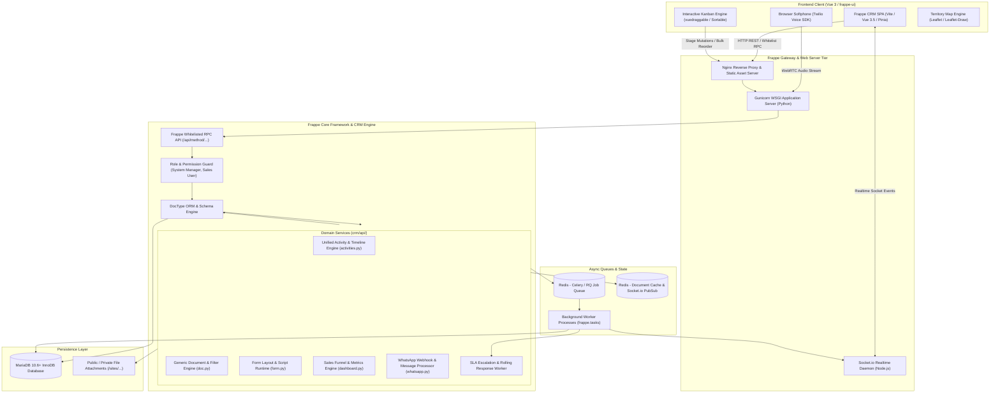
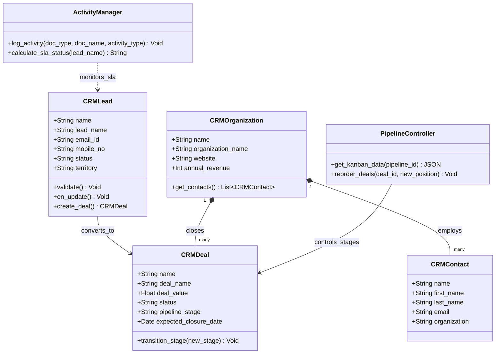
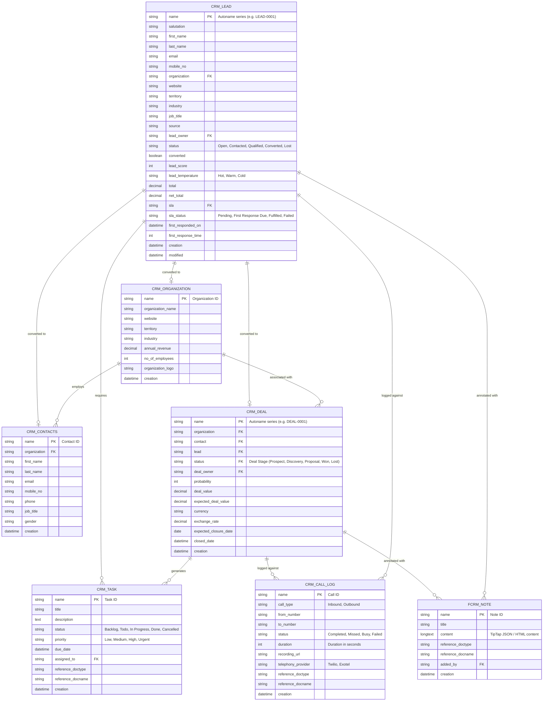
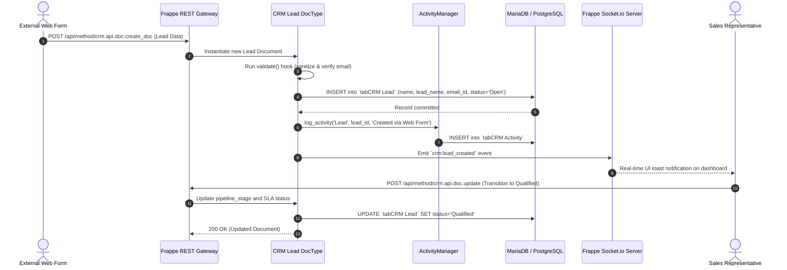

# crm (Frappe CRM) - Architecture & Technical Wiki

> **Modern Open-Source CRM Engineered on the Frappe Framework, Python & Reactive Vue 3**  
> GitHub: [frappe/crm](https://github.com/frappe/crm.git) | Stack: Python 3.10+, Frappe Framework, MariaDB 10.6+, Redis, Celery / RQ, Vue 3.5, Vite 8, TailwindCSS | License: AGPL-3.0

---

## 1. Executive Summary & Value Proposition

**crm** (commercially known as **Frappe CRM**) is a high-performance, modern open-source CRM developed by Frappe Technologies. Engineered to replace bloated, sluggish legacy CRM platforms, Frappe CRM couples the extensible Python-based Frappe Framework with a snappy, reactive Vue 3 Single-Page Application (`frappe-ui`). By treating customer interactions as a unified, real-time omnichannel timeline, Frappe CRM natively brings together email threads, WhatsApp messages, Twilio/Exotel VoIP telephony call recordings, internal notes, and SLA response tracking into a single view.

### Core Problems Solved
- **Sluggish Enterprise UI/UX**: Overcomes the friction of traditional multi-page enterprise software through an instantaneous, keyboard-friendly Vue 3 interface powered by Pinia and TailwindCSS.
- **SLA & Response-Time Breaches**: Implements built-in Service Level Agreements (SLAs) with automated first-response and rolling-response timers, preventing sales leads from going cold.
- **Fragmented Communication Silos**: Consolidates emails, WhatsApp chats, live phone calls, SMS, and team comments into a chronologically indexed activity stream.
- **Complex Schema Extensibility**: Leverages Frappe's declarative JSON DocType metadata system, allowing organizations to create custom fields, automated assignment rules, and territory geofences without modifying core code.
- **Omnichannel Telephony & Messaging**: Integrates browser-native VoIP calling via the Twilio Voice SDK and Exotel alongside bi-directional WhatsApp business messaging.

---

## 2. High-Level System Architecture

Frappe CRM is structured around a decoupled architecture where the Python Frappe backend manages metadata schemas (DocTypes), role-based permissions, database queries, and async queues, while the frontend is an independent Vite-bundled Vue 3 application interacting via REST APIs and Socket.io WebSockets.



---

### 2.1 Core Domain & Service Class Architecture



---

## 3. Technology Stack & Key Dependencies

- **Backend Language & Runtime**: Python 3.10+ (type hints, dataclasses, asynchronous workers)
- **Backend Framework**: Frappe Framework v15+ (metaprogramming, DocType ORM, hook system, background tasks)
- **Database & Storage**: MariaDB 10.6+ (InnoDB with UTF8MB4), Redis (caching, session store, Socket.io PubSub, RQ queues)
- **Asynchronous Task Processing**: Python RQ (Redis Queue) and Celery workers scheduled via `frappe.tasks` hooks
- **Real-Time Layer**: Socket.io (Node.js daemon) integrated via Frappe PubSub hooks for real-time document change broadcasts
- **Frontend Architecture**:
  - Framework: Vue 3.5+ (Composition API, `<script setup>`), Vite 8
  - UI Library: `frappe-ui` (1.0.0-rc.2), Headless UI (`@headlessui/vue`), TailwindCSS
  - State Management: Pinia 2.0+
  - Rich Text & Editors: TipTap 3.26 (`@tiptap/core`, `@tiptap/extension-paragraph`)
  - Drag-and-Drop: `vuedraggable` 4.1, `sortablejs` 1.15
  - Telephony & Audio: `@twilio/voice-sdk` 2.10
  - GIS & Mapping: `leaflet` 1.9, `leaflet-draw` 1.0 (territory polygon boundaries)

---

## 4. Repository Layout & Key Modules

```
crm/
├── crm/                              # Python backend application package
│   ├── api/                          # Whitelisted HTTP endpoints and business controllers
│   │   ├── activities.py             # Communication timeline, notes, call logs, WhatsApp, emails
│   │   ├── doc.py                    # Filterable query builder, bulk operations, linked documents
│   │   ├── form.py                   # Dynamic layouts, custom fields, form scripting hooks
│   │   ├── dashboard.py              # Sales analytics, pipeline conversion, SLA breach metrics
│   │   ├── whatsapp.py               # WhatsApp Cloud API and Twilio WhatsApp inbound/outbound
│   │   └── assignment_rule.py        # Automated round-robin lead distribution logic
│   ├── fcrm/                         # Core CRM module declarations
│   │   └── doctype/                  # JSON schema and Python controller classes
│   │       ├── crm_lead/             # CRM Lead (qualification, scoring, SLA timers)
│   │       ├── crm_deal/             # CRM Deal (sales pipeline stages, currency, products)
│   │       ├── crm_organization/     # B2B Companies / Accounts
│   │       ├── crm_contacts/         # People / Contacts linked to organizations
│   │       ├── crm_task/             # Follow-up tasks and calendar events
│   │       ├── fcrm_note/            # Internal collaborative notes with TipTap JSON
│   │       ├── crm_call_log/         # Inbound/outbound telephony call logs and recordings
│   │       └── crm_service_level_agreement/ # SLA definition, response targets, holidays
│   ├── hooks.py                      # Frappe event hooks, scheduled tasks, and app routing
│   ├── install.py                    # Database seeding, default pipelines, and initial roles
│   └── overrides/                    # Overrides for Frappe core DocTypes (User, Communication)
├── frontend/                         # Modern Vue 3 SPA frontend
│   ├── src/
│   │   ├── components/               # UI components (Kanban, Omnichannel Timeline, Lead Modal)
│   │   ├── views/                    # Top-level route views (Leads, Deals, Organizations, Settings)
│   │   ├── stores/                   # Pinia state stores (lead.js, deal.js, call.js)
│   │   └── utils/                    # Formatters, telephony handlers, and socket listeners
│   ├── package.json                  # Frontend dependencies and Vite configuration
│   └── vite.config.js                # Vite build config with base assets pathing
└── pyproject.toml                    # Python project configuration and package dependencies
```

---

## 5. Core Features & Capabilities

### 5.1 Dynamic Field Creation via Frappe DocType Engine
In Frappe CRM, entities are defined as JSON schemas within `crm/fcrm/doctype/`. Custom attributes can be provisioned through the administrative UI without requiring code deployments. The `crm_fields_layout` and `crm_form_script` DocTypes allow administrators to:
- Define dynamic fields (`Data`, `Select`, `Currency`, `Link`, `Check`, `Geolocation`).
- Insert custom client-side validation scripts that execute within the Vue form lifecycle.
- Set conditional display rules (e.g., reveal `Lost Reason` dropdown only when status transitions to `Lost`).

### 5.2 Interactive Sales Pipelines & Kanban Drag-and-Drop
Deals are organized into visual pipelines with customizable stages:
- The Vue frontend utilizes `vuedraggable` and `sortablejs` to enable smooth card reordering.
- Stage transitions trigger automated backend recalculations via `crm/api/doc.py`: updating probability weights, recalculating total stage value, and logging status changes in `crm_status_change_log`.
- Built-in multi-currency conversion dynamically computes deal amounts based on live exchange rates.

### 5.3 Automated Lead SLA & Rolling Response Tracking
Frappe CRM solves lead neglect through algorithmic SLA enforcement:
- **First Response Time**: Measures the duration from lead creation to the first outbound email, call, or WhatsApp message.
- **Rolling Response Time**: Tracks ongoing responsiveness (`crm_rolling_response_time`), checking whether inbound inquiries receive a reply within designated business hours.
- **Automated Escalation**: When an SLA timer expires, the `crm_service_level_agreement` daemon flags the lead as `SLA Failed` and notifies the sales manager via Socket.io.

### 5.4 Omnichannel Customer Timeline (`activities.py`)
Rather than isolating communications into disparate tabs, Frappe CRM computes a unified timeline feed by joining:
- Inbound/outbound emails synced from connected IMAP/SMTP accounts.
- WhatsApp chat messages received via webhooks (`whatsapp.py`).
- VoIP call recordings with in-browser audio players (`crm_call_log`).
- Internal team mentions and TipTap collaborative rich-text notes (`fcrm_note`).

### 5.5 Geographic Sales Territory Management
Using Leaflet and Leaflet Draw (`leaflet-draw`), Frappe CRM enables sales managers to draw spatial polygon boundaries on a map. When a lead or deal is created with geographic coordinates, spatial point-in-polygon queries automatically assign the record to the appropriate territorial sales team.

---

## 6. Data Models & Schema Architecture

Frappe CRM models relationships using Frappe's declarative `Link` and `Table` (child doctype) architecture.



### Core Schema Entity Details
1. **CRM Lead (`crm/fcrm/doctype/crm_lead/crm_lead.json`)**:
   - Primary key generated via `naming_series` (e.g. `CRM-LEAD-.YYYY.-.#####`).
   - Tracks engagement metrics: `lead_score`, `lead_temperature`, and `rolling_responses`.
   - Links directly to SLA management via `sla` and `sla_status`.
2. **CRM Deal (`crm/fcrm/doctype/crm_deal/crm_deal.json`)**:
   - `deal_value` and `expected_deal_value` (computed based on probability percentage).
   - Relational links to `organization`, `contact`, and source `lead`.
3. **Communication & Activity Logging**:
   - Polymorphic linking via `reference_doctype` (`CRM Lead`, `CRM Deal`, `CRM Organization`) and `reference_docname`.

---

### 6.1 Comprehensive Database Schema Specification

Frappe CRM persists data within MariaDB / PostgreSQL tables prefixed with `tab`, implementing document-level schema definitions via DocTypes.

#### Table: `tabCRM Lead`
Represents inbound prospective leads undergoing evaluation and SLA qualification.

| Column | Type | Constraints | Default | Description |
| :--- | :--- | :--- | :--- | :--- |
| `name` | `VARCHAR(140)` | `PRIMARY KEY` | - | Unique Frappe document ID (e.g. `LEAD-2026-0001`) |
| `lead_name` | `VARCHAR(140)` | `NOT NULL` | - | Prospect full contact name |
| `email_id` | `VARCHAR(140)` | `NULLABLE` | `NULL` | Prospect business email |
| `mobile_no` | `VARCHAR(50)` | `NULLABLE` | `NULL` | Primary phone number |
| `company_name` | `VARCHAR(140)` | `NULLABLE` | `NULL` | Prospective employer company |
| `status` | `VARCHAR(50)` | `NOT NULL` | `'Open'` | State (`Open`, `Contacted`, `Qualified`, `Lost`) |
| `territory` | `VARCHAR(140)` | `NULLABLE` | `NULL` | Sales territory region |
| `sla_status` | `VARCHAR(50)` | `NOT NULL` | `'Within SLA'`| Response SLA indicator (`Within SLA`, `Breached`) |
| `creation` | `DATETIME(6)` | `NOT NULL` | `NOW()` | Record creation timestamp |
| `modified` | `DATETIME(6)` | `NOT NULL` | `NOW()` | Document update timestamp |

*Indexes:* `idx_lead_email` (`(email_id)`), `idx_lead_status` (`(status)`).

---

#### Table: `tabCRM Deal`
Commercial opportunities progressing through defined pipeline stages.

| Column | Type | Constraints | Default | Description |
| :--- | :--- | :--- | :--- | :--- |
| `name` | `VARCHAR(140)` | `PRIMARY KEY` | - | Unique deal ID (e.g. `DEAL-2026-0001`) |
| `deal_name` | `VARCHAR(140)` | `NOT NULL` | - | Commercial deal title |
| `deal_value` | `DECIMAL(18, 6)`| `NOT NULL` | `0.000000`| Contract value |
| `currency` | `VARCHAR(10)` | `NOT NULL` | `'USD'` | Transaction currency code |
| `pipeline_stage`| `VARCHAR(140)` | `NOT NULL` | `'Prospecting'`| Active Kanban column stage |
| `organization` | `VARCHAR(140)` | `NULLABLE` | `NULL` | Target organization document link |
| `expected_closure_date`| `DATE` | `NULLABLE` | `NULL` | Forecast close target date |
| `probability` | `DECIMAL(5, 2)` | `NOT NULL` | `0.00` | Percentage win probability |

*Indexes:* `idx_deal_stage` (`(pipeline_stage)`), `idx_deal_org` (`(organization)`).

---

## 7. API Architecture, Webhooks & Key Endpoints

Frappe CRM utilizes Frappe’s Remote Procedure Call (RPC) mechanism (`@frappe.whitelist()`). Endpoints are accessed via `/api/method/<python_module_path>` and accept session cookies, API Secret headers (`Authorization: token <api_key>:<api_secret>`), or Bearer tokens.

### Key Endpoints

| HTTP Method | Endpoint | Description |
|:---|:---|:---|
| `POST` | `/api/method/crm.api.doc.get_data` | Filter and paginate CRM records with sorting, field projections, and quick filters |
| `POST` | `/api/method/frappe.client.insert` | Create a new record (DocType instance) |
| `POST` | `/api/method/frappe.client.set_value` | Update specific field values on an existing record |
| `GET` | `/api/method/crm.api.activities.get_activities` | Fetch chronological communication timeline for a record |
| `POST` | `/api/method/crm.api.activities.add_note` | Add a collaborative note to a lead or deal |
| `POST` | `/api/method/crm.api.whatsapp.send_message` | Send outbound WhatsApp template or freeform chat |
| `GET` | `/api/method/crm.api.dashboard.get_deal_funnel` | Retrieve aggregate conversion metrics for the sales funnel |
| `POST` | `/api/method/crm.api.doc.delete_bulk_docs` | Bulk delete records with cascading link cleanups |

### Sample Request: Query Leads (`POST /api/method/crm.api.doc.get_data`)
```json
{
  "doctype": "CRM Lead",
  "fields": [
    "name",
    "first_name",
    "last_name",
    "email",
    "organization",
    "status",
    "lead_score",
    "sla_status"
  ],
  "filters": [
    ["CRM Lead", "status", "!=", "Lost"],
    ["CRM Lead", "lead_score", ">=", 50]
  ],
  "order_by": "modified desc",
  "page_length": 20
}
```

### Sample Response: Query Leads
```json
{
  "message": {
    "rows": [
      {
        "name": "CRM-LEAD-2026-00142",
        "first_name": "Marcus",
        "last_name": "Vance",
        "email": "m.vance@apexcloud.io",
        "organization": "Apex Cloud Infrastructure",
        "status": "Qualified",
        "lead_score": 85,
        "sla_status": "Fulfilled",
        "_activity_counts": {
          "calls": 2,
          "emails": 4,
          "notes": 1
        }
      }
    ],
    "total_count": 1
  }
}
```

---

### 7.5 End-to-End Operational Lifecycle Sequence

The following sequence illustrates how Frappe REST endpoints process lead submissions, execute DocType lifecycle hooks, enforce SLA timing, and broadcast updates over Socket.io.



---

## 8. Strategic Value & Takeaways for MarketingStudio

### Reusable Architectural Patterns
1. **Algorithmic SLA & Response Time Engine**:
   - Frappe CRM demonstrates how to operationalize lead responsiveness. Instead of simply collecting leads, MarketingStudio should incorporate first-response timers and rolling SLA checkers (`first_response_time`, `sla_status`). If an inbound marketing inquiry is not claimed within a defined threshold (e.g. 15 minutes), the system automatically triggers an escalation webhook or reassigns the lead to an on-call SDR.
2. **Aggregated Multi-Channel Activity Feed**:
   - The unified timeline implementation in `activities.py` is an ideal architectural pattern for MarketingStudio. Rather than storing communications in isolated tables with independent query patterns, MarketingStudio should aggregate email events, WhatsApp messages, telephony recordings, form submissions, and marketing page views into a unified event projection.
3. **Decoupled Vue 3 + Pinia Single-Page Application**:
   - By breaking away from traditional server-rendered templates and implementing a decoupled Vite + Vue 3 architecture (`frappe-ui`), Frappe CRM achieves desktop-class responsiveness. MarketingStudio should leverage an optimistic client-side store pattern for its pipeline Kanban boards, ensuring cards move instantly while background syncing updates the database.
4. **Geographic Territory Boundaries via GeoJSON**:
   - The integration of Leaflet and spatial polygon coordinates directly inside the CRM gives sales teams geographic clarity. MarketingStudio can use this pattern to route marketing leads based on IP geolocation or postal code polygons directly to regional field sales teams.
