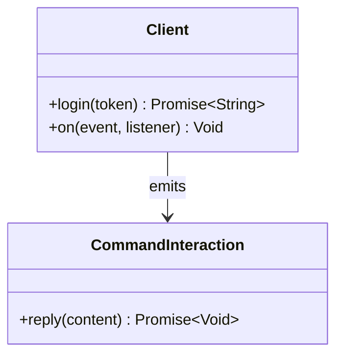
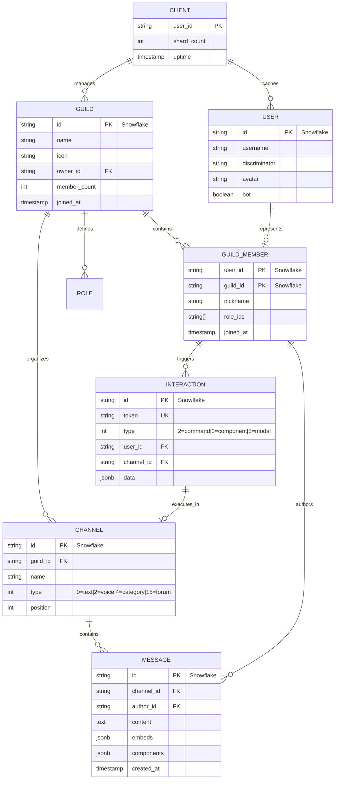
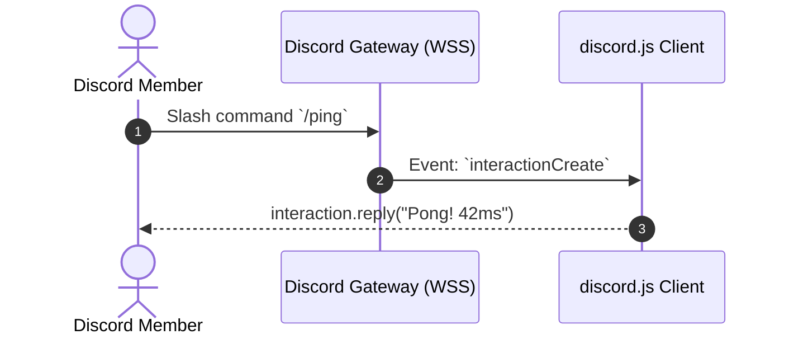

# discord.js - Architecture & Technical Wiki

> **Enterprise Object-Oriented Discord Gateway & REST Client Architecture in TypeScript**  
> GitHub: [discordjs/discord.js](https://github.com/discordjs/discord.js) | Stack: TypeScript, Node.js 18-22+, WebSocket Gateway v10, REST API v10, Sharding Manager, In-Memory Collections | License: Apache-2.0

---

## 1. Executive Summary & Value Proposition

**discord.js** is the most widely adopted and architecturally sophisticated JavaScript/TypeScript library for interfacing with the Discord API. Engineering a robust bridge over Discord's dual API surface—high-concurrency WebSocket Gateway event streams and HTTP REST endpoints—discord.js provides an object-oriented, strongly typed abstraction layer that powers millions of community bots, automated moderation systems, and enterprise conversational assistants.

By decomposing its monolithic codebase into modular packages (`@discordjs/ws`, `@discordjs/rest`, `@discordjs/builders`, `@discordjs/collection`, and `@discordjs/voice`), the framework achieves extreme architectural separation of concerns. It features an automated bucket-based rate-limiting engine, transparent WebSocket sharding across worker processes, aggressive in-memory caching with configurable TTL sweepers, and fluent declarative builders for Discord's interactive UI components (Buttons, Select Menus, Modals, Slash Commands).

### Core Problems Solved
- **High-Velocity WebSocket Stream Management**: Handles Discord Gateway v10 protocol requirements (heartbeating, payload zlib compression, sequence tracking, and seamless session resumption upon disconnect) across millions of concurrent guilds.
- **Hierarchical Sharding Across Processes**: Implements `ShardingManager`, distributing guild workloads across multiple V8 worker threads or separate child processes to bypass Node.js single-thread memory limits.
- **Complex Bucket-Based HTTP Rate Limiting**: Discord enforces route-specific and global rate limit buckets with dynamic headers (`X-RateLimit-Bucket`, `X-RateLimit-Reset-After`). `@discordjs/rest` manages sequential sub-queues per bucket hash, preventing HTTP 429 penalties.
- **Memory Bloat in Large Guilds**: Provides granular `GatewayIntentBits` and automated cache sweepers (`Sweepers`), allowing bots to prune inactive messages, threads, and offline member objects while maintaining sub-millisecond lookups via `@discordjs/collection`.
- **Component & Modal Interactivity**: Unifies Application Commands (Slash Commands, User Context Menus, Message Context Menus) and UI Component interactions into a typed, event-driven interaction lifecycle with guaranteed 3-second acknowledgement deadlines.

---

## 2. High-Level System Architecture

discord.js is organized as a layered monorepo governed by pnpm and Turborepo. Lower-level protocol packages (`@discordjs/ws` and `@discordjs/rest`) operate independently from the high-level object-oriented runtime (`discord.js`).

```mermaid
flowchart TD
    subgraph DiscordCloud ["Discord Cloud Infrastructure"]
        GatewayCloud["Discord Gateway (WebSocket WSS v10)"]
        RESTCloud["Discord REST API (HTTPS v10)"]
        CDNCloud["Discord CDN (Media, Avatars, Emojis)"]
    end

    subgraph ShardingLayer ["Sharding & Process Management"]
        ShardingManager["ShardingManager (Cluster / Worker Threads)"]
        Shard0["Shard Process 0"]
        Shard1["Shard Process 1"]
    end

    subgraph CoreClientRuntime ["discord.js Client Runtime (Shard Worker)"]
        ClientInstance["Client (discord.js)"]

        subgraph WSGatewayStack ["@discordjs/ws (Gateway Connection)"]
            WebSocketManager["WebSocketManager"]
            HeartbeatLoop["Heartbeat / ACK Monitor"]
            PayloadParser["Zlib Decompressor & Dispatcher"]
        end

        subgraph RESTStack ["@discordjs/rest (HTTP Engine)"]
            RESTManager["REST Client (RESTManager)"]
            BucketQueues["Sequential Bucket Rate Limiter"]
            UndiciClient["Undici / Fetch HTTP Dispatcher"]
        end

        subgraph CacheAndManagers ["State Management & Caching"]
            CollectionCache["@discordjs/collection (LRU / Map)"]
            SweeperScheduler["Cache Sweeper Scheduler"]
            GuildManager["GuildManager & ChannelManager"]
            UserManager["UserManager & MemberManager"]
        end

        subgraph InteractionDispatch ["Interaction & Event Subsystem"]
            EventDispatcher["Client Event Emitter (on('interactionCreate'))"]
            CommandHandlers["Application Command Handlers"]
            ModalHandlers["Modal & Component Interaction Handlers"]
        end
    end

    GatewayCloud <-->|WSS Encrypted Frames| WebSocketManager
    RESTCloud <-->|HTTPS API Calls| UndiciClient
    CDNCloud <--|Media Requests| RESTManager

    ShardingManager --> Shard0
    ShardingManager --> Shard1
    Shard0 --> ClientInstance

    WebSocketManager --> HeartbeatLoop
    WebSocketManager --> PayloadParser
    PayloadParser -->|Raw Gateway Dispatch| ClientInstance

    ClientInstance --> EventDispatcher
    EventDispatcher --> InteractionDispatch
    InteractionDispatch --> CommandHandlers
    InteractionDispatch --> ModalHandlers

    ClientInstance --> CacheAndManagers
    CacheAndManagers --> CollectionCache
    SweeperScheduler --> CollectionCache

    CommandHandlers -->|REST Action (reply, defer)| RESTManager
    RESTManager --> BucketQueues
    BucketQueues --> UndiciClient
```

### Architectural Data Flow Narrative
1. **Sharding Initialization**: When scaled across thousands of servers, `ShardingManager` queries Discord for the recommended shard count and spawns child processes or worker threads, assigning each a discrete shard ID range.
2. **Gateway Handshake & Heartbeat**: Inside each worker, `@discordjs/ws` establishes a secure WebSocket connection. It sends the `Identify` packet containing authorized `GatewayIntentBits`, receives the `Ready` event, stores the `session_id`, and begins the continuous periodic heartbeat loop to detect connection drops.
3. **Event Ingestion & Cache Hydration**: Inbound gateway events (e.g., `GUILD_CREATE`, `MESSAGE_CREATE`, `INTERACTION_CREATE`) are decompressed and dispatched to the `Client`. The data is converted into rich domain structures (`Guild`, `TextChannel`, `Message`, `GuildMember`) and stored in in-memory `Collection` maps.
4. **Interaction Handling & Ack Deadlines**: When a user runs a slash command or submits a modal, Discord emits an `INTERACTION_CREATE` event. The bot must acknowledge within 3,000 milliseconds (`interaction.deferReply()` or `interaction.reply()`), failing which the token expires.
5. **REST Dispatch with Bucket Rate Limiting**: All outbound mutations (sending messages, modifying channels, editing permissions) pass through `@discordjs/rest`. The client identifies the route's rate-limit bucket hash, queues the request in a FIFO queue for that specific bucket, and releases it sequentially according to Discord's HTTP header counters.

---

### 2.1 Core Domain & Service Class Architecture



---

## 3. Technology Stack & Key Dependencies

- **Language & Runtime**: TypeScript 5.4+, Node.js 18.0.0+ / 20+ / 22+ (Native ES Modules and CommonJS dual distribution)
- **Monorepo Architecture**: pnpm workspaces with Turborepo 2.3+ (`turbo.json`), ESLint, Prettier, API Extractor
- **Core Internal Monorepo Packages**:
  - `discord.js` (14.16.3): High-level client, rich classes, managers, and event emitters
  - `@discordjs/ws`: Standalone RFC 6455 WebSocket gateway client with automatic failover and reconnect logic
  - `@discordjs/rest`: Standalone HTTP REST client with bucket-hash rate-limit queueing
  - `@discordjs/builders`: Type-safe fluent builders for Slash Commands, Embeds, Buttons, Select Menus, and Modals
  - `@discordjs/collection`: Ultra-fast data structure extending JavaScript's native `Map` with utility algorithms (`filter`, `map`, `find`, `sweep`, `partition`)
  - `@discordjs/voice`: Complete WebRTC audio implementation for voice channels with Opus encryption
  - `@discordjs/core`: Headless REST-first client for serverless environments
- **External Dependencies**:
  - `ws` (8.18+): High-performance Node.js WebSocket library
  - `undici` / native fetch: High-throughput HTTP/1.1 and HTTP/2 client
  - `discord-api-types`: Canonical TypeScript typings for Discord API v10

---

## 4. Repository Layout & Key Modules

```
discord.js/
├── apps/                              # Internal documentation and web apps
├── packages/                          # Decoupled modular libraries
│   ├── builders/                      # Declarative builders for slash commands & UI components
│   │   └── src/components/            # ActionRow, Button, StringSelect, Modal builders
│   ├── collection/                    # Extended ES6 Map utility class (@discordjs/collection)
│   ├── core/                          # Lightweight headless gateway and REST abstractions
│   ├── discord.js/                    # Main object-oriented framework package
│   │   ├── src/client/                # Client class, ClientOptions, BaseClient
│   │   ├── src/managers/              # Data managers (GuildManager, UserManager, MessageManager)
│   │   ├── src/structures/            # Domain classes (Guild, Channel, Message, Interaction)
│   │   └── typings/                   # Comprehensive TypeScript definitions (index.d.ts)
│   ├── rest/                          # HTTP client and bucket rate-limit queue engine
│   │   ├── src/lib/RequestManager.ts  # Bucket hashing and request queuing logic
│   │   └── src/lib/CDN.ts             # Discord CDN URL builder
│   ├── voice/                         # WebRTC audio connections and player state machines
│   └── ws/                            # Discord Gateway WebSocket connection manager
│       ├── src/client/WebSocketManager.ts  # Shard lifecycle and reconnection coordinator
│       └── src/strategies/            # Worker thread and multi-process sharding strategies
├── package.json                       # Monorepo root manifest
├── pnpm-workspace.yaml                # Monorepo package workspace definitions
└── turbo.json                         # Turborepo task orchestration configuration
```

---

## 5. Core Features & Capabilities

### 5.1 Gateway Protocol & Resilient WebSocket Lifecycle
The `@discordjs/ws` package encapsulates the complex Discord Gateway v10 state machine:
- Manages opcode dispatch (`Opcode 1 Heartbeat`, `Opcode 2 Identify`, `Opcode 6 Resume`).
- In case of network disconnection, it captures the last received sequence number (`s`) and initiates a fast `Resume` handshake instead of a full `Identify`, avoiding redundant guild member streaming and state re-syncing.

### 5.2 Bucket-Based Sequential Rate Limiter (`@discordjs/rest`)
Unlike naive token-bucket or fixed-window limiters, Discord groups endpoints into dynamic server-assigned rate limit buckets identified by the `X-RateLimit-Bucket` header. `@discordjs/rest`:
- Maintains a hash map of route paths to bucket hashes.
- Dispatches requests through dedicated FIFO queues per bucket.
- Automatically suspends queue draining for a specific bucket when remaining tokens reach `0`, waking up precisely when `X-RateLimit-Reset-After` expires.
- Implements a global rate-limit lock that halts all outbound requests if Discord's global limit is hit.

### 5.3 In-Memory Cache Optimization & Sweepers
Because caching thousands of guilds with hundreds of thousands of members can rapidly exhaust Node.js heap memory, discord.js provides fine-grained cache control:
- Developers configure `ClientOptions.sweepers` to automatically purge stale items based on time-to-idle or size thresholds (e.g., pruning cached messages older than 30 minutes, sweeping offline members).
- Gateway intents can be strictly scoped (`GatewayIntentBits.Guilds | GatewayIntentBits.GuildMessages`), preventing Discord from transmitting unnecessary events over the socket.

### 5.4 Application Command & Slash Command Builders
Through `@discordjs/builders`, slash commands are authored with fluent, chainable TypeScript classes:

```typescript
import { SlashCommandBuilder } from "@discordjs/builders";

export const qualifyLeadCommand = new SlashCommandBuilder()
  .setName("qualify")
  .setDescription("Qualify an enterprise marketing prospect")
  .addStringOption(option =>
    option
      .setName("company")
      .setDescription("Target account company name")
      .setRequired(true)
  )
  .addIntegerOption(option =>
    option
      .setName("employees")
      .setDescription("Estimated employee headcount")
      .setRequired(true)
  );
```

### 5.5 Interactive Component & Modal Architecture
discord.js maps Discord's UI components into strongly typed classes:
- **`ActionRowBuilder`**: Top-level container hosting up to 5 buttons or 1 select menu.
- **`ButtonBuilder`**: Interactive clickable elements (`Primary`, `Secondary`, `Success`, `Danger`, `Link`).
- **`ModalBuilder`**: Native pop-up forms with `TextInputBuilder` fields, allowing multi-field data capture directly within the chat interface.

---

## 6. Data Models & Schema Architecture

discord.js maintains an object-oriented graph linking servers, channels, members, and conversations.



### Core Schema Attributes
- **Snowflakes (IDs)**: 64-bit integer strings conforming to Twitter Snowflake formatting, encoding timestamp, worker ID, and increment counter.
- **`Guild`**: The Discord server boundary. Encapsulates member rosters, channel trees, roles, and guild-level settings.
- **`Interaction`**: Ephemeral, token-authenticated transaction object. Contains the unique callback `token` required to send responses within the 3-second window.

---

### 6.1 Comprehensive Database Schema Specification

#### Table: `guild_settings`
| Column | Type | Constraints | Default | Description |
| :--- | :--- | :--- | :--- | :--- |
| `guild_id` | `VARCHAR(64)` | `PRIMARY KEY` | - | Discord Guild Snowflake |
| `prefix` | `VARCHAR(10)` | `NOT NULL` | `'!'` | Command prefix |

---

## 7. API Architecture, Webhooks & Key Endpoints

### 7.1 Slash Command Registration (`PUT /applications/:id/commands`)
Registers slash commands globally or per-guild using `@discordjs/rest`:

```typescript
import { REST, Routes } from "discord.js";

const rest = new REST({ version: "10" }).setToken(process.env.DISCORD_BOT_TOKEN!);

await rest.put(
  Routes.applicationGuildCommands(CLIENT_ID, GUILD_ID),
  { body: [qualifyLeadCommand.toJSON()] }
);
```

### 7.2 Handling Interaction Callbacks (`POST /interactions/:id/:token/callback`)
When an interaction arrives over the Gateway or HTTP webhook, discord.js sends an atomic response:

```json
// Interaction Response Payload (Modal Presentation)
{
  "type": 9,
  "data": {
    "custom_id": "modal_lead_intake",
    "title": "MarketingStudio SDR Intake Form",
    "components": [
      {
        "type": 1,
        "components": [
          {
            "type": 4,
            "custom_id": "field_budget",
            "label": "Annual Marketing Automation Budget",
            "style": 1,
            "min_length": 3,
            "max_length": 50,
            "placeholder": "$25,000+",
            "required": true
          }
        ]
      }
    ]
  }
}
```

### 7.3 Gateway Event Ingress Payload (`INTERACTION_CREATE`)
```json
{
  "t": "INTERACTION_CREATE",
  "s": 1420,
  "op": 0,
  "d": {
    "id": "1198765432109876543",
    "application_id": "1187654321098765432",
    "type": 2,
    "data": {
      "id": "1199001122334455667",
      "name": "qualify",
      "type": 1,
      "options": [
        { "name": "company", "type": 3, "value": "Acme Global" },
        { "name": "employees", "type": 4, "value": 250 }
      ]
    },
    "guild_id": "998877665544332211",
    "channel_id": "998877665544332222",
    "token": "a_unique_ephemeral_interaction_token_123456"
  }
}
```

---

### 7.5 End-to-End Operational Lifecycle Sequence



---

## 8. Strategic Value & Takeaways for MarketingStudio

### Reusable Architectural Patterns
1. **Dynamic Bucket-Based HTTP Rate Limiter**:  
   Discord's route-bucket rate-limiting architecture in `@discordjs/rest` is the premier industry pattern for handling external APIs that use per-resource rate limits. MarketingStudio can adapt this exact pattern to prevent 429 throttling across its outbound CRM, email, and social messaging integrations.

2. **In-Memory Collection Caching with Sweepers**:  
   The `@discordjs/collection` sweeper model provides a clean blueprint for managing high-volume, short-lived marketing conversation data in memory. Ephemeral prospect sessions can be kept hot in RAM and automatically evicted after inactivity to conserve infrastructure costs.

3. **Structured Native Modal Dialogues for Lead Capture**:  
   Instead of forcing prospects through tedious multi-turn back-and-forth chat prompts, leveraging Discord's native UI Modals (`ModalBuilder`) allows MarketingStudio's Discord integrations to capture structured B2B qualification data (budget, timeline, company size) in a single interactive form.

4. **Gateway Intent Scoping for Low-Bandwidth Operation**:  
   Selecting only necessary event intents (`Guilds`, `GuildMessages`) saves up to 90% of bandwidth and compute resources compared to listening to unneeded presence and typing updates—a vital strategy when scaling marketing bot fleets.
