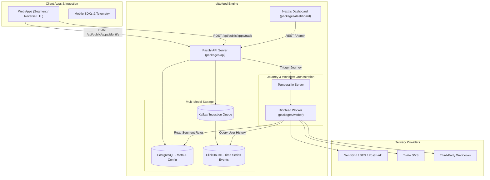
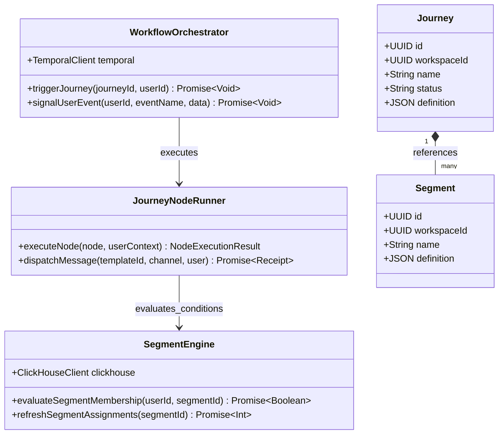
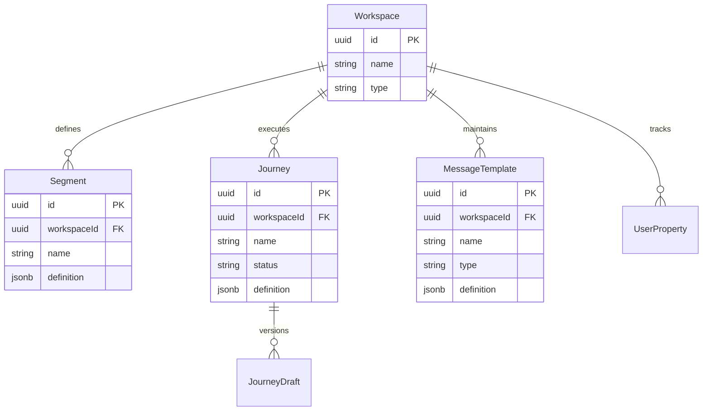
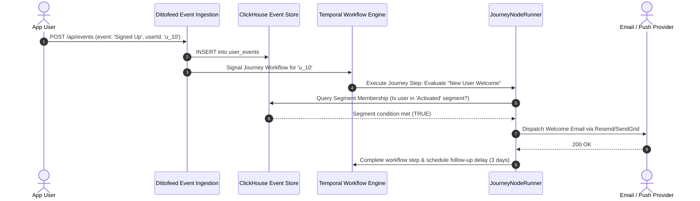

# dittofeed - Architecture & Technical Wiki

> **Open-Source Omnichannel Customer Engagement & Event-Driven Journey Platform**
> GitHub: [dittofeed/dittofeed](https://github.com/dittofeed/dittofeed.git) | Stack: TypeScript, Fastify, Next.js, Temporal.io, ClickHouse, PostgreSQL | License: MIT

---

## 1. Executive Summary & Value Proposition

**dittofeed** is a modern, event-driven customer engagement platform engineered as an open-source alternative to Customer.io, Braze, and Segment. It enables marketing and growth teams to track user events across web and mobile apps, define dynamic customer segments, and trigger multi-channel user journeys (Email, SMS, Push, Webhook) with extreme temporal durability.

### Core Problems Solved
- **Event-Driven Journey Orchestration**: Seamlessly execute branching customer workflows that wait for specific user actions (e.g., "Wait 3 days OR until user creates a project").
- **Extreme Durability with Temporal**: Uses Temporal.io to manage long-running workflow state, guaranteeing zero lost journeys even across server crashes and redeployments.
- **High-Velocity Event Ingestion**: Couples ClickHouse for massive, append-only time-series analytics with PostgreSQL for relational workspace metadata.
- **Segment-Level Dynamic Triggers**: Continuously evaluates user traits and event frequency to automatically enter or exit users from engagement funnels.

---

## 2. High-Level System Architecture

dittofeed's architecture is built around three complementary engines: an event ingestion API, a ClickHouse analytics warehouse, and a Temporal workflow worker engine.



---

### 2.1 Core Domain & Service Class Architecture



---

## 3. Technology Stack & Key Dependencies

- **Language**: TypeScript (Node.js 20+)
- **API Framework**: Fastify (high-throughput JSON routing)
- **Frontend Dashboard**: Next.js, React, TailwindCSS, Shadcn UI
- **Databases**:
  - ClickHouse (analytical database for user event streams and segment calculation)
  - PostgreSQL (relational database for users, journeys, templates, segments)
- **Workflow Orchestration**: Temporal.io (fault-tolerant workflow executions)
- **ORM**: Prisma for PostgreSQL queries
- **Message Broker**: Apache Kafka or native queue for high-volume ingest

---

## 4. Repository Layout & Key Modules

```
dittofeed/
├── packages/
│   ├── admin-cli/           # CLI tool for database migrations and tenant ops
│   ├── api/                 # Fastify HTTP ingestion & management API
│   ├── backend-lib/         # Shared domain logic, ClickHouse queries, Prisma models
│   │   ├── src/
│   │   │   ├── segments.ts  # Segment evaluation SQL generators
│   │   │   ├── journeys.ts  # Journey step transition logic
│   │   │   └── clickhouse.ts# ClickHouse connection pool & event queries
│   ├── dashboard/           # Next.js web application for marketers
│   ├── emailo/              # Email template parser and compiler
│   ├── isomorphic-lib/      # Universal types and validation schemas
│   ├── lite/                # SQLite/single-node local testing build
│   └── worker/              # Temporal workflow workers and BullMQ runners
├── docker-compose.yaml      # Complete multi-service development compose
└── helm-charts/             # Kubernetes production deployment charts
```

---

## 5. Core Features & Capabilities

1. **Visual Customer Journey Canvas**:
   - Multi-node journeys: Message Node, Delay Node (wait N hours/days), Wait Until Event Node (e.g. wait up to 7 days for `checkout_completed`), Branch/Split Node.
2. **Real-Time Segment Calculation**:
   - Generates optimized ClickHouse SQL to compute whether a user matches traits (`user.plan == 'pro'`) or behavior (`user performed 'signed_in' >= 3 times in last 7 days`).
3. **Multi-Channel Message Dispatch**:
   - Email (SendGrid, AWS SES, Postmark, Resend, SMTP).
   - SMS (Twilio).
   - Custom Webhook triggers (syncing back to CRM or triggering internal microservices).
4. **Subscription Center & Frequency Capping**:
   - Manage opt-in channels per user and prevent email fatigue through sending limits.

---

## 6. Data Models & Schema Architecture

dittofeed's relational model in `packages/backend-lib/prisma/schema.prisma` coordinates with ClickHouse tables:



---

### 6.1 Comprehensive Database Schema Specification

Dittofeed uses PostgreSQL for operational configurations and ClickHouse for high-scale event processing.

#### Table: `journeys`
| Column | Type | Constraints | Default | Description |
| :--- | :--- | :--- | :--- | :--- |
| `id` | `UUID` | `PRIMARY KEY` | `gen_random_uuid()` | Journey ID |
| `workspace_id` | `UUID` | `NOT NULL` | - | Workspace isolation |
| `name` | `VARCHAR(255)` | `NOT NULL` | - | Campaign journey name |
| `status` | `VARCHAR(50)` | `NOT NULL` | `'Draft'` | State (`Draft`, `Running`, `Paused`) |
| `definition` | `JSONB` | `NOT NULL` | `'{}'` | Visual flow nodes & edges |

*Indexes:* `idx_journeys_workspace` (`(workspace_id)`).

---

#### Table: `segments`
| Column | Type | Constraints | Default | Description |
| :--- | :--- | :--- | :--- | :--- |
| `id` | `UUID` | `PRIMARY KEY` | `gen_random_uuid()` | Segment ID |
| `workspace_id` | `UUID` | `NOT NULL` | - | Workspace ID |
| `name` | `VARCHAR(255)` | `NOT NULL` | - | Segment title |
| `definition` | `JSONB` | `NOT NULL` | `'{}'` | Behavioral filter criteria |

*Indexes:* `idx_segments_workspace` (`(workspace_id)`).

---

## 7. API Architecture & Key Endpoints

dittofeed exposes Segment-compatible event tracking APIs:

- `POST /api/public/apps/identify`: Associate user attributes and traits:
  ```json
  {
    "userId": "usr_9918",
    "traits": {
      "email": "sarah@techcorp.io",
      "plan": "growth",
      "company": "TechCorp"
    }
  }
  ```
- `POST /api/public/apps/track`: Ingest behavioral events:
  ```json
  {
    "userId": "usr_9918",
    "event": "Project Created",
    "properties": { "template": "nextjs", "teamSize": 4 }
  }
  ```

---

### 7.5 End-to-End Operational Lifecycle Sequence



---

## 8. Strategic Value & Takeaways for MarketingStudio

### Reusable Architectural Patterns
1. **Temporal for Resilient Journeys**: Using Temporal workflows ensures that complex multi-week marketing automations never lose state or double-send if a pod restarts.
2. **Dual-Store Architecture (Postgres + ClickHouse)**: Keep relational metadata in PostgreSQL while streaming millions of tracking events into ClickHouse for instantaneous segment evaluation.
3. **Segment-Compatible Ingestion Schema**: Support `identify` and `track` payloads so MarketingStudio can drop into any application with zero code rewrite.
