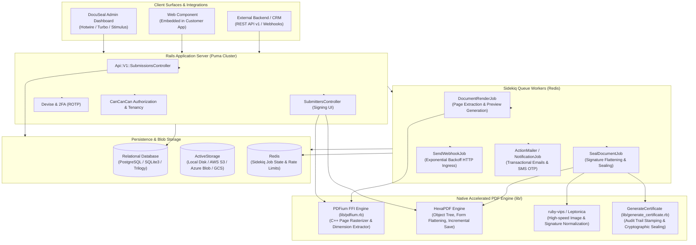
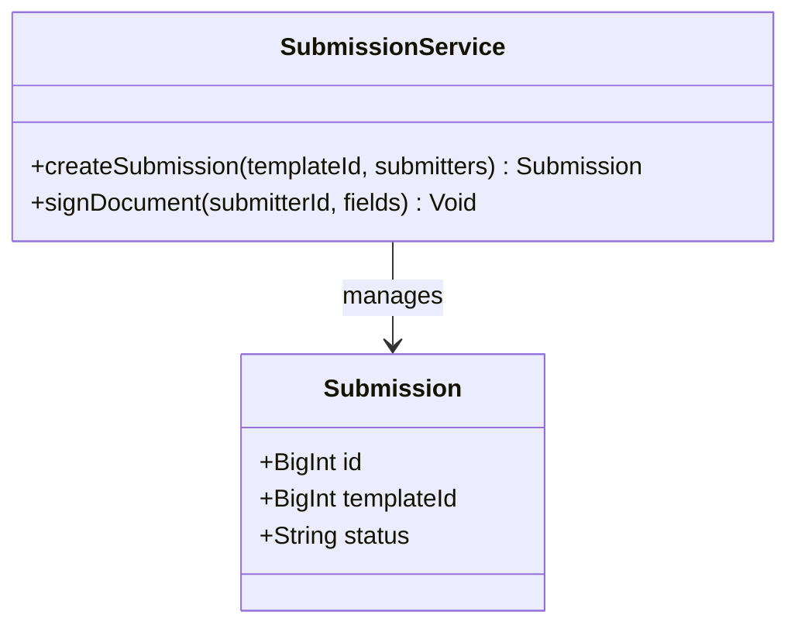
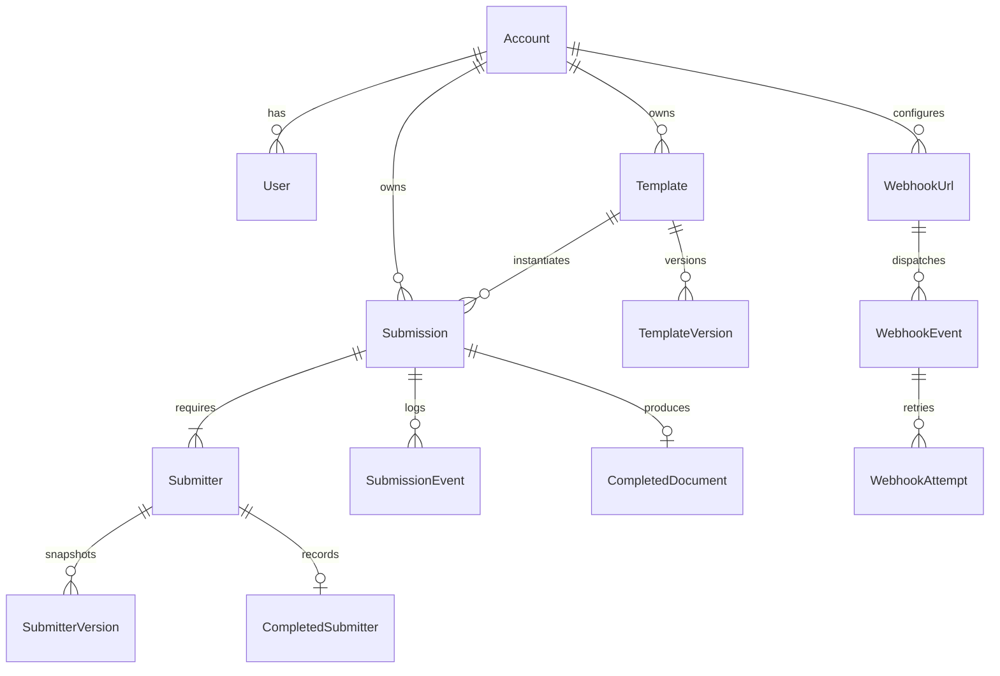
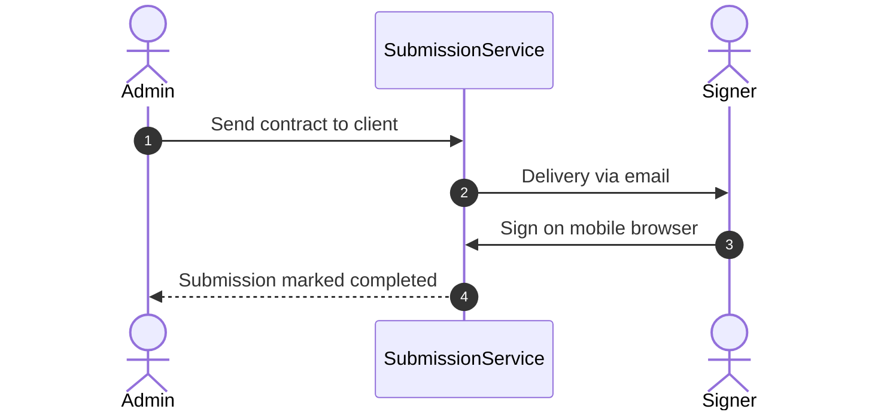

# docuseal - Architecture & Technical Wiki

> **High-Performance Open-Source Document Signing Platform, Embedded Web Components & Native PDFium Digital Sealing Engine**  
> GitHub: [docuseal/docuseal](https://github.com/docuseal/docuseal.git) | Stack: Ruby on Rails, Puma, Sidekiq, PostgreSQL / SQLite / MySQL, HexaPDF, PDFium (C++ FFI), ruby-vips, onnxruntime, Tailwind CSS | License: AGPL-3.0 (with Additional Terms)

---

## 1. Executive Summary & Value Proposition

**docuseal** is an ultra-fast, developer-centric open-source document signing engine and e-signature platform built with Ruby on Rails. Engineered for deep embedding and high-throughput document processing, DocuSeal allows businesses to integrate mobile-first, zero-friction contract signing into web applications, SaaS platforms, and mobile apps via native HTML custom web components (`<docuseal-form>`).

Traditional e-signature providers impose cumbersome multi-step redirect flows, slow heavy browser viewers, and expensive API consumption costs. DocuSeal overcomes these bottlenecks by combining a lightweight Rails application architecture, FFI-accelerated C++ PDF rendering via Google's PDFium, pure-Ruby cryptographic PDF manipulation via HexaPDF, and an embeddable client library that renders contracts directly inline with instant signature capture.

### Core Problems Solved
- **Clunky External Redirects & Drop-Off Rates**: Replaces external signing portals with an embeddable, customizable `<docuseal-form>` custom element that fits natively into existing user checkouts, onboarding funnels, and customer portals.
- **High Document Rendering & Flattening Latency**: Replaces slow headless browser PDF rendering with native C++ PDFium FFI bindings, executing page rasterization, text extraction, and thumbnail generation at native hardware speeds.
- **Complex Multi-Party Signing Dependencies**: Supports multi-role submitter chains with conditional fields, sequential or concurrent signing sequences, phone/SMS verification, and automatic reminder cadences.
- **Dynamic Variable-Driven Document Templating**: Enables programmatic generation of contracts from HTML/CSS templates or existing fillable PDFs with dynamic field interpolation prior to signing.
- **Comprehensive Audit Log & Cryptographic Verification**: Automatically attaches a tamper-evident Certificate of Completion to finalized documents and validates cryptographic signatures via X.509 certificates.

---

## 2. High-Level System Architecture

DocuSeal is structured around a high-performance Ruby on Rails core paired with Puma application servers, Sidekiq Redis workers, native C-libraries via FFI (`pdfium.rb`, `leptonica.rb`), and ActiveStorage.



### Document Ingestion & Execution Pipeline
1. **Template & Document Ingestion**: A PDF is uploaded via the UI or REST API. ActiveStorage saves the binary while `DocumentRenderJob` executes `PDFium` to extract page counts, aspect ratios, and generate WebP/PNG preview thumbnails.
2. **Field Schema Configuration**: Fields are defined in normalized coordinate bounds and assigned to specific submitter roles (e.g., "Buyer", "Vendor").
3. **Submission Instantiation**: An API call creates a `Submission` with child `Submitters`. Unique, signed URL tokens (`slug`) are issued for each signer.
4. **Interactive Signing**: The signer interacts through the embedded `<docuseal-form>` web component or mobile web UI. Real-time client inputs (drawn signatures, uploaded signature images, typed names) are sent via JSON.
5. **Sealing & Verification**: Sidekiq initiates `SealDocumentJob`. `HexaPDF` flattens form fields into PDF stream objects, `ruby-vips` scales signature bitmaps, `GenerateCertificate` renders a final audit sheet with SHA-256 digests, and the final completed artifact is archived to S3.

---

### 2.1 Core Domain & Service Class Architecture



---

## 3. Technology Stack & Key Dependencies

| Component | Technology | Role & Details |
|---|---|---|
| **Language & Framework** | Ruby 4.0.5 / 3.x, Ruby on Rails 7.x/8.x | Robust MVC application architecture with rapid JSON API routing |
| **App Server** | Puma | Multi-threaded, multi-process web server optimized for high concurrency |
| **Worker Queue** | Sidekiq, Redis | Fault-tolerant async background jobs for document rendering and webhooks |
| **Database Support** | PostgreSQL, SQLite3, Trilogy (MySQL) | Flexible multi-database support with standard ActiveRecord migrations |
| **PDF Manipulation** | HexaPDF, pdf_utils | High-performance pure-Ruby PDF manipulation, encryption, and object assembly |
| **Native Rendering Engine** | Google PDFium (via Ruby FFI) | Ultra-fast native C++ rendering of PDF pages to high-resolution bitmaps |
| **Image Processing** | `ruby-vips`, `leptonica.rb` | Low-memory raster processing for signature normalization and stamps |
| **AI / Machine Learning**| `onnxruntime` | On-device machine learning models for field detection and document analysis |
| **Auth & Security** | Devise, Devise-Two-Factor, ROTP | Password hashing, account recovery, session cookies, and TOTP 2FA |
| **Embedded Client** | Custom Elements (Web Components) | Framework-agnostic `<docuseal-form>` for React, Vue, Angular, or vanilla JS |

---

## 4. Repository Layout & Key Modules

```text
inspire/docuseal/
├── app/
│   ├── controllers/
│   │   ├── api/v1/                  # REST API controllers (submissions, templates, submitters)
│   │   ├── submissions_controller.rb # Submission lifecycle and status management
│   │   └── submitters_controller.rb  # Public signing page rendering and signature submission
│   ├── models/
│   │   ├── account.rb               # Tenant accounts and multi-user team boundaries
│   │   ├── template.rb              # Document templates, schemas, and default field layouts
│   │   ├── submission.rb            # Active signing instances connecting templates to submitters
│   │   ├── submitter.rb             # Individual signer state, field values, and tokens
│   │   ├── completed_document.rb    # Final sealed PDF files and checksum references
│   │   └── webhook_url.rb           # Outbound webhook registrations and HMAC signing
│   ├── jobs/                        # Sidekiq async jobs: document rendering, sealing, mailers
│   └── views/                       # Hotwire/ERB templates for dashboard and email templates
├── lib/
│   ├── pdfium.rb                    # Native FFI bindings to Google PDFium C++ library
│   ├── generate_certificate.rb      # Audit trail PDF certificate generator
│   ├── verify_pdf_signature.rb      # Cryptographic signature validation utilities
│   ├── submissions.rb               # Domain logic for submission state transitions
│   └── submitters.rb                # Signature validation, IP capture, and status updates
├── db/
│   └── schema.rb                    # Canonical ActiveRecord database schema
└── public/
    └── js/form.js                   # Client-side embeddable <docuseal-form> web component
```

---

## 5. Core Features & Capabilities

### 5.1 Native PDFium FFI Hardware-Accelerated Rendering
Rather than executing resource-intensive headless Chrome instances (e.g. Puppeteer) to convert PDF pages into preview images, DocuSeal uses direct C-bindings to Google's **PDFium** library (`lib/pdfium.rb`). This allows instant millisecond-level page rasterization, text bounding-box extraction, and viewport zoom rendering with minimal RAM usage.

### 5.2 Framework-Agnostic Embeddable `<docuseal-form>`
DocuSeal includes a lightweight custom HTML web component (`<docuseal-form src="...">`). Developers can embed live signing workflows into any React, Vue, Angular, or vanilla HTML frontend with two lines of code, capturing signature callbacks via browser events (`onComplete`, `onInit`).

### 5.3 Dynamic HTML & PDF Template Engine
DocuSeal allows users to upload pre-built PDFs or define dynamic HTML contracts with liquid-style variables (e.g., `{{ customer.company_name }}`). The dynamic document pipeline compiles HTML into PDF documents on the fly and auto-positions signature fields based on embedded CSS markers.

### 5.4 Multi-Submitter Workflows & SMS/OTP Verification
Submissions support sequential and parallel signing orders. To satisfy enterprise compliance and high-trust agreements, submitters can be forced to authenticate via SMS One-Time Passwords (OTP) or email challenge tokens before unlocking document access.

### 5.5 Immutable Completion Certificate & Digital Signatures
Upon the completion of all submitter steps, `generate_certificate.rb` dynamically creates and appends an audit certificate page to the document. The certificate details the unique Submission ID, document SHA-256 hash, IP addresses, geolocations, and cryptographic timestamp signatures of all signers.

---

## 6. Data Models & Schema Architecture

DocuSeal's schema is structured around accounts, templates, versions, submissions, submitters, and audit events in ActiveRecord.



### Core Schema Table Definitions

#### `accounts` (`accounts`)
- `id` (`bigint`, PK): Unique account identifier.
- `name` (`varchar`): Account/company display name.
- `subdomain` (`varchar`, unique): Custom tenant routing subdomain.
- `configs` (`jsonb` / `text`): Tenant configuration (branding, email logos, custom sender names).

#### `templates` (`templates`) & `template_versions`
- `id` (`bigint`, PK): Template ID.
- `account_id` (`bigint`, FK): Owning account.
- `name` (`varchar`): Title of the template.
- `schema` (`jsonb`): Field definitions, coordinates, validation rules, and submitter role mappings.
- `documents` (`jsonb`): Attached source PDF file references.

#### `submissions` (`submissions`)
- `id` (`bigint`, PK): Unique submission identifier.
- `account_id` (`bigint`, FK): Owning account.
- `template_id` (`bigint`, FK): Source template.
- `status` (`varchar`): `pending`, `completed`, `expired`, `archived`.
- `audit_hash` (`varchar`): SHA-256 hash of the sealed audit record.
- `expire_at` (`datetime`): Expiration timestamp.

#### `submitters` (`submitters`)
- `id` (`bigint`, PK): Submitter record ID.
- `submission_id` (`bigint`, FK): Reference to parent `submissions`.
- `email` (`varchar`), `phone` (`varchar`): Signer contact details.
- `role` (`varchar`): Role matching template schema (e.g., `Client`, `Counterparty`).
- `status` (`varchar`): `sent`, `opened`, `completed`, `declined`.
- `slug` (`varchar`, unique): Secure unique signing URL token.
- `values` (`jsonb`): User-entered field inputs and signature image payloads.
- `ip` (`varchar`), `user_agent` (`text`): Signer client environment telemetry.

#### `completed_documents` (`completed_documents`)
- `id` (`bigint`, PK): Completed artifact ID.
- `submission_id` (`bigint`, FK): Reference to completed submission.
- `doc_hash` (`varchar`): Cryptographic SHA-256 digest of the finalized PDF binary.

---

### 6.1 Comprehensive Database Schema Specification

Docuseal stores templates, submitters, and completed submissions in PostgreSQL.

#### Table: `submissions`
| Column | Type | Constraints | Default | Description |
| :--- | :--- | :--- | :--- | :--- |
| `id` | `BIGINT` | `PRIMARY KEY AUTO_INCREMENT` | - | Submission ID |
| `status` | `VARCHAR(50)` | `NOT NULL` | `'pending'` | Status |
| `created_at` | `TIMESTAMP` | `NOT NULL` | `NOW()` | Timestamp |

---

## 7. API Architecture, Webhooks & Key Endpoints

DocuSeal provides a clean RESTful JSON API mounted under `/api/v1/*` authenticated via API keys (`X-Auth-Token`).

### Key API Endpoints

| Method | Endpoint | Description | Auth |
|---|---|---|---|
| `POST` | `/api/v1/submissions` | Create and send a new document submission | `X-Auth-Token` |
| `GET` | `/api/v1/submissions/:id` | Fetch submission status, submitter progress, and download URLs | `X-Auth-Token` |
| `PUT` | `/api/v1/submissions/:id` | Update submission metadata or expire prematurely | `X-Auth-Token` |
| `POST` | `/api/v1/templates` | Create a new document template from file or HTML | `X-Auth-Token` |
| `GET` | `/api/v1/templates/:id` | Retrieve template schema and field configurations | `X-Auth-Token` |
| `GET` | `/api/v1/submitters/:id` | Retrieve individual submitter signing link and state | `X-Auth-Token` |

### API Payload Example: Create Submission from Template
```http
POST /api/v1/submissions HTTP/1.1
Host: docuseal.internal.net
X-Auth-Token: ds_live_9f81a73b28c049e
Content-Type: application/json

{
  "template_id": 4201,
  "send_email": true,
  "submitters": [
    {
      "role": "Customer",
      "email": "sarah.connor@cyberdyne.io",
      "name": "Sarah Connor",
      "phone": "+14155552671",
      "fields": [
        {
          "name": "Service Level",
          "default_value": "Tier 1 Enterprise"
        }
      ]
    }
  ]
}
```

### Outbound Webhook Event: `submission.completed`
```json
{
  "event_type": "submission.completed",
  "timestamp": "2026-10-24T12:08:45Z",
  "data": {
    "id": 98124,
    "slug": "sub_a98f12bc0",
    "status": "completed",
    "audit_hash": "b2c9e782d1a45f91129b8cfa823057e934a",
    "documents": [
      {
        "name": "Marketing_Retainer_Agreement.pdf",
        "url": "https://storage.internal.net/signed/ret_98124.pdf"
      }
    ],
    "submitters": [
      {
        "id": 14201,
        "name": "Sarah Connor",
        "email": "sarah.connor@cyberdyne.io",
        "status": "completed",
        "signed_at": "2026-10-24T12:08:42Z",
        "ip": "198.51.100.42"
      }
    ]
  }
}
```

---

### 7.5 End-to-End Operational Lifecycle Sequence



---

## 8. Strategic Value & Takeaways for MarketingStudio

### Reusable Architectural Patterns
1. **FFI-Accelerated PDFium Rendering**: By binding directly to Google's PDFium engine rather than launching heavyweight headless Chromium processes, MarketingStudio can render document previews, marketing proofs, and PDF pages at 10x-50x the speed with a fraction of the server RAM.
2. **Framework-Agnostic Web Component Integration**: The `<docuseal-form>` custom element pattern provides the ideal architecture for MarketingStudio's client portal, allowing seamless in-app document signing without iframe styling hacks or third-party redirects.
3. **Pure-Ruby/Native PDF Object Manipulation**: Using HexaPDF's low-level PDF stream manipulation allows dynamic field flattening, incremental saving, and audit stamp injection without corrupting existing document metadata or digital signatures.

### Convergence Blueprint for MarketingStudio
- **In-App Onboarding & Retainer Signing**: Embed DocuSeal's web components directly inside MarketingStudio's client onboarding flows, collecting signed NDAs, Master Service Agreements, and campaign approvals instantly.
- **Dynamic Variable Merging for Contracts**: Leverage DocuSeal's templating engine to automatically inject live CRM client data, pricing tables, and project scopes into standardized agreement templates.
- **Real-Time Sales Closing Alerts**: Route DocuSeal's `submitter.opened` and `submission.completed` webhook events into MarketingStudio's sales notification center and n8n workflow queues to instantly notify account executives.
