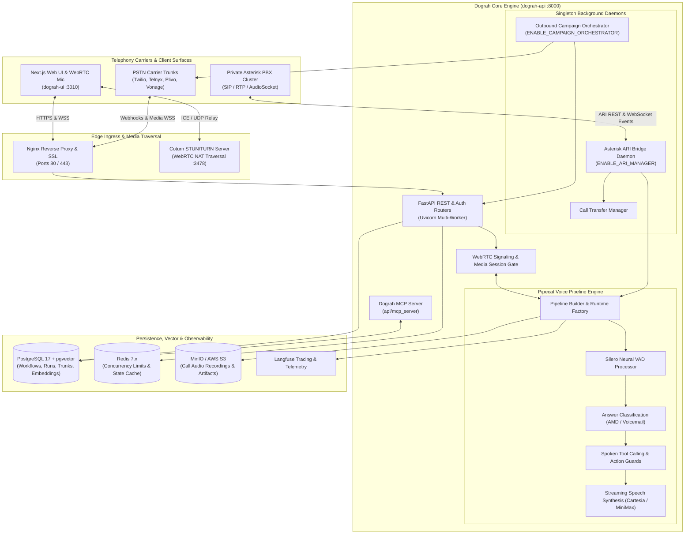
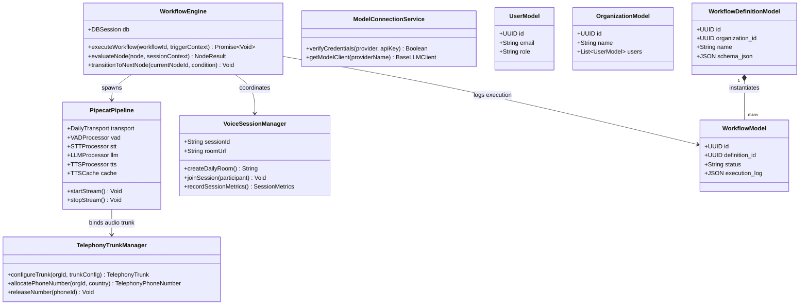
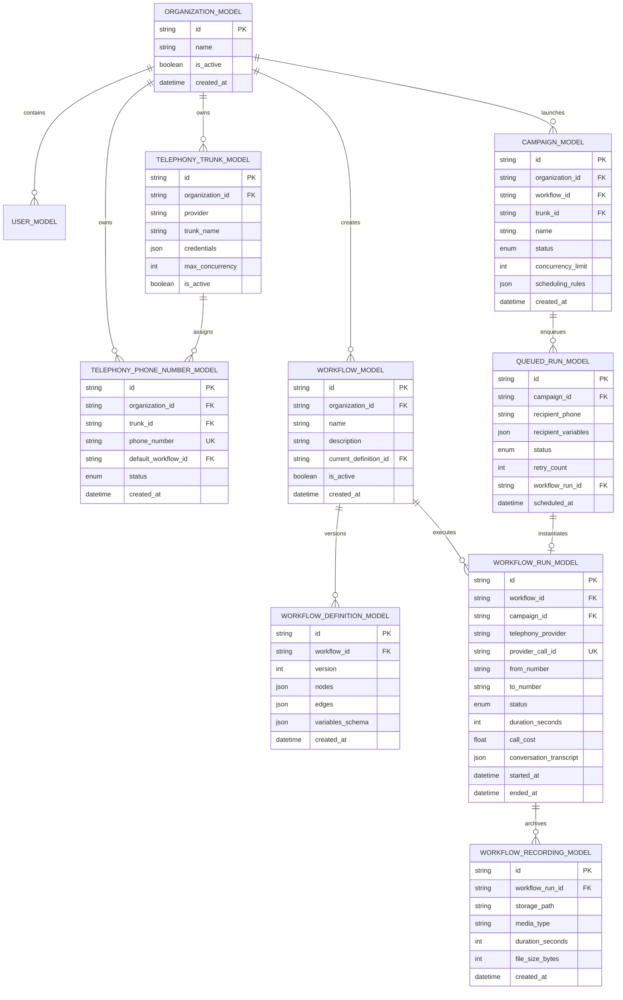
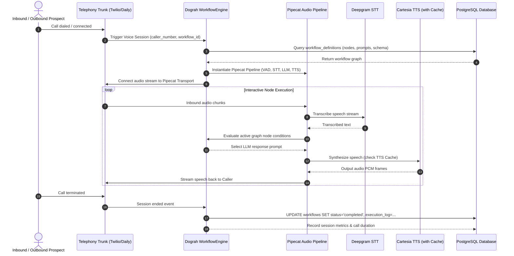

# dograh - Architecture & Technical Wiki

> **Open-Source, Self-Hostable Voice AI Platform, Visual Workflow Builder & Telephony Orchestration Engine**  
> GitHub: [dograh-hq/dograh](https://github.com/dograh-hq/dograh.git) | Stack: Python 3.11+, FastAPI, SQLAlchemy, PostgreSQL 17 (pgvector), Redis 7, Pipecat AI, WebRTC, Asterisk ARI | License: BSD-2-Clause

---

## 1. Executive Summary & Value Proposition

**dograh** is an open-source, self-hostable conversational voice AI platform engineered as a direct, sovereign alternative to proprietary cloud platforms like Vapi and Retell. Built on a high-concurrency Python 3.11+ / FastAPI backend and a modern Next.js visual workflow canvas, Dograh enables engineering and revenue teams to design, test, deploy, and monitor production voice agents without per-minute platform markups, closed vendor lock-in, or customer audio privacy compromises.

While commercial voice platforms charge heavy premiums on telecom minutes and restrict custom telephony infrastructure, Dograh empowers organizations to bring their own SIP trunks, connect directly to Asterisk PBX clusters via ARI, and orchestrate complex multi-turn conversational agents through an intuitive node-based graph editor. Furthermore, Dograh introduces deep AI coding assistant extensibility through a native Model Context Protocol (MCP) server, allowing external LLMs to inspect, construct, and validate voice agent workflows programmatically.

### Core Problems Solved
- **Vendor Lock-in & Heavy Per-Minute Telephony Markups**: Delivers a fully self-hostable stack (single-command Docker deployment) that bypasses proprietary SaaS markups by connecting directly to low-cost carriers (Twilio, Telnyx, Plivo, Vonage) and private Asterisk PBX setups.
- **Linear Prompt Fragility in Complex Conversations**: Replaces monolithic system prompts with a visual node-based workflow engine (`WorkflowDefinitionModel`) that models multi-branch decision trees, conditional intents, tool execution nodes, and conversational dead-ends.
- **Answering Machine Detection (AMD) & Voicemail Handling**: Features real-time acoustic classification (`answer_classification.py`) that distinguishes between human pick-ups, interactive IVRs, and answering machines within the first two seconds, enabling intelligent automated voicemail drops or immediate agent disconnects.
- **Sub-500ms End-to-End Voice Turnaround**: Leverages the Pipecat streaming framework (`pipecat-ai`) with Silero neural VAD, streaming speech-to-text (Deepgram Nova-2), and chunked neural text-to-speech (Cartesia, MiniMax, Speechify) for human-like conversational responsiveness.
- **Multi-Agent Transfers & Human Handoff**: Coordinates seamless warm and cold call transfers between distinct AI specialized workflows or live human call center representatives without dropping the media leg (`call_transfer_manager.py`).
- **Autonomous Agent Authoring via Model Context Protocol (MCP)**: Features an integrated MCP server (`api/mcp_server`) that allows external AI assistants (Claude Code, Cursor) to programmatically edit workflows, inspect call transcripts, and optimize conversation paths.

---

## 2. High-Level System Architecture

Dograh’s deployment architecture combines public reverse proxies, WebRTC NAT traversal daemons, a scalable multi-worker FastAPI application, background telephony bridges, durable relational storage, and object storage.



### Architectural Narrative & Data Flow
1. **Call Ingress & Signaling**: Inbound calls from PSTN carriers or WebRTC browser clients hit the Nginx edge proxy. For WebRTC clients, the Coturn server provides STUN/TURN relays to guarantee media traversal across corporate firewalls. Telephony carriers send standard HTTP answer webhooks, which Dograh validates with capability tokens (`TELEPHONY_WS_TOKEN_SECRET`).
2. **Audio Streaming over WebSockets**: The carrier connects to Dograh’s media WebSocket endpoint (`/api/v1/agent-stream/ws/{workflow_id}`). The `PipelineBuilder` instantiates a dedicated `pipecat-ai` pipeline worker for the session. Raw 8kHz/16kHz PCM audio flows into the pipeline without intermediate disk buffering.
3. **Answering Machine Detection (AMD)**: During the opening seconds of the call, `answer_classification.py` analyzes acoustic cadence and spectral energy. If an answering machine or IVR beep is detected, the pipeline triggers a voicemail handling branch (either dropping a prerecorded message or terminating the call to protect outbound rep capacity).
4. **Visual Node Graph Execution**: The dialogue state advances through nodes defined in `WorkflowDefinitionModel`. When an intent node triggers an action (e.g. `book_appointment`, `lookup_crm`), `spoken_tool_calls.py` executes the function, verifies arguments against guardrail schemas, and feeds results back to the LLM.
5. **Asterisk ARI Manager (`ari_manager.py`)**: For on-premise PBX deployments, Dograh's background ARI manager connects to Asterisk over WebSockets. When a call arrives at an Asterisk extension, Dograh captures the channel, bridges it to an external media socket, and controls audio directly via ARI commands.
6. **Campaign Concurrency & State Reaping**: The `CampaignOrchestrator` runs as a singleton worker within the API container. It continuously queries `CampaignModel` and `QueuedRunModel`, enforcing per-trunk concurrency limits via Redis before initiating outbound calls. Finished call recordings are uploaded to MinIO/S3, and execution traces are pushed to Langfuse.

---

### 2.1 Core Domain & Service Class Architecture



---

## 3. Technology Stack & Key Dependencies

| Component | Technology | Specification & Purpose |
|---|---|---|
| **API Framework** | FastAPI (Python 3.11+) + Uvicorn | High-performance asynchronous REST API and WebSocket media ingress |
| **Frontend Framework** | Next.js 14 + React + React Flow | Visual drag-and-drop conversational workflow canvas and dashboard |
| **Voice Pipeline** | Pipecat AI Framework (`pipecat-ai`) | Frame-based audio streaming, VAD integration, and LLM orchestration |
| **Neural VAD & AMD** | `silero-vad` + Custom Audio Classifier | Real-time speech activity detection and answering machine classification |
| **Speech Models (STT/TTS)**| Deepgram Nova-2, Cartesia, MiniMax, Speechify | Sub-200ms speech-to-text and low-latency streaming neural voices |
| **Database & Vector** | PostgreSQL 17 + `pgvector` | Relational tables, workflow definitions, and vector embeddings for RAG |
| **ORM & Migrations** | SQLAlchemy 2.0 (asyncpg) + Alembic | Asynchronous database operations, connection pooling, and schema versioning |
| **Cache & Concurrency** | Redis 7.x | Call concurrency counters, active session lockouts, and rate limits |
| **Telephony Integration**| Asterisk ARI, Twilio, Telnyx, Plivo, Vonage | Carrier SIP trunks and native PBX channel management |
| **Media Relay & NAT** | Coturn 4.8.0 | WebRTC STUN/TURN server for symmetric NAT traversal |
| **Object Storage** | MinIO / AWS S3 | S3-compatible storage for stereo audio recordings and transcripts |
| **Observability & MCP** | Langfuse + Model Context Protocol (MCP) | Full conversation tracing, latency waterfalls, and AI assistant tooling |

---

## 4. Repository Layout & Key Modules

```
dograh/
├── api/                         # Primary Python / FastAPI backend service
│   ├── app.py                   # FastAPI initialization, CORS, and route registration
│   ├── constants.py             # System constants, defaults, and environment parsers
│   ├── db/                      # Database clients and models
│   │   ├── base_client.py       # Base async database repository
│   │   ├── campaign_client.py   # Outbound dialer campaign persistence logic
│   │   ├── models.py            # Master SQLAlchemy model definitions (1,500+ lines)
│   │   └── telephony_trunk_client.py # BYOC SIP trunk credential management
│   ├── mcp_server/              # Model Context Protocol server for AI assistant control
│   ├── routes/                  # API endpoints (telephony, workflows, campaigns, agent-stream)
│   │   ├── agent_stream.py      # Real-time WebSocket media handler
│   │   ├── campaign.py          # Outbound campaign lifecycle endpoints
│   │   ├── telephony.py         # Inbound/outbound carrier webhooks and dial triggers
│   │   └── workflow.py          # Visual workflow CRUD and versioning
│   ├── services/
│   │   ├── campaign/            # Campaign orchestrator daemon and pacing loops
│   │   ├── pipecat/             # Core voice streaming pipeline implementation
│   │   │   ├── answer_classification.py # Answering machine & IVR acoustic detector
│   │   │   ├── pipeline_builder.py      # Pipecat frame processor graph builder
│   │   │   └── spoken_tool_calls.py     # In-call LLM tool execution with guardrails
│   │   └── telephony/           # Carrier and PBX integrations
│   │       ├── ari_manager.py           # Asterisk REST Interface background bridge
│   │       ├── call_transfer_manager.py # Warm/cold call transfer engine
│   │       └── providers/               # Carrier adapters (twilio, telnyx, plivo, vonage)
│   └── Dockerfile               # API production container build
├── ui/                          # Next.js visual workflow canvas and administration UI
├── nginx/                       # Nginx reverse proxy configuration templates
├── deploy/                      # Observability and Prometheus deployment assets
├── scripts/                     # Initialization scripts (dograh-init, coturn generator)
├── docker-compose.yaml          # Multi-container production deployment stack
└── pyproject.toml               # Poetry package dependencies and build definitions
```

---

## 5. Core Features & Capabilities

### 5.1 Visual Node-Based Workflow Canvas
Dograh departs from traditional prompt engineering by representing conversational agents as stateful directed graphs (`WorkflowModel`, `WorkflowDefinitionModel`). Reps design conversations using distinct node types:
- **Greeting Nodes**: Initial speech synthesis with dynamic variable interpolation.
- **Intent / Router Nodes**: Branches conversations based on caller responses using semantic classification.
- **Tool / Action Nodes**: Executes real-time REST API queries, database updates, or CRM lookups.
- **Transfer Nodes**: Routes calls to external phone numbers, SIP endpoints, or secondary AI agents.
- **End Call Nodes**: Cleanly terminates sessions and logs structured disposition tags.

### 5.2 Real-Time Streaming Audio Architecture
Using `pipecat-ai`, Dograh links audio input transports directly to neural VAD and streaming transcription engines. The agent does not wait for complete conversational sentences; text tokens generated by the LLM are batched into natural phonemic clauses and immediately dispatched to streaming neural TTS models (Cartesia Sonic, MiniMax, or Speechify). This streaming pipelining reduces end-to-end response latency to under 500ms.

### 5.3 Acoustic Answering Machine Detection (AMD)
In `api/services/pipecat/answer_classification.py`, Dograh implements continuous acoustic classification. During the first two seconds of call pickup, the audio buffer is evaluated for machine-like speech patterns, continuous tone frequencies (voicemail beeps), and automated greeting rhythms. If an answering machine is classified, Dograh immediately transitions to preconfigured voicemail handling: leaving a customized message or dropping the call leg to optimize trunk capacity.

### 5.4 Asterisk REST Interface (ARI) Manager
Unlike cloud-only solutions, Dograh ships with a built-in Asterisk manager (`api/services/telephony/ari_manager.py`). When configured (`ENABLE_ARI_MANAGER=true`), Dograh maintains a persistent WebSocket connection to an on-premise Asterisk PBX. When an outbound or inbound call enters the Stasis application, Dograh programmatically captures channel audio, routes it through the Pipecat pipeline, and issues hangup or transfer commands back to Asterisk via REST.

### 5.5 Multi-Agent & Human Call Transfers
The `call_transfer_manager.py` service handles mid-call routing:
- **Warm Transfer**: Places the caller on hold with music, dials a secondary human specialist or tiered AI agent, announces the caller's context, and bridges the legs together upon answer.
- **Cold Transfer**: Executes immediate SIP REFER or carrier redirect commands to hand the caller over to an external call center trunk.

### 5.6 High-Concurrency Campaign Orchestration
The `campaign_orchestrator` service automates outbound power dialing across hundreds of phone numbers simultaneously. It evaluates `CampaignModel` pacing rules, verifies recipient compliance against suppression lists, pulls DIDs from `TelephonyPhoneNumberModel`, enforces strict per-carrier concurrency throttles via Redis, and automatically reschedules unanswered leads based on retry policies.

---

## 6. Data Models & Schema Architecture

Dograh’s persistence layer is built on PostgreSQL 17 with the `pgvector` extension using SQLAlchemy async models (`api/db/models.py`). Below is the entity relationship diagram detailing the telephony, campaign, and workflow structures:



### Typed Field Descriptions
- **`TelephonyTrunkModel.max_concurrency`**: Maximum allowable concurrent outbound call legs for this carrier trunk, enforced via Redis distributed locks to prevent carrier throttling.
- **`WorkflowDefinitionModel.nodes`**: JSON array containing React Flow nodes (prompts, tool bindings, audio parameters, VAD thresholds, AMD flags).
- **`WorkflowRunModel.provider_call_id`**: External telecom call identifier (Twilio Call SID, Telnyx Call Control ID, or Asterisk Channel UniqueID).
- **`QueuedRunModel.recipient_variables`**: JSON key-value pairs (e.g. `lead_name`, `account_balance`, `last_purchase`) dynamically injected into workflow prompt templates at the moment of dialing.

---

### 6.1 Comprehensive Database Schema Specification

Dograh uses PostgreSQL managed via SQLAlchemy to persist multi-tenant agent configurations, dynamic workflow graphs, telephony trunks, and cached audio files.

#### Table: `organizations`
Multi-tenant workspace boundary governing phone trunks and model credentials.

| Column | Type | Constraints | Default | Description |
| :--- | :--- | :--- | :--- | :--- |
| `id` | `UUID` | `PRIMARY KEY` | `gen_random_uuid()` | Unique organisation identifier |
| `name` | `VARCHAR(255)` | `NOT NULL` | - | Display name of the business entity |
| `created_at` | `TIMESTAMPTZ` | `NOT NULL` | `NOW()` | Registration timestamp |

*Indexes:* Primary key on `id`.

---

#### Table: `telephony_trunks`
Configures SIP trunks, Twilio interconnects, or Daily.co SIP credentials.

| Column | Type | Constraints | Default | Description |
| :--- | :--- | :--- | :--- | :--- |
| `id` | `UUID` | `PRIMARY KEY` | `gen_random_uuid()` | Unique trunk identifier |
| `organization_id` | `UUID` | `NOT NULL, FK -> organizations(id)` | - | Associated organization |
| `provider` | `VARCHAR(50)` | `NOT NULL` | `'twilio'` | Telephony carrier (`twilio`, `telnyx`, `daily`) |
| `sip_endpoint` | `VARCHAR(255)` | `NOT NULL` | - | Carrier SIP gateway URL |
| `auth_username` | `VARCHAR(100)` | `NULLABLE` | `NULL` | SIP authentication username |
| `auth_password` | `VARCHAR(255)` | `NULLABLE` | `NULL` | Encrypted SIP authentication password |

*Indexes:* `idx_trunks_org` (`(organization_id)`).

---

#### Table: `workflow_definitions`
Visual workflow graphs containing state nodes, condition edges, and AI prompts.

| Column | Type | Constraints | Default | Description |
| :--- | :--- | :--- | :--- | :--- |
| `id` | `UUID` | `PRIMARY KEY` | `gen_random_uuid()` | Unique workflow definition ID |
| `organization_id` | `UUID` | `NOT NULL, FK -> organizations(id)` | - | Tenant scope key |
| `name` | `VARCHAR(255)` | `NOT NULL` | - | Human-readable workflow title |
| `schema_json` | `JSONB` | `NOT NULL` | `'{}'` | Full workflow graph (nodes, edges, prompt configs) |
| `created_at` | `TIMESTAMPTZ` | `NOT NULL` | `NOW()` | Creation timestamp |

*Indexes:* `idx_workflow_def_org` (`(organization_id)`).

---

#### Table: `workflows`
Runtime execution instances tracking conversational sessions and node traversals.

| Column | Type | Constraints | Default | Description |
| :--- | :--- | :--- | :--- | :--- |
| `id` | `UUID` | `PRIMARY KEY` | `gen_random_uuid()` | Workflow execution instance ID |
| `definition_id` | `UUID` | `NOT NULL, FK -> workflow_definitions(id)` | - | Parent definition |
| `status` | `VARCHAR(50)` | `NOT NULL` | `'running'` | Lifecycle state (`running`, `completed`, `failed`) |
| `current_node_id`| `VARCHAR(100)` | `NULLABLE` | `NULL` | Active node in execution graph |
| `execution_log` | `JSONB` | `NOT NULL` | `'[]'` | Chronological event and message log |
| `started_at` | `TIMESTAMPTZ` | `NOT NULL` | `NOW()` | Start timestamp |
| `ended_at` | `TIMESTAMPTZ` | `NULLABLE` | `NULL` | Termination timestamp |

*Indexes:* `idx_workflows_def` (`(definition_id)`), `idx_workflows_status` (`(status)`).

---

## 7. API Architecture, Webhooks & Key Endpoints

Dograh exposes REST endpoints for configuration, WebSocket endpoints for media streaming, and webhook receivers for carrier event notifications.

### Key API & Media Endpoints

| Method | Endpoint | Description | Auth / Security |
|---|---|---|---|
| `POST` | `/api/v1/telephony/outbound-call` | Initiates an outbound voice agent call | Bearer JWT / API Key |
| `POST` | `/api/v1/telephony/inbound` | Inbound carrier webhook ingress returning connection instructions | Carrier Signature Check |
| `WSS` | `/api/v1/agent-stream/ws/{workflow_id}`| Real-time bidirectional WebSocket media streaming endpoint | Telephony Capability Token |
| `POST` | `/api/v1/campaigns` | Creates and configures an outbound automated calling campaign | Bearer JWT / API Key |
| `POST` | `/api/v1/campaigns/{id}/start` | Begins campaign execution via `campaign_orchestrator` | Bearer JWT / API Key |
| `POST` | `/api/v1/webrtc/signaling` | WebRTC session negotiation for browser softphone testing | Bearer JWT |

### Sample Outbound Dialing Request
```http
POST /api/v1/telephony/outbound-call HTTP/1.1
Host: api.dograh.internal:8000
Authorization: Bearer <api_secret_key>
Content-Type: application/json

{
  "workflow_id": "wf_49a02fc1-8d21-419b-a01f-0a2c918e7e10",
  "to_number": "+14155552671",
  "from_number": "+18005550199",
  "trunk_id": "trunk_telnyx_primary",
  "variables": {
    "first_name": "Jordan",
    "company": "Enterprise Tech",
    "demo_requested": true
  }
}
```

### Sample Media WebSocket Capabilities Handshake
When an audio stream connects, the carrier or browser client transmits a stream initiation frame:
```json
{
  "event": "start",
  "sequenceNumber": "1",
  "start": {
    "streamSid": "MZ48a920b1c0e...",
    "accountSid": "AC019283019283...",
    "callSid": "CA981273918273...",
    "tracks": ["inbound"],
    "customParameters": {
      "workflow_id": "wf_49a02fc1-8d21-419b-a01f-0a2c918e7e10",
      "organization_id": "org_default"
    },
    "mediaFormat": {
      "encoding": "audio/x-mulaw",
      "sampleRate": 8000,
      "channels": 1
    }
  },
  "streamSid": "MZ48a920b1c0e..."
}
```

---

### 7.5 End-to-End Operational Lifecycle Sequence

The following sequence illustrates the event-driven workflow engine dispatching Pipecat real-time audio pipelines across Twilio SIP and Daily.co WebRTC rooms.



---

## 8. Strategic Value & Takeaways for MarketingStudio

### Reusable Architectural Patterns
1. **Visual Conversational Graph Engine**:
   - *Pattern*: Dograh’s separation of the conversational graph (`WorkflowDefinitionModel`) from the underlying code allows non-technical marketing and sales teams to construct complex voice agent decision trees without writing backend code.
   - *MarketingStudio Convergence*: Integrate a node-based voice agent builder into MarketingStudio's workflow canvas, letting marketers visually link email sequences, SMS alerts, and voice calls.
2. **Native Asterisk ARI Bridge (`ari_manager.py`)**:
   - *Pattern*: Direct integration with Asterisk via ARI unlocks self-hosted, carrier-grade voice infrastructure without paying CPaaS markups on SIP termination.
   - *MarketingStudio Convergence*: Adopt Dograh’s ARI bridge pattern to enable MarketingStudio customers with on-premise PBX or private SIP setups to run AI voice agents directly against their existing telephony trunks.
3. **Real-Time Acoustic Answering Machine Detection (AMD)**:
   - *Pattern*: Classifying audio within the first two seconds distinguishes live leads from answering machines, preserving outbound sales rep capacity and automating voicemail drops.
   - *MarketingStudio Convergence*: Implement acoustic AMD in MarketingStudio's power dialer so automated outbound campaigns drop voicemails seamlessly without human intervention.
4. **Model Context Protocol (MCP) Server for Autonomous Voice Agent Design**:
   - *Pattern*: Exposing the voice platform through an MCP server enables external AI coding agents to inspect call logs, refactor conversational prompt nodes, and test agent performance autonomously.
   - *MarketingStudio Convergence*: Ship an MCP server for MarketingStudio that allows AI agents to automatically analyze campaign call outcomes and rewrite underperforming softphone scripts.
