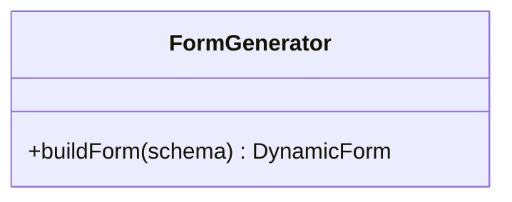
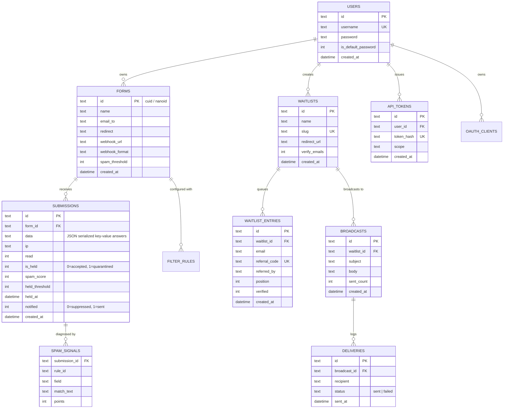
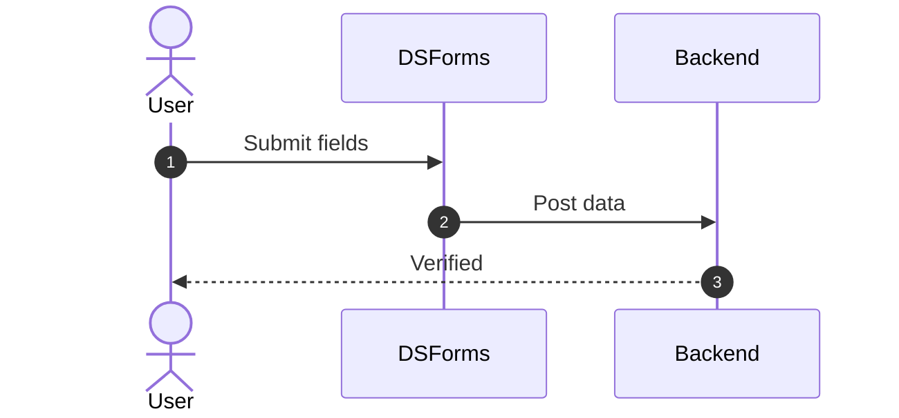

# dsforms - Architecture & Technical Wiki

> **Self-Hosted Lightweight Form Backend, Quarantine Spam Scoring & Viral Waitlist Engine**  
> GitHub: [dsforms/dsforms](https://github.com/dsforms/dsforms) | Stack: Go (Golang) 1.22+, SQLite / LibSQL (Pure Go), HTML5 / Go Templates, Model Context Protocol (MCP), SMTP | License: AGPLv3

---

## 1. Executive Summary & Value Proposition

**dsforms** is an ultra-lightweight, self-hosted form ingestion backend, spam quarantine forensic engine, and viral waitlist platform written in pure Go. Engineered as a fast, zero-dependency alternative to Formspree, Basin, and Waitlist API, dsforms allows developers and marketing teams to deploy a complete form capture and pre-launch audience queue in a single static binary with zero external runtime dependencies.

Typical headless form endpoints suffer from two critical flaws: either they lack adequate spam protection—flooding inboxes with bot submissions—or they employ aggressive black-box filtering that silently discards legitimate leads without operator visibility. dsforms solves this through an auditable **Quarantine Architecture**: submissions receive an algorithmic `spam_score` based on granular heuristics. Submissions breaching the threshold are placed into an isolated quarantine queue (`is_held: 1`) alongside exact diagnostic records (`spam_signals`), withholding alerts until a human operator or AI agent verifies or restores them. Furthermore, dsforms includes an integrated viral waitlist engine with referral queue-jumping and a native Model Context Protocol (MCP) server for autonomous agent operations.

### Core Problems Solved
- **Silent Lead Loss & Black-Box Spam Rejection**: Replaces silent drops with an auditable quarantine holding queue where every held submission records exact triggering rules, fields, and point penalties (`spam_signals`).
- **Zero-Dependency Single-Binary Operations**: Compiled into a single statically linked binary with an embedded SQLite / LibSQL database, requiring no external PostgreSQL, Redis, or Node.js infrastructure.
- **Viral Pre-Launch Lead Capture & Referral Gamification**: Features a built-in waitlist engine (`waitlists`, `waitlist_entries`) with automatic referral code generation and dynamic queue position jumping.
- **Native AI Agent Integration via MCP Protocol**: Implements an embedded Model Context Protocol (`internal/mcpserver`) server enabling LLM agents to inspect form inboxes, review quarantined leads with automatic PII redaction, and query conversion metrics.
- **Direct Cohort Email Broadcasting**: Built-in transactional email broadcast engine (`internal/broadcaster`) allowing operators to send updates, beta invites, and release notices directly to waitlist tiers.

---

## 2. High-Level System Architecture

dsforms follows a robust internal package design in Go. The core HTTP router multiplexes public submission routes (`/f/{id}`), the administrative dashboard (`/dashboard`), waitlist landing pages (`/w/{id}`), OAuth 2.0 authorization flows, and an embedded MCP server (`internal/mcpserver`).

```mermaid
flowchart TD
    subgraph ClientIngress ["Form Ingress & Clients"]
        StaticLandingPage["Static Marketing Landing Page (<form action=...>)"]
        WaitlistApplicant["Viral Waitlist Sign-up (Referral Link)"]
        AIAgent["Autonomous AI Agent (Claude / AgentSDR via MCP)"]
        Operator["Marketing Operator / Admin (Go Server-Rendered UI)"]
    end

    subgraph NetworkEdge ["Network & Routing Gateway"]
        ReverseProxy["Reverse Proxy / Caddy / Nginx (TLS Termination)"]
    end

    subgraph dsformsKernel ["dsforms Core Engine (Go Monolith)"]
        MainRouter["HTTP Router & Middleware (main.go)"]
        RateLimiter["In-Memory Token Bucket Rate Limiter (internal/ratelimit)"]
        
        subgraph IngestionPipeline ["Ingestion & Forensics Subsystem"]
            FormHandler["Form Submission Ingester (/f/{id})"]
            SpamScreener["Weighted Spam Screener (internal/screen)"]
            QuarantineStore["Quarantine Manager (internal/store/quarantine.go)"]
            RedactionEngine["PII Redaction Engine (internal/redact)"]
        end

        subgraph GrowthEngines ["Growth & Broadcasting Modules"]
            WaitlistEngine["Waitlist & Viral Referral Engine"]
            Broadcaster["Cohort Email Broadcaster (internal/broadcaster)"]
            WebhookDispatcher["Outbound Webhook Dispatcher (internal/webhook)"]
        end

        MCPServer["Model Context Protocol Server (internal/mcpserver)"]
        OAuthProvider["OAuth 2.0 Authorization Server (internal/oauth)"]
    end

    subgraph StorageLayer ["Persistence Layer"]
        SQLiteDB[("Embedded SQLite / LibSQL Database (internal/store)")]
        LocalFiles["Local Static Assets & Backups (internal/backup)"]
    end

    %% Wiring
    StaticLandingPage -->|POST /f/{id}| ReverseProxy
    WaitlistApplicant -->|POST /w/{id}| ReverseProxy
    AIAgent -->|JSON-RPC via MCP| ReverseProxy
    Operator -->|Session-Auth Dashboard| ReverseProxy

    ReverseProxy --> MainRouter

    MainRouter --> RateLimiter
    RateLimiter --> FormHandler
    RateLimiter --> WaitlistEngine
    MainRouter --> MCPServer
    MainRouter --> OAuthProvider

    FormHandler --> SpamScreener
    SpamScreener -->|Clean: is_held=0| SQLiteDB
    SpamScreener -->|Spam: is_held=1 + signals| QuarantineStore
    QuarantineStore --> SQLiteDB

    WaitlistEngine --> SQLiteDB
    Broadcaster --> SQLiteDB

    MCPServer --> RedactionEngine
    RedactionEngine --> SQLiteDB

    FormHandler -->|If clean| WebhookDispatcher
    WebhookDispatcher -->|HTTP POST| ExternalWebhook["MarketingStudio / Downstream CRM"]
    Broadcaster -->|SMTP Dispatch| EmailRecipients["Waitlist Leads / Subscribers"]
```

### Architectural Lifecycle of Form Ingestion & Spam Quarantine
1. **Public Ingress**: A lead submits an HTML form to `POST /f/{form_id}`.
2. **Rate Limiting & Extraction**: The request passes through `internal/ratelimit` (sliding window per IP). The form handler decodes JSON or `multipart/form-data` payload into key-value pairs.
3. **Multi-Heuristic Spam Scoring**: `internal/screen` evaluates the payload:
   - Checks invisible honeypot fields (`_gotcha`, `hp_field`).
   - Analyzes link density and domain reputation against disposable email blacklists.
   - Evaluates keyword heuristic weights and submission timing delta.
   - Computes an aggregate integer `spam_score`.
4. **Conditional Quarantine Routing**:
   - If `spam_score < form.spam_threshold`: The submission is committed with `is_held: 0, notified: 1`. An asynchronous webhook fires and immediate email alerts are dispatched to the operator.
   - If `spam_score >= form.spam_threshold`: The submission is saved as `is_held: 1, notified: 0`. The exact firing rules and matched text fragments are saved to `spam_signals`. All outbound notifications are suppressed.
5. **Operator / MCP Review**: Operators inspect the quarantine dashboard. Restoring a held entry flips `is_held: 0` and dispatches the originally withheld notification.

---

### 2.1 Core Domain & Service Class Architecture



---

## 3. Technology Stack & Key Dependencies

- **Language & Runtime**: Go (Golang) 1.22+, zero external CGO runtime requirements (`modernc.org/sqlite` pure-Go SQLite driver).
- **Core HTTP & Routing**:
  - Go standard library `net/http` router with sub-routing.
  - Server-rendered HTML templates utilizing Go `html/template` with contextual auto-escaping.
- **Database & Storage**:
  - **SQLite 3 / LibSQL**: Embedded database operating in WAL (Write-Ahead Logging) mode with busy timeouts.
  - Custom schema manager and migration runner (`internal/store/store.go`).
- **Protocol & Integration Standards**:
  - **Model Context Protocol (MCP)**: Native JSON-RPC server implementation exposing tools for AI agents.
  - **OAuth 2.0**: RFC 6749 compliant server with authorization code grant, PKCE, and refresh tokens.
  - Standard RFC-compliant Webhooks (JSON & form-encoded payloads).
- **Security & Utilities**:
  - Argon2id / bcrypt password hashing.
  - Token-bucket in-memory rate limiting.
  - Regex-based PII redaction engine.

---

## 4. Repository Layout & Key Modules

```
dsforms/
├── internal/
│   ├── astcheck/                     # Static analysis AST checks for database query safety
│   ├── auth/                         # Session authentication & password hashing
│   ├── backup/                       # Automated SQLite database snapshotting & restoration
│   ├── broadcaster/                  # Batch email broadcaster with concurrency throttling
│   ├── config/                       # Environment configuration and default sensitivity
│   ├── handler/                      # HTTP request handlers (dashboard, forms, waitlists)
│   ├── mail/                         # SMTP mailer client
│   ├── mcpserver/                    # Native Model Context Protocol (MCP) server
│   │   ├── mcpserver.go              # Protocol handlers & session initialization
│   │   ├── scope.go                  # Token-based form access scoping
│   │   └── tools.go                  # Agent tools (get_submissions, inspect_quarantine)
│   ├── oauth/                        # Full OAuth 2.0 authorization server implementation
│   ├── ratelimit/                    # Token bucket and sliding window rate limiters
│   ├── redact/                       # PII redaction engine for AI agent safety
│   ├── screen/                       # Algorithmic spam detection & heuristic scoring
│   ├── store/                        # SQLite storage layer & database tables
│   │   ├── aggregates.go             # Conversion metrics and time-series aggregations
│   │   ├── apitokens.go              # Scoped API token management
│   │   ├── quarantine.go             # Quarantine inspection, restore, and delete logic
│   │   └── store.go                  # Database DDL initialization & queries
│   └── webhook/                      # Outbound webhook execution worker
├── static/                           # CSS, Phosphor icons, Inter font files
├── templates/                        # Server-rendered Go HTML templates (dashboard, forms, waitlist)
├── main.go                           # Server bootstrap entrypoint & HTTP router wiring
└── go.mod                            # Go module dependencies
```

---

## 5. Core Features & Capabilities

### 5.1 Quarantine Submissions & Forensics Inspection
Unlike standard spam filters that binary-drop submissions:
- Quarantined submissions remain fully reviewable in `/quarantine`.
- The system stores immutable diagnostic signals in `spam_signals`:
  ```sql
  CREATE TABLE spam_signals (
      submission_id TEXT,
      rule_id       TEXT,
      field         TEXT,
      match_text    TEXT,
      points        INTEGER
  );
  ```
- Operators can inspect the exact text segment that triggered the rule and restore false positives with one click.

### 5.2 Viral Waitlists with Dynamic Queue Shuffling
The waitlist module is designed specifically for viral pre-launch marketing:
- **Unique Referral Links**: Every applicant receives a personalized referral code upon signing up (`/w/{slug}?ref={code}`).
- **Queue Position Jumping**: When a friend signs up using an existing applicant's link, the referrer jumps forward $N$ spots in the queue (`position = position - referral_boost`).
- **Verification Gate**: Supports double opt-in email verification to prevent bots from gaming referral positions.

### 5.3 Native Model Context Protocol (MCP) Server
dsforms embeds an MCP server allowing AI coding assistants and autonomous marketing agents to interact with the backend directly:
- **`list_forms`**: Discovers available endpoints and recent conversion tallies.
- **`get_submissions`**: Fetches lead submissions with automated PII masking (`internal/redact`) to prevent leaking credit cards or SSNs to LLM contexts.
- **`inspect_quarantine`**: Allows agents to analyze held submissions and programmatically approve legitimate leads.

### 5.4 Outbound Webhooks with Multiple Payload Formats
- Endpoints support both standard JSON (`application/json`) and Slack/Discord-compatible payload formats.
- Outbound requests feature exponential retry backoffs and failure logging.

---

## 6. Data Models & Schema Architecture

dsforms leverages an embedded SQLite schema utilizing foreign key constraints, indexes, and strict cascading deletions.



### Core Schema Invariants
1. **Quarantine Invariant**: A held submission (`is_held = 1`) always maintains `notified = 0` until explicit human or agent restoration, guaranteeing that spam never triggers downstream notification webhooks or emails.
2. **Deterministic Position Ordering**: Waitlist entry positions (`position`) dynamically adjust via SQL transactions when referral events occur, ensuring no duplicate queue numbers exist within a waitlist.
3. **Cascade Integrity**: Deleting a form automatically purges its associated submissions, quarantine spam signals, and filter rules via SQLite foreign key cascades (`ON DELETE CASCADE`).

---

### 6.1 Comprehensive Database Schema Specification

#### Table: `ds_forms`
| Column | Type | Constraints | Default | Description |
| :--- | :--- | :--- | :--- | :--- |
| `id` | `UUID` | `PRIMARY KEY` | `gen_random_uuid()` | ID |
| `schema` | `JSON` | `NOT NULL` | - | Form spec |

---

## 7. API Architecture, Webhooks & Key Endpoints

dsforms provides public ingestion endpoints, server-rendered views, and native JSON REST endpoints.

### Key Endpoints

| HTTP Method | Endpoint | Description |
|:---|:---|:---|
| `POST` | `/f/{id}` | Ingests public form submissions (JSON or urlencoded form-data) |
| `POST` | `/w/{slug}` | Submits an email to join a viral waitlist |
| `GET` | `/w/{slug}/status/{ref}` | Checks queue position and referral metrics for an applicant |
| `GET` | `/api/forms` | Lists configured forms and aggregate conversion counts |
| `GET` | `/api/forms/{id}/submissions` | Retrieves paginated submissions for an authenticated token |
| `POST` | `/api/submissions/{id}/restore` | Restores a quarantined submission and dispatches withheld alerts |
| `POST` | `/mcp` | Model Context Protocol JSON-RPC gateway for AI agents |

### Sample Request: Public Form Submission (`POST /f/lead-gen-01`)
```
POST /f/lead-gen-01 HTTP/1.1
Host: forms.marketingstudio.internal
Content-Type: application/x-www-form-urlencoded

first_name=Jordan&work_email=jordan%40techgrowth.io&company_size=50-100&_gotcha=
```

### Sample Outbound Webhook Payload (`submission.accepted`)
```json
{
  "event": "submission.accepted",
  "form_id": "lead-gen-01",
  "submission_id": "sub_01j9841029410a",
  "spam_score": 0,
  "created_at": "2026-10-24T12:00:00Z",
  "data": {
    "first_name": "Jordan",
    "work_email": "jordan@techgrowth.io",
    "company_size": "50-100"
  },
  "meta": {
    "ip": "198.51.100.18"
  }
}
```

---

### 7.5 End-to-End Operational Lifecycle Sequence



---

## 8. Strategic Value & Takeaways for MarketingStudio

### Reusable Architectural Patterns
1. **Quarantine-First Spam Scoring & Forensics Ledger**:
   - Rather than dropping suspicious submissions, MarketingStudio should adopt dsforms’ pattern of scoring submissions and recording triggering heuristics (`spam_signals`) in a quarantine table. This eliminates lost sales leads due to false-positive spam filter triggers.
2. **Viral Waitlist Engine with Referral Queue Shuffling**:
   - The gamified waitlist pattern (awarding higher queue positions for referral shares) provides MarketingStudio with an instant architecture for pre-launch product campaigns, beta access programs, and viral social signups.
3. **Embedded Native MCP Server for AI Agent Integration**:
   - dsforms’ implementation of an internal MCP server (`internal/mcpserver`) with automated PII redaction (`internal/redact`) is an ideal design pattern for MarketingStudio. It allows internal autonomous agents (like AgentSDR) to review incoming leads safely without human intervention.
4. **Single-Binary Zero-Maintenance Edge Deployment**:
   - The self-contained Go binary with embedded SQLite offers an exceptional footprint for deploying lightweight lead-collection backends at edge points or as portable microservices with zero database connection overhead.
