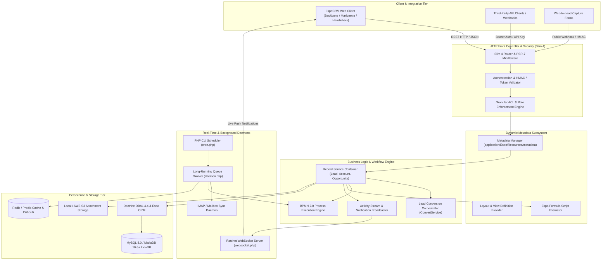
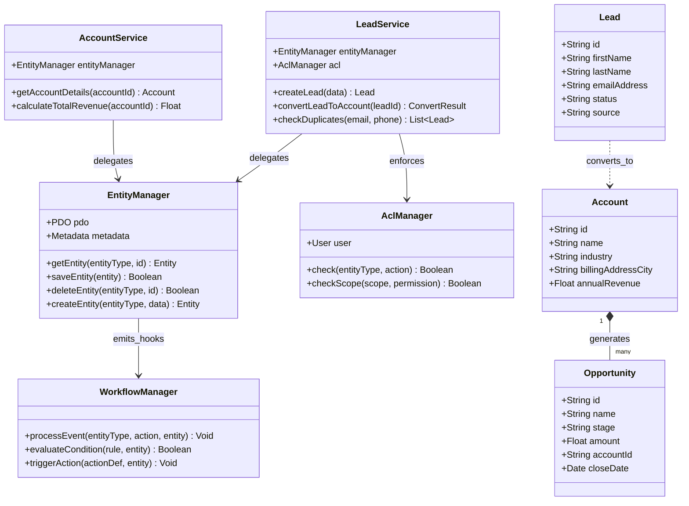
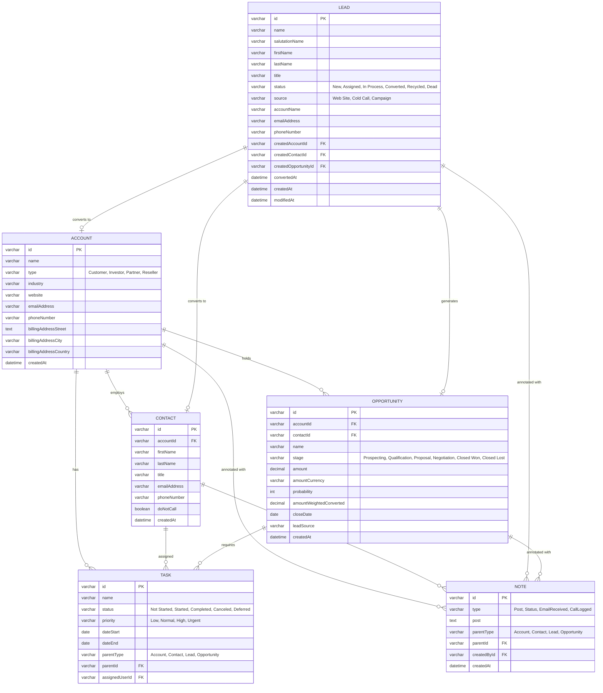
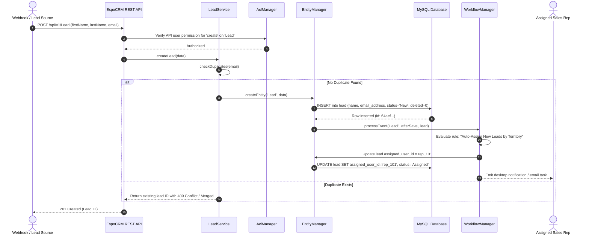

# espocrm - Architecture & Technical Wiki

> **Enterprise Open-Source CRM with Dynamic JSON Metadata Engine, BPMN Workflows & Modular Entity Architecture**  
> GitHub: [espocrm/espocrm](https://github.com/espocrm/espocrm.git) | Stack: PHP 8.3+, Slim 4, Doctrine DBAL, MySQL 8.0 / MariaDB, Ratchet WebSockets, Backbone/Marionette | License: AGPL-3.0

---

## 1. Executive Summary & Value Proposition

**espocrm** is a mature, battle-tested enterprise customer relationship management system engineered in PHP and MySQL. Designed for organizations requiring strict data sovereignty, unlimited schema customizability, and enterprise-grade multi-tenant access control, EspoCRM departs from traditional hardcoded monolithic CRMs by operating on a declarative **JSON metadata architecture**. Every entity, relation, layout, formula field, and workflow in EspoCRM is defined via structured JSON configuration files, allowing administrators to modify schemas, sales pipelines, and business logic at runtime without performing manual SQL migrations.

### Core Problems Solved
- **Rigid Database Schemas**: Eliminates static database tables through a dynamic Entity Manager where custom entities, foreign relations, and composite fields are provisioned instantly through the metadata subsystem.
- **Workflow Automation Without Code**: Features a visual Business Process Management (BPMN 2.0 compliant) execution engine that orchestrates service tasks, conditional user assignments, timed delays, and event triggers.
- **Granular Multi-Tier Access Control (ACL)**: Delivers hierarchical record-level and field-level security based on User, Team, and Role scopes, preventing unauthorized data leakage across regional sales divisions.
- **Unified Communication & Audit History**: Automatically threads inbound/outbound IMAP/SMTP emails, scheduled meetings, VoIP call logs, and customer status changes into a chronological activity stream.
- **Deterministic Lead Conversion Lifecycle**: Provides atomic, transactional conversion of raw unqualified leads into normalized Accounts (Organizations), Contacts (People), and Opportunities (Deals) while preserving audit logs and timeline events.

---

## 2. High-Level System Architecture

EspoCRM employs a layered, event-driven backend architecture where the Slim 4 framework serves as the front controller, routing requests through authentication guards, ACL evaluators, and dynamic service containers. Entity definitions are completely decoupled from runtime storage through the Metadata Manager, which dynamically drives the custom Espo ORM and Doctrine DBAL query composers.



---

### 2.1 Core Domain & Service Class Architecture



---

## 3. Technology Stack & Key Dependencies

- **Language & Runtime**: PHP 8.3+ (strict type declarations, constructor property promotion, match expressions)
- **Framework & HTTP Engine**: Slim 4.15 (`slim/slim`), PSR-7 standard (`slim/psr7`), PSR-11 Container, Symfony 7 components (`symfony/process`, `symfony/http-foundation`, `symfony/routing`, `symfony/mailer`)
- **Database & Persistence**: MySQL 8.0+ / MariaDB 10.6+ (InnoDB, UTF8MB4), Doctrine DBAL 4.4 (`doctrine/dbal`), Espo Custom ORM
- **Asynchronous Execution & Scheduling**:
  - `cron.php`: Scheduled jobs runner via `dragonmantank/cron-expression`
  - `daemon.php`: Multi-threaded background queue processor utilizing `spatie/async` and `react/child-process`
- **Real-Time Communication**: Ratchet WebSocket (`cboden/ratchet`), ReactPHP ZeroMQ (`react/zmq`), Predis (`predis/predis`), RabbitMQ (`php-amqplib/php-amqplib`)
- **Frontend Architecture**: Custom Single-Page Application (SPA) built with Backbone.js, Marionette.js, devtheorem/php-handlebars, jQuery, and Bootstrap 5 styles
- **Document & Mail Processing**:
  - Email Parsing: `directorytree/imapengine` ^1.25, `zbateson/mail-mime-parser` ^3.0
  - Documents & Export: `dompdf/dompdf` ^3.1, `openspout/openspout` ^5.0, `phpoffice/phpspreadsheet` ^5.7
  - Phone & Geocoding: `brick/phonenumber` ^0.5.0, `chillerlan/php-qrcode`

---

## 4. Repository Layout & Key Modules

```
espocrm/
├── application/
│   └── Espo/
│       ├── Core/                     # Engine internals: ORM, Metadata, ACL, Formula, Di Container
│       │   ├── Api/                  # Slim routing, action processors, route processors
│       │   ├── Formula/              # Built-in scripting language (AST parser & function evaluators)
│       │   ├── ORM/                  # Custom ORM layer, QueryComposer, Entity repository interfaces
│       │   ├── BPM/                  # BPMN 2.0 flowchart engine, service tasks, gateway evaluators
│       │   └── Utils/                # Database migrations, metadata merge, caching, config
│       ├── Controllers/              # Standard system REST API controllers (Metadata, Settings, Stream)
│       ├── Entities/                 # Core entity classes (Attachment, User, Preferences, Role)
│       ├── Repositories/             # Data access query builders and repository classes
│       ├── Services/                 # System services (Record, Stream, MassUpdate, Export)
│       ├── Modules/
│       │   └── Crm/                  # Dedicated CRM business package
│       │       ├── Controllers/      # CRM API controllers (Lead, Account, Contact, Opportunity)
│       │       ├── Entities/         # Entity classes (Lead, Account, Contact, Opportunity, Task)
│       │       ├── Tools/
│       │       │   ├── Lead/         # ConvertService.php (lead qualification & conversion pipeline)
│       │       │   └── Activities/   # Unified activity feed & timeline calculators
│       │       └── Resources/
│       │           ├── metadata/     # JSON entityDefs, clientDefs, recordDefs, scopes
│       │           └── routes.json   # CRM specific API routes
│       └── Resources/
│           ├── metadata/             # System entity definitions (entityDefs, app, fields)
│           └── routes.json           # Global REST routing table
├── client/                           # Frontend client application (Backbone views, models, templates)
├── custom/                           # Isolated directory for user-installed custom extensions and overrides
├── data/                             # Runtime cache, generated files, uploads, and logs
├── bin/
│   └── command                       # CLI runner (rebuild, clear-cache, migration, extension install)
├── cron.php                          # Periodic background job runner
├── daemon.php                        # Long-running queue processing daemon
└── websocket.php                     # Ratchet WebSocket server entrypoint
```

---

## 5. Core Features & Capabilities

### 5.1 Dynamic JSON Metadata Engine & Field Creation
In EspoCRM, data entities are not defined in PHP migration classes. Instead, they reside in JSON metadata declarations located in `application/Espo/Resources/metadata/entityDefs/<Entity>.json`. Adding a custom field (such as a currency field, multi-enum, or dynamic relation) involves appending an attribute definition:
- The `type` attribute specifies the data type (`varchar`, `currency`, `enum`, `link`, `linkMultiple`).
- The `audited` flag automatically attaches the field to the system audit log.
- The `ORM` layer reads the metadata dynamically, automatically adjusting database schemas upon executing `bin/command rebuild` without data truncation.

### 5.2 Opportunity Sales Pipeline & Weighted Revenue Forecasting
The `Opportunity` entity manages complex enterprise deal cycles:
- **Stages & Probability Mapping**: Configured via `probabilityMap` (e.g., Prospecting = 10%, Qualification = 20%, Proposal = 50%, Negotiation = 80%, Closed Won = 100%, Closed Lost = 0%).
- **Dynamic Weighted Value**: Calculated directly inside the database query layer via custom SQL composer expressions (`DIV:(MUL:(amount, probability, amountCurrencyRate.rate), 100)`), enabling real-time pipeline reporting across volatile multi-currency transactions.

### 5.3 Lead Qualification & Atomic Conversion Pipeline (`ConvertService`)
Lead records capture raw marketing interest. When a sales development rep (SDR) qualifies a lead, the `ConvertService` (`Espo\Modules\Crm\Tools\Lead\ConvertService.php`) executes an atomic, transactional conversion:
1. Validates that the lead has not already been converted.
2. Creates an `Account` (company) and a `Contact` (individual), copying addresses, phone numbers, and custom EAV attributes.
3. Optionally spawns a new `Opportunity` linked to the account and contact.
4. Reparents all linked `Calls`, `Meetings`, `Tasks`, `Emails`, and `Notes` from the Lead to the newly created Account and Contact.
5. Updates the Lead status to `Converted`, records `convertedAt`, and links foreign IDs (`createdAccountId`, `createdContactId`, `createdOpportunityId`).

### 5.4 Formula Scripting Language & Calculated Attributes
EspoCRM incorporates a sandbox formula interpreter (`Espo\Core\Formula`) that computes fields upon entity save:
```text
// Automatically assign Lead Score based on engagement
ifThen(
    entity\isNew(),
    leadScore = 10
);
ifThen(
    source == 'Web Site' && !string\isEmpty(phoneNumber),
    leadScore = leadScore + 25
);
```
Formula scripts execute server-side before database commits, ensuring business logic invariants cannot be bypassed via REST API mutations.

### 5.5 Unified Activity Stream, Notes & Timeline Feed
Every record contains an integrated activity stream managed by `StreamService`. Interactions are recorded as polymorphic `Note` records or concrete activities (`Call`, `Meeting`, `Task`, `Email`). The `/Timeline` API aggregates upcoming tasks and historical correspondence, calculating "busy ranges" to prevent calendar booking collisions.

### 5.6 Automated Two-Way Email Synchronization
The background daemon connects to IMAP mailboxes via `directorytree/imapengine`, parsing RFC-822 MIME streams with `zbateson/mail-mime-parser`. Inbound emails are matched against existing Contact, Lead, and Account email addresses. Unmatched incoming messages can automatically trigger the creation of a new Lead via the `LeadCapture` service.

---

## 6. Data Models & Schema Architecture

EspoCRM models customer interactions through a relational schema with polymorphic linking (`parentType` and `parentId`).



### Core Schema Entity Specifications
1. **Lead (`application/Espo/Modules/Crm/Resources/metadata/entityDefs/Lead.json`)**:
   - `status`: Enum (`New`, `Assigned`, `In Process`, `Converted`, `Recycled`, `Dead`).
   - `convertedAt`: Timestamp populated upon qualification.
   - Foreign references: `createdAccountId`, `createdContactId`, `createdOpportunityId`.
2. **Opportunity (`application/Espo/Modules/Crm/Resources/metadata/entityDefs/Opportunity.json`)**:
   - `amount`: Multi-currency decimal field.
   - `probabilityMap`: Dynamically updates close likelihood as stage changes.
   - `amountWeightedConverted`: Virtual read-only column computed via SQL `MUL` and currency conversion rates.
3. **Note (`application/Espo/Resources/metadata/entityDefs/Note.json`)**:
   - Polymorphic parent tracking via `parentType` and `parentId`, forming the backbone of the activity stream.

---

### 6.1 Comprehensive Database Schema Specification

EspoCRM runs on MySQL / MariaDB using a metadata-driven entity schema with soft deletes (`deleted = 0`) and automatic association mapping.

#### Table: `lead`
Stores inbound marketing leads prior to qualification or account conversion.

| Column | Type | Constraints | Default | Description |
| :--- | :--- | :--- | :--- | :--- |
| `id` | `VARCHAR(24)` | `PRIMARY KEY` | - | 24-character hexadecimal unique identifier |
| `name` | `VARCHAR(255)` | `NOT NULL` | `''` | Full composite name of the lead |
| `first_name` | `VARCHAR(100)` | `NOT NULL` | `''` | Given name |
| `last_name` | `VARCHAR(100)` | `NOT NULL` | `''` | Family name |
| `email_address` | `VARCHAR(255)` | `NULLABLE` | `NULL` | Primary business email |
| `phone_number` | `VARCHAR(100)` | `NULLABLE` | `NULL` | Direct contact telephone number |
| `status` | `VARCHAR(100)` | `NOT NULL` | `'New'` | Lead qualification stage (`New`, `Assigned`, `In Process`, `Converted`, `Dead`) |
| `source` | `VARCHAR(100)` | `NULLABLE` | `NULL` | Marketing origin (`Website`, `Cold Outreach`, `Referral`) |
| `assigned_user_id`| `VARCHAR(24)` | `NULLABLE, FK -> user(id)` | `NULL` | Sales representative responsible for follow-up |
| `deleted` | `TINYINT(1)` | `NOT NULL` | `0` | Soft delete marker (1 = deleted, 0 = active) |
| `created_at` | `DATETIME` | `NOT NULL` | - | Creation timestamp |

*Indexes:* `idx_lead_email` (`(email_address)`), `idx_lead_status` (`(status)`), `idx_lead_assigned` (`(assigned_user_id)`).

---

#### Table: `account`
Represents customer organizations and prospective enterprise accounts.

| Column | Type | Constraints | Default | Description |
| :--- | :--- | :--- | :--- | :--- |
| `id` | `VARCHAR(24)` | `PRIMARY KEY` | - | Hexadecimal unique account ID |
| `name` | `VARCHAR(255)` | `NOT NULL` | - | Organization commercial name |
| `website` | `VARCHAR(255)` | `NULLABLE` | `NULL` | Corporate domain URL |
| `type` | `VARCHAR(100)` | `NOT NULL` | `'Prospect'` | Account classification (`Customer`, `Partner`, `Prospect`) |
| `industry` | `VARCHAR(100)` | `NULLABLE` | `NULL` | Industry vertical (e.g. `Technology`, `Healthcare`) |
| `billing_address_city`| `VARCHAR(100)`| `NULLABLE` | `NULL` | City for billing purposes |
| `deleted` | `TINYINT(1)` | `NOT NULL` | `0` | Soft delete flag |
| `created_at` | `DATETIME` | `NOT NULL` | - | Creation timestamp |

*Indexes:* `idx_account_name` (`(name)`), `idx_account_type` (`(type)`).

---

#### Table: `opportunity`
Revenue pipeline records tracking sales stage progression and financial value.

| Column | Type | Constraints | Default | Description |
| :--- | :--- | :--- | :--- | :--- |
| `id` | `VARCHAR(24)` | `PRIMARY KEY` | - | Hexadecimal unique opportunity ID |
| `name` | `VARCHAR(255)` | `NOT NULL` | - | Deal title |
| `stage` | `VARCHAR(100)` | `NOT NULL` | `'Prospecting'` | Sales stage (`Prospecting`, `Proposal`, `Negotiation`, `Closed Won`) |
| `amount` | `DECIMAL(12, 2)`| `NOT NULL` | `0.00` | Financial value of deal |
| `account_id` | `VARCHAR(24)` | `NULLABLE, FK -> account(id)` | `NULL` | Parent account record |
| `close_date` | `DATE` | `NULLABLE` | `NULL` | Projected closing date |
| `probability` | `INT` | `NOT NULL` | `10` | Win probability percentage (0-100) |
| `deleted` | `TINYINT(1)` | `NOT NULL` | `0` | Soft delete flag |
| `created_at` | `DATETIME` | `NOT NULL` | - | Creation timestamp |

*Indexes:* `idx_opportunity_stage` (`(stage)`), `idx_opportunity_account` (`(account_id)`).

---

## 7. API Architecture, Webhooks & Key Endpoints

EspoCRM exposes a RESTful JSON API adhering to standard HTTP verbs. Authentication is handled via API Key headers (`X-Api-Key: <key>`) or HMAC session tokens (`Espo-Authorization: <base64>`).

### Key Endpoints

| HTTP Method | Endpoint | Description |
|:---|:---|:---|
| `GET` | `/api/v1/Lead` | Query leads with complex JSON filters, pagination, and sorting |
| `POST` | `/api/v1/Lead` | Create a new lead record |
| `GET` | `/api/v1/Lead/{id}` | Retrieve lead record by ID |
| `PATCH` | `/api/v1/Lead/{id}` | Partially update lead fields |
| `POST` | `/api/v1/Lead/action/convert` | Execute transactional lead conversion to Account/Contact/Deal |
| `GET` | `/api/v1/Opportunity` | List deals with stage and pipeline filters |
| `GET` | `/api/v1/Activities/{parentType}/{id}` | Fetch unified timeline for a specific record |
| `POST` | `/api/v1/LeadCapture/{apiKey}` | Public webhook endpoint for web-to-lead ingestion |

### Sample Payload: Lead Creation (`POST /api/v1/Lead`)
```json
{
  "firstName": "Elena",
  "lastName": "Rostova",
  "title": "VP of Revenue",
  "accountName": "Nordic Systems",
  "emailAddress": "elena.rostova@nordicsystems.io",
  "phoneNumber": "+46701234567",
  "source": "Web Site",
  "status": "New",
  "description": "Requested enterprise pricing guide from product landing page."
}
```

### Sample Payload: Lead Conversion (`POST /api/v1/Lead/action/convert`)
```json
{
  "id": "664c1f9e2b10a",
  "records": {
    "Account": {
      "name": "Nordic Systems",
      "type": "Customer",
      "industry": "Software"
    },
    "Contact": {
      "firstName": "Elena",
      "lastName": "Rostova",
      "title": "VP of Revenue",
      "emailAddress": "elena.rostova@nordicsystems.io"
    },
    "Opportunity": {
      "name": "Nordic Systems - Enterprise Annual",
      "stage": "Qualification",
      "amount": 48000.00,
      "amountCurrency": "USD",
      "closeDate": "2026-12-15"
    }
  }
}
```

---

### 7.5 End-to-End Operational Lifecycle Sequence

The following sequence traces an inbound lead submission through REST API processing, duplicate verification, workflow rule evaluation, and lead conversion.



---

## 8. Strategic Value & Takeaways for MarketingStudio

### Reusable Architectural Patterns
1. **Declarative Metadata-Driven Entity Model**:
   - Rather than creating rigid SQL migration files for every client attribute, MarketingStudio should adopt EspoCRM's pattern of JSON schema definitions (`entityDefs`). Storing field declarations, validation constraints, and UI presentation hints in declarative metadata allows customers to add custom properties (e.g. `Loyalty Tier`, `App Install Date`, `MRR`) without downtime or schema migrations.
2. **Transactional Polymorphic Conversion Pipeline (`ConvertService`)**:
   - EspoCRM’s lead conversion engine provides the exact architectural blueprint needed for MarketingStudio's marketing-to-sales qualification handoff. When an inbound lead reaches a qualification threshold, MarketingStudio can atomically fork the lead record into an Organization, Contact, and Deal while cleanly migrating conversation threads, page visit histories, and form submissions.
3. **In-Query Weighted Metric Computation**:
   - Instead of storing stale weighted revenue numbers that require recalculation jobs on every foreign exchange or stage update, EspoCRM embeds the computation formula directly in the SQL select definitions (`DIV:(MUL:(amount, probability, rate), 100)`). MarketingStudio should utilize this pattern for real-time pipeline reporting and live dashboard aggregations.
4. **Isolated `custom/` Override Directory**:
   - EspoCRM guarantees zero merge friction during upgrades by keeping tenant-specific custom fields, layouts, and overrides in a completely separate `custom/` tree. MarketingStudio can implement an isolated extension directory to ensure system core updates never overwrite client-specific workflows.
