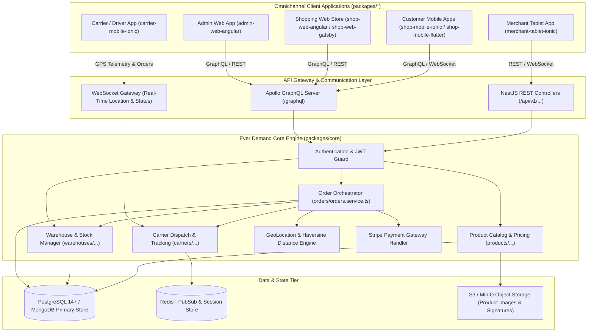
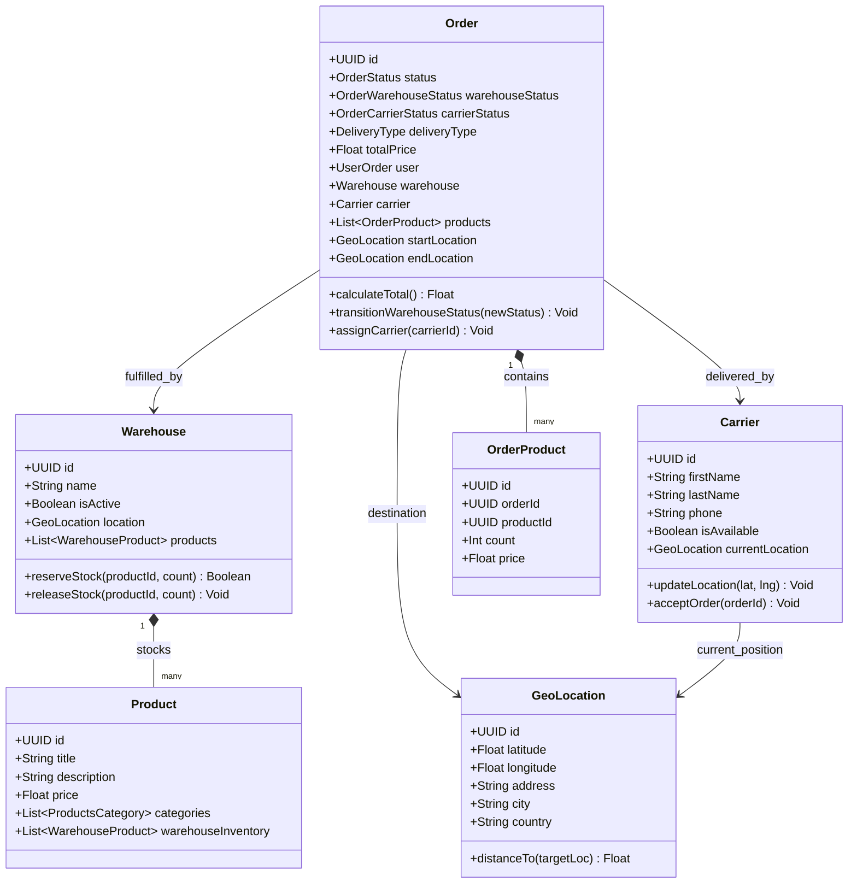
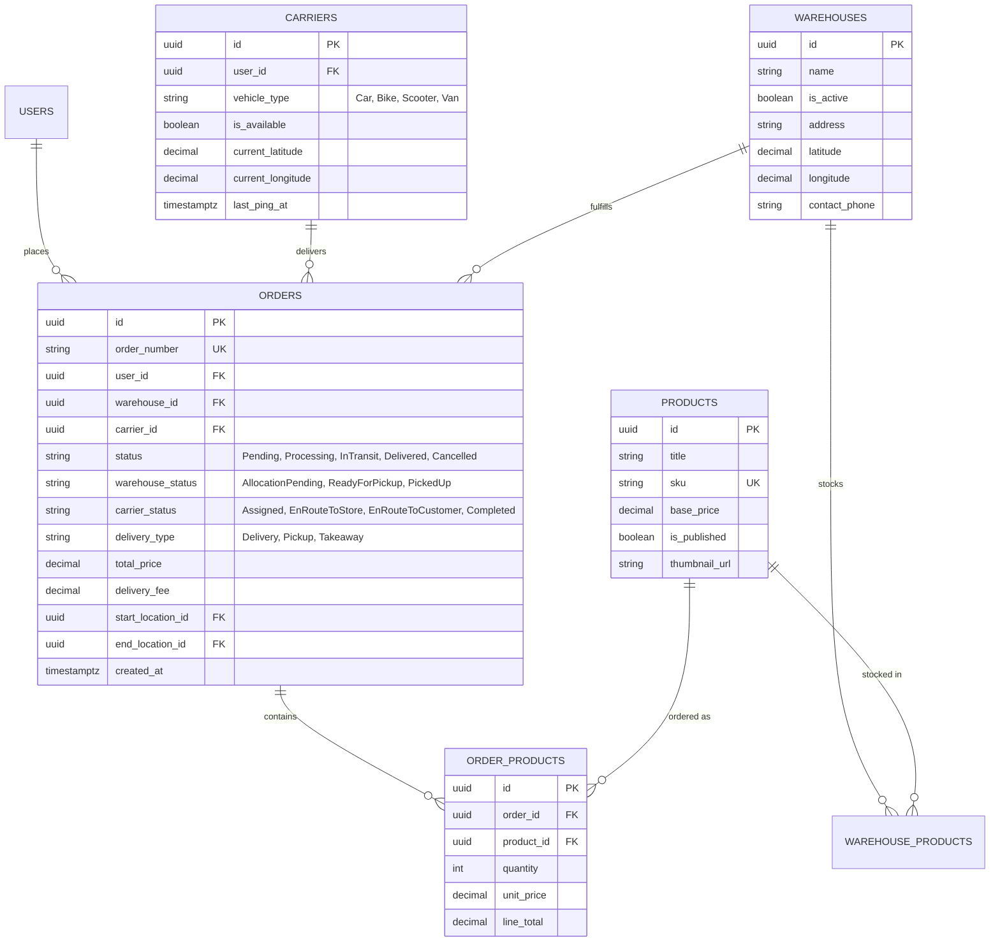
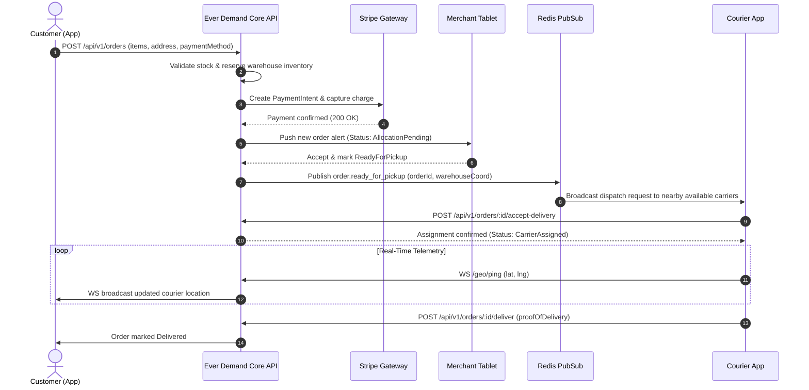

# ever-demand (Ever Demand) - Architecture & Technical Wiki

> **Open-Source, Real-Time On-Demand Commerce & Collaborative Delivery Platform**  
> GitHub: [ever-co/ever-demand](https://github.com/ever-co/ever-demand.git) | Stack: TypeScript, NestJS, TypeORM, PostgreSQL / MongoDB, GraphQL (Apollo), Angular 8/9+, Ionic / Capacitor, Flutter, Redis, Docker | License: AGPL-3.0

---

## 1. Executive Summary & Value Proposition

**ever-demand** (developed by Ever Co.) is an open-source, real-time, and reactive platform engineered for collaborative, on-demand, and sharing economies. Designed to power single-store setups, multi-store/multi-vendor marketplaces, peer-to-peer commerce, and localized delivery logistics, Ever Demand provides a complete suite of headless APIs alongside native mobile and web frontends.

### Core Problems Solved
- **Fragmented Delivery & Courier Logistics**: Connects merchants, customers, and carriers (drivers) in real time with continuous GPS location updates and automated delivery dispatches.
- **Multi-Client / Omnichannel Footprint**: Provides dedicated client applications for each role: web administration, store tablet order management, driver delivery apps, and customer shopping applications across web and mobile.
- **Headless Commerce Agility**: Decouples backend commerce logic (catalogs, stock management, promotion engines, payments) into headless GraphQL, REST, and WebSocket APIs.
- **Complex Inventory Across Multi-Warehouse Hubs**: Tracks inventory levels, warehouse stock allocations, and product variations across distinct physical distribution centers.
- **Turnkey Payment Orchestration**: Integrates payment gateways (Stripe) supporting card tokenization, multi-currency pricing, and guest checkouts.

---

## 2. High-Level System Architecture

Ever Demand is structured around a central NestJS backend (`packages/core`) exposing both GraphQL and REST APIs, paired with `@pyro/db` TypeORM persistence and dedicated frontend/mobile applications (`packages/*`).



---

### 2.1 Core Domain & Service Class Architecture



---

## 3. Technology Stack & Key Dependencies

- **Backend Runtime & Framework**: Node.js, TypeScript, NestJS (Modular Architecture, Inversify DI, Passport.js authentication)
- **API Formats**: GraphQL (Apollo Server Express), REST (Express), WebSockets (Socket.io)
- **ORM & Database**: TypeORM with multi-driver support (PostgreSQL, MariaDB, SQLite, MongoDB) via `@pyro/db`
- **In-Memory Cache & Messaging**: Redis (carrier telemetry pub/sub, real-time dispatch updates)
- **Frontend & Admin Web**: Angular 8/9+ with `@angular/material`, Gatsby (React static storefront)
- **Mobile & Tablet Apps**: 
  - Ionic Framework 4/5+ with Capacitor / Cordova for iOS/Android
  - Flutter 3+ mobile client (`shop-mobile-flutter`)
- **Payments**: Stripe API (`stripe` Node SDK) for payment intents, checkout sessions, and webhook processing
- **Storage**: AWS S3 SDK for CDN media assets, product photos, and digital receipts

---

## 4. Repository Layout & Key Modules

```
ever-demand/
├── packages/
│   ├── core/                          # Core NestJS API server
│   │   ├── src/
│   │   │   ├── controllers/           # REST API endpoints (Orders, Products, Warehouses, Users)
│   │   │   ├── graphql/               # GraphQL resolvers, schemas, and queries
│   │   │   ├── services/              # Business logic (Orders, Carriers, Warehouses, Geocoding)
│   │   │   ├── routes/                # Express & NestJS route definitions
│   │   │   ├── auth/                  # JWT strategies, user roles, permission guards
│   │   │   └── app.module.ts          # Main application dependency injection module
│   │   └── docker-compose.yml         # Container setup for Core API, PostgreSQL & Redis
│   ├── common/                        # Shared entities, interfaces, enums, and database wrappers
│   │   └── src/
│   │       ├── entities/              # TypeORM DB models (Order, Product, Warehouse, Carrier, User)
│   │       ├── enums/                 # OrderStatus, DeliveryType, OrderWarehouseStatus
│   │       ├── interfaces/            # TypeScript contracts (IOrder, IProduct, ICarrier)
│   │       └── @pyro/                 # High-performance DB schema decorators
│   ├── admin-web-angular/             # Angular administration dashboard
│   ├── shop-web-angular/              # Customer-facing Angular web storefront
│   ├── shop-web-gatsby/               # Headless Gatsby/React web storefront
│   ├── merchant-tablet-ionic/         # Ionic tablet application for kitchen / store fulfillment
│   ├── carrier-mobile-ionic/          # Ionic mobile app for couriers and delivery drivers
│   ├── shop-mobile-ionic/             # Ionic customer mobile ordering application
│   └── shop-mobile-flutter/           # Flutter customer mobile ordering application
├── docker-compose.yml                 # Full stack orchestration (PostgreSQL, Redis, Core API)
├── lerna.json                         # Monorepo multi-package configuration
└── package.json                       # Root workspaces and build scripts
```

---

## 5. Core Features & Capabilities

### 5.1 Three-Sided Marketplace Orchestration
Ever Demand simultaneously coordinates three interdependent participant roles:
1. **Merchants / Stores**: Manage product catalogs, stock thresholds per warehouse, accept incoming orders on a dedicated tablet UI, and signal when packages are ready for pickup.
2. **Carriers / Couriers**: Receive push alerts when nearby orders need pickup, accept dispatches, stream live GPS telemetry, and mark deliveries complete with proof-of-delivery notes.
3. **Customers**: Browse multi-merchant product catalogs, add items to cart, select delivery or pickup, execute Stripe payments, and watch live map updates as the carrier approaches.

### 5.2 Real-Time Geolocation Tracking & Proximity Matching
The platform implements distance-based carrier assignment using spherical distance (Haversine formula):
- Carriers broadcast periodic coordinates via WebSockets.
- The `GeoLocation` service calculates bounding boxes to identify couriers within dispatch radius of fulfillment warehouses.
- Customers view live carrier position updates along the delivery route.

### 5.3 Multi-Warehouse Stock Allocation
Unlike basic ecommerce carts with a single inventory count:
- Each product can be distributed across multiple physical warehouses (`WarehouseProduct`).
- During checkout, the inventory engine automatically identifies the optimal warehouse based on customer delivery address proximity and stock availability.
- Stock reservations prevent overselling during checkout hold periods.

---

## 6. Data Models & Schema Architecture



---

## 7. Operational Workflows & Sequence Diagrams

### 7.1 On-Demand Order Placement & Courier Dispatch Lifecycle



---

## 8. Strategic Value & Takeaways for MarketingStudio / SGrowing

### Reusable Architectural Patterns
1. **Three-Sided State Machine**: The clean decoupling between `OrderStatus`, `OrderWarehouseStatus`, and `OrderCarrierStatus` provides an ideal template for complex multi-party workflows (such as client lead approval, agency assignment, and execution tracking in SGrowing).
2. **Modular Micro-Frontends for Distinct Personas**: Structuring separate UI applications (`admin-web`, `merchant-tablet`, `carrier-mobile`, `customer-shop`) targeting specific form factors within a single monorepo prevents UI bloat.
3. **Geo-Spatial Query Pipeline**: Haversine calculation and proximity-based dispatching can be adapted in MarketingStudio for assigning regional sales leads to local SDRs or field representatives.
