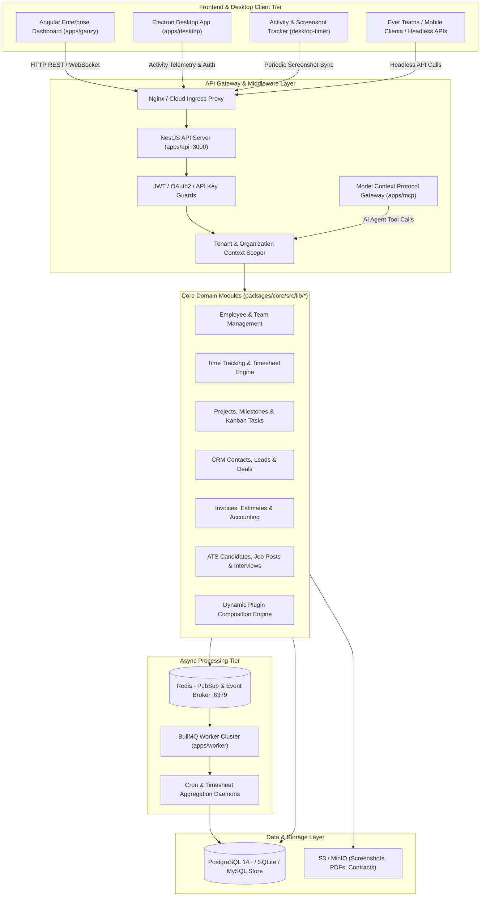
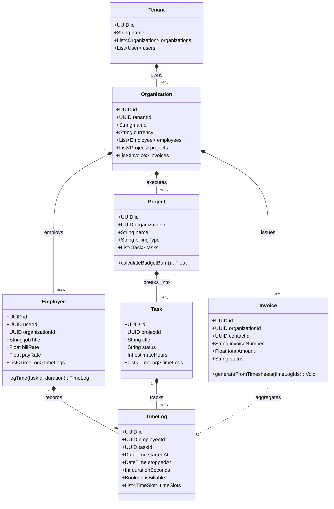
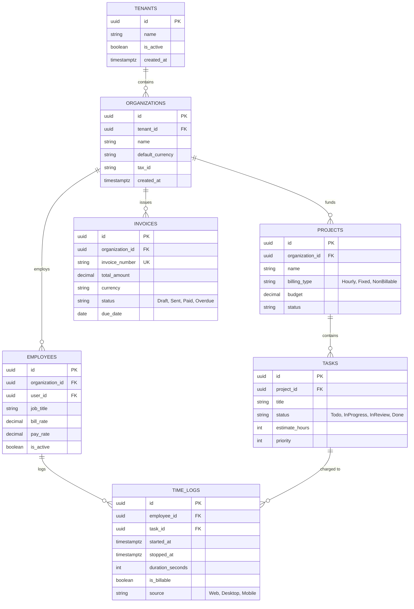
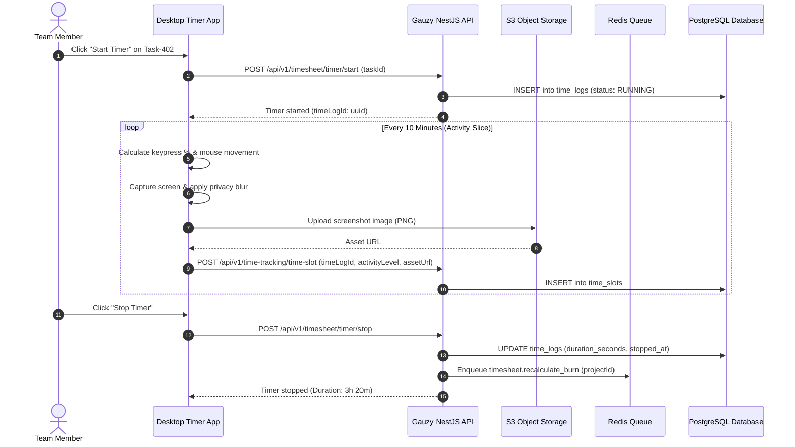

# ever-gauzy (Ever Gauzy Platform) - Architecture & Technical Wiki

> **Open Business Management Platform for Collaborative, On-Demand and Sharing Economies (ERP / CRM / HRM / ATS / PM)**  
> GitHub: [ever-co/ever-gauzy](https://github.com/ever-co/ever-gauzy.git) | Stack: TypeScript, NestJS, TypeORM / MikroORM / Prisma, PostgreSQL / SQLite, Redis, BullMQ, Angular 18+, Electron, Docker, Nx Monorepo | License: AGPL-3.0

---

## 1. Executive Summary & Value Proposition

**ever-gauzy** (developed by Ever Co.) is an enterprise-grade, open-source business management suite unifying Enterprise Resource Planning (ERP), Customer Relationship Management (CRM), Human Resources Management (HRM), Applicant Tracking Systems (ATS), Project Management (PM), and Employee Productivity & Time Tracking. 

Unlike single-purpose tools that create data silos between project delivery, employee hours, client billing, and revenue accounting, Ever Gauzy coordinates the complete operational lifecycle from employee onboarding and desktop activity logging to client project milestones, invoice generation, and financial accounting.

### Core Problems Solved
- **Fragmented ERP / HRM / CRM Toolchains**: Eliminates the operational overhead of synchronizing separate CRM tools, project trackers (Jira/Asana), timesheet recorders, and billing accounting platforms.
- **Automated Time & Desktop Activity Auditing**: Bundles desktop time-tracking agents (Windows/macOS/Linux Electron) capturing keyboard/mouse activity metrics, application tracking, and automated blurred screenshots.
- **Strict Multi-Tenant & Multi-Organization Scoping**: Built from the ground up with multi-tenant tenancy guarantees, allowing holding companies to manage multiple subsidiary organizations, branches, and cross-company employees.
- **Headless API-First Architecture**: Exposes comprehensive REST and GraphQL APIs enabling external client frontends (such as [Ever Teams](ever-teams.md)) and mobile apps to interact directly with core business logic.
- **Extensible Plugin Ecosystem**: Features an isolated plugin composition engine allowing dynamic loading of custom domain features without modifying the core codebase.

---

## 2. High-Level System Architecture

Ever Gauzy is architected as an Nx monorepo featuring a modular NestJS API core (`apps/api`), dedicated background workers (`apps/worker`), Model Context Protocol integrations (`apps/mcp`), an Angular enterprise dashboard (`apps/gauzy`), and desktop productivity apps (`apps/desktop`).



---

### 2.1 Core Domain & Service Class Architecture



---

## 3. Technology Stack & Key Dependencies

- **Monorepo Architecture**: Nx Monorepo (`nx.json`, `lerna.json`), Yarn Workspaces
- **Backend Language & Runtime**: TypeScript 5+, Node.js 20+
- **Application Framework**: NestJS 10+ (`@nestjs/core`, `@nestjs/common`, `@nestjs/swagger`, `@nestjs/typeorm`, `@nestjs/bullmq`)
- **Database ORM**: Dual abstraction with TypeORM and MikroORM support across PostgreSQL 14+, MySQL, and SQLite (WAL mode)
- **Queue & Async Processing**: BullMQ backed by Redis for worker background processing (`apps/worker`)
- **Frontend Architecture**: Angular 18+ Single Page Application with `@nebular/theme` and RxJS state streams
- **Desktop Application**: Electron 28+ wrapper with native OS hooks for idle detection, window title capture, and screencasting
- **AI & Integrations**: Model Context Protocol (MCP) server endpoints (`apps/mcp`, `apps/server-mcp`) enabling LLMs to execute Gauzy operations
- **Storage & Documents**: S3-compatible object storage (MinIO/AWS S3) and PDF generation engines (PDFKit)

---

## 4. Repository Layout & Key Modules

```
ever-gauzy/
├── apps/
│   ├── api/                           # Core NestJS HTTP & WebSocket REST API server
│   │   └── src/                       # Application entry point, plugins, migrations, and seeds
│   ├── gauzy/                         # Angular enterprise web application
│   │   └── src/app/                   # Modules: Dashboard, Employees, Tasks, Invoices, CRM, ATS
│   ├── worker/                        # Background BullMQ worker for timesheet/report aggregation
│   ├── desktop/                       # Electron desktop client shell
│   ├── desktop-timer/                 # Native tray timer widget for activity recording
│   ├── mcp/                           # Model Context Protocol server for AI agent workflows
│   └── server/                        # Bundled backend and static asset serving runner
├── packages/
│   ├── core/                          # Domain business logic (70+ feature modules in src/lib/)
│   │   └── src/lib/
│   │       ├── employee/              # Employee records, skills, departments, and payroll rates
│   │       ├── time-tracking/         # Activity logs, timeslots, screenshot capture, and timer
│   │       ├── tasks/                 # Task creation, priority, kanban transitions, and estimates
│   │       ├── invoice/               # Invoicing, line items, recurring billing, and PDF export
│   │       ├── contact/               # CRM client contacts, accounts, and vendor entities
│   │       ├── candidate/             # ATS candidate recruitment funnel and interview scheduling
│   │       └── tenant/                # Multi-tenancy isolation and tenant API key management
│   ├── contracts/                     # Shared TypeScript interfaces, DTOs, and API payloads
│   ├── auth/                          # Passport.js strategies, JWT handling, and RBAC guards
│   ├── plugin/                        # Plugin definition, lifecycle hooks, and extension API
│   ├── ui-core/                       # Reusable UI component libraries
│   └── utils/                         # Date helpers, math utilities, and currency formatters
├── docker-compose.yml                 # Local development container orchestration
├── nx.json                            # Nx workspace build targets and cache rules
└── package.json                       # Monorepo dependencies and CLI scripts
```

---

## 5. Core Features & Capabilities

### 5.1 Comprehensive Multi-Tenancy & Data Isolation
Gauzy enforces multi-tier hierarchy:
- **Tenant Level**: The root boundary (e.g., enterprise holding company or SaaS account).
- **Organization Level**: Business units, subsidiaries, or franchise branches operating with distinct currencies, tax rules, and employee rosters.
- **Role-Based Access Control (RBAC)**: Fine-grained permissions controlling access to salary data, client billing, financial reports, and administrative settings.

### 5.2 Desktop Productivity & Proof-of-Work Telemetry
Designed for remote and hybrid teams, Gauzy includes native desktop productivity monitoring:
- **Active Time Logging**: Tracks start, stop, pause, and elapsed time against specific project tasks.
- **Activity Metrics**: Calculates keyboard activity percentages and mouse movement density per 10-minute timeslot (`time-tracking`).
- **Automated Screenshot Audits**: Periodically captures desktop screens, applying optional blur filters for privacy before uploading to S3 storage.

### 5.3 Integrated Time-to-Invoice Financial Pipeline
Timesheets seamlessly flow into accounts receivable:
1. Developers and contractors track hours on project tasks.
2. Managers approve weekly timesheets (`request-approval`).
3. The billing engine converts approved billable hours into itemized client invoices with tax lines, currency conversions, and payment links.

### 5.4 AI Agent Compatibility via MCP
Ever Gauzy natively packages a Model Context Protocol (MCP) server. AI agents (such as Claude Code, AutoGPT, or custom bots) can query employee availability, retrieve project sprint velocity, schedule interviews, and log hours autonomously.

---

## 6. Data Models & Schema Architecture



---

## 7. Operational Workflows & Sequence Diagrams

### 7.1 Desktop Time-Tracking & Activity Capture Lifecycle



---

## 8. Strategic Value & Takeaways for MarketingStudio / SGrowing

### Reusable Architectural Patterns
1. **Tenant-Scoped Monorepo Structure**: The `@gauzy/core` package cleanly encapsulates multi-tenant business logic with strict isolation decorators, preventing cross-organization data leakage.
2. **Headless Time & Billing Engine**: The time-log aggregation and invoice calculation engine can be repurposed in MarketingStudio to track agency billable hours, client campaign budgets, and contractor remuneration.
3. **Model Context Protocol (MCP) Integration**: The pre-built MCP server in `apps/mcp` serves as an architectural blueprint for exposing internal MarketingStudio capabilities to external autonomous AI agents.
