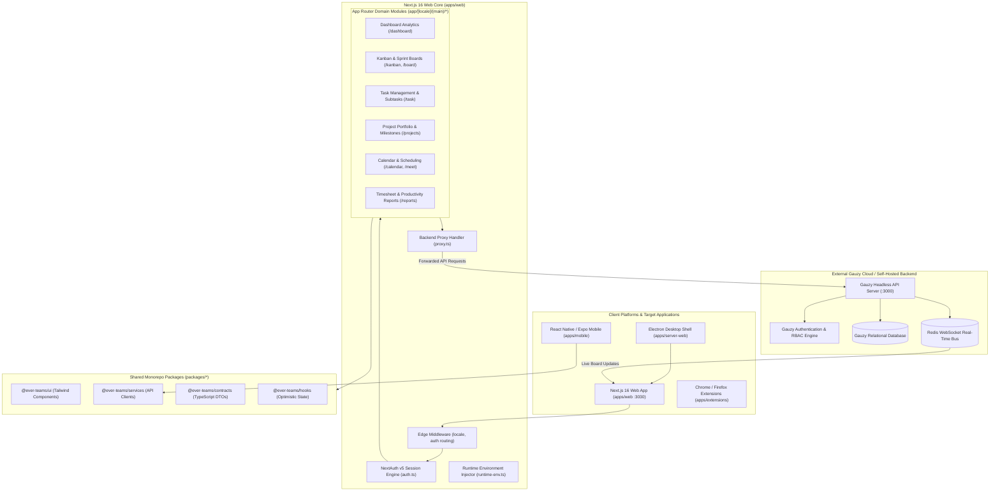
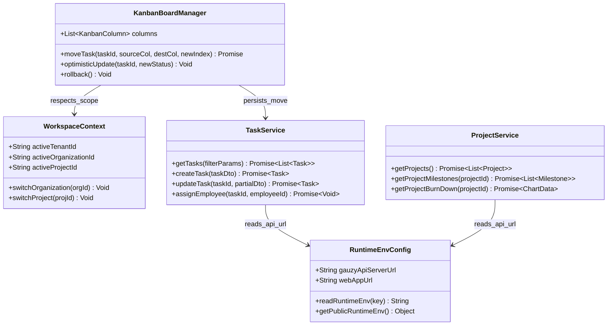
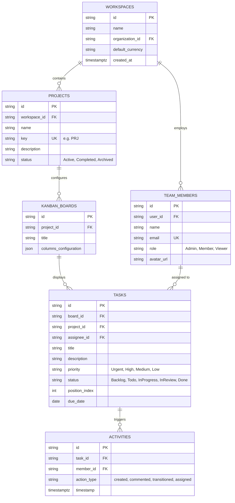
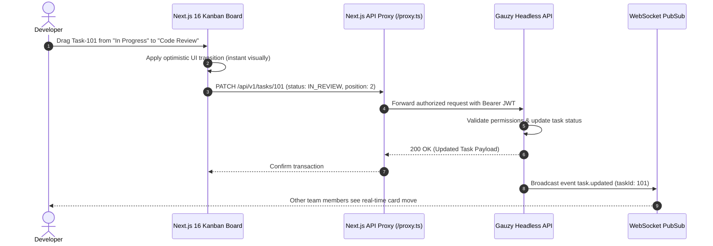

# ever-teams (Ever Teams) - Architecture & Technical Wiki

> **Open Work & Project Management Platform Built on Next.js 16 App Router & React Native**  
> GitHub: [ever-co/ever-teams](https://github.com/ever-co/ever-teams) | Stack: TypeScript, Next.js 16 (App Router, React 19), Tailwind CSS, NextAuth v5, React Native (Expo), Electron, Turborepo / Nx, Docker | License: AGPL-3.0

---

## 1. Executive Summary & Value Proposition

**ever-teams** (developed by Ever Co.) is an open-source, modern work, task, and project management application engineered to replace proprietary project management tools such as Linear, Jira, and Asana. Built as a high-performance Next.js 16 Single Page Application leveraging React 19, Tailwind CSS, and Server Components, Ever Teams interfaces directly with the headless [Ever Gauzy](ever-gauzy.md) platform APIs while providing a fluid, keyboard-centric user experience.

### Core Problems Solved
- **Sluggish Project Management UIs**: Implements instant, optimistic UI updates, keyboard navigation, and client-side view caching powered by Next.js 16 App Router and React 19 concurrent features.
- **Unified Cross-Platform Client Architecture**: Shares core validation schemas, contracts, hooks, and UI component definitions across the Web App (`apps/web`), React Native Mobile App (`apps/mobile`), and Electron Desktop Wrapper (`apps/server-web`).
- **Headless Decoupling from Heavy Backend Code**: Operates as a pure client-side and edge-compatible frontend service, offloading heavy relational storage, background jobs, and business logic to Gauzy APIs (`https://api.gauzy.co`).
- **Enterprise-Grade Dynamic Runtime Configuration**: Solves the classic Next.js container environment variable dilemma by injecting runtime environment properties at request time via `data-ever-teams-runtime-env` attributes, allowing a single Docker image to be deployed across staging and production without rebuilds.
- **Seamless NextAuth v5 Authentication**: Implements universal session management across OAuth providers (GitHub, Google) and Gauzy credentials.

---

## 2. High-Level System Architecture

Ever Teams operates as the modern presentation and interaction layer in the Ever ecosystem. It is organized as a Turborepo + Nx monorepo orchestrating web, mobile, desktop, and browser extension targets against Gauzy headless backend services.



---

### 2.1 Core Domain & Service Class Architecture



---

## 3. Technology Stack & Key Dependencies

- **Web Framework**: Next.js 16 (App Router, Server Components, Server Actions, Client Components)
- **Frontend Core**: React 19 (`react`, `react-dom`), TypeScript 5.4+
- **Styling & UI**: Tailwind CSS 3.4+, Lucide Icons (`lucide-react`), Radix UI primitives
- **Authentication**: NextAuth.js v5 (Beta) supporting credentials and OAuth callbacks
- **Monorepo & Build Tooling**: Turborepo (`turbo.json`), Nx Workspace integration (`nx.json`), Yarn 1.x
- **Mobile Client**: React Native with Expo SDK 50+ (`apps/mobile`)
- **Desktop Client**: Electron (`apps/server-web`)
- **Internationalization**: `next-intl` with route-level localization (`[locale]`)
- **Observability**: `@sentry/nextjs` (Edge, Client, and Server configurations)

---

## 4. Repository Layout & Key Modules

```
ever-teams/
├── apps/
│   ├── web/                           # Next.js 16 Web Application
│   │   ├── app/                       # App Router architecture
│   │   │   ├── api/                   # Route handlers (auth, health, proxy)
│   │   │   └── [locale]/              # Localized root layout
│   │   │       ├── (main)/            # Authenticated application shell
│   │   │       │   ├── board/         # High-density sprint boards
│   │   │       │   ├── calendar/      # Team calendar and schedule view
│   │   │       │   ├── dashboard/     # Project analytics and velocity metrics
│   │   │       │   ├── kanban/        # Drag-and-drop task workflow boards
│   │   │       │   ├── projects/      # Project directory and settings
│   │   │       │   ├── reports/       # Timesheet summary and cost analysis
│   │   │       │   └── task/          # Rich task detail modals and subtasks
│   │   │       └── auth/              # Sign-in, sign-up, and password recovery
│   │   ├── core/                      # Application core services and runtime utilities
│   │   │   └── services/              # API proxies, auth wrappers, and runtime-env
│   │   ├── proxy.ts                   # Backend API forwarder to Gauzy API
│   │   ├── auth.ts                    # NextAuth configuration and session callbacks
│   │   └── tailwind.config.js         # Design tokens and theme configuration
│   ├── mobile/                        # React Native / Expo mobile application
│   ├── server-web/                    # Electron wrapper packaging the web app
│   └── extensions/                    # Browser extension productivity quick-capture
├── packages/
│   ├── ui/                            # Shared React component library
│   ├── services/                      # Shared HTTP client SDK for Gauzy endpoints
│   ├── contracts/                     # TypeScript data contracts and DTOs
│   ├── hooks/                         # Custom React hooks (keyboard shortcuts, query state)
│   └── utils/                         # String formatters, date mathematics, color generators
├── turbo.json                         # Turborepo task pipeline definitions
├── CLAUDE.md                          # Comprehensive instructions for AI coding assistants
└── package.json                       # Monorepo dependencies and workspaces
```

---

## 5. Core Features & Capabilities

### 5.1 Runtime Environment Injection Pattern
Ever Teams implements an architectural pattern addressing static container builds:
- Standard Next.js builds inline `NEXT_PUBLIC_*` variables at compile time, making images non-portable.
- Ever Teams reads environment configurations per-request in `app/layout.tsx` via `getPublicRuntimeEnv()` (`core/services/server/runtime-env.ts`).
- It injects values into the root HTML tag as a `data-ever-teams-runtime-env` attribute (`useRuntimeEnvHtmlProps`).
- Client-side code accesses values via `readRuntimeEnv()`, allowing a single published Docker container to be customized at launch (`docker run -e GAUZY_API_SERVER_URL=...`).

### 5.2 Optimistic Kanban Task Reordering
Task updates across Kanban columns are optimized for instantaneous response:
1. When a user drags a card from *In Progress* to *Done*, the UI updates immediately with zero latency.
2. In the background, `KanbanBoardManager` issues a PATCH request to `proxy.ts` forwarding to Gauzy API.
3. If an error occurs (e.g., missing mandatory fields or network disconnect), the state cleanly rolls back with an alert banner.

### 5.3 Integrated Calendar & Team Meeting Hub
Through the `/calendar` and `/meet` routes, team members can view task due dates alongside scheduled client meetings, synchronizing sprint deadlines with personal availability.

---

## 6. Data Models & Schema Architecture

*Note: Data persistence is managed upstream by the Gauzy API backend; the models below represent the client-side domain schemas maintained within Ever Teams.*



---

## 7. Operational Workflows & Sequence Diagrams

### 7.1 Drag-and-Drop Task Transition Lifecycle



---

## 8. Strategic Value & Takeaways for MarketingStudio / SGrowing

### Reusable Architectural Patterns
1. **Portable Next.js Container Configuration**: The `data-ever-teams-runtime-env` runtime injection pattern solves container portability for any Next.js application, preventing the need to build separate Docker images per environment.
2. **Next.js 16 + React 19 Frontend Excellence**: Demonstrates how to organize an enterprise SaaS web app with high-density sprint boards, server actions, and localized routes using the modern React 19 compiler patterns.
3. **Optimistic Task State Synchronization**: The client-side drag-and-drop state management with automatic rollback serves as a reference implementation for MarketingStudio's campaign funnel builders and workflow board interfaces.
