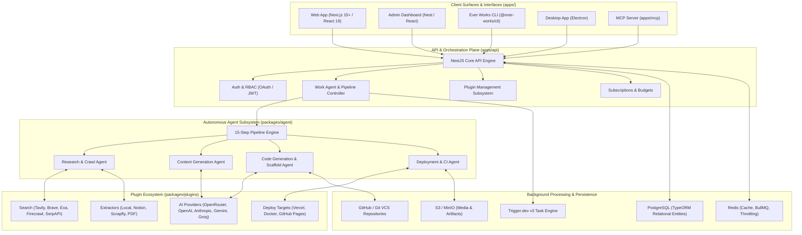
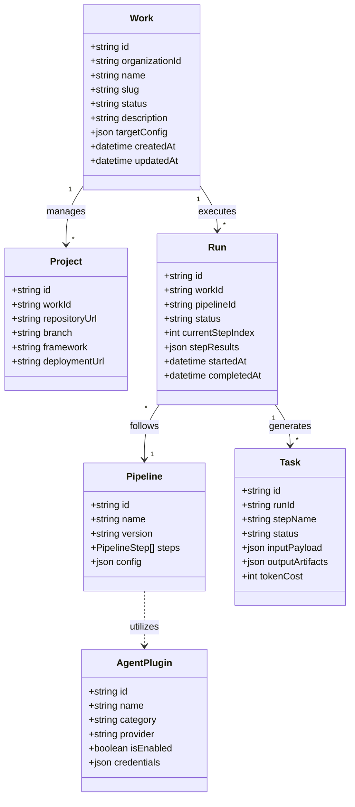
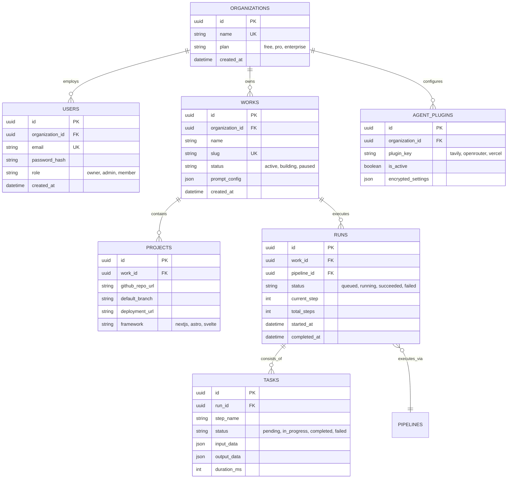
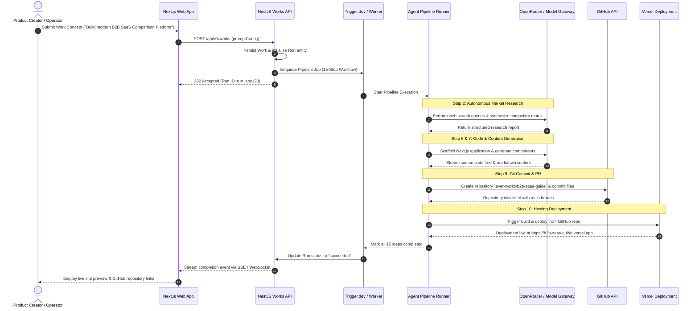

# ever-works (Ever Works Platform) - Architecture & Technical Wiki

> **Autonomous Agentic Runtime & Software Workshop: From Idea to Researched, Coded, and Deployed Business**  
> GitHub: [ever-works/ever-works](https://github.com/ever-works/ever-works) | Stack: TypeScript, NestJS, Next.js 15+, React 19, TypeORM (PostgreSQL), Turborepo / pnpm, Trigger.dev v3, Model Context Protocol (MCP) | License: AGPL-3.0

---

## 1. Executive Summary & Value Proposition

**Ever Works** ("The Workshop for AI") is an open-source, extensible agentic runtime platform engineered by Ever Co. LTD (makers of [Ever Gauzy](ever-gauzy.md), [Ever Demand](ever-demand.md), and [Ever Teams](ever-teams.md)). Designed as a complete 24/7 autonomous production shop, Ever Works takes a high-level prompt or business concept and orchestrates teams of AI agents to autonomously research the domain, write structured content, generate complete software applications and sites, commit code to Git, and deploy to modern hosting targets.

Ever Works enforces a **Git-native lifecycle** where every artifact—code, content models, documentation, and comparison matrices—lives as native Git commits. This eliminates vendor lock-in, ensures full provenance, and allows human developers to collaborate seamlessly with autonomous agent workflows via standard pull requests.

### Core Problems Solved
- **Fragmented AI Workflows**: Replaces disconnected coding assistants, copywriters, and deployment scripts with a unified, 15-step deterministic generation pipeline.
- **Surface-Level Hallucination**: Employs an autonomous research phase where agents perform deep web searches (Tavily, Brave, Exa, Firecrawl), extract citations, and verify claims before generating a single line of code or copy.
- **True Code & Content Ownership**: Unlike closed SaaS website builders, Ever Works commits every generation into user-owned GitHub repositories with standard file structures and clean dependencies.
- **Scheduled Continuous Improvement**: Agents do not terminate after initial deployment; they run on cron schedules to harvest new market data, update comparison charts, optimize SEO copy, and open maintenance PRs.
- **Multi-Surface Architecture**: Provides a single monorepo powering a Next.js 15+ Web application, NestJS REST API, CLI, Electron desktop app, Kubernetes hosting operator, and native Model Context Protocol (MCP) server.

---

## 2. High-Level System Architecture

Ever Works is architected as a high-performance Turborepo monorepo divided into consumer applications (`apps/`) and reusable modular packages (`packages/`).



---

## 2.1 Core Domain & Service Class Architecture

Ever Works organizes its domain around `Work` entities, autonomous `Runs`, structured `Pipelines`, and modular `Plugins`.



---

## 3. Technology Stack & Key Dependencies

| Layer | Component | Description & Role |
| :--- | :--- | :--- |
| **Monorepo Architecture** | Turborepo, pnpm workspaces | High-velocity build cache, unified dependency management |
| **Backend API** | NestJS v11+, TypeScript, `@nestjs/swagger` | Modular enterprise backend service with dependency injection |
| **Frontend Applications** | Next.js 15+ (App Router), React 19, Tailwind CSS | Server Components, responsive design, and streaming state |
| **Database & ORM** | PostgreSQL, TypeORM | Relational persistence for multi-tenant organizations, works, and runs |
| **Workflow Engine** | Trigger.dev v3, BullMQ, Redis | Long-running, resilient asynchronous agent task orchestration |
| **AI Orchestration** | OpenRouter, Vercel AI SDK, Composio | Unified multi-model gateway with tool calling and sandboxing |
| **Agent Protocols** | Model Context Protocol (MCP) | Bi-directional IDE and external agent integration |
| **VCS & Deployment** | Octokit (GitHub API), Vercel SDK | Automated branch creation, pull request generation, and deployment |

---

## 4. Repository Layout & Key Modules

```
inspire/ever-works/
├── apps/
│   ├── api/                         # NestJS API backend service
│   │   └── src/                     # Core modules: work-agent, runs, pipelines, auth, billing
│   ├── web/                         # Next.js 15+ web application and user portal
│   ├── admin/                       # Administrative control plane
│   ├── cli/                         # Command-line interface for agent operations
│   ├── mcp/                         # Model Context Protocol server exposing works API
│   ├── desktop/                     # Electron desktop client shell
│   └── hosting-operator/            # Kubernetes / Docker hosting orchestration controller
├── packages/
│   ├── agent/                       # Core autonomous agent runtime & pipeline executor
│   ├── agent-plugins/               # Integrated plugins (OpenAI, Anthropic, Tavily, Vercel)
│   ├── contracts/                   # Shared TypeScript interfaces, DTOs, and schemas
│   ├── plugin/                      # Plugin lifecycle and registration primitives
│   ├── tasks/                       # Trigger.dev background task workflow definitions
│   └── monitoring/                  # Sentry and PostHog telemetry instrumentation
├── docker-compose.yml               # Multi-container local orchestration (Postgres, Redis, API, Web)
├── pnpm-workspace.yaml              # Workspace directory configurations
└── turbo.json                       # Turborepo task pipeline definitions
```

---

## 5. Core Features & Capabilities

### 5.1 The 15-Step Idea-to-Site Pipeline
Ever Works implements a deterministic, multi-stage production pipeline:
1. **Concept Ingestion**: Parses high-level user instructions, target audience, and domain parameters.
2. **Deep Market Research**: Queries search APIs (Tavily/Exa/Brave) to discover competing products, key differentiators, and authoritative industry sources.
3. **Information Extraction**: Crawls and parses target URLs using clean headless extractors or Scrapfly.
4. **Content Architecture Design**: Formulates structured site maps, entity taxonomies, and comparison dimensions.
5. **Copywriting & Editorial Generation**: Produces long-form, citation-backed copy adhering to brand guidelines.
6. **Codebase Scaffolding**: Initializes a modern Next.js/Tailwind or Astro repository structure.
7. **Component Generation**: Generates UI components, landing pages, and interactive comparison tables.
8. **Automated Static Analysis & Testing**: Runs TypeScript type checking and linter validations against generated code.
9. **Git Commit & Repository Sync**: Pushes the generated codebase to a newly created GitHub repository.
10. **Automated Hosting Deployment**: Provisions project hosting on Vercel or Kubernetes via hosting operators.
11. **Screenshot & Visual Validation**: Captures live page previews using ScreenshotOne or Urlbox.
12. **Verification & Audit**: Validates Lighthouse SEO, accessibility, and Core Web Vitals performance.
13. **DNS & Custom Domain Setup**: Configures routing and TLS certificates.
14. **Telemetry & Analytics Ingestion**: Automatically injects analytics tracking (PostHog/Jitsu).
15. **Maintenance Scheduling**: Registers background cron triggers for recurring updates and SEO refreshes.

### 5.2 Git-Native Continuous Maintenance
Unlike traditional website generators where updates require manual re-exports, Ever Works maintains a persistent Git link:
- Scheduled workers monitor external data sources for price changes, new product features, or breaking industry news.
- When updates are required, agents fork a feature branch, apply code/content mutations, and open a GitHub pull request with detailed changelogs for human review.

---

## 6. Data Models & Schema Architecture



---

## 7. Operational Workflows & Sequence Diagrams

### 7.1 Autonomous "Idea-to-Site" Execution Flow



---

## 8. Strategic Value & Takeaways for MarketingStudio / SGrowing

### 1. Multi-Step Deterministic Pipelines
Ever Works demonstrates that production-grade AI generation cannot rely on single unconstrained prompts. By breaking the creation process into a 15-step pipeline with explicit checkpoints (Research → Schema → Copy → Code → Verify → Deploy), generation quality and reproducibility increase by orders of magnitude.

### 2. Git as the Primary Source of Truth
Storing both digital marketing copy and application code in standard Git commits allows MarketingStudio to bridge the gap between creative marketing teams and technical developers. Changes made by autonomous agents can be reviewed, reverted, or merged using standard Git PR workflows.

### 3. Integrated MCP Server Architecture
Ever Works' native `apps/mcp` package shows how modern platforms should expose their internal capabilities to AI coding assistants (like Antigravity or Claude Code). MarketingStudio should provide a first-class MCP server allowing agents to query analytics, trigger campaign builds, and manage contact segments directly from external IDEs.
