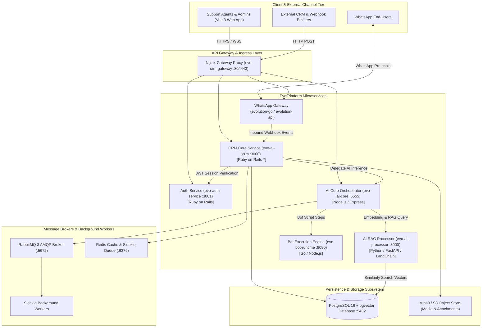
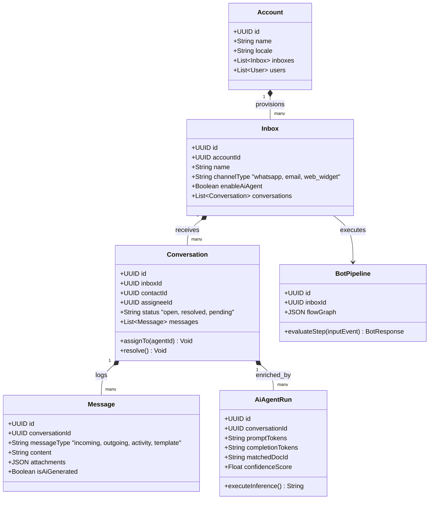
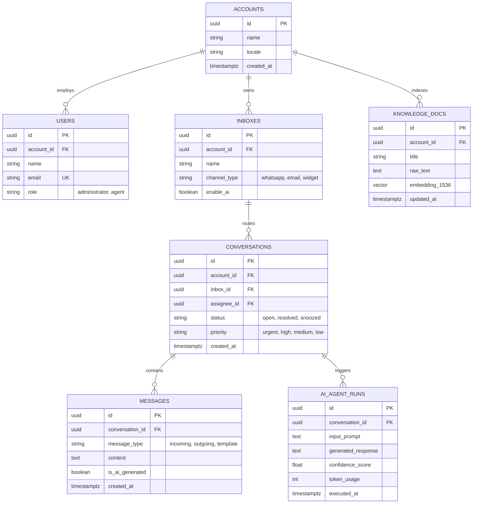
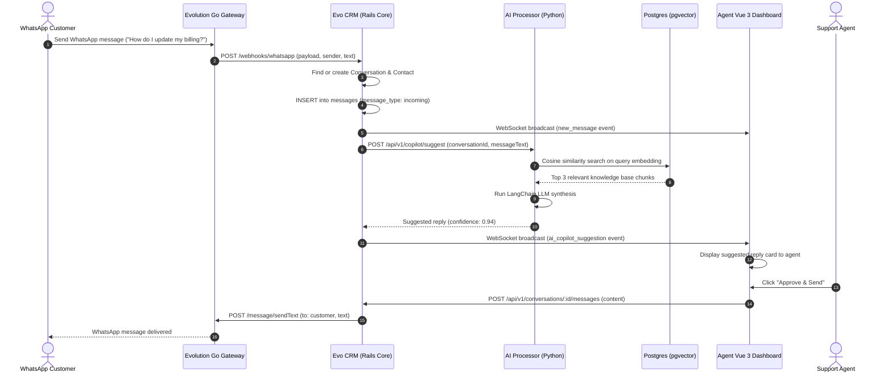

# evo-crm-community (Evo CRM Community) - Architecture & Technical Wiki

> **Open-Source, Single-Tenant AI-Powered Customer Support Platform & Omnichannel Messenger**  
> GitHub: [evolution-foundation/evo-crm-community](https://github.com/evolution-foundation/evo-crm-community) | Stack: Ruby on Rails 7+, Python (FastAPI / LangChain), Vue 3 (Vite, Pinia), PostgreSQL 16 (pgvector), Redis, RabbitMQ, Docker Swarm / Compose | License: Apache-2.0

---

## 1. Executive Summary & Value Proposition

**evo-crm-community** is the open-source flagship customer support and conversational platform engineered by the Evolution Foundation. Positioned as an AI-first, omnichannel evolution of platforms like Chatwoot, Evo CRM combines conversational customer relationship management with integrated generative AI agents, vector embeddings for automated knowledge retrieval, multi-channel bot runtimes, and deep native integration with the WhatsApp ecosystem via [evolution-go](evolution-go.md) and [evolution-api](evolution-api.md).

Rather than relying on loosely integrated third-party chatbots, Evo CRM Community operates as an orchestrated umbrella stack that coordinates authentication (`evo-auth`), CRM operations (`evo-crm`), AI agent workflows (`evo-ai-core`), intent & RAG processing (`evo-ai-processor`), and bot execution pipelines (`evo-bot-runtime`) into a single self-hostable cluster.

### Core Problems Solved
- **Disjointed AI Customer Support**: Combines conversational agent inboxes with automated AI copilots (suggested replies, summaries) and autopilots (autonomous resolution) directly inside customer chat streams.
- **WhatsApp Latency & Instability**: Natively connects with Evolution Foundation's specialized WhatsApp engines (`evolution-api` and `evolution-go`), handling QR code pairing, connection persistence, and rich media streaming.
- **RAG & Knowledge Base Embeddings**: Employs PostgreSQL 16 with `pgvector` to store high-dimensional embeddings of support documentation, product FAQs, and past conversation resolutions.
- **Multi-Service Microservice Orchestration**: Aggregates decoupled microservices (Rails, Python FastAPI, Vue 3, Go) through standardized Docker Compose and Swarm templates (`docker-compose.yml`, `docker-compose.swarm.yaml`).
- **Secure Asynchronous Task Processing**: Leverages RabbitMQ and Redis Sidekiq workers to isolate long-running LLM inferences, media transcoding, and webhook deliveries from interactive chat threads.

---

## 2. High-Level System Architecture

Evo CRM Community is organized as an umbrella monorepo containing interconnected microservices managed via Git submodules and routed through an Nginx reverse proxy gateway.



---

### 2.1 Core Domain & Service Class Architecture



---

## 3. Technology Stack & Key Dependencies

- **Platform Architecture**: Polyglot Microservices Orchestration (Docker Compose & Swarm)
- **CRM & Business Core**: Ruby 3.2+, Rails 7.0+, Sidekiq, ActiveStorage (`evo-ai-crm-community`)
- **Authentication Service**: Ruby on Rails API (`evo-auth-service-community`)
- **Frontend Architecture**: Vue 3 (Composition API, `<script setup>`), Vite, Tailwind CSS, Pinia (`evo-ai-frontend-community`)
- **AI & RAG Engine**: Python 3.11+, FastAPI, LangChain, Tiktoken, Fernet encryption (`evo-ai-processor-community`)
- **Bot Engine**: Go 1.22+ / Node.js runtime for high-throughput rule execution (`evo-bot-runtime`)
- **Database & Vector Search**: PostgreSQL 16 with `pgvector` extension for semantic document retrieval
- **Messaging Brokers**: RabbitMQ 3 (AMQP broker for EvoFlow and event distribution), Redis Alpine (Sidekiq queues & ActionCable WebSockets)
- **WhatsApp Engines**: Native support for `evolution-go` (Go / Whatsmeow) and `evolution-api` (Node.js / Baileys)
- **Storage**: MinIO / S3 for image, audio voice-note, and PDF document storage

---

## 4. Repository Layout & Key Modules

```
evo-crm-community/
├── evo-ai-crm-community/              # Core Rails CRM application
│   ├── app/
│   │   ├── controllers/               # API endpoints (Conversations, Messages, Inboxes, Contacts)
│   │   ├── models/                    # ActiveRecord models (Conversation, Message, Account, User)
│   │   ├── services/                  # Business logic (WhatsApp Webhook ingestion, AI handoff)
│   │   └── workers/                   # Sidekiq background jobs (Notification, Webhook dispatch)
│   └── config/                        # Database configurations, routes, and initializers
├── evo-auth-service-community/        # Dedicated Rails authentication & identity service
├── evo-ai-frontend-community/         # Modern Vue 3 SPA customer support workbench
│   └── src/                           # Vue components, conversation views, omnichannel chat timeline
├── evo-ai-processor-community/        # Python FastAPI microservice for embeddings & LLM execution
├── evo-ai-core-service-community/     # AI routing, intent classification, and conversation orchestration
├── evo-bot-runtime/                   # Multi-channel conversational bot execution runner
├── evolution-go/                      # Submodule: High-performance Go WhatsApp gateway
├── evolution-api/                     # Submodule: Node.js WhatsApp messaging engine
├── docker-compose.yml                 # Standalone development & single-node deployment compose
├── docker-compose.swarm.yaml          # Multi-node production Docker Swarm orchestration
└── setup.sh                           # Interactive environment configuration and initialization wizard
```

---

## 5. Core Features & Capabilities

### 5.1 Hybrid Human + AI Agent Support Workflow
Evo CRM Community supports three operational postures per inbox:
1. **Human-Only**: Traditional shared inbox with conversation queues, round-robin assignment, and agent collision detection.
2. **AI Copilot (Agent Assist)**: The AI listens to the customer's messages in real time, executes a similarity search against the knowledge base (`pgvector`), and drafts recommended responses for human agents to approve with one click.
3. **AI Autopilot (Autonomous Agent)**: The AI autonomously greets customers, answers complex questions based on vectorized company docs, collects qualification data, and seamlessly hands off to human agents when confidence falls below threshold.

### 5.2 Native WhatsApp Integration with Evolution Engines
Unlike CRMs relying on brittle webhooks or third-party wrappers, Evo CRM connects directly to `evolution-go` and `evolution-api`:
- Automatic QR-code generation and device status monitoring.
- Bi-directional support for audio voice notes, documents, image galleries, and location pins.
- Typing indicators and message read receipts synchronized across CRM channels.

### 5.3 Vector Search & Knowledge Retrieval (RAG)
Support documents and FAQs uploaded via the frontend are parsed, chunked, and embedded by `evo-ai-processor-community`. Vectors are stored in PostgreSQL using the `vector` data type, enabling sub-millisecond cosine distance lookups:
```sql
SELECT id, title, content, 1 - (embedding <=> $1) AS similarity
FROM knowledge_documents
WHERE account_id = $2
ORDER BY similarity DESC
LIMIT 5;
```

---

## 6. Data Models & Schema Architecture



---

## 7. Operational Workflows & Sequence Diagrams

### 7.1 Inbound WhatsApp Message to AI Copilot Resolution



---

## 8. Strategic Value & Takeaways for MarketingStudio / SGrowing

### Reusable Architectural Patterns
1. **Polyglot Service Orchestration**: Demonstrates how to effectively pair high-concurrency messaging gateways (Go) with developer-friendly CRM logic (Rails) and specialized ML/RAG pipelines (Python/FastAPI).
2. **`pgvector` RAG Foundation**: Eliminates the overhead of maintaining dedicated vector databases (Pinecone, Qdrant) by utilizing PostgreSQL’s native `pgvector` indexing inside the primary relational database.
3. **AI Copilot to Autopilot Graduated Escalation**: The human-in-the-loop suggestion model with one-click approval gives businesses complete control before granting full autonomous reply authority.
