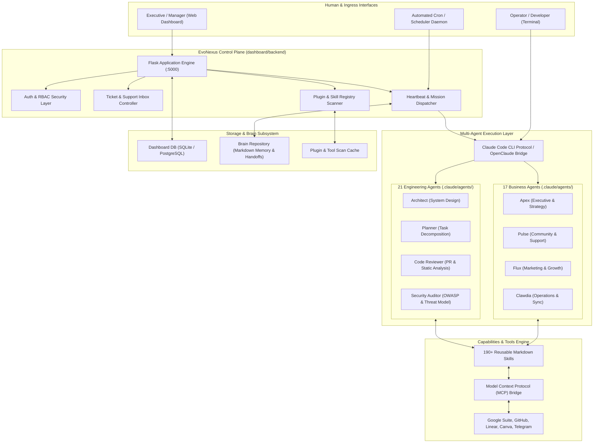
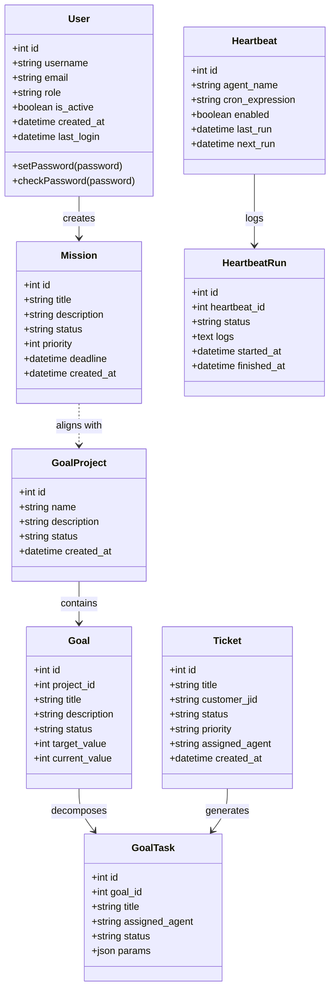
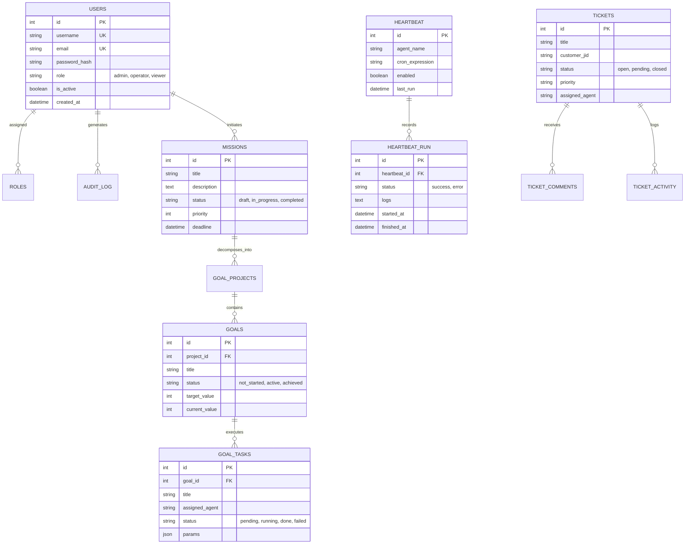
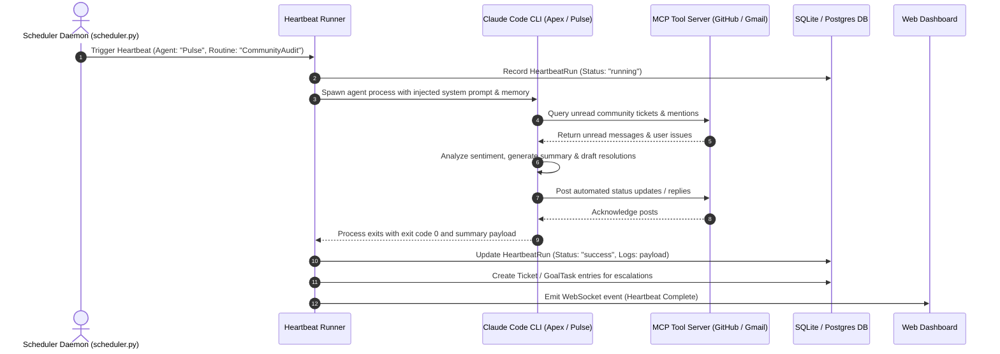

# evo-nexus (EvoNexus) - Architecture & Technical Wiki

> **Multi-Agent Operating Layer & Orchestration Hub for Claude Code CLI & Autonomous Teams**  
> GitHub: [evolution-foundation/evo-nexus](https://github.com/evolution-foundation/evo-nexus) | Stack: Python 3.12+, Flask / SQLAlchemy, Claude Code CLI, OpenClaude, Docker Swarm / Compose, Model Context Protocol (MCP) | License: Apache-2.0

---

## 1. Executive Summary & Value Proposition

**EvoNexus** is the foundational multi-agent operating layer developed by the Evolution Foundation. Engineered as an autonomous orchestration platform built around the Claude Code CLI protocol, EvoNexus transforms a standard terminal installation into an integrated workforce of **38 specialized AI agents** (17 business agents and 21 engineering agents) and **190+ markdown-driven skills**.

Crucially, EvoNexus is not a simple chatbot; it is an active enterprise operating layer that executes scheduled background routines, generates interactive HTML executive reports, triages customer support inboxes, synchronizes calendar events, audits financial health, and orchestrates the development lifecycle of the Evolution Foundation ecosystem (including [Evo CRM Community](evo-crm-community.md), [Evolution API](evolution-api.md), and [Evolution Go](evolution-go.md)).

### Core Problems Solved
- **Vendor Lock-in Elimination**: While defaulting to Anthropic's Claude Code CLI, EvoNexus integrates [OpenClaude](https://www.npmjs.com/package/@gitlawb/openclaude) to route agent prompts transparently across 200+ models on OpenRouter, OpenAI, Google Gemini, AWS Bedrock, Google Vertex AI, or local Ollama instances without modifying agent prompts.
- **Dual-Layer Organizational Division**: Separates operational concerns into two distinct agent groups:
  - **17 Business Agents**: Driving operations, finance, community moderation, marketing copy, human resources, legal compliance, and customer support.
  - **21 Engineering Agents**: Covering architecture, iterative planning, code review, security auditing, testing, and retrospective analysis following a canonical 6-phase engineering lifecycle (`dev-phases.md`).
- **Markdown-First Agent Architecture**: Agents and skills are declared as `.md` system instructions and workflows rather than rigid compiled code. Adding or modifying an agent requires simply creating or editing a markdown file in `.claude/agents/` or via modular plugin manifests.
- **Enterprise Heartbeats & Scheduled Routines**: Employs an asynchronous scheduler (`scheduler.py`) and heartbeat runner (`heartbeat_runner.py`) that wake agents on cron schedules to execute automated auditing, backlog grooming, and repository maintenance.
- **Unified Management Dashboard**: Backed by a Flask/SQLAlchemy engine, EvoNexus provides an executive web dashboard with RBAC, ticket inboxes, goal tracking, terminal sessions, and audit logging.

---

## 2. High-Level System Architecture

The EvoNexus architecture bridges human operators, terminal-based CLI tools, scheduled daemons, and external LLM/MCP providers into a centralized operating plane.



---

## 2.1 Core Domain & Service Class Architecture

EvoNexus organizes backend operations into relational models for mission tracking, scheduled heartbeats, goal decomposition, and plugin auditing.



---

## 3. Technology Stack & Key Dependencies

| Layer | Component / Tool | Role in EvoNexus |
| :--- | :--- | :--- |
| **Agent Protocol** | Claude Code CLI, OpenClaude | Foundation CLI protocol supporting Anthropic, OpenRouter, OpenAI, and Gemini |
| **Backend API** | Python 3.12+, Flask, Werkzeug | REST API and WebSocket controller for the control plane |
| **ORM & Database** | SQLAlchemy, SQLite / PostgreSQL | Structured persistence for users, RBAC, tickets, goals, and heartbeat runs |
| **Task Scheduler** | Python `apscheduler` / `schedule`, asyncio | Cron-based autonomous background agent dispatching |
| **Tool Integration** | Model Context Protocol (MCP) | Standardized client-server bridge for GitHub, Gmail, Linear, Canva, Telegram |
| **Container & Swarm**| Docker, Docker Compose, Docker Swarm | Production containerization (`Dockerfile.swarm`, `evonexus.stack.yml`) |
| **Security & Auth** | Flask-Login, bcrypt, RBAC | Multi-user session management and login rate throttling (`LoginThrottle`) |

---

## 4. Repository Layout & Key Modules

```
inspire/evo-nexus/
├── .claude/
│   ├── agents/                      # 38 System prompt markdown definitions for agents
│   └── rules/                       # Core workflow rules (dev-phases.md, dev-cycle.md)
├── cli/                             # Node.js/TypeScript command line helper wrapper
│   ├── bin/                         # CLI executables
│   └── src/                         # CLI entry points and templates
├── dashboard/                       # Executive web interface
│   ├── backend/                     # Flask REST API backend
│   │   ├── app.py                   # Main Flask application and router endpoints
│   │   ├── models.py                # Complete SQLAlchemy data models
│   │   ├── heartbeat_runner.py      # Background heartbeat execution engine
│   │   ├── ticket_inbox.py          # Unified support ticket inbox
│   │   ├── plugin_loader.py         # Plugin and skill scanner
│   │   └── auth_security.py         # Authentication and role guards
│   ├── frontend/                    # Web dashboard frontend components and assets
│   └── terminal-server/             # Web-based xterm terminal server
├── memory/                          # Persistent agent memory logs and state files
├── plugins/                         # Extensible plugin bundles (skills, hooks, agents)
├── scheduler.py                     # Root scheduler daemon executing automated routines
├── backup.py                        # Automated database and brain repository backup tool
├── ROUTINES.md                      # Declarative definitions of daily/weekly agent routines
├── docker-compose.yml               # Local multi-service orchestration
└── evonexus.stack.yml               # Production Docker Swarm stack definition
```

---

## 5. Core Features & Capabilities

### 5.1 Dual-Layer Agent Architecture
EvoNexus partitions autonomous responsibilities across two dedicated operational tiers:
1. **Business Operations Layer**: Agents such as `Apex` (overall strategic direction), `Clawdia` (daily calendar, email triage, and ops synchronization), `Pulse` (community sentiment and customer engagement), and `Flux` (campaign copywriting and growth experiments).
2. **Software Engineering Layer**: Adheres to a strict 6-phase engineering discipline:
   - *Phase 1: Architecture* (`Architect`)
   - *Phase 2: Planning & Decomposition* (`Planner`)
   - *Phase 3: Implementation & TDD* (`Developer`)
   - *Phase 4: Code Review* (`Code Reviewer`)
   - *Phase 5: Security & Verification* (`Security Auditor`)
   - *Phase 6: Retrospective & Release* (`Retrospective Agent`)

### 5.2 Declarative Routines & Heartbeats
Rather than waiting for user interaction, EvoNexus agents wake autonomously via `scheduler.py`:
- **Morning Standup Routine**: Pulls commits from GitHub, checks unread Linear tickets, checks calendar conflicts, and drafts an executive briefing.
- **Community Health Audit**: Scans community channels, summarizes unanswered member queries, and queues draft replies.
- **Continuous Backlog Grooming**: Evaluates completed tasks, updates `Goal` progress percentages, and archives finished tickets.

### 5.3 Model Context Protocol (MCP) Integration
EvoNexus natively mounts MCP servers into the Claude Code runtime environment, allowing agents to execute external operations deterministically:
- `github-mcp`: Review PRs, create branches, and merge code.
- `google-calendar-mcp` & `gmail-mcp`: Schedule executive meetings and draft outreach responses.
- `linear-mcp`: Transition issues and manage agile sprints.

---

## 6. Data Models & Schema Architecture



---

## 7. Operational Workflows & Sequence Diagrams

### 7.1 Autonomous Scheduled Heartbeat Execution Flow



---

## 8. Strategic Value & Takeaways for MarketingStudio / SGrowing

### 1. Unified Operating Layer Pattern
EvoNexus demonstrates how to organize autonomous marketing and engineering initiatives into distinct agent specializations (17 business, 21 engineering) while sharing a single persistent memory store. MarketingStudio can adopt this taxonomy to separate creative content generation from technical campaign analytics.

### 2. Multi-Model Provider Freedom via OpenClaude
By abstracting the underlying LLM via OpenClaude, teams are not held hostage to single-provider rate limits, outages, or pricing tiers. Critical background tasks can route to high-speed low-cost models (e.g. Gemini Flash / Haiku), while high-level strategic reasoning runs on frontier models (Claude Opus / Sonnet / GPT-4o).

### 3. Asynchronous Routine Heartbeats
The pattern of combining cron-scheduled Python daemons with prompt-driven CLI agents allows an organization to function continuously 24/7 without requiring active human prompt loops.
