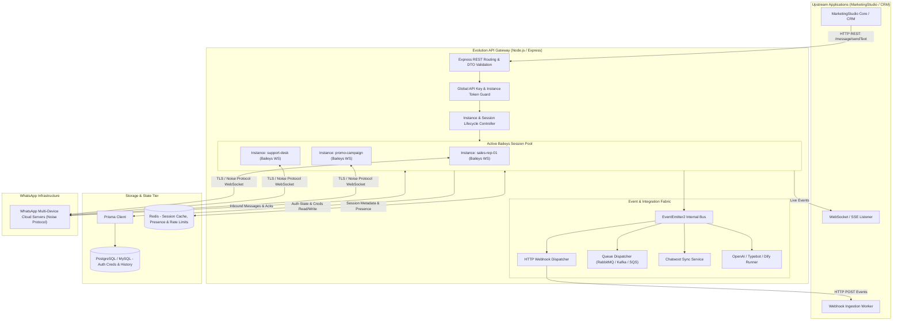
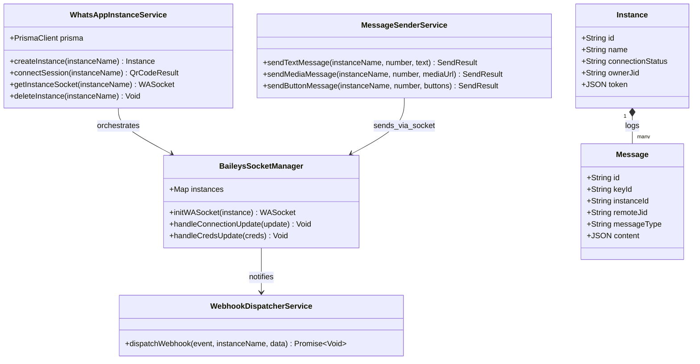
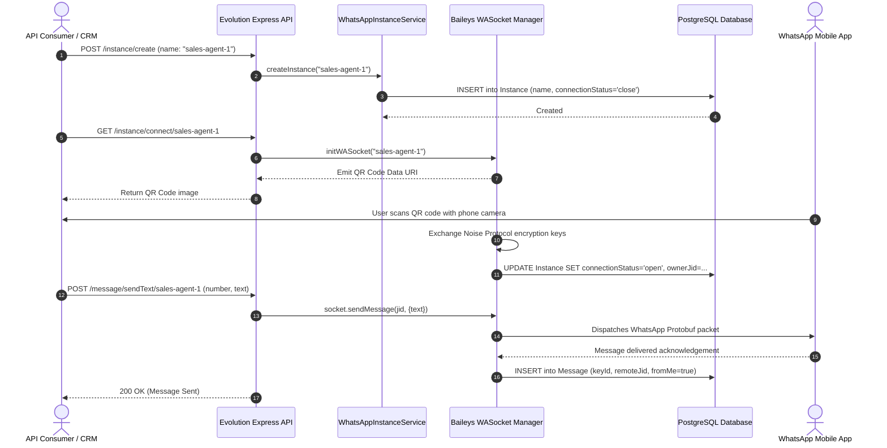

# evolution-api - Architecture & Technical Wiki

> **The Premier Open-Source Multi-Instance WhatsApp API Gateway**  
> GitHub: [EvolutionAPI/evolution-api](https://github.com/EvolutionAPI/evolution-api.git) | Stack: TypeScript, Node.js, Express, Baileys, Prisma, PostgreSQL/MySQL, Redis, RabbitMQ/SQS/Kafka | License: Apache-2.0

---

## 1. Executive Summary & Value Proposition

**evolution-api** is the industry standard for self-hosted, multi-tenant WhatsApp API gateways. By decoupling the WhatsApp Web multi-device protocol from proprietary frontends, Evolution API transforms regular WhatsApp accounts (Personal and Business) into fully automated, programmatic HTTP REST API endpoints. It is engineered specifically for marketing platforms, shared inbox CRM systems, and AI agent orchestrators that require reliable, high-throughput WhatsApp connectivity without paying per-conversation Meta Cloud API fees.

### Core Problems Solved
- **Elimination of Per-Conversation Cloud Fees**: Meta's official WhatsApp Business Cloud API imposes variable conversation fees and strict 24-hour customer service session windows. Evolution API runs on standard WhatsApp numbers with zero per-message API licensing fees.
- **True Multi-Tenant Session Clustering**: Enables a single server deployment to host hundreds of isolated WhatsApp sessions simultaneously, allowing SaaS platforms to provision unique WhatsApp numbers per tenant or sales agent.
- **Resilient Multi-Device Auth State Persistence**: Solves the fragile session drop-out problem common in headless browser bots by persisting cryptographic keys and auth credentials directly to PostgreSQL, MySQL, or Redis using specialized Baileys auth state providers.
- **Enterprise Webhook & Message Broker Ingestion**: Delivers sub-second two-way event streaming through HTTP webhooks, WebSockets, RabbitMQ, Apache Kafka, AWS SQS, and NATS.
- **Turnkey Omnichannel & AI Integrations**: Built-in native connectors for Chatwoot (live agent inbox), Typebot (visual flow builder), OpenAI Assistants, Dify, Flowise, and N8N.

---

## 2. High-Level System Architecture

Evolution API operates as an event-driven microservice. Incoming HTTP REST commands are validated through DTO guards and dispatched to the Baileys session controller. The session controller communicates over an encrypted WebSocket using the WhatsApp Noise Protocol. Inbound events (messages, status receipts, presence updates) are ingested by event listeners, cached in Redis, persisted to relational storage via Prisma, and published to downstream consumers via webhooks or AMQP message brokers.



---

### 2.1 Core Domain & Service Class Architecture



---

## 3. Technology Stack & Key Dependencies

- **Language & Runtime**: TypeScript 5.3+, Node.js 20+ LTS, `tsx` / `tsup` for development and production compilation.
- **Web Application Framework**: Express 4.x with modular router brokers, DTO schema validation, and custom error middleware.
- **WhatsApp Gateway Engine**: `@whiskeysockets/baileys` (v6.x) — pure TypeScript implementation of the WhatsApp Web Multi-Device binary protocol over WebSockets.
- **ORM & Data Layer**: Prisma ORM (v5.x), featuring separate schema manifests for PostgreSQL (`postgresql-schema.prisma`), MySQL (`mysql-schema.prisma`), and PgBouncer connection pooling.
- **In-Memory Cache & Distributed State**: Redis 7+ via `ioredis` for session presence, message buffering, and fast multi-instance coordination.
- **Message Queues & Event Streaming**:
  - `amqplib` for RabbitMQ message broker publishing.
  - `@aws-sdk/client-sqs` for Amazon SQS event delivery.
  - `kafkajs` for high-throughput enterprise event streaming.
  - `nats` for lightweight pub/sub microservice event meshes.
- **Media Processing**: `sharp` for image compression and sticker webp formatting, `fluent-ffmpeg` for Opus PTT audio transcoding.

---

## 4. Repository Layout & Key Modules

```
inspire/evolution-api/
├── prisma/
│   ├── postgresql-schema.prisma     # Complete PostgreSQL relational schema definitions
│   ├── mysql-schema.prisma          # MySQL engine schema definitions
│   └── psql_bouncer-schema.prisma   # Connection pooler optimized definitions
├── src/
│   ├── main.ts                      # Application bootstrap, Express server initialization
│   ├── api/
│   │   ├── abstract/                # Base abstract router, controller, and repository classes
│   │   ├── controllers/             # Instance, Message, Chat, Group, Webhook controllers
│   │   ├── dto/                     # Strongly-typed request payload definitions
│   │   ├── guards/                  # API key authentication & route authorization
│   │   ├── integrations/            # Connectors for Chatwoot, Typebot, Dify, Flowise, OpenAI
│   │   ├── repository/              # Prisma database queries and transaction wrappers
│   │   ├── routes/                  # Express route declarations (sendMessage, instance, etc.)
│   │   ├── services/                # Baileys session lifecycle, message formatting, media conversion
│   │   └── types/                   # TypeScript interfaces and Baileys type overrides
│   ├── cache/
│   │   ├── rediscache.ts            # Redis connection manager and cache helper
│   │   └── localcache.ts            # Fallback memory cache for single-node setups
│   ├── config/                      # Environment variables, logger, and event configs
│   └── utils/
│       ├── use-multi-file-auth-state-prisma.ts   # Custom Baileys auth store backed by PostgreSQL
│       ├── use-multi-file-auth-state-redis-db.ts # Baileys auth state stored directly in Redis
│       └── createJid.ts             # Phone number to WhatsApp remote JID formatting
├── docker-compose.yaml              # Production multi-service orchestration
└── package.json                     # Project manifest and build scripts
```

---

## 5. Core Features & Capabilities

### Multi-Device Session Clustering
Evolution API allows running multiple isolated instances under distinct human-readable identifiers (e.g., `client-acme-prod`, `rep-john`). Each instance maintains its own cryptographic session keys, remote JID mappings, message buffers, and proxy configurations. Sessions are initialized dynamically via the REST API without restarting the server container.

### QR-Code Generation & Phone Pairing Code Auth
The platform supports two pairing mechanisms:
1. **Dynamic Base64 QR-Code**: Emitted via WebSocket and returned in REST response for scanning with the WhatsApp mobile app.
2. **Pairing Code Authentication**: By providing the target phone number, Evolution API triggers WhatsApp's 8-digit pairing code workflow, allowing pairing without a camera.

### Media Upload, Transcoding & Native Voice Notes (PTT)
Evolution API handles full-duplex binary media:
- **Audio / PTT**: Automatically transcodes `.mp3`, `.wav`, or `.m4a` files into `.ogg` Opus audio formatted with correct WhatsApp PTT (push-to-talk) waveforms so they appear as recorded voice notes.
- **Documents & Visuals**: Validates MIME types, generates thumbnail previews, and supports direct uploads via multipart/form-data or remote URLs with base64 conversion.

### Webhook Delivery & Granular Event Filtering
Events are broadcast in real-time over HTTP POST endpoints configured globally or per instance. Administrators can selectively subscribe to specific events:
- `CONNECTION_UPDATE`: Session state changes (`open`, `close`, `connecting`).
- `QRCODE_UPDATED`: Real-time QR rotation.
- `MESSAGES_UPSERT`: New incoming and outgoing message payloads.
- `MESSAGES_UPDATE`: Delivery confirmations (`PENDING`, `SERVER_ACK`, `DELIVERY_ACK`, `READ`).
- `CONTACTS_UPSERT`, `CHATS_UPSERT`, `GROUP_PARTICIPANTS_UPDATE`.

### Anti-Ban Protection & Proxy Routing
To prevent automated spam detection by WhatsApp:
- Each instance can be bound to an individual HTTP/HTTPS/SOCKS5 proxy (`Proxy` model in Prisma).
- Configurable typing delay (`delayMessage`), presence status toggles (`alwaysOnline`, `readMessages`), and automated incoming call rejection with custom automated text notices.

### Native Chatbot & AI Integrations
Built-in integrations forward incoming messages directly to conversational backends:
- **Chatwoot**: Syncs conversations, incoming customer chats, agent replies, and attachments into a shared support inbox.
- **Typebot & Dify**: Executes visual bot flows and multi-step AI automations directly within WhatsApp chats.
- **OpenAI Assistants**: Evaluates incoming text against OpenAI Assistant threads with automated tool-calling callbacks.

---

## 6. Data Models & Schema Architecture

Evolution API's persistence tier is governed by Prisma ORM. The relational model links every operational entity back to an `Instance`.

```mermaid
erDiagram
    Instance ||--o| Session : "stores credentials"
    Instance ||--o{ Message : "owns"
    Instance ||--o{ Chat : "tracks"
    Instance ||--o{ Contact : "syncs"
    Instance ||--o| Webhook : "configures"
    Instance ||--o| Setting : "manages"
    Instance ||--o| Proxy : "routes through"
    Message ||--o| Media : "attaches"
    Message ||--o{ MessageUpdate : "status receipts"

    Instance {
        string id PK
        string name UK "Instance identifier"
        enum connectionStatus "open | close | connecting"
        string ownerJid "Associated WhatsApp phone JID"
        string profileName
        string profilePicUrl
        string token "Instance API key"
        datetime createdAt
        datetime updatedAt
    }

    Session {
        string id PK
        string sessionId FK "Instance foreign key"
        string creds "Serialized Baileys auth credentials JSON"
        datetime createdAt
    }

    Chat {
        string id PK
        string remoteJid "WhatsApp conversation JID"
        string name "Contact or group name"
        json labels
        int unreadMessages
        string instanceId FK
    }

    Contact {
        string id PK
        string remoteJid UK "Contact JID"
        string pushName "User display name"
        string profilePicUrl
        string instanceId FK
    }

    Message {
        string id PK
        json key "Baileys WAMessageKey (remoteJid, fromMe, id)"
        string pushName "Sender push name"
        string messageType "conversation | extendedTextMessage | imageMessage"
        json message "Decoded message content payload"
        enum source "ios | android | web | desktop"
        int messageTimestamp
        string status "PENDING | SENT | DELIVERED | READ"
        string instanceId FK
    }

    MessageUpdate {
        string id PK
        string keyId "Target message ID"
        string remoteJid "Chat JID"
        boolean fromMe
        string status "DELIVERY_ACK | READ | PLAYED"
        string messageId FK
        string instanceId FK
    }

    Webhook {
        string id PK
        string url "Destination HTTP webhook endpoint"
        json headers "Custom request headers"
        boolean enabled
        json events "Array of subscribed event names"
        boolean webhookByEvents "Append event name to URL"
        string instanceId FK
    }

    Media {
        string id PK
        string fileName
        string type "image | video | audio | document"
        string mimetype
        string messageId FK
        string instanceId FK
    }

    Setting {
        string id PK
        boolean rejectCall
        string msgCall
        boolean alwaysOnline
        boolean readMessages
        boolean syncFullHistory
        string instanceId FK
    }

    Proxy {
        string id PK
        boolean enabled
        string host
        string port
        string protocol "http | https | socks5"
        string username
        string password
        string instanceId FK
    }
```



### Core Schema Entity Specifications
- **`Instance`**: Central root entity. Enforces uniqueness on instance `name` and controls instance connection state (`open`, `close`, `connecting`).
- **`Session`**: Retains multi-file authorization state (`creds`). When an instance restarts, Baileys restores crypto keys from this table without requiring QR re-scan.
- **`Message`**: Stores complete inbound and outbound WAMessages. The `key` column stores `{ remoteJid, fromMe, id }` as JSONB.
- **`MessageUpdate`**: Captures delivery status receipts (DLR). Tracks transitions from single tick (server ack) to double tick (delivered) and blue ticks (read).
- **`Webhook`**: Configures downstream HTTP push destinations, including custom authentication headers and event whitelists.

---

### 6.1 Comprehensive Database Schema Specification

Evolution API uses PostgreSQL with Prisma ORM to manage instance configurations, credentials, and message ledgers.

#### Table: `Instance`
Stores provisioned multi-device WhatsApp sessions and connection state.

| Column | Type | Constraints | Default | Description |
| :--- | :--- | :--- | :--- | :--- |
| `id` | `TEXT` | `PRIMARY KEY` | `cuid()` | Unique instance ID |
| `name` | `TEXT` | `NOT NULL, UNIQUE` | - | Unique session name (e.g. `support_line_1`) |
| `connectionStatus`| `TEXT` | `NOT NULL` | `'close'` | Connection state (`open`, `close`, `connecting`) |
| `ownerJid` | `TEXT` | `NULLABLE` | `NULL` | WhatsApp JID of the connected smartphone |
| `token` | `TEXT` | `NULLABLE` | `NULL` | API authorization bearer token |
| `createdAt` | `TIMESTAMP(3)` | `NOT NULL` | `CURRENT_TIMESTAMP` | Creation timestamp |

*Indexes:* `Instance_name_key` (`UNIQUE (name)`).

---

#### Table: `Message`
Historical record of inbound and outbound WhatsApp chat messages.

| Column | Type | Constraints | Default | Description |
| :--- | :--- | :--- | :--- | :--- |
| `id` | `TEXT` | `PRIMARY KEY` | `cuid()` | Internal message ID |
| `keyId` | `TEXT` | `NOT NULL` | - | WhatsApp protocol message ID |
| `instanceId` | `TEXT` | `NOT NULL, FK -> Instance(id)` | - | Associated session instance |
| `remoteJid` | `TEXT` | `NOT NULL` | - | Destination / Sender JID (e.g. `5511999999999@s.whatsapp.net`) |
| `fromMe` | `BOOLEAN` | `NOT NULL` | `false` | True if sent outbound |
| `messageType` | `TEXT` | `NOT NULL` | `'conversation'` | Type (`conversation`, `imageMessage`, `documentMessage`) |
| `createdAt` | `TIMESTAMP(3)` | `NOT NULL` | `CURRENT_TIMESTAMP` | Ingestion timestamp |

*Indexes:* `Message_instanceId_idx` (`(instanceId)`), `Message_remoteJid_idx` (`(remoteJid)`).

---

## 7. API Architecture, Webhooks & Key Endpoints

### 1. Instance Management: Create & Provision Instance
- **POST** `/instance/create`
- **Headers**: `apikey: <GLOBAL_API_KEY>`, `Content-Type: application/json`

**Request Payload:**
```json
{
  "instanceName": "marketing-campaign-01",
  "token": "cust_sec_tok_9918237",
  "qrcode": true,
  "number": "15550192834",
  "integration": "WHATSAPP_BAILEYS",
  "rejectCall": true,
  "msgCall": "This number does not accept incoming voice calls. Please chat with us.",
  "groupsIgnore": false,
  "alwaysOnline": true,
  "readMessages": true
}
```

**Response Payload (`201 Created`):**
```json
{
  "instance": {
    "instanceName": "marketing-campaign-01",
    "instanceId": "cly2348a000108l4gh5b",
    "status": "created"
  },
  "hash": {
    "apikey": "cust_sec_tok_9918237"
  },
  "qrcode": {
    "pairingCode": "K89W-4X2M",
    "code": "2@q...==",
    "base64": "data:image/png;base64,iVBORw0KGgoAAAANSUhEUgAA..."
  }
}
```

### 2. Messaging: Send Text Message with Quoted Reply
- **POST** `/message/sendText/marketing-campaign-01`
- **Headers**: `apikey: cust_sec_tok_9918237`, `Content-Type: application/json`

**Request Payload:**
```json
{
  "number": "15559876543",
  "text": "Hello Alexander, your marketing audit report is ready for download!",
  "delay": 1200,
  "linkPreview": true,
  "quoted": {
    "key": {
      "remoteJid": "15559876543@s.whatsapp.net",
      "fromMe": false,
      "id": "BAE59F82A034"
    },
    "message": {
      "conversation": "Can you send my report?"
    }
  }
}
```

**Response Payload (`200 OK`):**
```json
{
  "key": {
    "remoteJid": "15559876543@s.whatsapp.net",
    "fromMe": true,
    "id": "3EB0C2719B2D8E"
  },
  "message": {
    "extendedTextMessage": {
      "text": "Hello Alexander, your marketing audit report is ready for download!"
    }
  },
  "messageTimestamp": 1729768120,
  "status": "PENDING"
}
```

### 3. Messaging: Send PTT Audio Note (Voice Message)
- **POST** `/message/sendWhatsAppAudio/marketing-campaign-01`
- **Headers**: `apikey: cust_sec_tok_9918237`, `Content-Type: application/json`

**Request Payload:**
```json
{
  "number": "15559876543",
  "audio": "https://assets.marketingstudio.io/audio/voice-memo-sample.mp3",
  "delay": 2000,
  "encoding": true
}
```

### 4. Webhook Inbound Message Event Payload (`MESSAGES_UPSERT`)
Dispatched by Evolution API to MarketingStudio's webhook endpoint when a customer sends a message:
```json
{
  "event": "messages.upsert",
  "instance": "marketing-campaign-01",
  "data": {
    "key": {
      "remoteJid": "15559876543@s.whatsapp.net",
      "fromMe": false,
      "id": "3EB0A98F73412B"
    },
    "pushName": "Jane Doe",
    "message": {
      "conversation": "I'd like to book a demo for next Tuesday."
    },
    "messageType": "conversation",
    "messageTimestamp": 1729768200,
    "owner": "marketing-campaign-01",
    "source": "ios"
  },
  "destination": "https://api.marketingstudio.io/v1/webhooks/whatsapp",
  "date_time": "2026-10-24T11:50:00.000Z",
  "server_url": "https://evolution.marketingstudio.internal",
  "apikey": "cust_sec_tok_9918237"
}
```

---

### 7.5 End-to-End Operational Lifecycle Sequence

The following sequence details the full lifecycle from instance provisioning to QR code pairing and automated message dispatch.



---

## 8. Strategic Value & Takeaways for MarketingStudio

### Reusable Architectural Patterns
1. **Prisma-Backed Baileys Auth Store (`use-multi-file-auth-state-prisma`)**:
   - *Problem*: Traditional Baileys instances write encryption keys to ephemeral local disk files. In multi-container Docker or Kubernetes environments, container restarts destroy the credentials, requiring customers to re-scan QR codes.
   - *Solution*: Evolution API implements a custom multi-file auth adapter that serializes Baileys credentials into PostgreSQL records keyed by instance ID. MarketingStudio must implement this pattern to ensure zero session drop-offs during automated deployments.

2. **Decoupled Queue Ingestion Pipeline (RabbitMQ / Kafka)**:
   - *Problem*: Direct HTTP webhook dispatching blocks Node.js event loops when downstream webhook endpoints suffer latency spikes.
   - *Solution*: Evolution API decouples inbound WhatsApp socket events from HTTP egress by pushing messages to RabbitMQ/Kafka topics. MarketingStudio should adopt this broker architecture to buffer inbound chat surges during viral marketing campaigns.

3. **Instance-Scoped Proxy Binding**:
   - *Problem*: Running hundreds of WhatsApp connections from a single server IP triggers Meta's automated network fingerprinting and shadow-bans.
   - *Solution*: Evolution API models proxy credentials at the `Instance` level (`Proxy` schema), injecting dedicated HTTP/SOCKS5 agents into individual Baileys WebSocket handshakes. This enables MarketingStudio to assign dedicated residential proxies to high-value enterprise accounts.

### Concrete Convergence Roadmap for MarketingStudio
- **Unified Gateway Connector**: Adopt Evolution API as the primary high-throughput WhatsApp driver for MarketingStudio's conversational marketing suite.
- **Shared Inbox Bridge**: Leverage Evolution API's prebuilt Chatwoot integration to sync WhatsApp customer dialogues seamlessly into MarketingStudio's agent workspace.
- **Automated Lead Qualifier**: Chain inbound `messages.upsert` webhooks to MarketingStudio's AI workflow builder to qualify inbound leads before routing them to human sales representatives.
