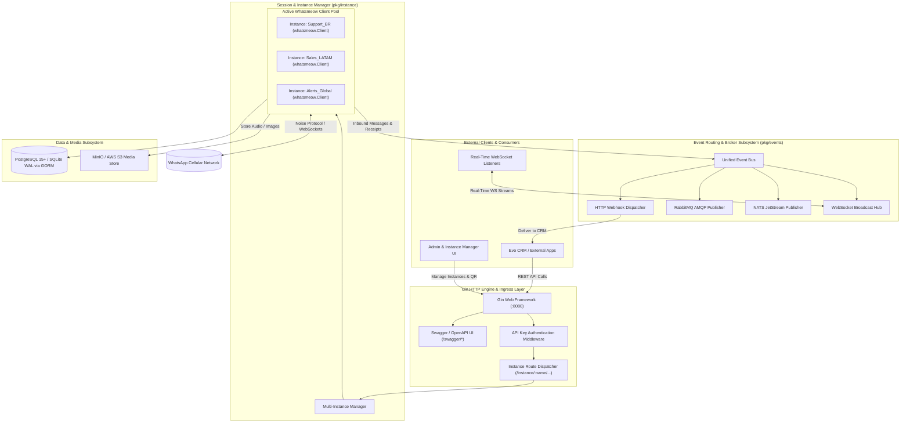
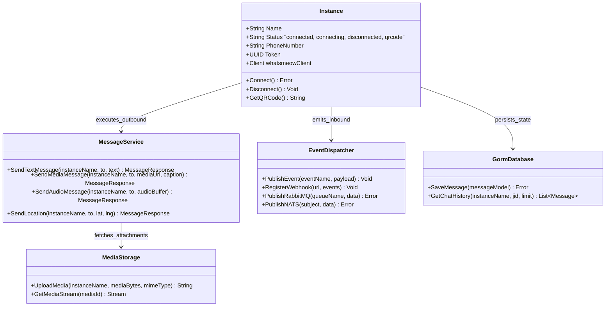
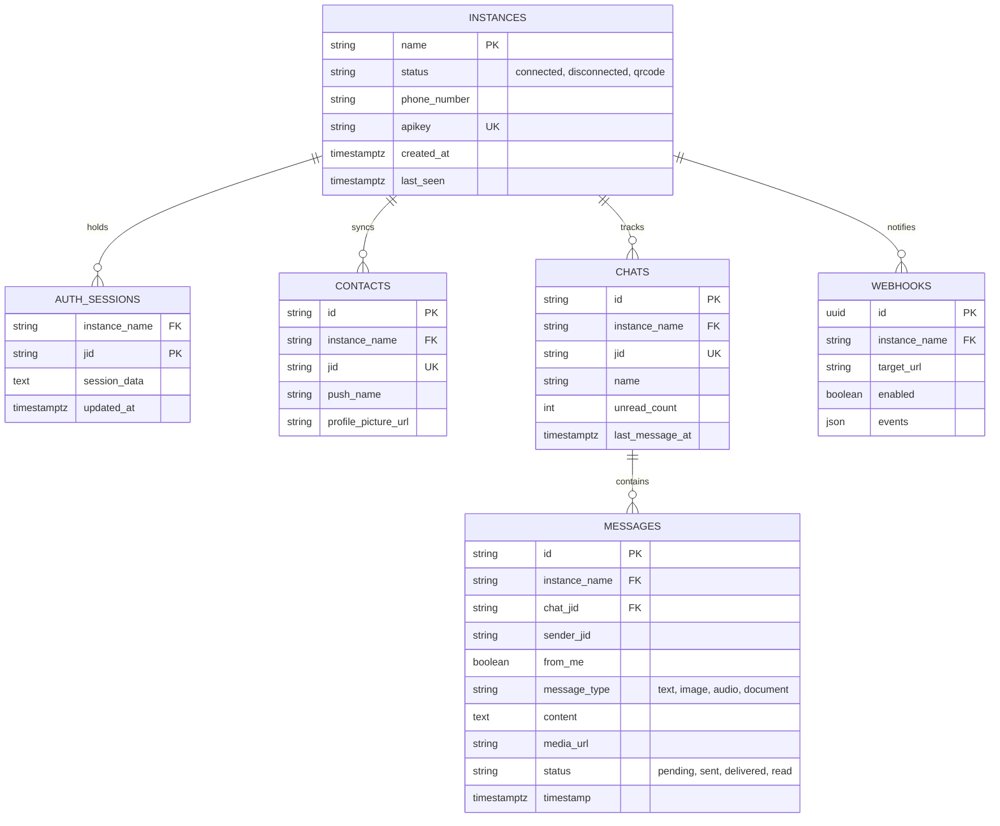
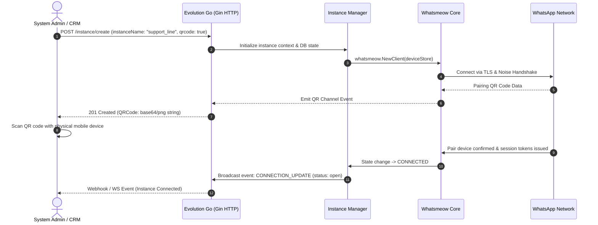

# evolution-go (Evolution Go) - Architecture & Technical Wiki

> **High-Performance, Lightweight WhatsApp API Gateway Engineered in Go & Whatsmeow**  
> GitHub: [evolution-foundation/evolution-go](https://github.com/evolution-foundation/evolution-go) | Stack: Go 1.25+, Gin Framework, Whatsmeow, GORM (PostgreSQL / SQLite), RabbitMQ, NATS, MinIO / S3, Docker | License: Apache-2.0

---

## 1. Executive Summary & Value Proposition

**evolution-go** is the compiled, high-throughput WhatsApp messaging engine developed by the Evolution Foundation. Engineered as a high-performance alternative to Node.js/Baileys-based WhatsApp gateways (such as [evolution-api](evolution-api.md)), Evolution Go leverages the raw concurrency, low memory footprint, and goroutine parallelism of Go paired with the [whatsmeow](https://github.com/tulir/whatsmeow) library.

Evolution Go provides a multi-tenant RESTful API, embedded Swagger documentation, multi-instance session management, automated QR code generation, and multi-broker event streaming (Webhooks, WebSockets, RabbitMQ, and NATS) for enterprise high-volume WhatsApp communication.

### Core Problems Solved
- **Resource Exhaustion in Node.js WhatsApp Gateways**: Node.js/Puppeteer/Baileys stacks often consume hundreds of megabytes per connected session. Evolution Go drastically reduces memory consumption to tens of megabytes per WhatsApp instance, allowing hundreds of concurrent instances on modest hardware.
- **High-Velocity Message Dispatch**: Capable of processing thousands of inbound/outbound messages per second without event loop lag.
- **Enterprise Event Fanout**: Dispatches real-time WhatsApp events (message received, message status, presence updates) across multiple enterprise event brokers simultaneously: RabbitMQ (AMQP), NATS, WebSockets, and HTTP webhooks.
- **Decoupled Media Storage**: Automatically downloads, decrypts, and uploads incoming images, audio voice notes, videos, and documents to S3-compatible object storage (MinIO/AWS S3), preventing disk saturation.
- **Drop-in WhatsApp Provider**: Serves as the primary WhatsApp transport layer for CRM suites like [Evo CRM Community](evo-crm-community.md).

---

## 2. High-Level System Architecture

Evolution Go is structured as a modular Go service centered around the Gin HTTP framework, an internal instance manager managing `whatsmeow` client structs, and an event dispatcher publishing to queues and webhooks.



---

### 2.1 Core Domain & Service Class Architecture



---

## 3. Technology Stack & Key Dependencies

- **Language & Runtime**: Go 1.25+ (compiled binary, zero runtime dependency)
- **HTTP Web Framework**: `gin-gonic/gin` v1.10 (fast HTTP router, middleware chain, JSON binding)
- **API Documentation**: `swaggo/gin-swagger` v1.6 & `swaggo/swag` (OpenAPI specification auto-generation)
- **WhatsApp Core Protocol**: `go.mau.fi/whatsmeow` (Golang library implementing the WhatsApp Web multi-device protobuf and Noise encryption protocols)
- **ORM & Persistence**: `gorm.io/gorm` v1.25 with drivers for PostgreSQL (`gorm.io/driver/postgres`) and SQLite (`modernc.org/sqlite`)
- **Event Brokers**:
  - `rabbitmq/amqp091-go` v1.10 (AMQP 0-9-1 for enterprise queue consumers)
  - `nats-io/nats.go` v1.39 (ultra-fast cloud-native messaging)
  - `gorilla/websocket` v1.5 (bidirectional live socket streaming)
- **Object Storage**: `minio/minio-go/v7` v7.0.80 (S3-compatible bucket interactions)
- **Utilities**: `skip2/go-qrcode` (ASCII and PNG QR code rendering for browser terminal pairing)

---

## 4. Repository Layout & Key Modules

```
evolution-go/
├── cmd/
│   └── server/                        # Application entrypoint (main.go)
├── pkg/
│   ├── instance/                      # Instance lifecycle, registration, connection states
│   ├── whatsmeow/                     # Whatsmeow event listeners, pairing, protobuf wrappers
│   ├── sendMessage/                   # Outbound payloads (Text, Media, Audio, Buttons, Polls)
│   ├── message/                       # Message parsing, decryption, format conversions
│   ├── chat/                          # Chat history, mark-as-read, typing status indicators
│   ├── group/                         # Group creation, participant management, metadata
│   ├── community/                     # WhatsApp Community channel creation and management
│   ├── newsletter/                    # WhatsApp Newsletter / Broadcast channel APIs
│   ├── events/                        # Event publisher adapters (Webhook, AMQP, NATS, WS)
│   ├── storage/                       # MinIO / S3 upload adapters and asset cache
│   ├── middleware/                    # API key validation, rate-limiting, CORS, logging
│   └── routes/                        # Gin HTTP route declarations and Swagger annotations
├── manager/                           # Instance manager controller and background heartbeats
├── passkey-helper/                    # Passkey verification and authentication utilities
├── docs/                              # Generated Swagger docs (swagger.json, swagger.yaml)
├── Dockerfile                         # Multi-stage lightweight scratch/alpine container build
├── Makefile                           # Development, test, swagger-gen, and build automation
└── go.mod                             # Go module definition and dependencies
```

---

## 5. Core Features & Capabilities

### 5.1 Multi-Instance WhatsApp Isolation
Evolution Go is designed for multi-tenant SaaS environments:
- Each WhatsApp phone number operates as a named **Instance** (e.g., `company_support`, `marketing_alerts`).
- Every instance maintains its own cryptographic session keys, in-memory buffers, and isolated SQLite/PostgreSQL connection.
- Instances can be dynamically created, reconnected, or deleted at runtime via REST calls without restarting the Go process.

### 5.2 Multi-Broker Event Streaming
Incoming events (e.g., `MESSAGES_UPSERT`, `MESSAGES_UPDATE`, `CONNECTION_UPDATE`, `CALL_OFFER`) can be broadcast across multiple channels concurrently:
1. **HTTP Webhooks**: Instant HTTP POST deliveries to endpoint URLs with retry backoff.
2. **RabbitMQ**: Direct publishing to AMQP exchanges for worker-pool consumption.
3. **NATS**: Subject-based event distribution (`whatsapp.instance.events`).
4. **WebSockets**: Streamed to live dashboard UIs for sub-millisecond agent notifications.

### 5.3 Automated Media Transcoding & Cloud Offloading
When an audio voice note, high-resolution photo, or PDF contract is received:
- Evolution Go automatically requests the media decryption key from WhatsApp servers.
- It decrypts the stream in-memory, converts voice notes to compatible Opus/OGG formats, and streams the buffer directly to MinIO/S3.
- The webhook payload delivered to the CRM contains clean public URLs rather than bloated base64 data strings.

---

## 6. Data Models & Schema Architecture



---

## 7. Operational Workflows & Sequence Diagrams

### 7.1 Instance Provisioning & QR-Code Pairing Flow



---

## 8. Strategic Value & Takeaways for MarketingStudio / SGrowing

### Reusable Architectural Patterns
1. **Lightweight Concurrency**: The Go + `whatsmeow` architecture proves that high-volume WhatsApp automation can be executed at a fraction of the RAM footprint required by Node.js or Chromium-based alternatives.
2. **Multi-Protocol Fanout**: The unified event dispatcher pattern (broadcasting events simultaneously to Webhooks, WebSockets, RabbitMQ, and NATS) is directly applicable to MarketingStudio’s webhook delivery architecture.
3. **Decoupled Media Ingestion**: Streaming binary payload decryption straight into S3/MinIO rather than serializing as base64 inside JSON requests keeps API payloads lean and prevents memory spikes.
