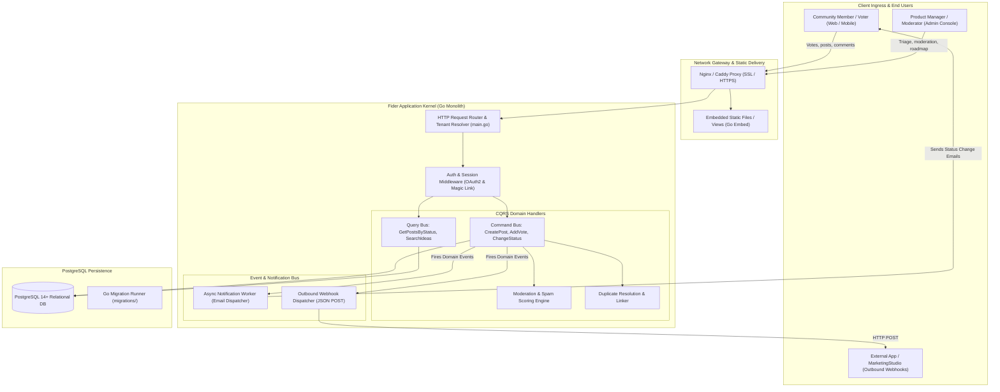
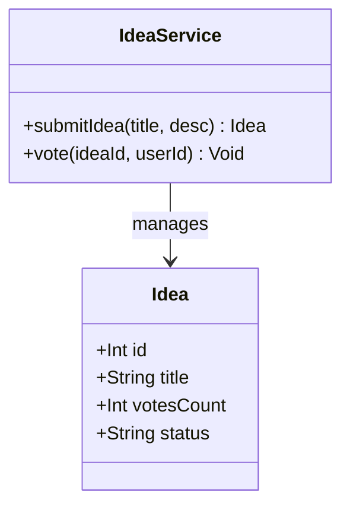
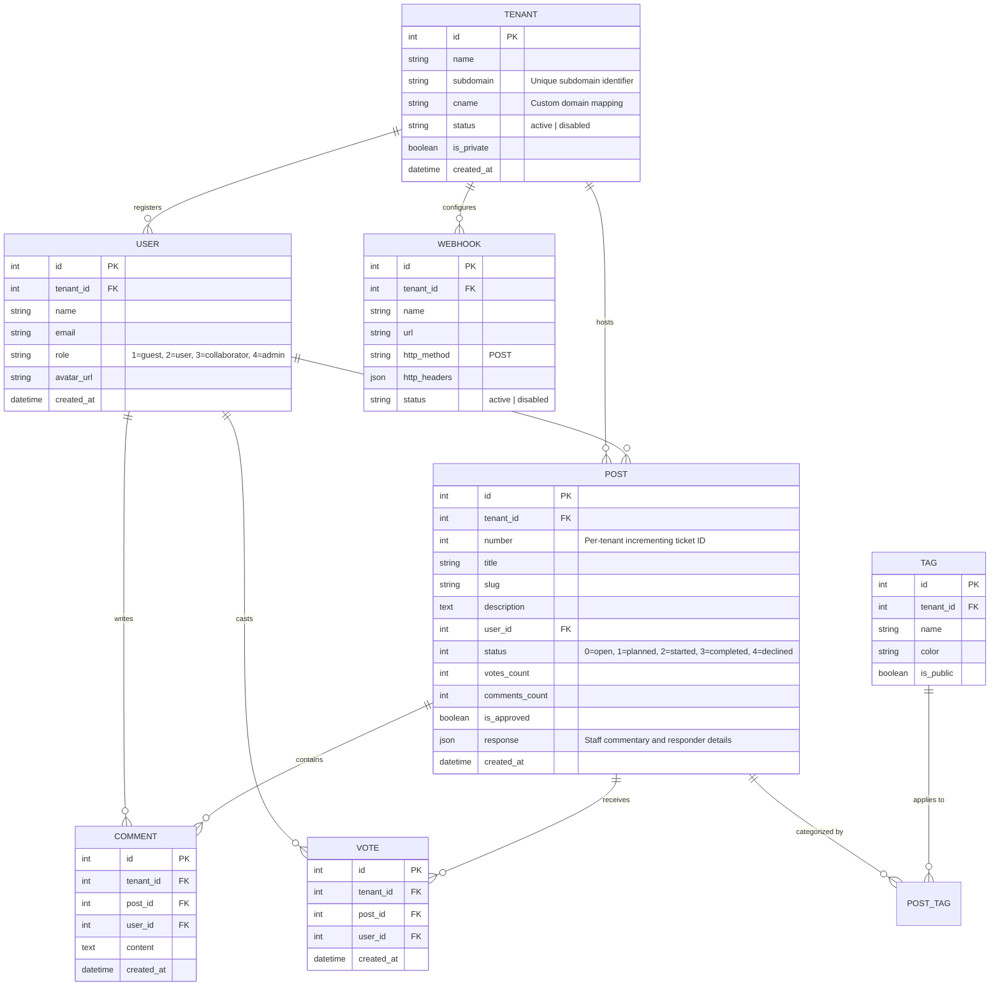
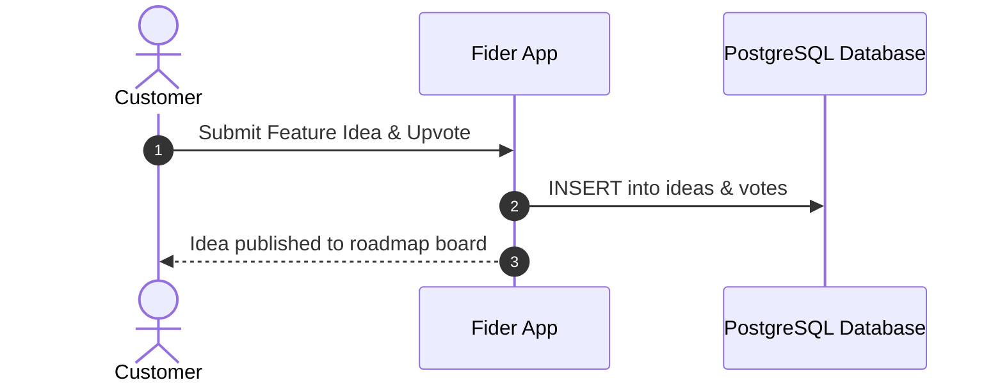

# fider - Architecture & Technical Wiki

> **Open-Source Customer Feedback Forum, Feature Voting Platform & Public Roadmap Engine**  
> GitHub: [getfider/fider](https://github.com/getfider/fider) | Stack: Go (Golang) 1.22+, PostgreSQL 14+, React 18, TypeScript, esbuild, Tailwind CSS | License: AGPLv3

---

## 1. Executive Summary & Value Proposition

**Fider** is an open-source customer feedback platform and feature voting engine engineered as an accessible, self-hosted alternative to Canny, UserVoice, and Productboard. Designed to bridge the communication gap between product teams and their user communities, Fider enables software companies to collect, organize, and prioritize feature requests, bug reports, and product suggestions through transparent community upvoting.

Traditional customer feedback channels—such as fragmented support tickets, scattered Slack messages, and unorganized email threads—suffer from lack of visibility, frequent duplicate submissions, and zero customer feedback loops. Fider resolves this by providing a unified, multi-tenant portal where customers can submit suggestions, vote on priorities, and engage in threaded discussions. Product managers can moderate proposals, tag ideas, mark duplicates, publish official staff responses, and transition approved items across an automated **Public Roadmap** (Planned, Started, Completed).

### Core Problems Solved
- **Feature Request Fragmentation & Noise**: Consolidates customer suggestions into a public or private community board with real-time fuzzy search to surface existing ideas before duplicates are filed.
- **Democratic Community Prioritization**: Empowers users to allocate votes to proposals, providing product managers with clear quantitative signal on market demand.
- **Duplicate Request Merging**: Provides built-in duplicate tracking where duplicate ideas reference the canonical post (`OriginalPost`), preserving discussion context while aggregating vote signals.
- **Closed-Loop Feedback & Roadmap Transparency**: Automatically notifies subscribed users via transactional email whenever a proposal changes status (e.g., from `Planned` to `Started` or `Completed`).
- **High-Performance Minimalist Footprint**: Built with compiled Go and lightweight React, consuming minimal memory and delivering sub-20ms API response times backed by PostgreSQL.

---

## 2. High-Level System Architecture

Fider adopts a compiled monolithic architecture in **Go**, applying the **Command Query Responsibility Segregation (CQRS)** pattern across business domains (`app/models/cmd` for mutations and `app/models/query` for reads). The frontend is a **React 18** Single-Page Application bundled via **esbuild**.



### Architectural Lifecycle of Feedback Processing
1. **Tenant Resolution**: Every incoming HTTP request passes through tenant resolution middleware. Fider inspects the Host header to match `tenants.subdomain` or `tenants.cname`.
2. **Post Submission & Duplicate Search**: As a user types their suggestion title, client-side debounce queries `GET /api/v1/posts?query={text}` to display potential duplicate matches. If unique, the user submits `POST /api/v1/posts`.
3. **Command Execution**: The command bus runs `CreatePostCommand`, generating a URL-safe slug, assigning an incrementing tenant-scoped `number`, sanitizing description markdown, and automatically casting the author's initial upvote.
4. **Moderation & Approval**: Depending on tenant settings (`is_approved_by_default`), the idea is either immediately published or queued for moderator review.
5. **Status Mutation & Roadmap Transition**: A staff member updates the status to `planned` with an official response message (`PostResponse`). The command updates PostgreSQL and dispatches an asynchronous event to `NotificationWorker`, sending email updates to every voter.

---

### 2.1 Core Domain & Service Class Architecture



---

## 3. Technology Stack & Key Dependencies

- **Language & Runtime**: Go (Golang) 1.22+, Node.js 20+ (for frontend compilation).
- **Backend Application Framework**:
  - Native Go standard library HTTP routing with lightweight middleware wrappers.
  - CQRS command/query separation.
  - SQL migrations executed via native Go SQL runners (`migrations/`).
- **Database & Object Relational Mapper**:
  - **PostgreSQL 14+**: Relational persistence using raw SQL queries with type-safe struct mapping (`github.com/lib/pq`).
  - Full-text search utilizing PostgreSQL trigram matching and `tsvector` indexes.
- **Frontend & UI Libraries**:
  - **React 18**, TypeScript, and LinguiJS for internationalization.
  - **esbuild**: Sub-second compilation pipeline.
  - Tailwind CSS for modern responsive styling.
- **Authentication & Security**:
  - OAuth 2.0 social login (Google, GitHub, Facebook, Azure AD).
  - Passwordless Email Magic Links via SMTP.

---

## 4. Repository Layout & Key Modules

```
fider/
├── app/
│   ├── actions/                      # Reusable controller actions
│   ├── handlers/                     # HTTP Handlers
│   │   ├── apiv1/                    # Public REST API v1 (post, user, tag, moderation)
│   │   ├── admin.go                  # Staff admin endpoints & board configuration
│   │   ├── post.go                   # Post creation, voting, and status updates
│   │   ├── roadmap.go                # Public roadmap column renderers
│   │   └── webhook.go                # Outbound webhook configuration
│   ├── models/                       # CQRS domain models
│   │   ├── cmd/                      # Command models (CreatePost, AddVote, SetStatus)
│   │   ├── dto/                      # Data transfer objects
│   │   ├── entity/                   # Relational database entities (post, tenant, user, vote)
│   │   ├── enum/                     # System enumerations (PostStatus, UserRole)
│   │   └── query/                    # Query models (SearchPosts, GetRoadmap)
│   ├── pkg/                          # Shared Go packages (crypto, errors, markdown)
│   └── services/                     # Business services (email, oauth, storage)
├── migrations/                       # Sequential SQL migration files
├── public/                           # Static assets, favicon, localized strings
├── views/                            # Server-rendered HTML templates for SSR
├── main.go                           # Server bootstrapper & route registration
└── go.mod                            # Go module dependencies
```

---

## 5. Core Features & Capabilities

### 5.1 Community Voting & Atomic Ballot Mechanics
Fider allows users to upvote proposals they support:
- Users can cast votes on active ideas (`open`, `planned`, `started`).
- Voting is guarded against race conditions using atomic database increments:
  ```sql
  UPDATE posts SET votes_count = votes_count + 1 WHERE id = $1;
  ```
- **Vote Refunds on Resolution**: When a proposal is marked `Completed` or `Declined`, Fider can release votes back to respondents so they can allocate them to other active initiatives.

### 5.2 Status Workflow & Public Roadmap
Fider structures idea lifecycles through discrete stages:
- **`Open`**: Community proposal open for debate and upvoting.
- **`Planned`**: Confirmed on product roadmap.
- **`Started`**: Active engineering development.
- **`Completed`**: Shipped and deployed to production.
- **`Declined`**: Out of scope or rejected with a transparent staff explanation.
- **`Duplicate`**: Merged into an existing canonical issue.
- The **Public Roadmap** automatically aggregates items into kanban columns (`Planned`, `Started`, `Completed`).

### 5.3 Duplicate Resolution & Canonical Merging
- Staff can flag redundant requests as duplicates, linking them to an original target (`OriginalPost`).
- The duplicate post displays a visual badge directing future visitors to the primary thread, preventing fragmented discussion.

### 5.4 Multi-Tenant White-Label Architecture
- Single Fider cluster hosts multiple independent organizations via `Tenant` entities.
- Supports custom subdomains (`feedback.yourcompany.com`), custom logos, localized brand colors, and private access restrictions (requiring corporate OAuth or email domain whitelists).

---

## 6. Data Models & Schema Architecture

Fider utilizes a clean relational PostgreSQL schema scoped strictly by `tenant_id`.



### Core Schema Invariants
1. **Per-Tenant Post Numbers**: The composite unique index on `(tenant_id, number)` ensures user-facing URLs (e.g. `/posts/42/add-dark-mode`) increment cleanly within each tenant board.
2. **Single Vote Constraint**: A unique index on `(tenant_id, post_id, user_id)` guarantees a user can only vote on a given idea once.
3. **Atomic Counter Synchronization**: Triggers and transactional updates maintain `votes_count` and `comments_count` directly on the `posts` table to eliminate expensive `COUNT(*)` aggregations.

---

### 6.1 Comprehensive Database Schema Specification

#### Table: `ideas`
| Column | Type | Constraints | Default | Description |
| :--- | :--- | :--- | :--- | :--- |
| `id` | `SERIAL` | `PRIMARY KEY` | - | Idea ID |
| `title` | `VARCHAR(255)` | `NOT NULL` | - | Feature request title |
| `votes_count` | `INTEGER` | `NOT NULL` | `1` | Upvotes count |
| `status` | `VARCHAR(50)` | `NOT NULL` | `'open'` | Status (`open`, `planned`, `completed`) |

---

## 7. API Architecture, Webhooks & Key Endpoints

Fider provides a RESTful JSON API (`/api/v1/*`) for programmatic integration.

### Key REST Endpoints

| HTTP Method | Endpoint | Description |
|:---|:---|:---|
| `GET` | `/api/v1/posts` | Paginated idea list filtered by status, tag, or search query |
| `POST` | `/api/v1/posts` | Creates a new feedback post |
| `POST` | `/api/v1/posts/{number}/votes` | Casts a vote on a specific post |
| `DELETE` | `/api/v1/posts/{number}/votes` | Retracts an existing vote |
| `POST` | `/api/v1/posts/{number}/status` | Updates post status (`planned`, `completed`, etc.) with staff response |
| `GET` | `/api/v1/roadmap` | Fetches grouped roadmap columns for public display |
| `POST` | `/api/v1/admin/webhooks` | Registers an outbound webhook destination |

### Sample Request: Status Transition (`POST /api/v1/posts/42/status`)
```json
{
  "status": "planned",
  "text": "Thank you for the suggestion! We have prioritized this for our Q1 roadmap."
}
```

### Sample Outbound Webhook Payload (`post.status_changed`)
```json
{
  "event": "post.status_changed",
  "tenant": {
    "name": "MarketingStudio Community",
    "subdomain": "feedback.marketingstudio.internal"
  },
  "post": {
    "id": 1042,
    "number": 42,
    "title": "Automated Multi-Channel Campaign Attribution",
    "slug": "automated-multi-channel-campaign-attribution",
    "status": "planned",
    "votes_count": 87,
    "url": "https://feedback.marketingstudio.internal/posts/42/automated-multi-channel-campaign-attribution",
    "author": {
      "name": "Chloe Bennett",
      "email": "chloe@growthventures.io"
    },
    "response": {
      "text": "Thank you for the suggestion! We have prioritized this for our Q1 roadmap.",
      "responded_at": "2026-10-24T12:00:00Z",
      "author": "Product Team"
    }
  }
}
```

---

### 7.5 End-to-End Operational Lifecycle Sequence



---

## 8. Strategic Value & Takeaways for MarketingStudio

### Reusable Architectural Patterns
1. **CQRS Architecture in Go for Ultra-Low Overhead**:
   - Fider's strict separation between commands (`app/models/cmd`) and queries (`app/models/query`) ensures maintainable, bug-free domain logic. For MarketingStudio’s public feedback and roadmap modules, implementing CQRS provides clean auditing and rapid reads.
2. **Community Feedback Loops & Public Roadmap Convergence**:
   - Integrating a public roadmap directly with customer voting enables MarketingStudio to close the feedback loop: marketing leads and existing customers feel heard, and automated status transition emails re-engage users when requested features launch.
3. **Duplicate Request Triage Pattern**:
   - Fider’s UX and schema for linking duplicate requests (`OriginalPost`) prevents community fragmentation and provides a clean workflow for customer support agents triaging repetitive feedback.
4. **Single-Binary Zero-Dependency Deployment**:
   - The compiled Go binary embedding all static assets and React bundles offers a friction-free deployment model that can be packaged directly into MarketingStudio’s single-tenant appliance offerings.
