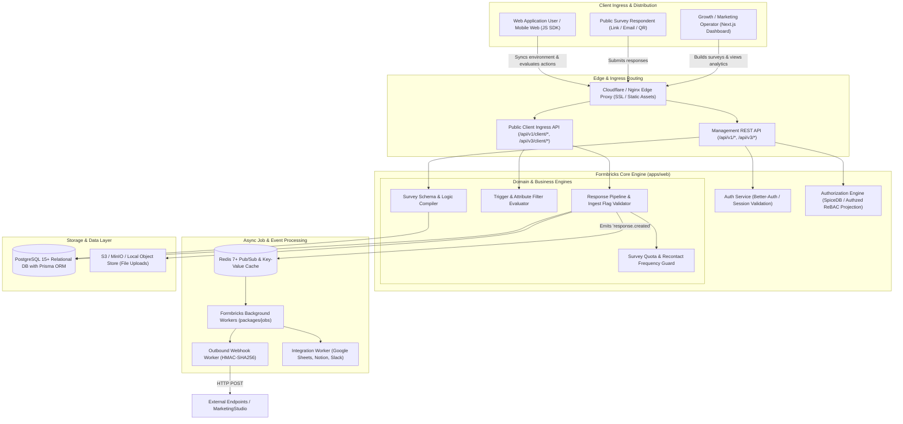
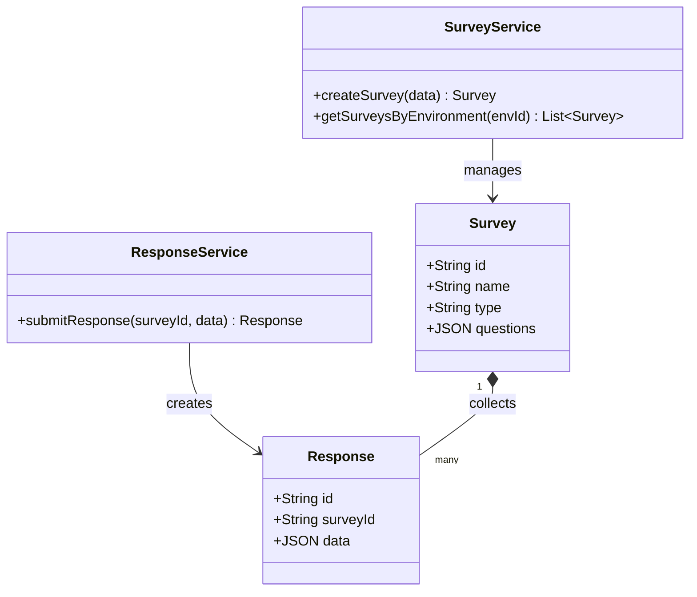
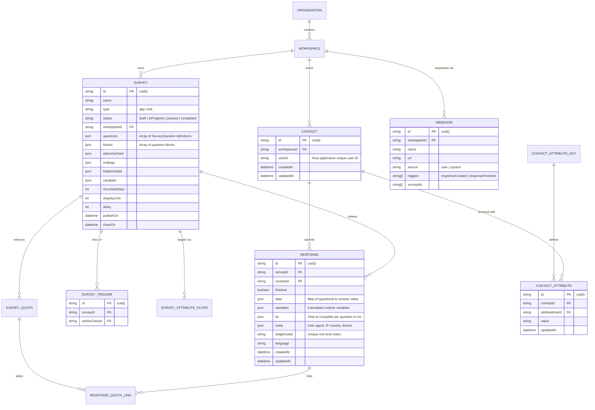
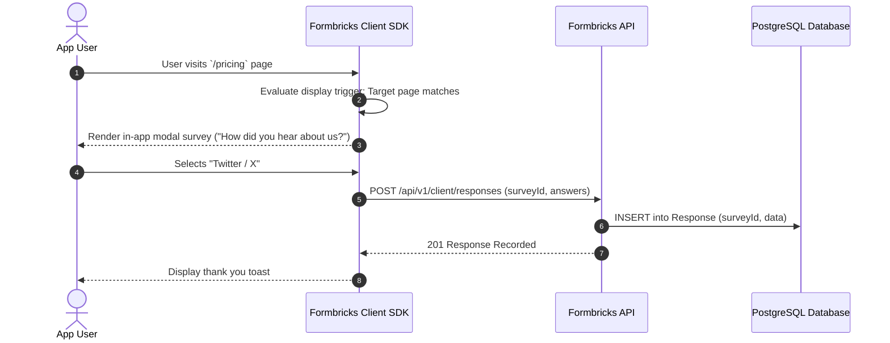

# formbricks - Architecture & Technical Wiki

> **Enterprise Open-Source Experience Management Suite & In-App Micro-Survey Targeting Engine**  
> GitHub: [formbricks/formbricks](https://github.com/formbricks/formbricks) | Stack: TypeScript, Next.js 15/16 (App Router), Prisma ORM, PostgreSQL, Redis, SpiceDB/Authzed, Better-Auth, Tailwind CSS | License: AGPLv3 / Enterprise

---

## 1. Executive Summary & Value Proposition

**Formbricks** is the leading open-source Experience Management (XM) platform and privacy-first micro-survey engine. Engineered as an extensible, enterprise-grade alternative to Qualtrics, SurveyMonkey, and PostHog surveys, Formbricks enables product, marketing, and customer success teams to deploy hyper-targeted surveys directly inside web and mobile applications, as standalone links, or embedded in email flows.

Traditional survey solutions suffer from rigid monolithic rendering, intrusive full-page interruptions, high latency, and severe privacy disconnects when handling sensitive customer data. Formbricks resolves these limitations through a decoupled architecture: an ultra-lightweight, zero-dependency client SDK (`@formbricks/js-core`) communicates with a reactive Next.js backend, executing precise client-side targeting rules, multi-attribute cohort filtering, and event-driven trigger evaluations without round-tripping to central servers for every DOM state transition.

### Core Problems Solved
- **In-App Survey Fatigue & Intrusiveness**: Eliminates disruptive popups through non-intrusive modal overlays, floating slide-ins, and embedded inline cards driven by client-side trigger rules (click events, URL changes, user cohort attributes).
- **Decoupled Client-Side Action & Attribute Evaluation**: Dispatches survey definitions with compiled targeting logic directly to the user's browser, enabling instant evaluation of custom events (`trackAction`) and user attributes without latency.
- **Enterprise Multi-Tenant Data Governance & Access Control**: Features granular workspace isolation backed by PostgreSQL row schemas and relationship-based access control (ReBAC) projected into SpiceDB / Authzed.
- **Bi-Directional Customer Data Convergence**: Automatically maps survey responses to unified `Contact` records, synchronizing enriched response metadata and time-to-complete (TTC) telemetry across webhooks, Segment, Slack, Zapier, and Google Sheets.
- **High-Throughput Keyset-Paginated Ingest**: Employs keyset cursor pagination and atomic row-constructor database predicates `(created_at, id) < ($1, $2)` to process millions of responses without table scan degradation.

---

## 2. High-Level System Architecture

Formbricks operates as a modern monorepo combining a Next.js App Router core (`apps/web`), shared TypeScript domain packages (`packages/database`, `packages/surveys`, `packages/js-core`, `packages/survey-ui`), and background queue workers (`packages/jobs`).



### Architectural Lifecycle of a Formbricks In-App Survey
1. **Environment Initialization & Client Cache**: When the host web application boots, the Formbricks SDK (`formbricks.init()`) queries `GET /api/v1/client/{environmentId}/environment`. The response bundles active surveys, trigger action definitions, and attribute filter trees into client-side IndexedDB / memory.
2. **Local Trigger Evaluation**: User interactions (such as completing an onboarding checklist or clicking a pricing tier) fire `formbricks.track("plan_upgraded")`. The client-side targeting engine evaluates whether the action matches survey triggers, checks recontact rules (`recontactDays`), and validates display limits.
3. **Modal DOM Mounting & Conversational Rendering**: Upon a trigger match, `@formbricks/survey-ui` mounts an accessible, sandboxed iframe or shadow DOM element. Steps, logic branching, and dynamic variable replacements (e.g., `Hello, {{ contact.name }}`) are computed instantly without network round-trips.
4. **Optimistic Partial Ingestion**: When the respondent answers question #1, a `POST /api/v1/client/{environmentId}/responses` payload creates an in-progress response. As subsequent questions are answered, `PUT /api/v1/client/{environmentId}/responses/{responseId}` stream answers incrementally, capturing drop-off points.
5. **Event Propagation & Integrations**: Upon response finalization (`finished: true`), the server verifies quota limits (`SurveyQuota`), tags contact records, stores telemetry (TTC), and publishes an event to Redis. Background jobs dispatch webhooks and push transformed rows to third-party integrations.

---

### 2.1 Core Domain & Service Class Architecture



---

## 3. Technology Stack & Key Dependencies

- **Language & Runtime**: TypeScript 5.4+, Node.js 20+ LTS, pnpm workspaces.
- **Application Framework**: Next.js 15/16 with React 19, Server Components, and App Router API endpoints.
- **Database & Object Relational Mapper**:
  - PostgreSQL 15+ managed via **Prisma ORM** with modular multi-file schema architecture (`main.prisma`, `retention.prisma`, `workflows.prisma`).
  - Strict keyset cursor indexes combining `(survey_id, created_at, id)` for deterministic high-volume pagination.
- **Caching & Message Broker**: Redis 7+ for environment metadata caching, rate-limiting counters, and async worker pipelines.
- **Authorization & Security**:
  - **SpiceDB / Authzed**: Relationship-Based Access Control (ReBAC) projecting permissions asynchronously via transactional outbox triggers.
  - **Better-Auth** with OAuth providers (GitHub, Google, Azure AD) and session tokens.
- **Frontend & UI Libraries**:
  - Tailwind CSS v4, Lucide Icons, Radix UI primitives.
  - `@formbricks/survey-ui`: Lightweight React component library supporting WCAG 2.2 AA accessibility standards.
  - `@formbricks/js-core`: Zero-dependency vanilla JavaScript SDK bundle for web and mobile browsers.
- **Validation & Serialization**: Zod schemas across shared types (`packages/api-v3-schemas`, `packages/types`).

---

## 4. Repository Layout & Key Modules

```
formbricks/
├── apps/
│   ├── web/                          # Main Next.js App Router application
│   │   ├── app/                      # App router directory
│   │   │   ├── (app)/                # Authenticated application dashboard routes
│   │   │   ├── (auth)/               # Better-Auth login, signup, invite flows
│   │   │   ├── api/                  # REST APIs (v1, v2, v3, client, mcp, billing)
│   │   │   └── s/[surveyId]/         # Standalone public link survey renderer
│   │   └── lib/                      # Server-side business utilities, cache, services
│   └── storybook/                    # Component documentation & visual test harness
├── packages/
│   ├── api-v3-schemas/               # Shared Zod validation schemas for V3 API contracts
│   ├── cache/                        # Redis-backed distributed cache invalidation helpers
│   ├── database/                     # Core persistence package
│   │   ├── schema/                   # Multi-file Prisma definitions (main, retention, workflows)
│   │   ├── migration/                # SQL migration files and triggers
│   │   └── src/                      # PrismaClient singleton exports & query extensions
│   ├── js-core/                      # Core vanilla JS SDK for web client targeting
│   ├── jobs/                         # Background job handlers (webhooks, email dispatch)
│   ├── storage/                      # File upload adapters (S3, Azure Blob, MinIO)
│   ├── survey-ui/                    # Headless & themed survey question UI components
│   ├── surveys/                      # Survey builder canvas, block editors, and logic parsers
│   └── types/                        # Core TypeScript type definitions & interfaces
├── docker/                           # Production Dockerfiles and docker-compose templates
└── scripts/                          # CI validation, container security scans, DB seeding
```

---

## 5. Core Features & Capabilities

### 5.1 Advanced Client-Side Targeting & Micro-Survey Triggers
Formbricks avoids heavy backend polling by pushing declarative targeting rule sets to the client runtime:
- **Action Triggers (`ActionClass`)**: Evaluates DOM clicks, inner text matches, CSS selectors, and programmatic JavaScript calls (`trackAction("pricing_clicked")`).
- **User Attribute Filters (`SurveyAttributeFilter`)**: Matches visitor properties (e.g., `role === 'admin'`, `mrr > 500`, `signedUpDays >= 14`) using boolean operators (`equals`, `notEquals`, `greaterThan`, `lessThan`, `contains`).
- **Segment-Based Cohort Scoping**: Links surveys to dynamic `Segments` constructed from real-time customer behavioral properties.
- **Recontact Frequency & Display Caps**: Enforces `recontactDays` cooldown windows (e.g., do not show another survey to this user for 30 days) and `displayLimit` quotas per user.

### 5.2 Declarative Logic Branching & Question Piping
Surveys support complex conditional routing executed seamlessly within both link and in-app modes:
- **Block-Level Logic Rules**: Each survey block evaluates jumping criteria (e.g., `if NPS score <= 6 then jump to 'Detractor Feedback Block'`).
- **Dynamic Variable Recall & Piping**: Interpolates previously answered questions, hidden query parameters, or contact attributes directly into subsequent question prompts (`"What did you dislike most about {{ q_feature_dropdown }}?"`).
- **Hidden Fields & URL Parameter Capture**: Captures UTM tags, referral IDs, user emails, and arbitrary query string arguments without exposing input fields to the respondent.

### 5.3 Keyset Ingestion, Drop-Off Tracking & Partial Responses
Unlike traditional forms that discard incomplete answers, Formbricks captures partial submissions:
- Responses are initialized as `finished: false` upon the first answer submission.
- Real-time time-to-complete (`ttc`) telemetry logs the exact millisecond duration spent on every single question.
- Abandonment analytics highlight friction points and high drop-off steps across complex multi-step questionnaires.

### 5.4 Anti-Spam, Rate Limiting & Single-Use Tokens
- **Single-Use Survey Links**: Generates encrypted single-use tokens (`singleUseId`) backed by composite unique database constraints (`@@unique([surveyId, singleUseId])`), guaranteeing that email invite links cannot be submitted more than once.
- **IP & User Cooldown Throttling**: Restricts anomalous spikes through Redis sliding-window rate limiters.
- **HoneyPot Fields**: Transparently catches automated scrapers without degrading respondent UX.

---

## 6. Data Models & Schema Architecture

The data model maintains strict relational isolation across workspaces, contacts, surveys, and responses.



### Core Schema Invariants
1. **Atomic Keyset Indexes**: Responses utilize a compound index on `(surveyId, createdAt, id)` ensuring that `GET /api/v3/responses` paginates millions of rows efficiently via row-constructor predicates without offset skips.
2. **Contact-Centric De-duplication**: Contacts are keyed uniquely on `(workspaceId, userId)`. When an authenticated user submits a survey, their responses automatically bind to their historical profile.
3. **Encrypted Single-Use Enforcement**: The unique constraint `@@unique([surveyId, singleUseId])` prevents race conditions when concurrent duplicate submissions hit the link survey endpoint.

---

### 6.1 Comprehensive Database Schema Specification

Formbricks runs on PostgreSQL with Prisma ORM.

#### Table: `Survey`
| Column | Type | Constraints | Default | Description |
| :--- | :--- | :--- | :--- | :--- |
| `id` | `TEXT` | `PRIMARY KEY` | `cuid()` | Survey ID |
| `name` | `TEXT` | `NOT NULL` | - | Survey name |
| `type` | `TEXT` | `NOT NULL` | `'web'` | Type (`web`, `email`, `link`) |
| `status` | `TEXT` | `NOT NULL` | `'draft'` | Status (`draft`, `inProgress`, `completed`) |
| `questions` | `JSONB` | `NOT NULL` | `'[]'` | Structured question blocks |

*Indexes:* `Survey_status_idx` (`(status)`).

---

#### Table: `Response`
| Column | Type | Constraints | Default | Description |
| :--- | :--- | :--- | :--- | :--- |
| `id` | `TEXT` | `PRIMARY KEY` | `cuid()` | Response ID |
| `surveyId` | `TEXT` | `NOT NULL, FK -> Survey(id)` | - | Associated survey |
| `data` | `JSONB` | `NOT NULL` | `'{}'` | User answers map |
| `createdAt` | `TIMESTAMP(3)` | `NOT NULL` | `CURRENT_TIMESTAMP` | Submission time |

*Indexes:* `Response_surveyId_idx` (`(surveyId)`).

---

## 7. API Architecture, Webhooks & Key Endpoints

Formbricks provides distinct API tiers: Public Client Ingress APIs for headless/SDK integration, and Management V1/V3 APIs for administrative control.

### Key REST Endpoints

| HTTP Method | Endpoint | Description |
|:---|:---|:---|
| `GET` | `/api/v1/client/{envId}/environment` | Fetches active surveys, targeting rules, and action classes for SDK cache |
| `POST` | `/api/v1/client/{envId}/responses` | Creates an in-progress response session and records initial answers |
| `PUT` | `/api/v1/client/{envId}/responses/{responseId}` | Incrementally updates response answers and question completion times |
| `GET` | `/api/v3/management/surveys` | Lists all surveys within the authenticated workspace |
| `POST` | `/api/v3/management/surveys` | Programmatically creates a survey with questions, logic, and triggers |
| `GET` | `/api/v3/management/responses` | Keyset-paginated retrieval of responses with filter criteria |
| `POST` | `/api/v1/management/webhooks` | Registers an outbound webhook subscription for response events |

### Sample Request: In-App Response Creation (`POST /api/v1/client/{envId}/responses`)
```json
{
  "surveyId": "clt92x9ab000108l071b712fa",
  "contactId": "clt92x1ab000008l043a290bc",
  "finished": false,
  "data": {
    "q_nps_rating": 9,
    "q_primary_reason": "Seamless onboarding and great developer documentation."
  },
  "meta": {
    "userAgent": "Mozilla/5.0 (Macintosh; Intel Mac OS X 10_15_7)",
    "country": "US",
    "device": "desktop"
  },
  "ttc": {
    "q_nps_rating": 2840,
    "q_primary_reason": 6430
  }
}
```

### Sample Outbound Webhook Payload (`responseFinished`)
```json
{
  "event": "responseFinished",
  "timestamp": "2026-10-24T12:00:00.000Z",
  "data": {
    "id": "rsp_9812401928401",
    "surveyId": "clt92x9ab000108l071b712fa",
    "surveyName": "Q4 NPS & Feature Evaluation",
    "finished": true,
    "createdAt": "2026-10-24T11:58:30.000Z",
    "updatedAt": "2026-10-24T12:00:00.000Z",
    "answers": {
      "q_nps_rating": 9,
      "q_primary_reason": "Seamless onboarding and great developer documentation.",
      "q_recommend_colleague": true
    },
    "contact": {
      "id": "cnt_1092830192",
      "userId": "usr_corp_9941",
      "attributes": {
        "plan": "Enterprise",
        "role": "Lead Architect"
      }
    }
  }
}
```

---

### 7.5 End-to-End Operational Lifecycle Sequence



---

## 8. Strategic Value & Takeaways for MarketingStudio

### Reusable Architectural Patterns
1. **Client-Side Trigger & Evaluation Cache**:
   - Rather than pinging a central server on every page view or user click, MarketingStudio should adopt Formbricks’ model of syncing targeting rules and attribute segment trees to the client during session bootstrap. This enables MarketingStudio’s lead-capture forms, upgrade prompts, and CSAT modals to trigger instantly with zero latency.
2. **Incremental Response Ingestion with Drop-Off Forensics**:
   - Persisting partial answers (`finished: false`) along with question-level time-to-complete (`ttc`) data gives MarketingStudio complete funnel visibility. Marketing operators can identify exactly which form field causes lead drop-off and retarget visitors who started but didn't complete high-intent lead capture forms.
3. **Decoupled Relational Schema with JSON Question Definitions**:
   - Instead of maintaining complex polymorphic database tables for every conceivable question type, Formbricks stores question blocks, choices, and logic rules as structured JSON within the `Survey` model while keeping `Response` records indexed and relational. MarketingStudio should implement this JSON-backed schema compiler for its dynamic Form Builder module.
4. **Keyset Cursor Pagination for High-Throughput Submissions**:
   - By utilizing row-constructor predicates `(created_at, id) < ($1, $2)`, MarketingStudio guarantees linear query performance when exporting or synchronizing millions of survey responses into downstream CRM tools without hitting PostgreSQL offset-scan limits.
