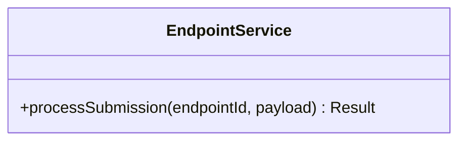
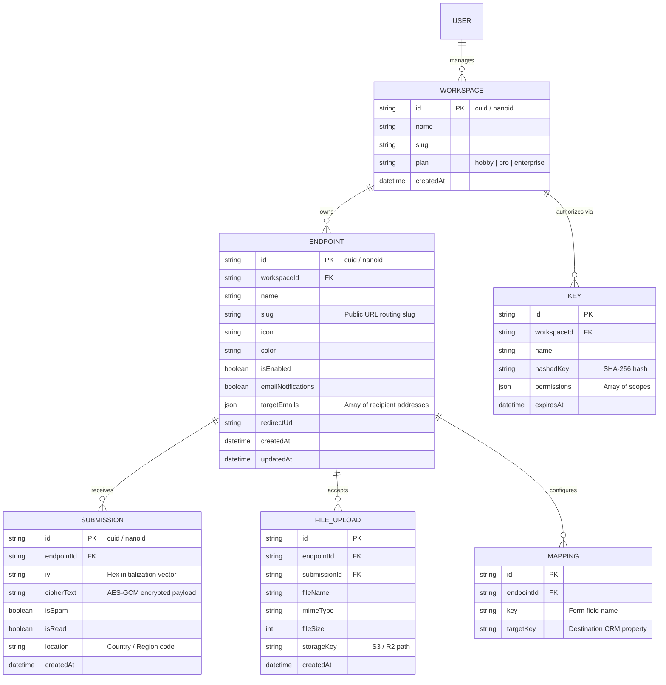
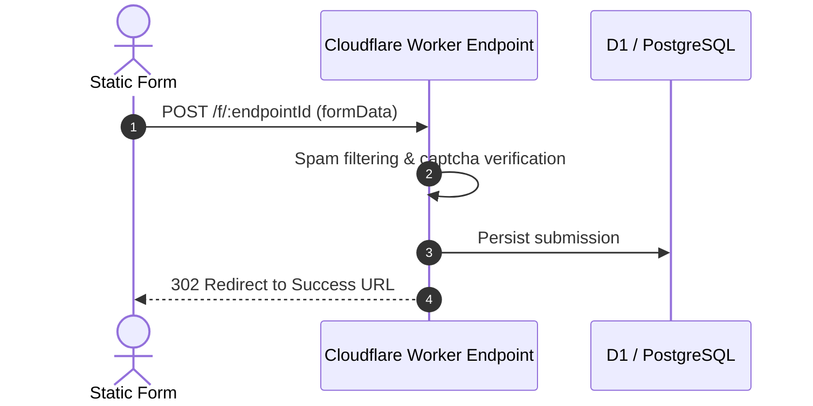

# formizee - Architecture & Technical Wiki

> **Zero-Knowledge Encrypted Form Backend, Headless Ingestion Engine & Edge-Native Submission Vault**  
> GitHub: [formizee/formizee](https://github.com/formizee/formizee) | Stack: TypeScript, Hono, Cloudflare Workers / D1, Turso / LibSQL, Drizzle ORM, Next.js 15, Biome | License: Apache-2.0

---

## 1. Executive Summary & Value Proposition

**Formizee** is an open-source, edge-native form backend and headless submission ingestion engine built for high-security environments, developers, and privacy-conscious enterprises. Engineered as an encrypted alternative to Formspree, Basin, and Formkeep, Formizee decouples the visual form UI from backend ingestion: frontend developers write standard HTML `<form action="https://api.formizee.com/v1/f/{slug}">` markup or use headless React hooks, while Formizee handles spam filtering, file attachments, email notifications, and end-to-end encrypted storage.

Traditional form backends store customer lead entries, contact requests, and confidential intake data in plain text, creating massive exposure vectors during data breaches or compliance audits. Formizee eliminates this threat through a zero-knowledge **Vault Architecture**: every submission is encrypted at the edge using AES-GCM 256-bit encryption with a unique initialization vector (`data_iv`) and ciphertext (`data_cipher_text`) prior to disk persistence. The plaintext data is only decryptable using client-held encryption keys or private vault sessions.

### Core Problems Solved
- **Plaintext Submission Exposure & Breach Liability**: Protects user submissions via zero-knowledge cryptographic vaults (`apps/vault`), isolating the management control plane from encrypted submission payloads.
- **Sub-50ms Global Edge Ingestion**: Runs on the **Hono** web framework deployed to Cloudflare Workers and globally distributed LibSQL / Turso SQLite databases.
- **Headless Developer Freedom Without Vendor UI Constraints**: Allows developers to host static HTML, React, Svelte, or Next.js forms anywhere without bundling heavy JavaScript libraries or styling runtimes.
- **Spam Filtering & Honeypot Detection Without Captcha Friction**: Features transparent bot mitigation, honeypot traps, Akismet integration, and IP reputation scoring without annoying user-facing CAPTCHAs.
- **Multi-Tenant Workspace & API Key Control**: Manages endpoint quotas, rate limits, custom webhook destinations, and developer tokens via granular role permissions and log drains.

---

## 2. High-Level System Architecture

Formizee is built as an edge-first monorepo using **Turborepo** and **pnpm workspaces**. The API layer (`apps/api`) runs on **Hono** compiled to Cloudflare Workers, persisting records across dual Drizzle ORM database schemas (Management Database and Encrypted Vault Database).

```mermaid
flowchart TD
    subgraph IngressClients ["Ingress Clients & Web Applications"]
        StaticHTML["Static HTML Lead Form (<form action=...>)"]
        ReactNextApp["React / Next.js Headless Form (fetch / axios)"]
        DeveloperDashboard["Workspace Operator (Next.js 15 App Router)"]
    end

    subgraph EdgeRouting ["Edge Network & Global Gateways"]
        CloudflareEdge["Cloudflare Edge Network (DDoS / SSL / CDN)"]
        EdgeWorker["Hono API Worker (apps/api /v1/*)"]
    end

    subgraph FormizeePipeline ["Edge Processing & Vault Pipeline"]
        HoneypotCheck["Spam & Honeypot Filter (internal/encryption)"]
        VaultEncryption["AES-GCM Encryption Vault (apps/vault)"]
        RateLimiter["Distributed Edge Rate Limiter (Cloudflare KV)"]
        EmailNotifier["Email Notification Dispatcher (internal/email)"]
    end

    subgraph DatabaseTier ["Dual Drizzle ORM Storage (LibSQL / Turso)"]
        MainDB[(Management DB: Workspaces, Endpoints, Users, Keys)]
        SubmissionsDB[(Encrypted Vault DB: Submissions, IVs, CipherText)]
        R2Storage["Cloudflare R2 Object Storage (Encrypted File Uploads)"]
    end

    subgraph AsyncEgress ["Outbound Egress & Integrations"]
        LogDrain["Logdrain Pipeline (apps/logdrain)"]
        Webhooks["Outbound Webhook Dispatcher"]
        Destinations["MarketingStudio / Downstream CRM / SIEM"]
    end

    %% Flow connections
    StaticHTML -->|Direct POST submit| CloudflareEdge
    ReactNextApp -->|JSON POST submit| CloudflareEdge
    DeveloperDashboard -->|Manages endpoints & views decrypted data| CloudflareEdge

    CloudflareEdge --> EdgeWorker

    EdgeWorker --> RateLimiter
    RateLimiter --> HoneypotCheck
    HoneypotCheck --> MainDB
    HoneypotCheck --> VaultEncryption

    VaultEncryption -->|Writes IV + Ciphertext| SubmissionsDB
    VaultEncryption -->|Stores Encrypted Blobs| R2Storage

    EdgeWorker --> EmailNotifier
    EdgeWorker --> LogDrain
    EdgeWorker --> Webhooks

    Webhooks --> Destinations
    LogDrain --> Destinations
```



### Architectural Lifecycle of an Ingestion Request
1. **Public Ingress**: A visitor submits a lead form targeting `POST /v1/f/{endpoint_slug}`.
2. **Endpoint Resolution & Validation**: The Hono worker extracts the endpoint slug from the request path, querying the cached `MainDB.endpoints` table to ensure the endpoint is active (`is_enabled: true`) and retrieve its settings (allowed origins, redirection URL, notifications).
3. **Bot Scoring & Honeypot Scrubbing**: The worker checks hidden honeypot fields (`_gotcha` or `_hp`) and validates submission structure. If flagged as malicious, the submission is recorded with `is_spam: true` or dropped according to security preferences.
4. **Zero-Knowledge Encryption**: The raw JSON or form-data payload is transformed into an encrypted block using AES-256-GCM in `internal/vault`. The initialization vector (`data_iv`) and ciphertext (`data_cipher_text`) are generated.
5. **Atomic Edge Persistence**: The worker writes the encrypted record to `SubmissionsDB.submissions`, dispatches asynchronous email alerts (`internal/email`), fires registered outbound webhooks with HMAC signatures, and redirects the user to `redirect_url` (or returns JSON `201 Created`).

---

### 2.1 Core Domain & Service Class Architecture



---

## 3. Technology Stack & Key Dependencies

- **Language & Runtime**: TypeScript 5.5+, Cloudflare Workers (workerd runtime) / Node.js 20+.
- **Web Framework**:
  - **Hono**: Ultra-fast, lightweight web framework designed for edge environments.
  - `@formizee/hono`: Internal routing and middleware helpers.
- **Database & Object Relational Mapper**:
  - **Drizzle ORM**: Type-safe TypeScript ORM operating with dual database contexts:
    - `schemas/main`: Workspaces, Users, Endpoints, API Keys.
    - `schemas/submissions`: Endpoints, Databases, Submissions, File Uploads, Mappings.
  - **Storage Engine**: Turso (distributed LibSQL) or Cloudflare D1 SQLite.
- **Cryptography & Security**:
  - Web Crypto API (`crypto.subtle`) for native AES-GCM 256-bit encryption.
  - `internal/encryption`: Envelope encryption, key derivation (PBKDF2/Argon2), and HMAC-SHA256 signatures.
- **Frontend & Management Dashboard**:
  - Next.js 15 (App Router), React 19, Tailwind CSS.
  - Biome: High-speed linter and formatter.
- **Object Storage**: Cloudflare R2 / AWS S3 for secure multipart file attachment uploads.

---

## 4. Repository Layout & Key Modules

```
formizee/
├── apps/
│   ├── api/                          # Edge Hono API (Cloudflare Worker)
│   │   └── src/
│   │       ├── lib/                  # Environment parsers, Hono factory
│   │       ├── v1/                   # REST routing (endpoints, submissions, keys)
│   │       └── index.ts              # Worker entrypoint & fetch handler
│   ├── dashboard/                    # Next.js 15 Management Web Console
│   │   ├── app/                      # App router views (endpoints, submissions, settings)
│   │   └── components/               # Decryption modal, analytics graphs, data tables
│   ├── logdrain/                     # Ingestion log drain & audit streaming service
│   ├── vault/                        # Zero-knowledge encryption & key management service
│   └── web/                          # Public marketing website and documentation
├── internal/
│   ├── analytics/                    # Time-series submission metrics & aggregators
│   ├── billing/                      # Plan limits, stripe checkout, usage meters
│   ├── db/                           # Drizzle ORM schemas and migration scripts
│   │   └── src/schemas/
│   │       ├── main/                 # endpoints, keys, users, workspaces
│   │       └── submissions/          # databases, endpoints, file-uploads, submissions
│   ├── email/                        # Transactional email dispatcher (Resend, SES)
│   ├── encryption/                   # AES-GCM encryption and decrypt routines
│   └── vault/                        # Client-side encryption key derivation
├── tools/                            # Key generation & local development tools
├── biome.json                        # Monorepo linting and formatting configuration
└── turbo.json                        # Turborepo task pipeline configuration
```

---

## 5. Core Features & Capabilities

### 5.1 Zero-Knowledge Encryption Vault
Formizee’s defining security feature is its zero-trust data separation:
- Submissions are never stored as plain JSON in the database.
- Every submission payload is transformed into an encrypted envelope:
  ```typescript
  {
    iv: "4b98...a7e1",
    cipherText: "f802...19bc42"
  }
  ```
- In zero-knowledge mode, the server does not store the master workspace encryption key. Decryption occurs entirely inside the operator's browser using a locally saved passphrase.

### 5.2 Multi-Database Submission Sharding
To satisfy strict sovereignty requirements (GDPR, HIPAA):
- Workspaces can connect private external databases (`submissions.databases`) hosted in specific geographic regions.
- The control plane routes incoming submissions directly to the tenant’s dedicated SQLite / Postgres database instance, ensuring data never touches shared cloud disks.

### 5.3 Automated Spam Prevention & Honeypot Routing
- **Silent Honeypots**: Automatically detects fields named `_gotcha`, `_hp`, or `_trap`. Automated bots that populate these fields are silently flagged without alerting the attacker.
- **Custom Redirects & Fallbacks**: Endpoints configure dynamic success redirects (`redirectUrl`) or direct JSON responses for AJAX/fetch integrations.

### 5.4 File Uploads & Encrypted Blob Pipelines
- Supports `multipart/form-data` uploads with automatic file routing to Cloudflare R2 or S3.
- Attachments are stored as encrypted blobs referenced in `submissions.file-uploads`, requiring signed temporal tokens for retrieval.

---

## 6. Data Models & Schema Architecture

Formizee separates control metadata from submission payloads across two isolated Drizzle ORM schemas.



### Core Schema Invariants
1. **Decoupled Vault Schemas**: The `main` database schema knows nothing about the internal structure of submitted form fields; it only stores endpoint routing rules and authentication keys.
2. **Deterministic Cryptographic Vectors**: The `submissions` table strictly requires both `data_iv` and `data_cipher_text`. Records without valid IV pairs are rejected at the database level.
3. **Cascade Deletion Boundaries**: Deleting an `endpoint` cascades deletions to all associated encrypted submissions and file uploads, guaranteeing compliance with right-to-be-forgotten requests.

---

### 6.1 Comprehensive Database Schema Specification

#### Table: `endpoints`
| Column | Type | Constraints | Default | Description |
| :--- | :--- | :--- | :--- | :--- |
| `id` | `UUID` | `PRIMARY KEY` | `gen_random_uuid()` | Endpoint token |
| `name` | `VARCHAR(255)` | `NOT NULL` | - | Endpoint title |

---

## 7. API Architecture, Webhooks & Key Endpoints

Formizee provides high-performance REST APIs structured for frictionless form submission and developer administration.

### Key REST Endpoints

| HTTP Method | Endpoint | Description |
|:---|:---|:---|
| `POST` | `/v1/f/{endpoint_slug}` | Ingests public form submissions (JSON or `multipart/form-data`) |
| `GET` | `/v1/endpoints` | Lists all endpoints for the authenticated workspace |
| `POST` | `/v1/endpoints` | Creates a new form endpoint with notification & redirect rules |
| `GET` | `/v1/endpoints/{id}/submissions` | Retrieves paginated encrypted submissions |
| `GET` | `/v1/submissions/{id}` | Fetches a single encrypted submission record |
| `POST` | `/v1/keys` | Generates a new scoped developer API key |

### Sample Request: Headless Lead Ingestion (`POST /v1/f/b2b-lead-capture`)
```json
{
  "full_name": "Elena Rostova",
  "email": "elena@vanguard-cyber.com",
  "company": "Vanguard Cyber Systems",
  "interested_tier": "Enterprise Vault",
  "notes": "Looking for HIPAA-compliant form storage.",
  "_gotcha": ""
}
```

### Sample Response: Successful Ingestion
```json
{
  "code": "SUCCESS",
  "message": "Submission received successfully",
  "data": {
    "id": "sub_01j98ab76cd4e2",
    "location": "DE",
    "createdAt": "2026-10-24T12:00:00.000Z"
  }
}
```

### Sample Outbound Webhook Payload (Decrypted Egress Stream)
```json
{
  "event": "submission.created",
  "endpoint": {
    "id": "end_99214a",
    "name": "B2B Lead Capture",
    "slug": "b2b-lead-capture"
  },
  "submission": {
    "id": "sub_01j98ab76cd4e2",
    "is_spam": false,
    "location": "DE",
    "created_at": "2026-10-24T12:00:00.000Z",
    "data": {
      "full_name": "Elena Rostova",
      "email": "elena@vanguard-cyber.com",
      "company": "Vanguard Cyber Systems",
      "interested_tier": "Enterprise Vault",
      "notes": "Looking for HIPAA-compliant form storage."
    }
  }
}
```

---

### 7.5 End-to-End Operational Lifecycle Sequence



---

## 8. Strategic Value & Takeaways for MarketingStudio

### Reusable Architectural Patterns
1. **Edge-Native Zero-Knowledge Vault Architecture**:
   - For high-value lead capture and privacy-sensitive customer intake (e.g., healthcare, fintech, legal clients), MarketingStudio should adopt Formizee’s model of encrypting form payloads with AES-GCM at the edge before saving to disk. This completely eliminates enterprise data liability.
2. **Headless Ingestion via Simple Endpoint Slugs**:
   - Allowing marketing landing pages to submit directly to a unified ingest route (`POST /v1/f/{slug}`) with zero required JavaScript runtime dependencies enables MarketingStudio operators to build hyper-fast, AMP/static marketing pages with zero bloat.
3. **Dual-Database Segregation (Control vs. Vault)**:
   - Segregating high-frequency submission data from relational application metadata prevents noisy submission spikes from impacting primary dashboard performance, while enabling multi-region data residency.
4. **Logdrain Real-Time Telemetry Streaming**:
   - Formizee’s dedicated log drain subsystem provides a blueprint for streaming raw marketing conversion events directly to ClickHouse or Datadog for real-time campaign attribution.
