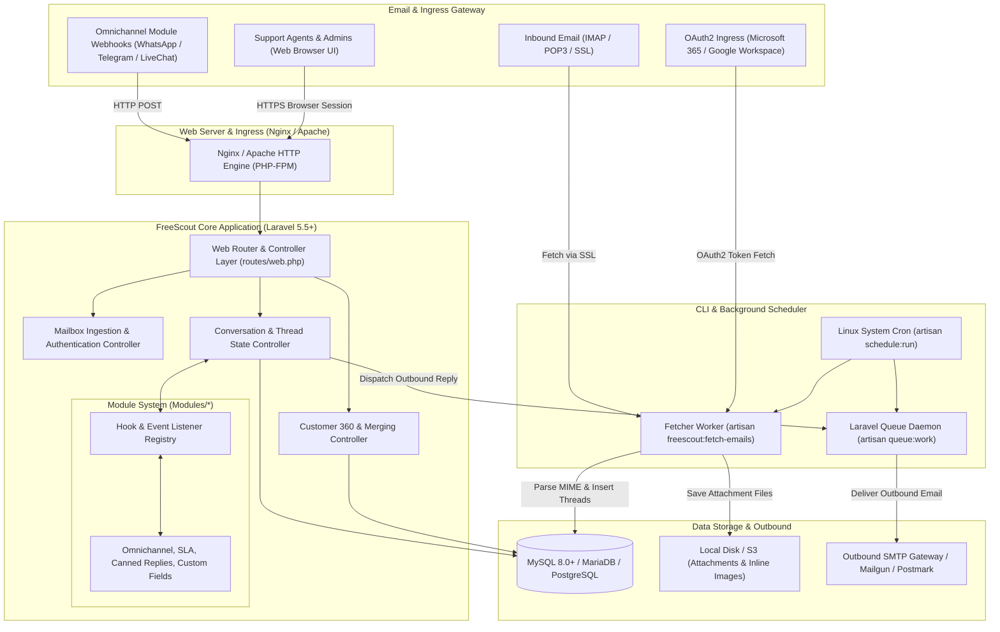
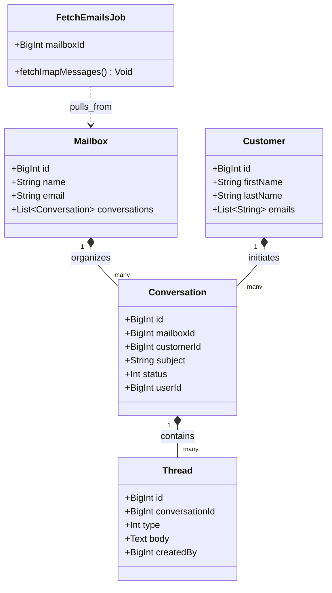
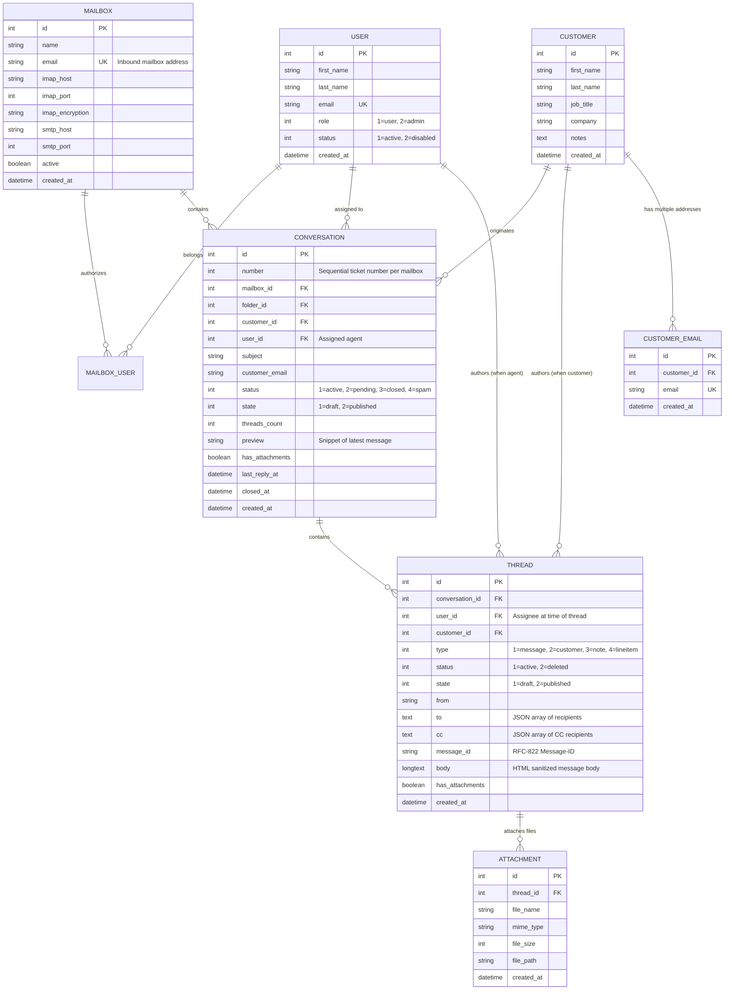
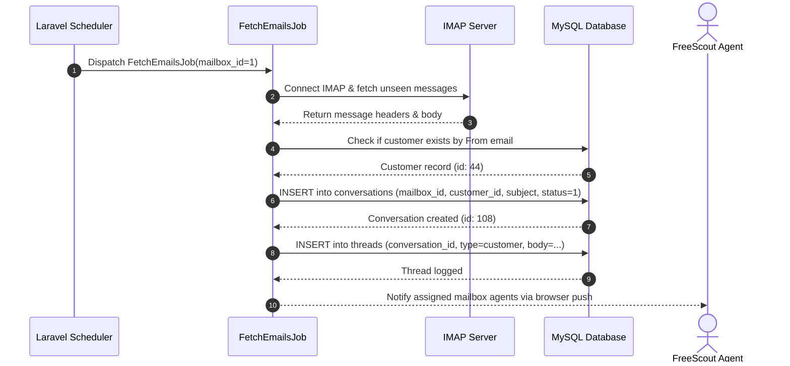

# freescout - Architecture & Technical Wiki

> **Lightweight Open-Source Helpdesk, Shared Mailbox & Help Scout Alternative**  
> GitHub: [freescout-help-desk/freescout](https://github.com/freescout-help-desk/freescout.git) | Stack: PHP 8.x, Laravel Framework, MySQL / MariaDB / PostgreSQL, Redis / DB Queue | License: GNU AGPL v3

---

## 1. Executive Summary & Value Proposition

**FreeScout** is a high-performance, minimalist open-source shared mailbox and customer support platform engineered as an exact self-hosted alternative to Help Scout and Zendesk. Built on top of the **Laravel Framework** and standard PHP/MySQL infrastructure, FreeScout eliminates the resource-heavy overhead of modern containerized enterprise suites, delivering a responsive email-centric helpdesk that runs efficiently even on low-cost virtual private servers (VPS).

FreeScout bridges the gap between raw email inboxes and collaborative ticketing. It provides shared visibility across multiple support mailboxes, internal agent collision detection, threaded conversation histories, automated email fetching via IMAP/OAuth2 (Microsoft 365, Google Workspace), and an extensible module architecture that allows organizations to activate omnichannel messaging (WhatsApp, Telegram, Live Chat), SLA management, and auto-assignment without core codebase modifications.

### Core Problems Solved
- **Shared Mailbox Collision & Confusion**: Replaces messy Google Groups and shared IMAP logins with synchronized agent presence, collision warnings, and explicit thread assignment.
- **Resource Footprint Overhead**: Operates on standard LAMP/LEMP stacks with minimal CPU and memory requirements (<512MB RAM), avoiding hefty Redis/Elasticsearch prerequisites for small-to-medium businesses.
- **Seamless Email Threading**: Normalizes RFC-822 email headers (`Message-ID`, `In-Reply-To`, `References`) to reliably thread customer email replies into existing conversations rather than spawning duplicate tickets.
- **Extensible Module Ecosystem**: Provides a plug-and-play architecture (`Modules/`) enabling organizations to install add-ons (Custom Fields, Canned Responses, Satisfaction Ratings, WhatsApp, Telegram, Auto-Reply, Round-Robin) cleanly isolated from the core application.
- **Customer 360 & Conversation Consolidation**: Merges fragmented customer records and addresses across multiple corporate domains into a canonical customer profile with unified history.

---

## 2. High-Level System Architecture

FreeScout follows a classic, battle-tested Model-View-Controller (MVC) architecture powered by Laravel. The ingestion loop relies on a scheduled background command (`freescout:fetch-emails`) and queue workers, communicating with MySQL/PostgreSQL for relational persistence.



### Architectural Lifecycle of an Incoming Message
1. **Scheduled Polling**: Every minute, the system cron executes `php artisan freescout:fetch-emails`.
2. **Mailbox Connection & Authentication**: The command iterates through all active `Mailbox` records, establishing SSL/TLS IMAP connections using stored credentials or refreshed OAuth2 refresh tokens (for Microsoft 365 or Gmail).
3. **MIME Parsing & HTML Sanitization**: Raw email streams are parsed. Bodies pass through `Mews/Purifier` (HTML Purifier) to eliminate malicious scripts, and inline MIME attachments are extracted to local disk storage (`storage/app/attachment/`).
4. **Header Threading & Conversation Resolution**: FreeScout inspects the `In-Reply-To` and `References` headers against the `threads.message_id` index.
   - If a match is found: appends a new `Thread` (of type `TYPE_CUSTOMER`) to the existing `Conversation`, updating `conversations.status = STATUS_ACTIVE` and refreshing `conversations.last_reply_at`.
   - If no match: checks the email subject for a ticket tracking token; if absent, creates a new `Conversation` and assigns it to the target `mailbox_id`.
5. **Customer Resolution**: Matches the `From` address against `customers.emails`. If unrecognized, a new `Customer` record is spawned with `first_name` and `last_name` parsed from the RFC header.
6. **Notification & Hook Emission**: Fires internal Laravel events (`ConversationCreated` or `ThreadCreated`), notifying assigned agents via email or browser notifications.

---

### 2.1 Core Domain & Service Class Architecture



---

## 3. Technology Stack & Key Dependencies

- **Language & Runtime**: PHP 8.1 / 8.2 / 8.3
- **Application Framework**: Laravel Framework 5.5 LTS base (enhanced with modern PHP compatibility)
- **Database & ORM**: MySQL 5.7+ / 8.0+, MariaDB 10.3+, or PostgreSQL via Laravel Eloquent ORM
- **HTML Sanitization & Security**: `mews/purifier` (HTMLPurifier wrapper for sanitizing raw email bodies)
- **Mail Handling**: Custom IMAP reader, `webklex/laravel-imap`, SwiftMailer / Symfony Mailer
- **Asset Pipeline**: Laravel Mix, Webpack, jQuery, Bootstrap 3 (clean, lightweight dashboard UI)
- **Background Queue System**: Database-backed queue driver (`jobs` / `failed_jobs` tables) or Redis queue
- **Authentication**: Native session-based authentication with optional LDAP / OAuth2 modules

---

## 4. Repository Layout & Key Modules

```
freescout/
├── app/
│   ├── Console/Commands/             # Artisan CLI tools (FetchEmails.php, BuildCommand.php)
│   ├── Http/Controllers/             # HTTP Controllers (Conversations, Mailboxes, Customers)
│   ├── Jobs/                         # Asynchronous queued jobs (SendMailJob.php)
│   ├── Listeners/                    # Event listeners for conversation state changes
│   ├── Mail/                         # Mailable classes for outbound correspondence
│   ├── Conversation.php              # Conversation model & state constants
│   ├── Thread.php                    # Individual message/note entry model
│   ├── Customer.php                  # Customer profile model & mergeWith logic
│   ├── Mailbox.php                   # Shared mailbox configuration & IMAP credentials
│   ├── User.php                      # Agent & admin user model
│   └── Folder.php                    # Virtual conversation categorization folders
├── database/
│   └── migrations/                   # Relational database migration scripts
├── Modules/                          # Modular extension directory (Addon modules reside here)
├── public/                           # Web document root, compiled JS/CSS, public attachments
├── resources/
│   └── views/                        # Blade view templates (emails, conversations, mailboxes)
├── routes/
│   ├── web.php                       # Core web and dashboard routes
│   └── console.php                   # CLI task definitions
└── storage/                          # Logs, sessions, file attachments, and framework cache
```

---

## 5. Core Features & Capabilities

### 5.1 Shared Mailbox Multiplexing & Virtual Folders
FreeScout structures customer support around `Mailbox` containers:
- Each mailbox has its own dedicated incoming IMAP connection, outgoing SMTP server, custom signature, auto-reply, and agent access permissions (`mailbox_user`).
- Conversations inside a mailbox are categorized into virtual folders:
  - **Unassigned**: Inbound conversations waiting for agent pickup (`user_id IS NULL`).
  - **Mine**: Conversations assigned to the currently authenticated agent (`user_id = auth_user_id`).
  - **Drafts**: Conversations with uncommitted agent replies.
  - **Assigned**: Conversations currently handled by other team members.
  - **Closed**: Resolved issues.
  - **Spam / Trash**: Filtered or purged items.

### 5.2 Deterministic Customer Merging (`Customer::mergeWith`)
Customer identities frequently fragment when clients email from alternate personal or work addresses. FreeScout includes a clean, transaction-safe merge routine in `app/Customer.php`:
```php
public function mergeWith(Customer $customer2) {
    if ($this->id == $customer2->id) return false;
    
    // 1. Reassign all conversations from secondary customer to primary
    $customer2->conversations()->update(['customer_id' => $this->id]);
    
    // 2. Transfer secondary customer email aliases
    $customer2->emails()->update(['customer_id' => $this->id]);
    
    // 3. Update author references in message threads
    Thread::where('customer_id', $customer2->id)->update(['customer_id' => $this->id]);
    Thread::where('created_by_customer_id', $customer2->id)->update(['created_by_customer_id' => $this->id]);
    
    // 4. Fill missing master attributes from secondary record
    foreach ($this->fillable as $attr) {
        if (!in_array($attr, ['channel', 'channel_id']) && !$this->$attr) {
            $this->$attr = $customer2->$attr;
        }
    }
    $this->save();
    $customer2->delete();
}
```

### 5.3 Live Agent Collision Detection
To prevent multiple agents from sending conflicting replies to the same customer:
- When an agent views a conversation, an AJAX heartbeat registers their active session.
- Other agents opening the conversation see a warning header: *"Agent Marcus is currently viewing this conversation"*.
- If an agent starts composing a reply, the system flags the thread as a draft and alerts other agents before they begin typing.

### 5.4 Granular Thread Types (`threads.type`)
FreeScout distinguishes conversational entries within `threads`:
- `TYPE_MESSAGE` (Value 1): Standard public customer reply sent via email or channel.
- `TYPE_CUSTOMER` (Value 2): Inbound message received from the customer.
- `TYPE_NOTE` (Value 3): Internal staff note highlighted in yellow, invisible to customers.
- `TYPE_LINEITEM` (Value 4): System audit action (e.g., *"Status changed to Closed by Sarah"*, *"Assigned to Tier 2 Support"*).

### 5.5 Auto-Reply & Office Hours Orchestration
Each mailbox can enforce automated business hour logic:
- Configures operational schedules and holiday exclusions.
- Sends customizable auto-reply emails during non-business hours while preventing infinite auto-responder loops (`Auto-Submitted: auto-replied` header detection).

### 5.6 Native Modular Architecture
The `Modules/` directory acts as an application framework within FreeScout:
- Modules can register custom Eloquent models, migration files, views, controllers, and event listeners.
- Common production modules include: **API & Webhooks**, **Canned Responses**, **Custom Fields**, **Round-Robin Assignment**, **SLA Timers**, and **Satisfaction Ratings (CSAT)**.

---

## 6. Data Models & Schema Architecture

FreeScout utilizes a normalized relational schema optimized for high-volume email storage and rapid mailbox indexing.



### Core Schema Entity Details
1. **`conversations`**:
   - `threads_count`: Counter cache column avoiding costly `COUNT()` database queries when loading mailbox grids.
   - `preview`: Caches the first 255 characters of the latest reply for instant list rendering.
   - `folder_id` and `status`: Composite indexes on `[folder_id, status]` guarantee instant page pagination under millions of rows.
2. **`threads`**:
   - `message_id`: Indexed RFC-822 string used for sub-second email reply association.
   - `type`: Dispatches rendering logic between public replies, customer messages, internal notes, and audit action logs.
3. **`customers` & `customer_emails`**:
   - Supports 1-to-N email mappings per customer, allowing users emailing from work or personal addresses to automatically associate with their central record.

---

### 6.1 Comprehensive Database Schema Specification

FreeScout utilizes Laravel Eloquent on MySQL with strict mailbox scoping.

#### Table: `mailboxes`
Team mailboxes mapped to specific shared inboxes (e.g. `support@company.com`).

| Column | Type | Constraints | Default | Description |
| :--- | :--- | :--- | :--- | :--- |
| `id` | `INT UNSIGNED` | `PRIMARY KEY AUTO_INCREMENT` | - | Mailbox identifier |
| `name` | `VARCHAR(255)` | `NOT NULL` | - | Display title of mailbox |
| `email` | `VARCHAR(255)` | `NOT NULL, UNIQUE` | - | Incoming email address |
| `created_at` | `TIMESTAMP` | `NOT NULL` | `NOW()` | Creation timestamp |

*Indexes:* `idx_mailboxes_email` (`UNIQUE (email)`).

---

#### Table: `conversations`
Support conversations grouped under specific mailboxes.

| Column | Type | Constraints | Default | Description |
| :--- | :--- | :--- | :--- | :--- |
| `id` | `INT UNSIGNED` | `PRIMARY KEY AUTO_INCREMENT` | - | Unique conversation ID |
| `mailbox_id` | `INT UNSIGNED` | `NOT NULL, FK -> mailboxes(id)`| - | Parent mailbox |
| `customer_id`| `INT UNSIGNED` | `NOT NULL, FK -> customers(id)`| - | Customer contact |
| `subject` | `VARCHAR(255)` | `NOT NULL` | - | Email subject thread |
| `status` | `TINYINT` | `NOT NULL` | `1` | 1=Active, 2=Pending, 3=Closed |
| `user_id` | `INT UNSIGNED` | `NULLABLE, FK -> users(id)` | `NULL` | Assigned agent |

*Indexes:* `idx_conv_mailbox_status` (`(mailbox_id, status)`).

---

## 7. API Architecture, Webhooks & Key Endpoints

When the official **API & Webhooks Module** is installed, FreeScout exposes an authenticated REST API modeled closely after Help Scout's Mailbox API v2.

### Key REST Endpoints

| HTTP Method | Endpoint | Description |
|:---|:---|:---|
| `GET` | `/api/mailboxes` | List all configured shared mailboxes |
| `GET` | `/api/mailboxes/{id}/conversations` | Retrieve paginated conversations for a specific mailbox |
| `POST` | `/api/conversations` | Programmatically create an inbound customer ticket or outbound message |
| `GET` | `/api/conversations/{id}` | Retrieve full conversation details along with all message threads |
| `POST` | `/api/conversations/{id}/threads` | Append a public reply or internal staff note to a conversation |
| `PUT` | `/api/conversations/{id}/assign` | Reassign conversation to a specific agent (`user_id`) |
| `POST` | `/customers/{id}/merge` | Web endpoint executing customer profile consolidation |

### Sample Request: Append Internal Staff Note (`POST /api/conversations/{id}/threads`)
```json
{
  "type": "note",
  "text": "Verified account in billing portal. Customer is on the Enterprise tier with 50 active seats.",
  "user": 4
}
```

### Sample Response: Thread Created Payload
```json
{
  "id": 18294,
  "conversation_id": 841,
  "type": 3,
  "state": 2,
  "body": "<p>Verified account in billing portal. Customer is on the Enterprise tier with 50 active seats.</p>",
  "user": {
    "id": 4,
    "first_name": "Marcus",
    "last_name": "Brody",
    "email": "marcus@marketingstudio.internal"
  },
  "created_at": "2026-10-24T10:14:00Z"
}
```

---

### 7.5 End-to-End Operational Lifecycle Sequence

The following sequence details how FreeScout executes scheduled email retrieval and converts threads into assigned support conversations.



---

## 8. Strategic Value & Takeaways for MarketingStudio

### Reusable Architectural Patterns
1. **Lightweight Shared Mailbox Design**:
   - FreeScout proves that a full-featured, high-volume helpdesk does not require complicated microservices or memory-hungry runtimes. MarketingStudio can replicate FreeScout’s compact Laravel/PHP architecture for dedicated email-based campaign replies and sales team mailboxes.
2. **RFC-822 Email Ingestion & Thread Normalization**:
   - The threading logic based on `Message-ID`, `In-Reply-To`, and `References` headers provides a production-tested model for MarketingStudio’s cold outreach and lead follow-up engine, ensuring prospective customer replies are never lost or orphaned.
3. **Multi-Email Customer Identity Modeling (`CustomerEmail`)**:
   - Decoupling a customer from a single email address by utilizing a dedicated `customer_emails` association allows MarketingStudio to track business contacts who transition across email domains or reply from mobile aliases.
4. **Isolate Feature Complexity via Modular Hooks**:
   - FreeScout's `Modules/` architecture keeps the core ticketing core lean while allowing optional features (WhatsApp, SLA, CSAT) to be loaded as independent packages. MarketingStudio can adopt this modular plugin structure for third-party marketplace integrations.
