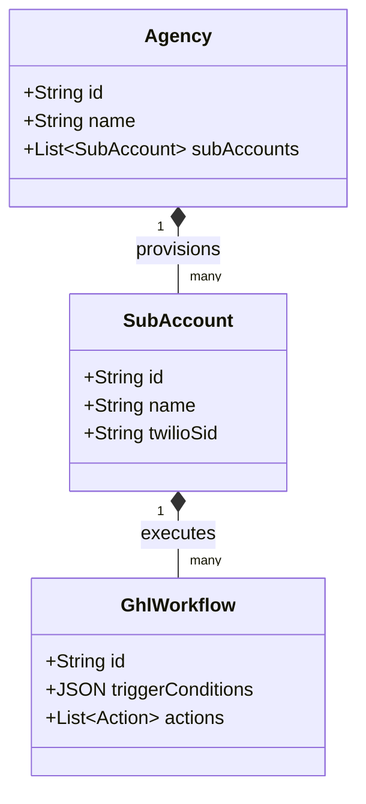
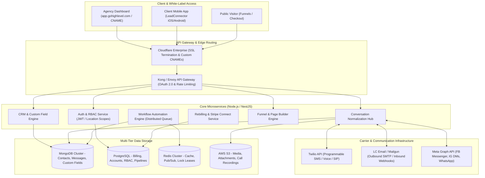
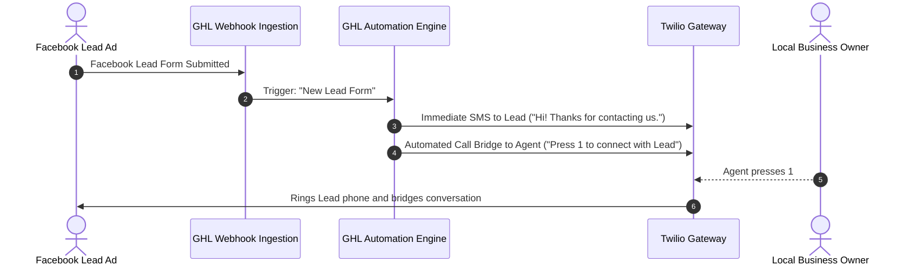

# GoHighLevel (HighLevel) System and Functional Architecture

> Comprehensive technical and functional reverse-engineered reference for **GoHighLevel (HighLevel)**: the premier multi-tenant white-label CRM, agency operating system, sales funnel, and automated marketing platform.

---

## 1. Executive Overview and Market Positioning

**GoHighLevel (GHL)** revolutionized digital marketing agency operations by introducing a white-label, multi-tenant SaaS business model. Prior to HighLevel, marketing agencies had to stitch together a fragile, expensive stack:
- CRM: ActiveCampaign, HubSpot, or Salesforce ($100-$500/mo)
- Funnel & Landing Page Builder: ClickFunnels ($97-$297/mo)
- Two-way SMS & Calling: Twilio + CallRail or Podium ($150-$400/mo)
- Appointment Scheduling: Calendly or Acuity ($15-$50/mo)
- Form & Survey Engine: Typeform or Jotform ($35-$99/mo)
- Review & Reputation Management: Birdeye or Grade.us ($150-$300/mo)
- Course & Membership Hosting: Teachable or Kajabi ($99-$199/mo)

HighLevel unified these capabilities into a single white-label platform with a two-tier multi-tenant hierarchy (Agency Level ➔ Sub-Account / Location Level), enabling agencies to resell GHL under their own brand, custom domain, and custom pricing plans as "SaaS Mode".

### Core Value Proposition
- **Multi-Tenant Agency Hierarchy**: Strict separation between Agency administrative controls and unlimited client Sub-Accounts (Locations).
- **Snapshot Deployment Engine**: One-click deep cloning of entire business configurations (funnels, automations, custom fields, SMS/email templates, pipelines) to instantly spin up new client locations.
- **Unified Two-Way Communication Hub**: Centralized conversation thread combining SMS, MMS, WhatsApp, Email, Phone Calls, Google Business Messages, Facebook Messenger, and Instagram DMs.
- **Visual Multi-Channel Workflow Engine**: Event-driven automation canvas orchestrating communication, task assignments, webhook dispatches, and CRM pipeline transitions.
- **SaaS Mode & Rebilling Engine**: Native Stripe integration enabling agencies to bill clients recurring SaaS subscriptions and automatically rebill Twilio SMS, Phone minutes, and Mailgun emails with customizable profit markups.

---

## 2. Core Entities and Reverse-Engineered Data Model

```
┌────────────────────────────────────────────────────────┐
│                   Agency (Tenant Level 1)              │
│    (White-label Domain, Stripe Billing, Global Users)  │
└───────────────────────────┬────────────────────────────┘
                            │ 1:N
                            ▼
┌────────────────────────────────────────────────────────┐
│               Sub-Account / Location (Tenant L2)       │
│  (Business Profile, Twilio Sub-account, Mailbox, Time) │
└──────┬────────────────────┬────────────────────┬───────┘
       │ 1:N                │ 1:N                │ 1:N
       ▼                    ▼                    ▼
┌──────────────┐     ┌──────────────┐     ┌──────────────┐
│   Contact    │     │  Pipeline /  │     │   Calendar   │
│ (Custom Flds,│     │ Opportunity  │     │ (Slots, Sync,│
│  Tags, DND)  │     │ (Stages, Val)│     │  Round-Robin)│
└──────┬───────┘     └──────────────┘     └──────────────┘
       │ 1:N
       ▼
┌────────────────────────────────────────────────────────┐
│                     Conversations                      │
│   (Unified Messages: SMS, Email, Call, WhatsApp, DM)   │
└──────┬─────────────────────────────────────────────────┘
       │ Triggers / Actions
       ▼
┌────────────────────────────────────────────────────────┐
│                   Workflows & Automations              │
│    (Triggers, Delays, Condition Branches, Actions)     │
└──────┬─────────────────────────────────────────────────┘
       │ Associated With
       ▼
┌────────────────────────────────────────────────────────┐
│               Funnels, Websites & Forms                │
│     (Steps, Page HTML/CSS, Form Submissions, Orders)   │
└────────────────────────────────────────────────────────┘
```

### Entity Schema Breakdown
1. **Agency (`Company`):** Master tenant entity holding billing subscription, white-label branding (logo, favicon, CSS, custom CNAME domain), Stripe Connect account, and global staff users.
2. **Sub-Account (`Location`):** Fully isolated operational partition representing a single business or client. Holds its own Twilio sub-account, Mailgun/LC Email domain, payment gateway, calendars, and CRM records.
3. **Contact:** Core record of truth. Unlike traditional CRMs with separate "Leads" and "Contacts", GHL maintains a single unified Contact schema enriched with arbitrary custom fields (`customFields: [{id, value}]`), tags, attribution source, and DND (Do-Not-Disturb) flags per channel.
4. **Opportunity:** Sales stage tracking entity linking a Contact to a specific Pipeline, Monetary Value, Assigned User, and Status (`open`, `won`, `lost`, `abandoned`).
5. **Conversation:** Multi-channel thread container aggregating all inbound/outbound communication events for a contact into a continuous chronological stream.
6. **Workflow:** State machine DAG (Directed Acyclic Graph) containing enrollment triggers, wait states, IF/ELSE decision nodes, and action steps.
7. **Snapshot:** Serialized JSON bundle capturing an entire Location's configuration blueprint for cross-account provisioning.

---

### 2.1 Core Domain and Service Class Architecture



---

### 2.2 Comprehensive Database Schema Specification

#### Table: `sub_accounts`
| Column | Type | Constraints | Default | Description |
| :--- | :--- | :--- | :--- | :--- |
| `id` | `VARCHAR(64)` | `PRIMARY KEY` | - | Location / SubAccount ID |
| `agency_id` | `VARCHAR(64)` | `NOT NULL` | - | Parent Agency |
| `business_name` | `VARCHAR(255)` | `NOT NULL` | - | Business client title |
| `phone_number` | `VARCHAR(50)` | `NULLABLE` | `NULL` | Provisioned Twilio number |

---

## 3. Reverse-Engineered System Architecture & Engineering Blueprint



### 3.1 Technology Stack Analysis
- **Backend Language & Runtime:** Node.js (v18/v20 LTS), TypeScript, with transitions toward **NestJS** for structured modular services.
- **Frontend Framework:** Vue.js 3 and React SPAs, utilizing TailwindCSS, Pinia/Vuex for state management, and modern Webpack/Vite bundlers.
- **Databases:**
  - **MongoDB:** Houses unstructured/polymorphic data including Contacts, Custom Field definitions, Messages, and Form Submissions where schema flexibility is critical.
  - **PostgreSQL / MySQL:** Enforces ACID compliance for multi-tenant accounts, user permissions, invoices, subscriptions, and opportunity pipeline stages.
  - **Redis:** High-speed caching, distributed rate-limiting tokens, session state, and BullMQ task queues.
  - **AWS S3 / CloudFront:** Stores user-uploaded media, landing page assets, and call audio recordings.
- **Messaging Infrastructure:** Kafka and RabbitMQ event buses routing millions of daily webhook events from Twilio, SendGrid/Mailgun, and Meta Graph APIs.

---

## 4. Key Operational Mechanics & Deep Technical Differentiators

### 4.1 The Snapshot Provisioning Engine
HighLevel's most defensible feature is its **Account Snapshot System**:
- **Serialization:** GHL traverses a template Sub-Account and serializes all configuration artifacts into a declarative JSON schema:
  ```json
  {
    "snapshotVersion": "2.4",
    "pipelines": [...],
    "customFields": [...],
    "workflows": [...],
    "emailTemplates": [...],
    "funnels": [...],
    "calendars": [...]
  }
  ```
- **Conflict Resolution & ID Remapping:** When applying a snapshot to a new or existing Sub-Account, GHL executes an intelligent entity-remapping pass. References in workflows (e.g. `workflow_action.send_email -> template_id_123`) are dynamically rewritten to target the newly provisioned entity IDs within the target location, preventing broken foreign keys.

### 4.2 The LC Phone & LC Email Rebilling Engine
Rather than requiring every SMB client to register their own Twilio or Mailgun account:
- HighLevel acts as the master carrier account holder ("LeadConnector").
- When an agency activates "SaaS Mode", GHL provisions isolated Twilio sub-accounts and Mailgun sending domains programmatically.
- **Automated Profit Markup:** Agencies configure billing rules (e.g., charge client \$0.02 per SMS when underlying carrier cost is \$0.0079). HighLevel automatically debits the client's credit card via Stripe Connect and deposits the agency's profit margin directly into the agency's Stripe account.

### 4.3 Multi-Channel Conversation State Machine
HighLevel unifies disparate communication protocols into a single normalized WebSocket stream:
- Incoming SMS from Twilio webhook (`/api/twilio/incoming-sms`)
- Inbound email from Mailgun MIME parser (`/api/mailgun/inbound`)
- WhatsApp webhook from Meta Cloud API (`/api/meta/whatsapp`)
- Instagram DM webhook from Facebook Graph API (`/api/meta/instagram`)

All incoming payloads are translated into a standardized `MessageDTO`, persisted in MongoDB under the contact's `conversation_id`, and broadcast via WebSockets to active agents viewing the unified inbox.

---

## 5. Integration Architecture and API Surface

- **REST API v2:** Modern OAuth 2.0 specification with granular location-scoped authorization tokens. Required headers include `Authorization: Bearer <token>` and `Version: 2021-07-28`.
- **Core API Endpoints:**
  - `/locations`: Sub-account provisioning and settings.
  - `/contacts`: Full CRUD operations on contacts with dynamic custom field mapping.
  - `/opportunities`: Pipeline stage management and lead value updates.
  - `/conversations/messages`: Programmatic two-way message dispatch across any supported channel.
  - `/funnels`: Funnel step and page asset metadata.
- **Webhooks:** Instant HTTP POST dispatches on events: `ContactCreate`, `ContactUpdate`, `InboundMessage`, `OpportunityStageUpdate`, `AppointmentBooked`.

---

### 3.1 End-to-End Operational Lifecycle Sequence



---

## 6. MarketingStudio Convergence & Architectural Takeaways

For **MarketingStudio**, GoHighLevel provides the ultimate commercial blueprint for multi-tenant SaaS and agency monetization:

1. **Adopt GHL's Two-Tier Multi-Tenant Hierarchy**: Design MarketingStudio with an Agency/Workspace layer that controls child Sub-Accounts (Locations) with isolated data, custom domains, and custom permissions.
2. **Implement GHL's Snapshot Architecture**: Allow MarketingStudio users to export, clone, and share pre-built marketing systems (funnels + email drips + CRM pipelines) with one click.
3. **Replicate the Unified Two-Way Inbox**: Unify Email (Listmonk/Postal), WhatsApp (Evolution-API), and SMS (TextBee/Twilio) into a single chronological contact conversation stream.
4. **Build Native Rebilling on Stripe Connect**: Integrate carrier rebilling so agencies can resell MarketingStudio as an autonomous marketing engine with built-in recurring profit margins.