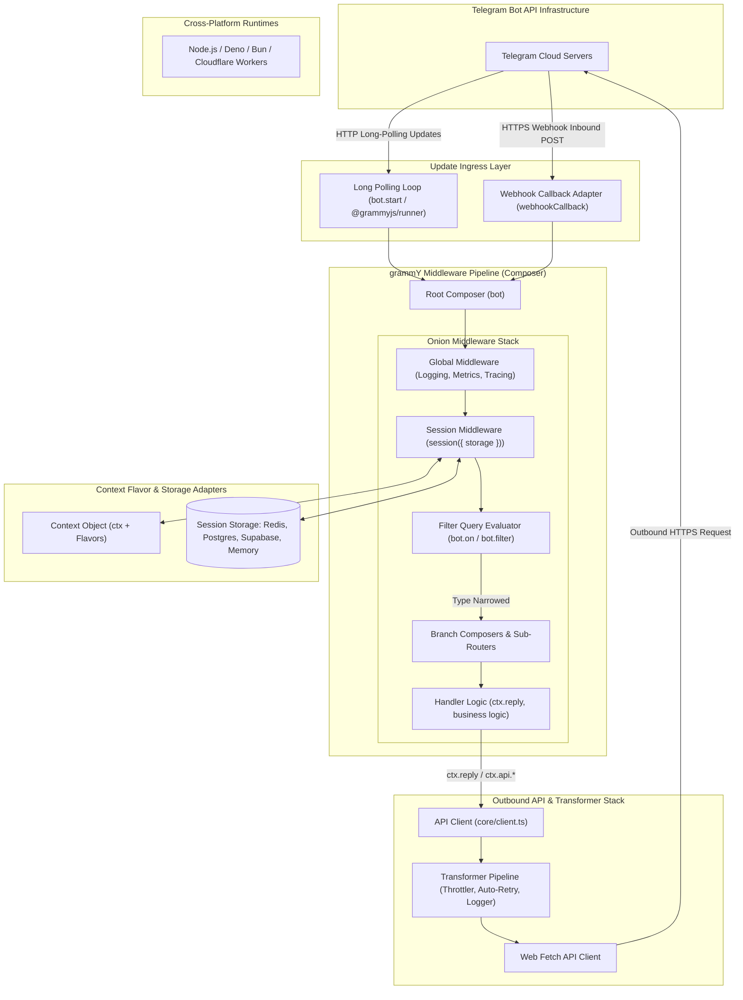
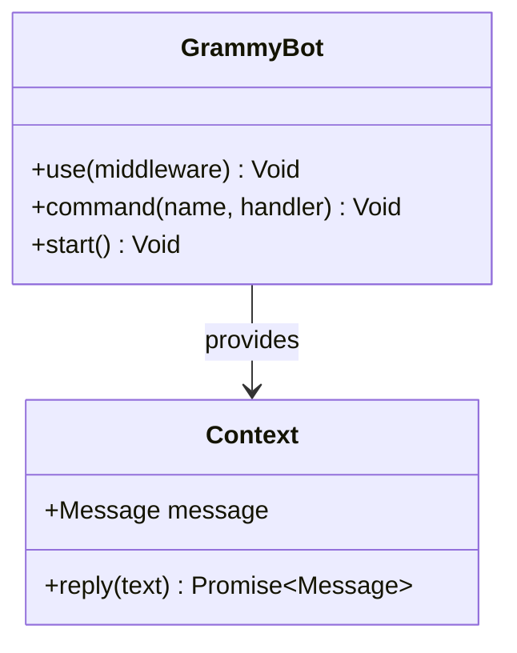
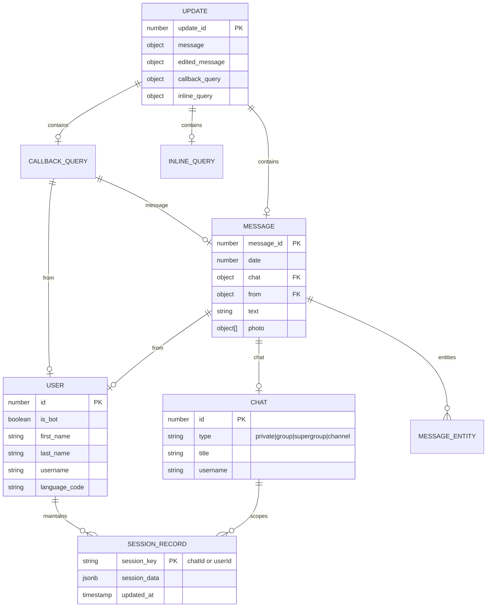
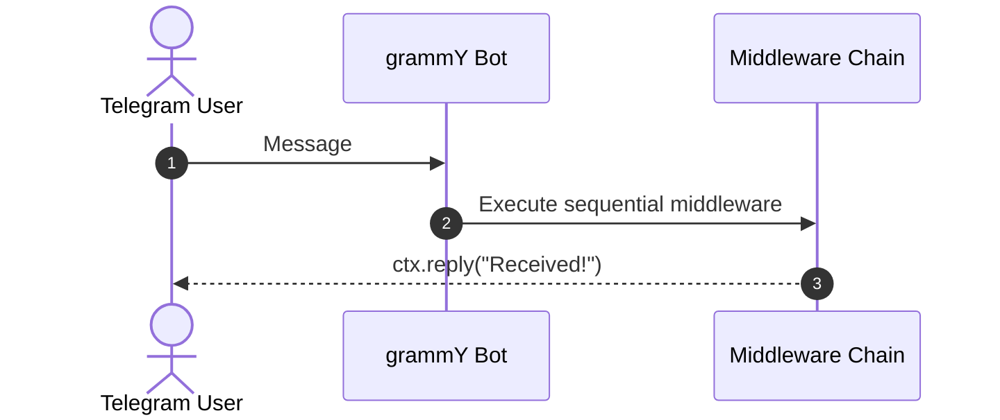

# grammY - Architecture & Technical Wiki

> **The Telegram Bot Framework for TypeScript & JavaScript across Deno, Node.js, Bun, & Cloudflare Workers**  
> GitHub: [grammyjs/grammY](https://github.com/grammyjs/grammY) | Stack: TypeScript, Deno, Node.js, Bun, Cloudflare Workers, Fetch API, Middleware Onion Architecture, Session Adapters | License: MIT

---

## 1. Executive Summary & Value Proposition

**grammY** is the premiere, ultra-modern TypeScript framework for building Telegram bots and conversational applications. Built from the ground up to replace legacy libraries like Telegraf, grammY combines native TypeScript typing, cross-runtime portability (Deno, Node.js, Bun, Cloudflare Workers, Fastly, AWS Lambda), a composable onion-layer middleware architecture, and an extensible Context Flavor system.

Designed for high developer ergonomics and extreme runtime efficiency, grammY eliminates runtime overhead by using standard Web APIs (`fetch`, `AbortController`, `Streams`). Its compile-time filter queries provide automatic TypeScript type narrowing, ensuring that accessing `ctx.message.text` is guaranteed to be safe without manual type guards. Supported by a rich ecosystem of official plugins—including `@grammyjs/runner` for massive concurrent polling, `@grammyjs/conversations` for linear async dialog flows, and pluggable distributed session storage—grammY represents the state of the art in modern bot engineering.

### Core Problems Solved
- **Runtime Fragmentation & Cloud Lock-in**: Engineered with clean platform shims (`platform.deno.ts`, `platform.node.ts`, `platform.web.ts`), allowing bots to run unchanged on traditional servers (Node/Bun) or serverless edge platforms (Cloudflare Workers, Deno Deploy).
- **TypeScript Type Casting Hell**: Introduces *Filter Queries* (`bot.on('message:text')`), allowing TypeScript's compiler to narrow down the union type of 18+ different Telegram update types to the exact properties present at runtime.
- **Middleware Rigidity**: Implements an onion-layer middleware model (similar to Koa) via `Composer`, allowing pre-processing, post-processing, branching, and error capturing with intuitive `next()` cascades.
- **Outbound API Rate Limiting & Auto-Retries**: Features an outbound *Transformer Pipeline* (`bot.api.config.use(...)`) that intercepts all outgoing HTTP requests, enabling automated throttling, retry backoff on 429/500 errors, and payload logging.
- **Complex Multi-Step Dialogue Coding**: Complements traditional state machines with the `@grammyjs/conversations` plugin, enabling linear, procedural code style using JavaScript async/await functions for multi-step onboarding and checkout wizards.

---

## 2. High-Level System Architecture

grammY separates event ingress, middleware composition, context synthesis, dialogue state management, and outbound HTTP request dispatch into an elegant modular pipeline.



### Architectural Data Flow Narrative
1. **Ingress & Platform Adaptation**: Updates arrive via long polling (`bot.start()` or `@grammyjs/runner` for multi-worker concurrency) or webhooks (`webhookCallback(bot, 'express' | 'hono' | 'cloudflare')`).
2. **Context Instantiation & Flavoring**: For every update, a fresh `Context` instance is constructed. If custom context flavors are defined (`type MyContext = Context & SessionFlavor<SessionData>`), typed helper methods and session properties attach seamlessly.
3. **Onion Middleware Propagation**: Execution flows through the registered middleware chain. Before handlers run, middlewares can inject database connections, fetch user state, and measure latency. After `await next()`, post-processing logic executes in reverse order.
4. **Filter Query Evaluation**: `bot.on('message:photo')` or `bot.on('callback_query:data')` evaluates update structures, pruning non-matching branches and narrowing TypeScript types for the downstream handler.
5. **Session Resolution**: The `session()` middleware fetches the session record for the active chat/user from Redis, PostgreSQL, or memory, making it available as `ctx.session`. Mutating `ctx.session` automatically stages changes for flush upon middleware completion.
6. **Outbound API Transformation**: Handler responses (e.g., `ctx.reply()`) route through the client transformer pipeline (`bot.api.config.use`). Transformers automatically pace requests to obey Telegram's 30 messages/sec limit, retry on network flakiness, or attach default parse modes.

---

### 2.1 Core Domain & Service Class Architecture



---

## 3. Technology Stack & Key Dependencies

- **Language & Runtime**: TypeScript 5.0+, compatible with Node.js (>=14.13.1), Deno (>=1.16), Bun (>=1.0), and Cloudflare Workers / V8 Isolates
- **Build & Transpilation**: Authored in standard Deno TypeScript; transpiled for Node.js / NPM via `deno2node`
- **Core Dependencies**:
  - `@grammyjs/types` (5.0.0): Pinned, complete TypeScript definitions matching the official Telegram Bot API specification
  - Standard Web APIs: Native `fetch`, `AbortController`, `FormData`, `ReadableStream`
  - `debug` (4.4+) for runtime diagnostics
- **Ecosystem Plugins**:
  - `@grammyjs/runner`: High-performance concurrent polling engine with queue-based worker pooling
  - `@grammyjs/conversations`: Linear dialog manager implementing async-generator state machines
  - `@grammyjs/storage-redis` / `@grammyjs/storage-postgres`: Production-ready distributed session drivers
  - `@grammyjs/ratelimiter` & `@grammyjs/auto-retry`: Resilient outbound request guards
  - `@grammyjs/menu`: Dynamic inline keyboard builder with interactive callback state handling

---

## 4. Repository Layout & Key Modules

```
grammY/
├── bundling/                          # Deno and browser bundling configurations
├── src/                               # TypeScript source codebase
│   ├── convenience/                   # High-level utilities and developer sugar
│   │   ├── constants.ts               # Telegram API limits and default configurations
│   │   ├── frameworks.ts              # Adapters for Express, Fastify, Koa, Hono, NestJS
│   │   ├── inline_query.ts            # Inline query result builders
│   │   ├── input_media.ts             # Media group and file upload helpers
│   │   ├── keyboard.ts                # Fluent Keyboard and InlineKeyboard builders
│   │   ├── session.ts                 # Session middleware and storage adapter interfaces
│   │   └── webhook.ts                 # Universal webhook handler engine
│   ├── core/                          # Low-level Telegram Bot API protocol drivers
│   │   ├── api.ts                     # Strongly typed Telegram Bot API method bindings
│   │   ├── client.ts                  # HTTP client, transformer pipeline, and payload serializer
│   │   ├── error.ts                   # GrammyError and HttpError hierarchy
│   │   └── payload.ts                 # Multipart form-data serializer for binary media
│   ├── bot.ts                         # Main Bot class extending Composer
│   ├── composer.ts                    # Core onion middleware engine and branching router
│   ├── context.ts                     # Context prototype, shortcuts (ctx.reply), and flavors
│   ├── filter.ts                      # Filter query parser and type narrowing logic
│   ├── mod.ts                         # Deno entrypoint exporting public API
│   ├── platform.deno.ts               # Deno platform-specific shims
│   ├── platform.node.ts               # Node.js platform-specific shims
│   └── platform.web.ts                # Web Standards / Edge platform shims
├── test/                              # Vitest & Deno test suites
├── deno.jsonc                         # Deno configuration and task definitions
├── package.json                       # NPM package manifest
└── tsconfig.json                      # TypeScript compiler configuration
```

---

## 5. Core Features & Capabilities

### 5.1 The Composer Onion Middleware Pipeline
At the foundation of grammY is the `Composer` class. Every `Bot` instance is a `Composer`. Middleware functions conform to the standard signature:

```typescript
type MiddlewareFn<C extends Context> = (ctx: C, next: NextFunction) => Promise<void> | void;
```

Middlewares wrap downstream handlers in concentric layers. This allows developers to measure execution time, wrap handler execution in database transactions, catch errors with fine-grained boundaries, or short-circuit processing based on authentication guards.

### 5.2 Context Flavoring & Compile-Time Extensibility
grammY avoids monolithic context classes by using TypeScript type intersection (Context Flavoring):

```typescript
import { Bot, Context, SessionFlavor } from "grammy";

interface SessionData {
  leadScore: number;
  assignedSDR: string;
}

type MyContext = Context & SessionFlavor<SessionData>;

const bot = new Bot<MyContext>("BOT_TOKEN");
bot.use(session({ initial: () => ({ leadScore: 0, assignedSDR: "unassigned" }) }));

bot.command("score", async (ctx) => {
  // ctx.session is fully typed without type assertions
  ctx.session.leadScore += 10;
  await ctx.reply(`Updated lead score: ${ctx.session.leadScore}`);
});
```

### 5.3 Filter Queries & Compile-Time Narrowing
Rather than requiring repetitive checks (`if (ctx.message && ctx.message.text)`), grammY uses string-literal filter queries that automatically narrow types:
- `bot.on('message:text')`: Guarantees `ctx.message.text` is a defined `string`.
- `bot.on('message:photo')`: Guarantees `ctx.message.photo` is an array of `PhotoSize`.
- `bot.on('callback_query:data')`: Guarantees `ctx.callbackQuery.data` is present.
- `bot.on('::url')`: Matches any message containing a URL entity.

### 5.4 Pluggable Session Middleware
The session engine supports custom session keys (e.g., scoping sessions by user, chat, or composite thread ID). grammY provides official storage adapters for:
- Memory (default for testing)
- Redis (`@grammyjs/storage-redis`)
- PostgreSQL (`@grammyjs/storage-postgres`)
- Supabase, DynamoDB, MongoDB, and local SQLite files via Keyv

### 5.5 Outbound Bot API Transformer Pipeline
grammY provides an outgoing middleware stack called *Transformers*. While regular middleware intercepts incoming updates, transformers intercept outgoing API requests:

```typescript
// Intercept all outgoing calls to enforce global rate limiting
bot.api.config.use(async (prev, method, payload, signal) => {
  console.log(`Calling Telegram Bot API method: ${method}`);
  return await prev(method, payload, signal);
});
```
This is used by `@grammyjs/auto-retry` to automatically sleep and retry when encountering HTTP 429 (`retry_after`) responses from Telegram.

### 5.6 Universal Webhook Adapters
`src/convenience/frameworks.ts` provides native zero-dependency webhook adapters for 10+ standard frameworks:
`express`, `fastify`, `koa`, `hono`, `nextjs`, `worktop`, `std/http` (Deno), `bun`, and `aws-lambda`.

---

## 6. Data Models & Schema Architecture

grammY models Telegram's API types strictly according to the official spec in `@grammyjs/types`.



### Core Schema Types
- **`Update`**: Root incoming object matching Telegram's update schema.
- **`Context`**: Wraps the update, providing shortcut methods (`ctx.reply`, `ctx.editMessageText`, `ctx.deleteMessage`) that automatically infer the target `chat_id`.
- **`SessionData`**: User-defined interface describing the persistent state shape.

---

### 6.1 Comprehensive Database Schema Specification

#### Table: `sessions`
| Column | Type | Constraints | Default | Description |
| :--- | :--- | :--- | :--- | :--- |
| `key` | `VARCHAR(255)` | `PRIMARY KEY` | - | Session key |
| `value` | `TEXT` | `NOT NULL` | - | Session JSON |

---

## 7. API Architecture, Webhooks & Key Endpoints

### 7.1 Webhook Callback Adapter (`webhookCallback`)
Integrates directly into Next.js App Router, Express, or Hono:

```typescript
import { Bot, webhookCallback } from "grammy";
import { Hono } from "hono";

const bot = new Bot(process.env.TELEGRAM_BOT_TOKEN!);
const app = new Hono();

// Mount webhook handler on Hono edge router
app.post("/api/telegram", webhookCallback(bot, "hono", {
  secretToken: process.env.TELEGRAM_WEBHOOK_SECRET
}));

export default app;
```

#### Incoming Webhook Payload (POST `/api/telegram`):
```json
{
  "update_id": 554433221,
  "message": {
    "message_id": 105,
    "from": {
      "id": 99887766,
      "is_bot": false,
      "first_name": "Marcus",
      "username": "marcus_sales"
    },
    "chat": {
      "id": 99887766,
      "type": "private"
    },
    "date": 1729772000,
    "text": "Book a demo for MarketingStudio"
  }
}
```

### 7.2 Outbound API Method Call
```typescript
// Sending a formatted interactive sales prompt
await bot.api.sendMessage(99887766, "*MarketingStudio Lead Qualifying*\nSelect your organization size:", {
  parse_mode: "MarkdownV2",
  reply_markup: new InlineKeyboard()
    .text("1 - 10 Seats", "org_tier_small")
    .text("10 - 50 Seats", "org_tier_mid")
    .row()
    .text("50+ Enterprise", "org_tier_enterprise")
});
```

---

### 7.5 End-to-End Operational Lifecycle Sequence



---

## 8. Strategic Value & Takeaways for MarketingStudio

### Reusable Architectural Patterns
1. **Cross-Runtime Edge Portability**:  
   grammY's ability to run inside Cloudflare Workers, Bun, and Node.js with identical code provides the blueprint for MarketingStudio's distributed webhook ingress. Inbound lead webhooks can be processed globally on the edge within single-digit milliseconds.

2. **Outbound API Transformer Pipelines**:  
   MarketingStudio connects to external APIs that enforce strict rate limits (Telegram, WhatsApp, LinkedIn, SendGrid). Implementing an outbound Transformer pipeline enables centralized, transparent rate-limiting, exponential backoff retries, and quota metering without littering business logic with retry boilerplate.

3. **Context Flavoring for Modular Architecture**:  
   Instead of polluting global variables or passing ten arguments to every handler, MarketingStudio can use Context Flavoring to cleanly inject CRM lead records, analytics loggers, and LLM clients into conversational contexts with full TypeScript autocomplete.

4. **Linear Dialogues via Async Generators (`@grammyjs/conversations`)**:  
   For complex multi-turn lead intake (asking for email, company name, marketing budget, scheduling a slot), linear async generator dialogues allow marketing engineers to write simple, sequential code (`const email = await conversation.waitFor(':text')`) instead of designing complex state machines with dozens of transitions.
